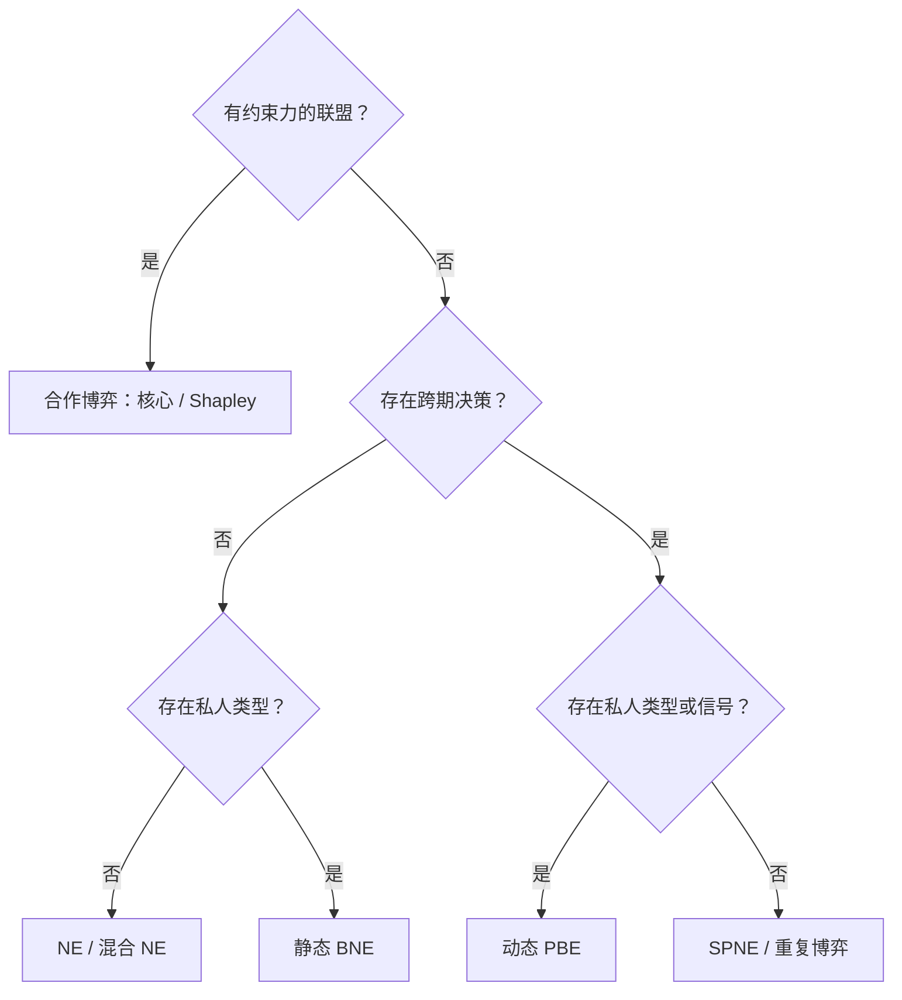

# 博弈论九讲｜模型识别、求解方法与公式速查

[返回九讲目录](../README.md)

[九讲跨章节综合练习与完整答案](comprehensive-practice.md)

先看决策时序、信息结构和是否允许有约束力的联盟，再决定使用什么均衡概念。出现“价格”“信任”或“合作”等关键词，本身不足以判定模型。

## 一、从题目条件识别模型

| 题目特征 | 模型 | 主要解法 | 笔记 |
| --- | --- | --- | --- |
| 同时行动，不观察对手当前选择 | 策略式博弈 | 最佳反应、NE | [1](../notes/lecture-01-strategic-form-games.md)、[2](../notes/lecture-02-strategic-form-games.md) |
| 需要使用随机行动避免被对手利用 | 混合策略 | 支持集与无差异条件 | [3](../notes/lecture-03-mixed-strategies.md) |
| 先后行动，后行动者可观察历史 | 扩展式博弈 | 逆向归纳、SPNE | [4](../notes/lecture-04-extensive-form-games.md) |
| 相同阶段博弈重复发生，历史可观察 | 重复博弈 | 触发策略与一次偏离 | [5](../notes/lecture-05-repeated-games.md) |
| 轮流分配资源，拒绝需要等待 | 交替报价 | 继续价值与逆向归纳 | [6](../notes/lecture-06-bargaining.md) |
| 同时行动，但存在私人类型 | 静态贝叶斯博弈 | 类型策略与 BNE | [7](../notes/lecture-07-bayesian-games.md) |
| 先发信号，再依据信号行动 | 动态贝叶斯博弈 | Bayes 更新、激励约束与 PBE | [8](../notes/lecture-08-dynamic-bayesian-games.md) |
| 有约束力的联盟与收益分配 | TU 合作博弈 | 核心、Shapley 值 | [9](../notes/lecture-09-cooperative-games.md) |



这只是初步分类图，并非严格的互斥划分。例如重复博弈也可以包含私人类型，谈判也可以是不完全信息博弈。

## 二、七个概念的核心区别

| 概念 | 关键检验 | 典型错误 |
| --- | --- | --- |
| 纳什均衡（NE） | 对手不动，个人单方改变不能增加收益 | 把总支付最高当成 NE |
| 混合 NE | 支持集内收益相同且最大，支持集外不更优 | 算完概率不检查支持集 |
| 子博弈精炼 NE（SPNE） | 每个真子博弈中也构成 NE | 保留不可信威胁 |
| 贝叶斯 NE（BNE） | 每个私人类型的条件期望收益最大 | 只求平均类型的最优行动 |
| 完美贝叶斯均衡（PBE） | 每个信息集序贯理性，路径上信念满足 Bayes | 只算后验而不检查信号激励 |
| 核心（Core） | 有效率且任何联盟都不愿退出 | 漏掉双人联盟约束 |
| Shapley 值 | 全部加入顺序的平均边际贡献 | 误认为必然属于核心 |

## 三、最常用的计算模板

### 1. 两人混合策略

设行玩家选上概率为 $p$，列玩家选左概率为 $q$。**列玩家的 $q$ 让行玩家在两行之间无差异；行玩家的 $p$ 让列玩家在两列之间无差异**。最后检查概率落在 $[0,1]$，支持集外行动没有更高收益。

### 2. 线性 Cournot

若反需求 $P=a-b(q_1+q_2)$，边际成本相同为 $c$，则

```math
BR_i(q_j)=\max\left\{0,\frac{a-c-bq_j}{2b}\right\},\qquad
q_i^{*}=\frac{a-c}{3b}.
```

必须确认企业同时决定产量；若存在先后顺序，应改用 Stackelberg 分析。

### 3. 无限重复囚徒困境的冷酷触发

设合作收益 $R$、单方背叛收益 $T$、共同背叛收益 $P$，则合作路径上不背叛的条件为

```math
\frac{R}{1-\delta}\ge T+\frac{\delta P}{1-\delta}
\iff\boxed{\delta\ge\frac{T-R}{T-P}}.
```

必须再检查触发后惩罚行动是否可信，不能只验证正常合作路径。

### 4. 无限轮交替报价

完全信息、指数贴现且玩家 1 先报价时：

```math
x_1=\frac{1-\delta_2}{1-\delta_1\delta_2},\qquad
x_2=\frac{\delta_2(1-\delta_1)}{1-\delta_1\delta_2}.
```

有限轮谈判应从最后一期倒推，不能把这个无限期公式直接代入。

### 5. 贝叶斯更新

对于类型 $H,L$ 和信号 $m$：

```math
\Pr(H\mid m)=\frac{\Pr(m\mid H)\Pr(H)}
{\Pr(m\mid H)\Pr(H)+\Pr(m\mid L)\Pr(L)}.
```

先验类型概率与信号的条件准确率是两种不同信息。动态信号题中，求出后验后还要逐类型检验发送者是否愿意模仿其他类型。

### 6. 合作博弈

收益博弈的核心要求

```math
\sum_i x_i=v(N),\qquad \sum_{i\in S}x_i\ge v(S)\quad\text{对全部联盟 }S.
```

三人 Shapley 值中，某玩家最先加入和最后加入的权重各为 $1/3$；第二个加入且此前为某个指定玩家的权重是 $1/6$。成本分摊博弈的核心不等号要反向。

## 四、标准答案的最低完整性

先定义参与者、完整策略、支付与信息结构；再列最佳反应、无差异条件、继续价值或联盟约束；解出数值后检查概率范围、行动边界和偏离条件；最后解释经济含义及结论依赖的假设。

矩阵题应找**全部**均衡；动态题应写**完整策略**而非只有均衡路径；信号题应明确路径上的信念与发送者激励；合作题应把**平均边际贡献的公平性**与**联盟稳定性**分开。

## 五、读题时需要主动问自己的六个问题

| 检查问题 | 决定后续哪一步 |
| --- | --- |
| 玩家是同时行动还是先后行动？ | 使用最佳反应交点还是逆向归纳 |
| 玩家能否观察对手此前的选择？ | 能否将某个节点视为独立子博弈、是否存在信息集 |
| 是否存在私人类型或私人信息？ | 是否需要列类型依赖策略与贝叶斯信念 |
| 互动会重复，且能观察历史吗？ | 是否需要检查偏离之后的惩罚是否可信 |
| 是否允许形成有约束力的联盟？ | 是计算 NE 还是核心与 Shapley 值 |
| 题目要求均衡、效率还是公平？ | 应计算策略稳定性、总剩余还是收益分配 |

尤其注意三个相似但不相同的词：**完全信息**涉及博弈结构和支付是否为共同知识，**完美信息**涉及行动历史是否可观察，**完美回忆**涉及玩家是否记得自己的既往信息和行动。

## 六、常见“公式正确但答案不完整”的情况

在 Cournot 题中，只写一阶条件却不验证产量非负；在混合策略题中，只写无差异概率却不验证支持集；在扩展式博弈中，只写均衡路径、不写路径外完整行动；在重复博弈中，只检查合作路径、不检查惩罚路径；在动态贝叶斯题中，只算后验、不检验发送者类型的偏离；在合作博弈中，只给出 Shapley 值、不区分其是否属于核心。这些情况都可能遗漏题目实际要求的均衡验证。

综合训练见[跨章节模型识别与计算题](comprehensive-practice.md)，涵盖市场竞争、混合策略、可信威胁、交替报价、重复合作、贝叶斯更新和联盟稳定性。
