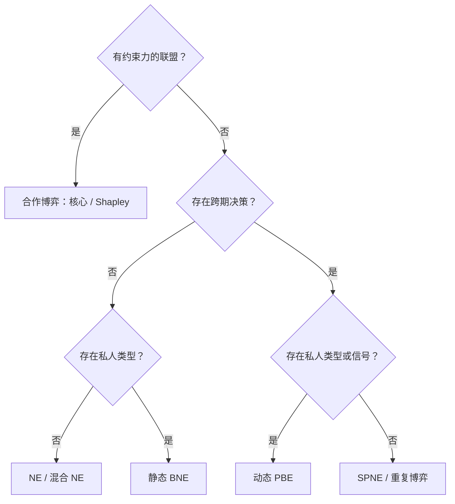

# 博弈论九讲｜模型识别、求解方法与公式速查

[返回九讲目录](../README.md)

[九讲跨章节综合练习与完整答案](comprehensive-practice.md)

[图解博弈论：支付矩阵、最佳反应曲线与博弈树](../visuals/README.md)

先看决策时序、信息结构和是否允许有约束力的联盟，再决定使用什么均衡概念。出现“价格”“信任”或“合作”等关键词，本身不足以判定模型。

## 一、从题目条件识别模型

| 题目特征 | 模型 | 主要解法 | 笔记 |
| --- | --- | --- | --- |
| 同时行动，不观察对手当前选择 | 策略式博弈 | 最佳反应、NE | [1](../notes/lecture-01-strategic-form-games.md)、[2](../notes/lecture-02-strategic-form-games.md) |
| 需要使用随机行动避免被对手利用 | 混合策略 | 支持集与无差异条件 | [3](../notes/lecture-03-mixed-strategies.md) |
| 先后行动，后行动者可观察历史 | 扩展式博弈 | 逆向归纳、SPNE | [4](../notes/lecture-04-extensive-form-games.md) |
| 相同阶段博弈重复发生，历史可观察 | 重复博弈 | 触发策略与一次偏离 | [5](../notes/lecture-05-repeated-games.md) |
| 轮流分配资源，拒绝需要等待 | 交替报价 | 继续价值与逆向归纳 | [6](../notes/lecture-06-bargaining.md) |
| 同时行动，但存在私人类型 | 静态贝叶斯博弈 | 类型策略与 BNE | [7](../notes/lecture-07-bayesian-games.md) |
| 先发信号，再依据信号行动 | 动态贝叶斯博弈 | Bayes 更新、激励约束与 PBE | [8](../notes/lecture-08-dynamic-bayesian-games.md) |
| 有约束力的联盟与收益分配 | TU 合作博弈 | 核心、Shapley 值 | [9](../notes/lecture-09-cooperative-games.md) |



这只是初步分类图，并非严格的互斥划分。例如重复博弈也可以包含私人类型，谈判也可以是不完全信息博弈。

## 二、七个概念的核心区别

| 概念 | 关键检验 | 典型错误 |
| --- | --- | --- |
| 纳什均衡（NE） | 对手不动，个人单方改变不能增加收益 | 把总支付最高当成 NE |
| 混合 NE | 支持集内收益相同且最大，支持集外不更优 | 算完概率不检查支持集 |
| 子博弈精炼 NE（SPNE） | 每个真子博弈中也构成 NE | 保留不可信威胁 |
| 贝叶斯 NE（BNE） | 每个私人类型的条件期望收益最大 | 只求平均类型的最优行动 |
| 完美贝叶斯均衡（PBE） | 每个信息集序贯理性，路径上信念满足 Bayes | 只算后验而不检查信号激励 |
| 核心（Core） | 有效率且任何联盟都不愿退出 | 漏掉双人联盟约束 |
| Shapley 值 | 全部加入顺序的平均边际贡献 | 误认为必然属于核心 |

## 三、最常用的计算模板

### 1. 两人混合策略

设行玩家选上概率为 $`p`$，列玩家选左概率为 $`q`$。<strong>列玩家的 $`q`$ 让行玩家在两行之间无差异；行玩家的 $`p`$ 让列玩家在两列之间无差异</strong>。最后检查概率落在 $`[0,1]`$，支持集外行动没有更高收益。

### 2. 线性 Cournot

若反需求 $`P=a-b(q_1+q_2)`$，边际成本相同为 $`c`$，则

```math
BR_i(q_j)=\max\left\{0,\frac{a-c-bq_j}{2b}\right\},\qquad
q_i^{*}=\frac{a-c}{3b}.
```

必须确认企业同时决定产量；若存在先后顺序，应改用 Stackelberg 分析。

### 3. 无限重复囚徒困境的冷酷触发

设合作收益 $`R`$、单方背叛收益 $`T`$、共同背叛收益 $`P`$，则合作路径上不背叛的条件为

```math
\frac{R}{1-\delta}\ge T+\frac{\delta P}{1-\delta}
\iff\boxed{\delta\ge\frac{T-R}{T-P}}.
```

必须再检查触发后惩罚行动是否可信，不能只验证正常合作路径。

### 4. 无限轮交替报价

完全信息、指数贴现且玩家 1 先报价时：

```math
x_1=\frac{1-\delta_2}{1-\delta_1\delta_2},\qquad
x_2=\frac{\delta_2(1-\delta_1)}{1-\delta_1\delta_2}.
```

有限轮谈判应从最后一期倒推，不能把这个无限期公式直接代入。

### 5. 贝叶斯更新

对于类型 $`H,L`$ 和信号 $`m`$：

```math
\Pr(H\mid m)=\frac{\Pr(m\mid H)\Pr(H)}
{\Pr(m\mid H)\Pr(H)+\Pr(m\mid L)\Pr(L)}.
```

先验类型概率与信号的条件准确率是两种不同信息。动态信号题中，求出后验后还要逐类型检验发送者是否愿意模仿其他类型。

### 6. 合作博弈

收益博弈的核心要求

```math
\sum_i x_i=v(N),\qquad \sum_{i\in S}x_i\ge v(S)\quad\text{对全部联盟 }S.
```

三人 Shapley 值中，某玩家最先加入和最后加入的权重各为 $`1/3`$；第二个加入且此前为某个指定玩家的权重是 $`1/6`$。成本分摊博弈的核心不等号要反向。

## 四、标准答案的最低完整性

先定义参与者、完整策略、支付与信息结构；再列最佳反应、无差异条件、继续价值或联盟约束；解出数值后检查概率范围、行动边界和偏离条件；最后解释经济含义及结论依赖的假设。

矩阵题应找<strong>全部</strong>均衡；动态题应写<strong>完整策略</strong>而非只有均衡路径；信号题应明确路径上的信念与发送者激励；合作题应把<strong>平均边际贡献的公平性</strong>与<strong>联盟稳定性</strong>分开。

## 五、读题时需要主动问自己的六个问题

| 检查问题 | 决定后续哪一步 |
| --- | --- |
| 玩家是同时行动还是先后行动？ | 使用最佳反应交点还是逆向归纳 |
| 玩家能否观察对手此前的选择？ | 能否将某个节点视为独立子博弈、是否存在信息集 |
| 是否存在私人类型或私人信息？ | 是否需要列类型依赖策略与贝叶斯信念 |
| 互动会重复，且能观察历史吗？ | 是否需要检查偏离之后的惩罚是否可信 |
| 是否允许形成有约束力的联盟？ | 是计算 NE 还是核心与 Shapley 值 |
| 题目要求均衡、效率还是公平？ | 应计算策略稳定性、总剩余还是收益分配 |

尤其注意三个相似但不相同的词：<strong>完全信息</strong>涉及博弈结构和支付是否为共同知识，<strong>完美信息</strong>涉及行动历史是否可观察，<strong>完美回忆</strong>涉及玩家是否记得自己的既往信息和行动。

## 六、常见“公式正确但答案不完整”的情况

在 Cournot 题中，只写一阶条件却不验证产量非负；在混合策略题中，只写无差异概率却不验证支持集；在扩展式博弈中，只写均衡路径、不写路径外完整行动；在重复博弈中，只检查合作路径、不检查惩罚路径；在动态贝叶斯题中，只算后验、不检验发送者类型的偏离；在合作博弈中，只给出 Shapley 值、不区分其是否属于核心。这些情况都可能遗漏题目实际要求的均衡验证。

综合训练见[跨章节模型识别与计算题](comprehensive-practice.md)，涵盖市场竞争、混合策略、可信威胁、交替报价、重复合作、贝叶斯更新和联盟稳定性。

## 七、从“会看答案”到“自己能写出来”：混合策略题的五次检查

许多计算题的实际难点并不是解一次方程，而是发现自己何时<strong>不应继续套用内部混合策略公式</strong>。下面把第三讲的求解过程拆成五个连续动作，每一步都对应一个常见失误。

<strong>第一步：标出谁控制什么变量。</strong> 如果行玩家选 $`U`$ 的概率为 $`p`$，列玩家选 $`L`$ 的概率为 $`q`$，则行玩家在 $`U,D`$ 两个纯行动之间的比较只需要 $`q`$；列玩家在 $`L,R`$ 之间的比较只需要 $`p`$。这里先不要考虑“我应该选择多少概率”，因为自己改变混合权重本身不会改变<strong>每个纯行动面对对手分布时</strong>的期望收益。

<strong>第二步：分别列出两个差值函数。</strong> 对二乘二矩阵，定义：

```math
\Delta_1(q)=U_1(U,q)-U_1(D,q),
\qquad
\Delta_2(p)=U_2(L,p)-U_2(R,p).
```

如果 $`\Delta_1(q)>0`$，行玩家必须选 $`U`$；如果小于 0，必须选 $`D`$；若等于 0，才允许任意混合。列玩家完全类似。这个比较已经包含了纯策略、完全混合和部分混合的可能情形。

<strong>第三步：不要把“无差异”当成“必须各选一半”。</strong> 如果两纯行动都得到 3，那么不论玩家以 10%、50% 或 100% 的概率选第一个行动，他的期望收益都为 3。两种行动收益相等只意味着<strong>他可以任意混合</strong>；最后允许哪种概率，还要由另一个玩家的最佳反应决定。

<strong>第四步：求两个最佳反应对应的交集。</strong> 例如[第三讲习题 15](../exercises/lecture-03-exercises.md)的收益差为 $`\Delta_1(q)=3q-1`$、$`\Delta_2(p)=-p`$。列玩家仅在 $`p=0`$ 时无差异，而行玩家纯选 $`D`$ 需要 $`q\le1/3`$。所以不是只有一个交点，而是 $`p=0,0\le q\le1/3`$ 的一整段均衡。把“求交点”理解为“求最佳反应对应的交集”，就不会漏掉这种退化情况。

<strong>第五步：区分弱支配与严格支配。</strong> 严格被支配行动不能进入均衡支持集；弱支配行动则有可能在对手只选择令其收益相等的行动时获得正概率。删掉弱支配行动也许方便寻找某一个均衡，但可能损失原博弈的<strong>全部均衡集合</strong>。

这五步可直接转化成考试答案的顺序：先给每个格子的最佳反应，再定义概率、写出各纯行动收益、解分段最佳反应、求所有交集，最后代回检查边界。相比“两个方程直接联立”，多写的几行恰好说明解的完整性。

## 八、比较静态题的方向为什么容易写反

税务稽查、巡逻、监管抽查等题目常问“提高处罚或成本后，谁的均衡行为概率变化”。它不是简单的常识判断题，而是一道<strong>双向最佳反应的均衡调整题</strong>。

以[第三讲笔记 §17](../notes/lecture-03-mixed-strategies.md)中的模型为例：纳税人逃税概率 $`x`$、机关检查概率 $`q`$ 的内部混合均衡分别为：

```math
x^*=\frac{c}{R+L},\qquad
q^*=\frac{B}{B+F}.
```

罚款 $`F`$ 出现在决定纳税人是否无差异的条件中，因此这一条件解出来的是<strong>机关检查概率</strong> $`q`$；检查成本 $`c`$ 出现在决定机关是否无差异的条件中，因此解出来的是<strong>纳税人逃税概率</strong> $`x`$。若各参数保持在内部混合范围：

```math
\frac{\partial q^*}{\partial F}
=-\frac{B}{(B+F)^2}<0,
\qquad
\frac{\partial x^*}{\partial c}
=\frac{1}{R+L}>0.
```

这两个导数不是“政策效果已经被识别”的实证结论，而是特定收益矩阵内均衡概率的比较静态。做题必须同时说清<strong>比较时保持哪些参数不变、求的是哪一个玩家的随机化概率，以及该解是否仍处于 $`(0,1)`$ 区间</strong>。当 $`c\ge R+L`$ 时，内部公式可能给出 $`x\ge1`$，这时应回到纯策略与边界最佳反应，不再把公式结果解释成概率。

对这一类题，最有用的自测问题不是“公式记住了吗”，而是：如果检查变得更贵，为什么机关在混合均衡中需要遇到更高的逃税频率才肯继续检查？如果罚款更重，为什么纳税人在更低的检查频率下已经愿意保持无差异？能用这两句话解释[习题 16](../exercises/lecture-03-exercises.md)中的计算，说明已理解均衡机制，而不仅是完成代数运算。
