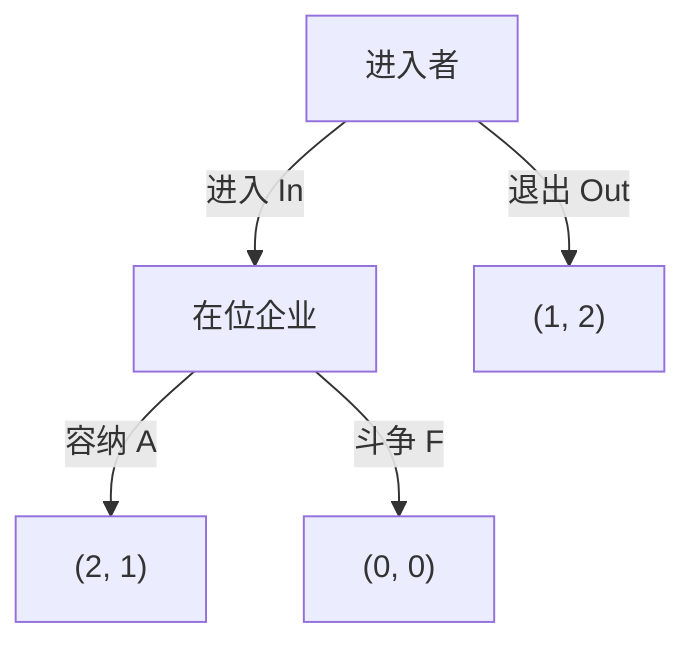

# Lecture 4｜扩展式博弈与子博弈精炼纳什均衡

<strong>Extensive-Form Games and Subgame Perfect Equilibrium</strong>

本章按照概念、模型与求解方法组织知识，并补充完整策略、均衡验证及计算推导。

[返回目录](../README.md) · [本讲练习与答案](../exercises/lecture-04-exercises.md)

## 目录

1. [从策略式博弈到扩展式博弈](#1-从策略式博弈到扩展式博弈)
2. [博弈树、信息结构和完整策略](#2-博弈树信息结构和完整策略)
3. [策略式转换与普通纳什均衡](#3-策略式转换与普通纳什均衡)
4. [子博弈与子博弈精炼纳什均衡](#4-子博弈与子博弈精炼纳什均衡)
5. [逆向归纳与多个 SPNE](#5-逆向归纳与多个-spne)
6. [道德风险、承诺与合同设计](#6-道德风险承诺与合同设计)
7. [最后通牒与交替报价谈判](#7-最后通牒与交替报价谈判)
8. [敲竹杠问题与 Rotten Kid Theorem](#8-敲竹杠问题与-rotten-kid-theorem)
9. [五名海盗分金币](#9-五名海盗分金币)
10. [Cournot 与 Stackelberg 竞争](#10-cournot-与-stackelberg-竞争)
11. [不完美信息、随机节点与无限期博弈](#11-不完美信息随机节点与无限期博弈)
12. [蜈蚣博弈与逆向归纳的适用边界](#12-蜈蚣博弈与逆向归纳的适用边界)
13. [求解清单与常见错误](#13-求解清单与常见错误)
14. [不可信威胁与市场进入](#14-用市场进入博弈识别不可信威胁)
15. [混合策略与行为策略](#15-混合策略与行为策略信息集决定随机化位置)

---

## 1. 从策略式博弈到扩展式博弈

前面的策略式博弈（strategic-form game）主要把各参与人的完整策略放进一个支付矩阵，寻找没有人愿意单方面改变策略的组合。扩展式博弈（extensive-form game）则显式记录<strong>谁先行动、后行动者观察到什么，以及不同历史之下有哪些后续选择</strong>。

经典例子是潜在进入者与在位企业：进入者先决定是否进入市场；在位企业观察到进入之后，再决定容纳还是打价格战。进入者的选择不仅取决于直接收益，还取决于其对后续决策的合理预期。

注意：<strong>先后发生</strong>不必然意味着<strong>后行动者知道前面的行动</strong>。刻画信息结构需要使用信息集。

## 2. 博弈树、信息结构和完整策略

### 2.1 博弈树的基本要素

| 术语 | 英文 | 含义 |
| --- | --- | --- |
| 参与人 | Player | 作出决策并获得收益的人或企业 |
| 决策节点 | Decision node | 某参与人轮到自己行动的位置 |
| 行动 | Action | 在当前节点选择的一个分支 |
| 历史 | History | 从根节点到当前节点的行动序列 |
| 终点节点 | Terminal node | 博弈结束，给出收益的位置 |
| 信息集 | Information set | 参与人无法区分的决策节点集合 |
| 纯策略 | Pure strategy | 在自己<strong>每一个</strong>信息集应如何行动的完整计划 |

完全信息（complete information）侧重参与人是否知道博弈结构、收益函数等；完美信息（perfect information）要求当前行动者清楚自己处于哪个决策节点，即所有信息集均为单点集。二者并不等价。

### 2.2 行动与策略不能混为一谈

考虑以下博弈树：玩家 1 先选 $`C`$ 或 $`D`$，玩家 2 在看到 $`C`$ 后选 $`E/F`$，看到 $`D`$ 后选 $`G/H`$。

| 玩家 1 行动 | 玩家 2 后续行动 | 最终收益 $`(u_1,u_2)`$ |
| --- | --- | --- |
| $`C`$ | $`E`$ | $`(2,1)`$ |
| $`C`$ | $`F`$ | $`(3,0)`$ |
| $`D`$ | $`G`$ | $`(0,2)`$ |
| $`D`$ | $`H`$ | $`(1,3)`$ |

玩家 1 只有一个决策节点，所以 $`S_1=\{C,D\}`$。

玩家 2 需要同时规定两个情形下如何选择，因此

```math
S_2=\{EG,EH,FG,FH\}.
```

比如 $`EG`$ 的意思是“如果前面走 $`C`$，选 $`E`$；如果前面走 $`D`$，选 $`G`$”。即使某条分支最终不会发生，策略也必须事先规定该分支上的行动。

如果玩家 $`i`$ 有 $`k`$ 个信息集，第 $`j`$ 个信息集有 $`m_j`$ 个可选行动，则其纯策略数量为

```math
\boxed{|S_i|=\prod_{j=1}^{k}m_j}.
```

## 3. 策略式转换与普通纳什均衡

将上述树写成标准支付矩阵：

| 玩家 1 $`\backslash`$ 玩家 2 | $`EG`$ | $`EH`$ | $`FG`$ | $`FH`$ |
| --- | --- | --- | --- | --- |
| $`C`$ | $`(2,1)`$ | $`(2,1)`$ | $`(3,0)`$ | $`(3,0)`$ |
| $`D`$ | $`(0,2)`$ | $`(1,3)`$ | $`(0,2)`$ | $`(1,3)`$ |

为什么第一行中 $`EG`$ 和 $`EH`$ 的收益相同？因为一旦玩家 1 已经选择 $`C`$，玩家 2 在 $`D`$ 分支打算采取 $`G`$ 还是 $`H`$，都不会影响本次实际结果。不过，这些<strong>未到达节点上的计划</strong>仍然属于策略的一部分。

纳什均衡（NE）要求任何参与人都不能通过单方面更换<strong>完整策略</strong>提高自己的收益：

```math
u_i(s_i^{*},s_{-i}^{*})\ge u_i(s_i,s_{-i}^{*}),\quad\forall i,\ s_i.
```

这个定义适用于扩展式博弈的策略式表示，但可能保留非可信的后续威胁。

## 4. 子博弈与子博弈精炼纳什均衡

### 4.1 进入阻遏博弈

进入者先选择进入 $`In`$ 或退出 $`Out`$；进入后，在位企业选容纳 $`A`$ 或斗争 $`F`$。



支付顺序为（进入者，在位企业）。策略式表示：

| 进入者 $`\backslash`$ 在位企业 | 容纳 $`A`$ | 斗争 $`F`$ |
| --- | --- | --- |
| 进入 $`In`$ | $`(2,1)`$ | $`(0,0)`$ |
| 退出 $`Out`$ | $`(1,2)`$ | $`(1,2)`$ |

通过最佳反应可得两个纯策略 NE：

```math
NE=\{(In,A),(Out,F)\}.
```

其中 $`(Out,F)`$ 依赖“如果你进入，我就斗争”的威胁。然而，一旦真的发生进入，在位企业容纳可得 $`1`$，斗争只能得 $`0`$，因此斗争不是其后续最优选择。

### 4.2 什么是子博弈？

子博弈（subgame）是原博弈树中的一个完整后续博弈，必须满足：

1. 从单个决策节点开始；
2. 包含该节点的全部后继节点；
3. 不切断任何信息集。

整个博弈本身也是一个子博弈。在进入阻遏博弈中，除了整个博弈，还存在“进入之后由在位企业作决定”的真子博弈。

子博弈精炼纳什均衡（subgame perfect Nash equilibrium，SPNE）的定义：

> 在整个博弈以及每一个子博弈中，策略组合都构成纳什均衡。

从最后一个子博弈逆向求解：在位企业选 $`A`$（因为 $`1>0`$），进入者预见该选择，所以选 $`In`$（因为 $`2>1`$）。于是

```math
\boxed{SPNE=\{(In,A)\}}.
```

因此，$`SPNE\subseteq NE`$，反过来一般不成立。

### 4.3 三阶段例题：为什么完整策略会产生多余的 NE？

考虑一个多层决策树：玩家 1 在根节点选择 $`C/D`$。若 $`C`$，玩家 2 再选 $`E/F`$；若 $`E`$，玩家 1 还要选 $`G/H`$。

终点收益：$`C\!\to E\!\to G=(1,2)`$；$`C\!\to E\!\to H=(0,0)`$；$`C\!\to F=(3,1)`$；$`D=(2,0)`$。

玩家 1 的完整策略是 $`CG,CH,DG,DH`$；玩家 2 是 $`E,F`$。支付矩阵：

| 玩家 1 $`\backslash`$ 玩家 2 | $`E`$ | $`F`$ |
| --- | --- | --- |
| $`CG`$ | $`(1,2)`$ | $`(3,1)`$ |
| $`CH`$ | $`(0,0)`$ | $`(3,1)`$ |
| $`DG`$ | $`(2,0)`$ | $`(2,0)`$ |
| $`DH`$ | $`(2,0)`$ | $`(2,0)`$ |

纯策略纳什均衡：

```math
NE=\{(CH,F),(DG,E),(DH,E)\}.
```

但玩家 1 在最后的决策节点一定偏好 $`G`$（收益 $`1>0`$）；预见这一点，玩家 2 在自己的节点选 $`E`$（收益 $`2>1`$）；根节点玩家 1 则选 $`D`$（收益 $`2>1`$）。所以

```math
\boxed{SPNE=\{(DG,E)\}}.
```

这题的考点是：<strong>先写完整策略、求普通 NE，再检查每个真子博弈的行为是否合理。</strong>

## 5. 逆向归纳与多个 SPNE

### 5.1 求解步骤

对于有限期、完美信息博弈，从每个最末端决策节点开始，先保留行动者最优行动，将它对应的收益带回前一层，再重复到根节点。最终要给出<strong>每个参与人的完整策略</strong>，不能只写均衡路径。

若某节点多个行动收益相同，就必须把所有最优行动保留，分别检查前序玩家的最佳反应。

### 5.2 多个子博弈精炼均衡：六个 SPNE

玩家 1 在根节点选 $`C,D,E`$。玩家 2 观察后相应选择：

| 玩家 1 先选 | 玩家 2 的行动与收益 |
| --- | --- |
| $`C`$ | $`F:(3,0)`$，$`G:(1,0)`$ |
| $`D`$ | $`H:(1,1)`$，$`I:(2,1)`$ |
| $`E`$ | $`J:(2,2)`$，$`K:(1,3)`$ |

玩家 2 在 $`C`$ 后对 $`F/G`$ 无差异，在 $`D`$ 后对 $`H/I`$ 无差异，在 $`E`$ 后严格选择 $`K`$。所以其逆向归纳允许的策略是：

```math
\{FHK,FIK,GHK,GIK\}.
```

对每种策略重新检查玩家 1：

| 玩家 2 的策略 | 玩家 1 在 $`C,D,E`$ 下的收益 | 根节点最佳反应 |
| --- | --- | --- |
| $`FHK`$ | $`3,1,1`$ | $`C`$ |
| $`FIK`$ | $`3,2,1`$ | $`C`$ |
| $`GHK`$ | $`1,1,1`$ | $`C,D,E`$ |
| $`GIK`$ | $`1,2,1`$ | $`D`$ |

共有六个 SPNE：

```math
\boxed{\{(C,FHK),(C,FIK),(C,GHK),(D,GHK),(E,GHK),(D,GIK)\}}.
```

<strong>泽梅洛定理</strong>：有限、完美信息的扩展式博弈至少存在一个 SPNE。若任何玩家在任意两个不同终点获得的收益都不相同，则逆向归纳产生唯一 SPNE。这是充分条件，不是唯一性的必要条件。

## 6. 道德风险、承诺与合同设计

### 6.1 “帽子里的钱”

玩家 1 选择投入 $`0,1,3`$ 单位资金，随后玩家 2 观察并决定“匹配投入”还是“拿走资金”。课件给出的逆向归纳结果是：<strong>玩家 1 投入 1，玩家 2 匹配</strong>。更大的项目虽然能使双方都获益，但在较大贷款下，后行动者的机会主义激励使合作难以实现。

这是一类道德风险问题：合同订立后，一方可能选择不利于另一方的行动，而双方也可能因此错失更高的整体收益。

课件给出五种制度变化路径：法律约束、资金用途限制、分期贷款、重新设计收益分配、抵押担保。它们的共同机制是改变行动可行集、后续收益或承诺的可信程度，而不是仅靠口头要求合作。

## 7. 最后通牒与交替报价谈判

### 7.1 最后通牒博弈

玩家 1 决定从总额 $`c`$ 中给玩家 2 金额 $`x\in[0,c]`$。玩家 2 接受时收益为 $`(c-x,x)`$，拒绝则 $`(0,0)`$。

只要 $`x>0`$，玩家 2 严格偏好接受；若 $`x=0`$ 则无差异。对于连续报价且纯粹金钱收益，唯一 SPNE 中玩家 2 接受所有报价（包括 $`0`$），玩家 1 报价 $`x=0`$，结果为 $`(c,0)`$。

为什么不能令玩家 2 拒绝 $`x=0`$、接受一切 $`x>0`$？因为玩家 1 此时希望给出任意小的正金额，没有一个<strong>最小正实数</strong>能实现最大收益；因此其最优报价不存在。

### 7.2 两轮交替报价

总额为 1；玩家 1 第一轮报价，玩家 2 可以拒绝并在第二轮反过来报价。每延迟一轮，收益乘以共同折现因子 $`0<\delta<1`$。

第二轮最后报价者玩家 2 可获得全部奖金，但在第一轮看来的价值是 $`\delta`$。故玩家 2 第一轮的接受门槛为 $`x_2\ge\delta`$。玩家 1 因此选择

```math
\boxed{(x_1,x_2)=(1-\delta,\delta)}.
```

### 7.3 三轮及多轮

三轮时，最后一轮由玩家 1 报价。继续逆向归纳可得首轮分配：

```math
\boxed{(x_1,x_2)=(1-\delta+\delta^2,\delta-\delta^2)}.
```

若有 $`n`$ 轮、由玩家 1 在第一轮报价，其均衡首轮份额是交错级数

```math
x_1^{(n)}=1-\delta+\delta^2-\cdots+(-\delta)^{n-1}=\frac{1-(-\delta)^n}{1+\delta},
```

```math
x_2^{(n)}=1-x_1^{(n)}.
```

当轮数趋于无穷时：

```math
\boxed{x_1=\frac{1}{1+\delta},\qquad x_2=\frac{\delta}{1+\delta}}.
```

随着 $`\delta\to1`$，两个份额均趋近 $`1/2`$。要区分<strong>两轮博弈</strong>中第二位报价者的优势与<strong>三轮博弈</strong>中最后报价者变化带来的结果。

## 8. 敲竹杠问题与 Rotten Kid Theorem

### 8.1 Hold-up game

玩家 1 先投入高努力 $`H`$ 或低努力 $`L`$ 生产可分配收益；玩家 2 再决定给玩家 1 的分配比例，玩家 1 最后选择接受或拒绝。若玩家 2 在最后通牒阶段具有全部议价权，玩家 1 预期无论多努力都拿不到额外收益，就会选择成本更低的努力水平。

所以，<strong>事后的议价权分配会反过来影响事前的投资和努力激励</strong>。这就是不完全合同与投资不足问题的一种基础模型。

### 8.2 Rotten Kid Theorem

孩子选择行动 $`a`$，使自己收入为 $`c(a)`$、家长收入为 $`p(a)`$，家长可以在观察到行动后进行转移支付。按照讲义的偏好设定，家长愿意通过转移支付平衡双方的最终收入，最优转移额为

```math
t(a)=\frac{p(a)-c(a)}{2}.
```

孩子最终得到

```math
c(a)+t(a)=\frac{p(a)+c(a)}{2}.
```

因此，在该模型假设下，孩子即便只重视个人收入，也会选择最大化家庭总收入 $`p(a)+c(a)`$ 的行动。关键不是“自私总会产生合作”，而是转移支付规则改变了孩子的边际激励。

## 9. 五名海盗分金币

五名海盗 $`P_1,\ldots,P_5`$ 按顺序提出分配 100 枚金币的方案。每次均投票；不过半则提议者被处决。<strong>课件特殊规则</strong>：赞成票与反对票相同时，方案通过；对通过与否无差异者投反对票。

逆向归纳：

| 剩余人数 | 按当前剩余顺序的均衡分配 | 原因 |
| --- | --- | --- |
| 1 | $`(100)`$ | 最后一个人独占 |
| 2 | $`(100,0)`$ | 提议者自己的票即可打平 |
| 3 | $`(99,0,1)`$ | 买下未来收益为零的人的票 |
| 4 | $`(99,0,1,0)`$ | 提议者再买一票即可达到平票 |
| 5 | $`(98,0,1,0,1)`$ | 提议者再买两票即可形成多数 |

因此从 $`P_1`$ 开始，最终分配为

```math
\boxed{(P_1,P_2,P_3,P_4,P_5)=(98,0,1,0,1)}.
```

无人被处决。不能直接套用其他“海盗分金币”版本的答案，因为是否允许平票通过、无差异者如何投票，都会改变结果。

## 10. Cournot 与 Stackelberg 竞争

### 10.1 同时选择产量：Cournot

市场价格为 $`P=a-b(q_1+q_2)`$，单位边际成本为 $`c`$，其中 $`a>c`$、$`b>0`$。利润：

```math
\pi_i=[a-b(q_1+q_2)-c]q_i
```

两家企业同时确定产量，内点最佳反应函数为

```math
BR_1(q_2)=\frac{a-c-bq_2}{2b},\qquad BR_2(q_1)=\frac{a-c-bq_1}{2b}.
```

交点给出 Cournot 均衡：

```math
\boxed{q_1^C=q_2^C=\frac{a-c}{3b}},\qquad Q^C=\frac{2(a-c)}{3b},
```

```math
\pi_1^C=\pi_2^C=\frac{(a-c)^2}{9b}.
```

### 10.2 先后决定产量：Stackelberg

企业 1 先承诺产量 $`q_1`$，企业 2 观察后行动。先解后行动者：

```math
q_2(q_1)=\max\left\{0,\frac{a-c-bq_1}{2b}\right\}.
```

将内点反应函数代回企业 1 利润：

```math
\max_{q_1}\pi_1=\max_{q_1}\frac{a-c-bq_1}{2}q_1.
```

一阶条件：

```math
\frac{a-c}{2}-bq_1=0.
```

均衡产量为

```math
\boxed{q_1^S=\frac{a-c}{2b},\qquad q_2^S=\frac{a-c}{4b}}.
```

进而

```math
Q^S=\frac{3(a-c)}{4b},\qquad\pi_1^S=\frac{(a-c)^2}{8b},\qquad\pi_2^S=\frac{(a-c)^2}{16b}.
```

| 对比 | Cournot | Stackelberg |
| --- | --- | --- |
| 企业 1 产量 | $`(a-c)/(3b)`$ | $`(a-c)/(2b)`$ |
| 企业 2 产量 | $`(a-c)/(3b)`$ | $`(a-c)/(4b)`$ |
| 总产量 | $`2(a-c)/(3b)`$ | $`3(a-c)/(4b)`$ |
| 企业 1 利润 | $`(a-c)^2/(9b)`$ | $`(a-c)^2/(8b)`$ |
| 企业 2 利润 | $`(a-c)^2/(9b)`$ | $`(a-c)^2/(16b)`$ |

因此 $`Q^S>Q^C`$：在该线性同质产品模型下，Stackelberg 总产量更高、价格更低，先行动企业利润增加，后行动企业利润减少。<strong>有些文字解释把总产量描述为“下降”，但这与模型公式矛盾；判断方向应以实际推导为准。</strong>

先动优势依赖<strong>可观察且可信的先行承诺</strong>。若企业 1 可以事后随意修改已宣布的产量，原先的顺序博弈结构就会改变。

## 11. 不完美信息、随机节点与无限期博弈

### 11.1 信息集与同时行动

以猜硬币为例，虽然可以把玩家 1 的行动画在玩家 2 前面，但若玩家 2 并不知道玩家 1 选了正面还是反面，其两个决策节点必须连接为<strong>同一个信息集</strong>。玩家 2 不能针对两个自己无法区分的节点采取不同动作。

这种同时行动的扩展式表述是不完美信息博弈；仍可能是完全信息博弈。若某个后续子博弈包含同时行动阶段，应当先求该阶段的纳什均衡；如果有多个均衡，就可能有多个 SPNE。

核危机案例也可以具有这种多阶段与同时行动混合的结构；均衡选择影响前期升级、退让的决策。

### 11.2 随机节点

自然状态可能以已知概率影响下一阶段。例如选 $`B`$，有 $`1/2`$ 的概率获得 3、$`1/2`$ 的概率获得 0，则期望收益

```math
\mathbb E[u(B)]=\frac{1}{2}\times3+\frac{1}{2}\times0=1.5
```

若选 $`A`$ 确定获得 1，则风险中性玩家选择 $`B`$。有随机节点时，逆向归纳需要先计算期望收益，再比较当前行动。

### 11.3 无限期轮流开枪

两人交替决定是否开枪；只有生存概率进入效用。由于没有最后一轮，无法直接从终点开始逆向归纳。

讲义讨论两个可构成 SPNE 的策略组合：双方永远不开枪；双方轮到自己时都开枪。前者使双方均保持存活，不存在更高的生存概率；后者则因为对方始终开枪，单方面放弃射击只会降低自己先消除威胁的概率。

## 12. 蜈蚣博弈与逆向归纳的适用边界

在经典蜈蚣博弈中，双方轮流选择“继续”或“停止”；继续使游戏进入更后阶段，并有机会增加双方总收益。

但对于已知终点的有限期游戏，末轮行动者会根据自身支付选择停止。倒数第二轮行动者预见这一点后也会停止，如此向前递推，导致初始行动者第一轮就停止。讲义设定中的结果为

```math
\boxed{(2,0)}.
```

实验中，人们可能连续合作若干轮，因此理论预测与实际行为之间存在差异。一个重要原因是<strong>理性及理性的共同知识</strong>未必满足：观察到对方此前连续合作后，参与人可能修正对其后续行为的判断。

## 13. 求解清单与常见错误

| 检查问题 | 常见错误 | 正确做法 |
| --- | --- | --- |
| 策略是否完整？ | 只写实际路径上的行动 | 为每个信息集规定行动 |
| 纯策略数怎么算？ | 各节点行动数简单相加 | 对各信息集行动数量求乘积 |
| NE 是否等于 SPNE？ | 直接把所有 NE 当作 SPNE | 检查所有子博弈是否也是 NE |
| 存在无差异行动怎么办？ | 随意保留其中一个 | 列出所有最优行动，向前回溯 |
| 有同时行动阶段怎么办？ | 逐节点独立取最大 | 在不能区分的节点上按信息集决策，求该阶段 NE |
| 连续先后决策怎么解？ | 先直接对领先者优化 | 先求跟随者最佳反应，再代入领先者目标 |
| 比较 Cournot / Stackelberg？ | 混淆总产量和单家产量 | 分别算 $`q_1,q_2,Q,P,\pi_1,\pi_2`$ |

学完本讲，应能独立完成两类核心计算：一是将三阶段博弈树转换为策略式并求出全部 NE、SPNE；二是根据后行动者的反应函数求出连续型动态博弈的均衡。

## 14. 用市场进入博弈识别不可信威胁

考虑进入者先选“进入”或“不进入”。不进入时，收益为（进入者 $`0`$，在位企业 $`2`$）。若进入，在位企业再选“打价格战”或“容纳进入”：前者收益为 $`(-1,-1)`$，后者为 $`(1,1)`$。

只看策略式纳什均衡，$`(\text{不进入},\text{打价格战})`$ 也可能成立：进入者相信自己会被打击，因而不进入；既然没有发生进入，在位企业后续的威胁就没有在实际路径上接受检验。

但从在位企业的真实决策节点向后看，“容纳”带来支付 $`1`$，“打价格战”带来 $`-1`$，所以它一定选择容纳。进入者预见到这一点后，比较进入收益 $`1`$ 与不进入收益 $`0`$，会选择进入。

因此本例的子博弈精炼均衡是

```math
\boxed{(\text{进入},\text{容纳})}
```

其完整策略规定：进入者选择进入；在位企业若面对进入则选择容纳。<strong>SPNE 通过要求每个真子博弈都理性，剔除了依靠不可信惩罚维持的普通纳什均衡。</strong>

## 15. 混合策略与行为策略：信息集决定随机化位置

扩展式博弈可以有两种随机化描述。混合策略（mixed strategy）是在博弈开始前对一整套完整纯策略抽签；<strong>行为策略（behavioral strategy）</strong>则是在每个信息集分别规定各行动的概率。

在有限且具有<strong>完美回忆（perfect recall）</strong>的扩展式博弈中，Kuhn 定理说明：对于任一混合策略，存在一个行为策略使其面对对手策略时诱导相同的终局概率分布，反之亦然。这里的完美回忆是指玩家不会忘记自己曾经掌握的信息及做过的行动，并不等于<strong>完美信息</strong>：玩家仍可以不知道对手此前选了哪条路径。

实际做题时，若两个节点被同一个信息集连接，玩家无法辨别自己身在哪个节点，必须在这两个节点使用<strong>同一份行动随机化规则</strong>。不能把“左节点选 U，右节点选 D”写成一个可执行的行为策略。也不能认为信息集内任一节点都自然是子博弈起点：真子博弈必须从单点信息集开始，且不能切断其他信息集。

<strong>练题入口：</strong> [第四讲标准习题与逐题解析](../exercises/lecture-04-exercises.md)。
