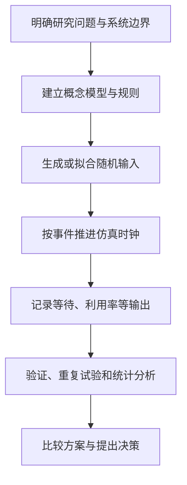

# 系统建模与仿真｜System Modeling & Simulation

[返回仓库首页](../README.md) · [基础与随机数](notes/01-random-numbers.md) · [离散事件与排队](notes/02-discrete-event-queue.md) · [标准练习与解析](exercises/01-core-exercises.md)

本板块面向管理科学与工程、工业工程与管理的**系统建模与仿真**课程。按“理解系统 → 产生随机输入 → 推动事件时钟 → 统计输出 → 评价模型”的顺序整理，重点是**能够手算、能够解释、能够用 Arena 或代码复现**。

这里的例题为教学目的重新编写；具体考试范围仍以任课教师的课件和要求为准。

## 学习导航

| 主题 | 主要知识点 | 笔记 | 练习 |
| --- | --- | --- | --- |
| 01 仿真基础与随机性 | 系统、状态、事件、时钟；线性同余法；卡方、KS、游程、扑克检验；反函数法与 Box–Muller | [学习笔记](notes/01-random-numbers.md) | [题 1–5](exercises/01-core-exercises.md) |
| 02 离散事件与服务台 | 未来事件表；FCFS 队列；两个并行服务台、M1 优先；手工事件推进；Arena 模块 | [学习笔记](notes/02-discrete-event-queue.md) | [题 6–7](exercises/01-core-exercises.md) |
| 03 输出分析 | 终止型与稳态仿真；预热期；多次独立重复；置信区间；方差缩减 | [学习笔记第 6–7 节](notes/02-discrete-event-queue.md) | [题 8–9](exercises/01-core-exercises.md) |

## 一张图看清仿真流程

**四个最容易混淆的问题：**

1. 随机数发生器产生的是近似 $U(0,1)$ 的序列；到达间隔、服务时间等其他分布的样本还需要**随机变量生成**步骤。
2. 离散事件仿真并非每秒更新一次系统，而是让时钟直接跳到**下一次事件**。
3. 服务台优先规则只是**路由规则**；等待队列是 FCFS 还是优先队列，需要另行约定。
4. 仿真一次的平均值不是系统长期的真实均值，输出要考虑**随机误差、初始条件与重复试验**。

## 推荐复习顺序

先掌握 $U(0,1)$ 随机数的构造与检验，再学习反函数法，把均匀随机数转换为目标分布；随后手算并行服务台，熟悉到达事件、离开事件和未来事件表；最后再进入 Arena 搭建、置信区间和稳态输出分析。

如果考试以计算题为主，优先训练以下五类：线性同余序列；卡方与 KS；反函数法；事件表/服务台等待时间；独立重复的均值置信区间。不要只背公式，重点是**数据从哪来、何时更新状态、分母该用什么**。

## 内容规划

- [x] 基础概念、随机数及随机变量生成
- [x] 离散事件机制、并行服务台与 Arena 入门
- [x] 稳态分析、方差缩减的基础框架
- [x] 第一组标准习题与逐题解析
- [ ] 结合完整课程课件，逐章对照补充推导与例题
- [ ] Arena：项目工序分解模型及实验步骤
- [ ] 仿真输出分析专题：批均值法、相关性、方差缩减进阶

