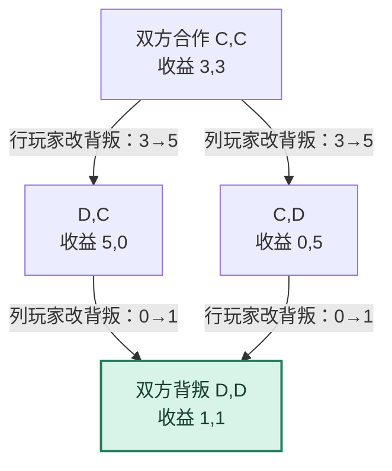

# 图解 01｜支付矩阵：为什么最佳反应箭头指向纳什均衡

[图解目录](README.md) · [第一讲完整笔记](../notes/lecture-01-strategic-form-games.md) · [第一讲习题](../exercises/lecture-01-exercises.md)

## 一、囚徒困境的四个格子

每格的第一个数字是行玩家收益，第二个数字是列玩家收益：

| 行 / 列 | 合作 C | 背叛 D |
| --- | --- | --- |
| 合作 C | (3,3) | (0,5) |
| 背叛 D | (5,0) | (1,1) |

下面每根箭头都表示<strong>只有一名玩家改变行动，且改变之后其个人收益提高</strong>。

<strong>为什么只有 (D,D) 是均衡？</strong> 因为到达该格子后，任一玩家单方面改为合作，自己的收益都会从 1 下降为 0，已经没有有利的偏离箭头。而 (C,C) 虽让双方各得 3，却有两条有利偏离箭头，因此不是 NE。

## 二、最佳反应究竟圈哪个数字

求行玩家最佳反应时，必须<strong>固定列玩家的一列</strong>，比较这一列中各格的第一个数字；求列玩家最佳反应时，必须<strong>固定行玩家的一行</strong>，比较第二个数字。每个格子同时属于双方最佳反应，才是纯策略 NE。

## 三、图解容易隐藏的前提

这里的箭头描述<strong>单方偏离</strong>，不能拿一条“双方同时改变行动”的路径判断 NE。要评价从 (D,D) 一起回到 (C,C) 是否更好，应使用帕累托效率标准，而非纳什均衡定义。
