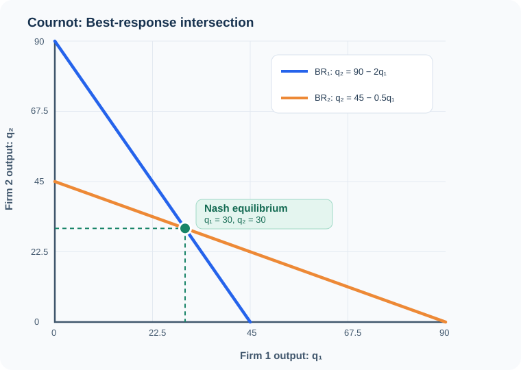
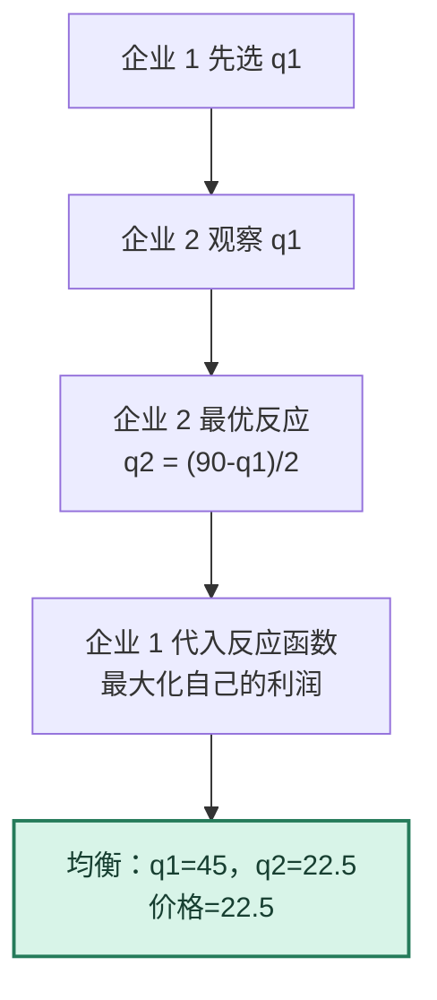

# 图解 02｜Cournot 最佳反应曲线与 Stackelberg 的时序变化

[图解目录](README.md) · [第二讲完整笔记](../notes/lecture-02-strategic-form-games.md) · [计算习题](../exercises/lecture-02-exercises.md)

## 一、同时选择产量：两条最佳反应线

假设反需求为 $`P=90-q_1-q_2`$，边际成本为 0。企业 1 的最佳反应为 $`q_1=(90-q_2)/2`$，企业 2 的最佳反应为 $`q_2=(90-q_1)/2`$。两条线在 $`(30,30)`$ 相交。

图中横轴是企业 1 产量，纵轴是企业 2 产量。蓝线上的任意点都满足**企业 1 在给定企业 2 产量时最优**；橙线上的任意点都满足**企业 2 在给定企业 1 产量时最优**。只有交点同时满足双方条件。

## 二、先后选择产量：倒推而非交点

两种模型的数值对照：

| 竞争方式 | 企业 1 产量 | 企业 2 产量 | 总产量 | 价格 |
| --- | ---: | ---: | ---: | ---: |
| Cournot：同时选择 | 30 | 30 | 60 | 30 |
| Stackelberg：企业 1 先行 | 45 | 22.5 | 67.5 | 22.5 |

理解重点：Stackelberg 中领先者不是在不知道跟随者反应的情况下任意增产，而是**预见了跟随者会沿自己的最佳反应函数移动**，因此优化的目标函数已经发生变化。
