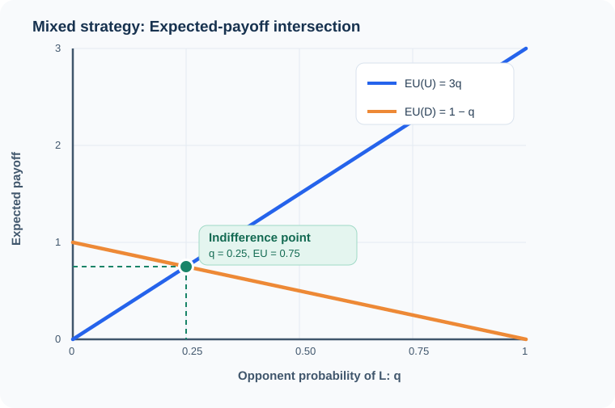
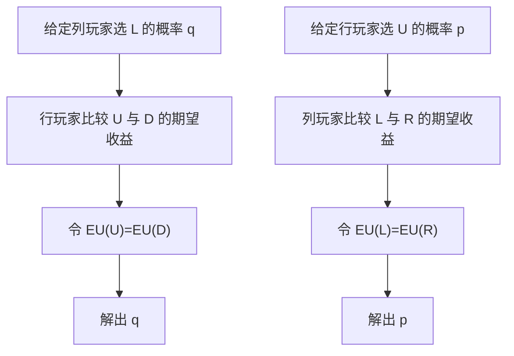

# 图解 03｜混合策略：无差异条件就是两条期望收益线的交点

[图解目录](README.md) · [第三讲完整笔记](../notes/lecture-03-mixed-strategies.md) · [第三讲习题](../exercises/lecture-03-exercises.md)

## 一、为什么概率是解方程得到的

考虑行玩家的收益矩阵：

| 行 / 列 | L | R |
| --- | ---: | ---: |
| U | 3 | 0 |
| D | 0 | 1 |

若列玩家以概率 $`q`$ 选择 L，则行玩家选 U 的期望收益是 $`3q`$，选 D 的期望收益是 $`1-q`$。

两条线相交处满足 $`3q=1-q`$，因此 $`q=1/4`$。只有当对手这样随机化时，行玩家才愿意在 U 和 D 之间混合；若 $`q>1/4`$，行玩家更愿意选择 U，反之更愿意选择 D。

## 二、为什么求自己的概率，要看对方的收益

这里的图仅展示了**行玩家收益**，因此可以求出列玩家的混合概率 $`q`$；如果没有列玩家的收益表，就无法仅凭这张图求出行玩家自己的概率 $`p`$。这是混合策略题最容易忽略的信息条件。

## 三、完整答案需要验证什么

必须检查双方求得的概率均处于 $`[0,1]`$；如果是内部混合，必须严格位于 $`(0,1)`$；所有赋予正概率的纯行动必须获得相同且最高的期望收益。超出支持集的其他行动若能带来更高收益，候选混合策略就不是 NE。
