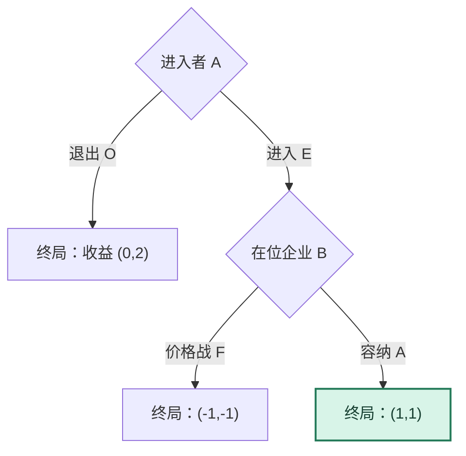
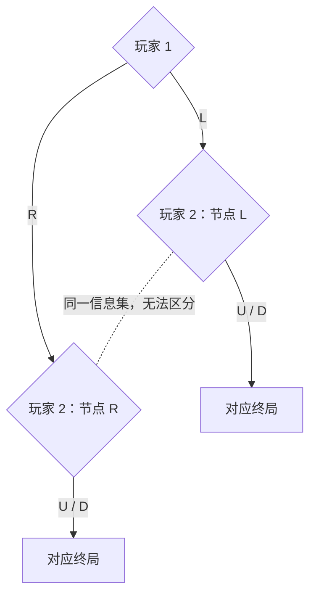

# 图解 04｜扩展式博弈：从博弈树倒推 SPNE

[图解目录](README.md) · [第四讲完整笔记](../notes/lecture-04-extensive-form-games.md) · [第四讲习题](../exercises/lecture-04-exercises.md)

## 一、市场进入：为什么威胁未必可信

逆向归纳不是一开始就猜进入者会不会进入，而是先站在在位企业的后续节点：发生进入后，容纳收益 1，价格战收益 $`-1`$，在位企业会选择容纳。于是进入者预见到“进入后获得 1”，会选择进入而不是退出（获得 0）。

普通 NE 还可能包括“退出＋声称价格战”，因为价格战并不会真正发生；<strong>SPNE 通过要求每个子博弈都理性，排除了不可信的路径外威胁</strong>。

## 二、信息集为什么改变策略数量

虚线不是行动路径，而是“同一信息集”的标记。玩家 2 看不见玩家 1 选择的是 L 还是 R，所以不能把“L 后选 U、R 后选 D”作为可执行策略。玩家 2 只有<strong>在该信息集选 U</strong>和<strong>在该信息集选 D</strong>两种纯策略。

## 三、两种模型的根本区别

| 要问的问题 | 策略式分析 | 扩展式分析 |
| --- | --- | --- |
| 策略描述 | 每个人的完整行动计划 | 每个信息集的行动计划 |
| 稳定性条件 | 没有人愿意单方改变完整策略 | 所有子博弈也必须稳定 |
| 求解工具 | 最佳反应、支付矩阵 | 逆向归纳、子博弈精炼 |

完整策略包含<strong>即使均衡路径上没发生，也可能需要执行的行动</strong>；只列均衡路径不足以说明一个 SPNE。
