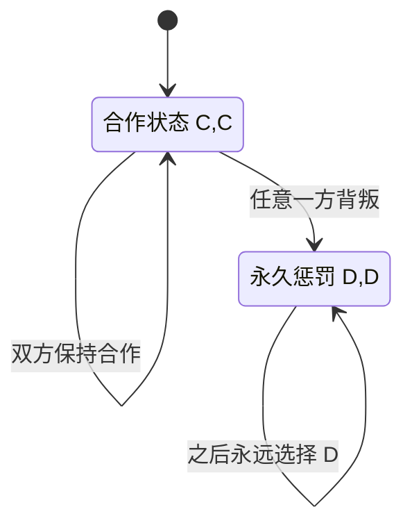

# 图解 05｜重复博弈：合作状态与惩罚状态怎样切换

[图解目录](README.md) · [第五讲完整笔记](../notes/lecture-05-repeated-games.md) · [第五讲习题](../exercises/lecture-05-exercises.md)

## 一、冷酷触发（Grim Trigger）的状态机



图中的状态不是“某一期支付”，而是一个**完整的历史依赖策略**：还没有出现背叛就合作，一旦发现背叛就进入永久惩罚状态。若阶段收益是 $`T=5,R=3,P=1,S=0`$，正常合作的折现收益为 $`3/(1-\delta)`$，现在单方背叛则得到 $`5+\delta/(1-\delta)`$。

合作不偏离要求

```math
\frac{3}{1-\delta}\ge 5+\frac{\delta}{1-\delta}
\quad\Longleftrightarrow\quad \delta\ge\frac12.
```

## 二、奖励、惩罚与等待的三层含义

第一层：背叛使本期收益从 3 提高到 5，存在即时诱惑。第二层：未来永远从每期 3 下降为每期 1，产生持续损失。第三层：折现因子越高，未来损失在今天越重要，因此更有可能维持合作。

若关系每期只有概率 $`\rho`$ 存续、时间折现为 $`\beta`$，应将图中的未来状态转移纳入期望收益，有效折现因子成为 $`\beta\rho`$。这时合作阈值是 $`\beta\rho\ge1/2`$，不能只看玩家“主观上是否耐心”。

## 三、TFT 与冷酷触发不能画成同一张状态图

以牙还牙（Tit-for-Tat）只根据**对手上一期行动**决定本期行动，可能在对方恢复合作后恢复合作；冷酷触发则一旦进入惩罚状态就不再返回。因此 TFT 的状态必须记录历史行动，并且需要分别检验每个状态下的一次偏离；不能直接把冷酷触发的折现阈值套给 TFT。
