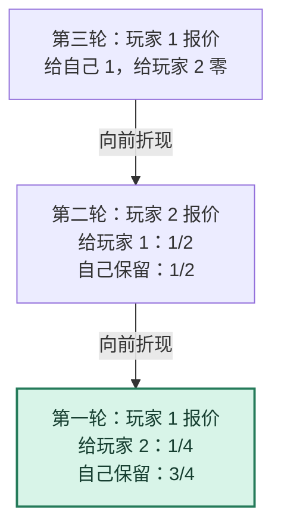

# 图解 06｜讨价还价：末轮报价权如何决定首轮结果

[图解目录](README.md) · [第六讲完整笔记](../notes/lecture-06-bargaining.md) · [第六讲习题](../exercises/lecture-06-exercises.md)

## 一、三轮交替报价，先画时间线

双方分配 1 单位资源，每等待一期都以 $`\delta=1/2`$ 折现，接受者无差异时接受。玩家 1、玩家 2、玩家 1 依次掌握报价权，第三轮若仍拒绝则双方得零。

<strong>为什么第一轮是四分之一而不是二分之一？</strong> 因为玩家 2 拒绝第一轮后，下一轮虽有报价权，但第二轮自己也只能保留二分之一；再向前折现一次，第一轮的最低接受份额就变成四分之一。

## 二、两轮与三轮的对比

| 模型 | 末轮报价者 | 第一轮玩家 1 份额 | 第一轮玩家 2 份额 |
| --- | --- | ---: | ---: |
| 两轮 | 玩家 2 | 1/2 | 1/2 |
| 三轮 | 玩家 1 | 3/4 | 1/4 |

两个模型折现因子相同，但最后报价权不同，因此倒推后的首轮分配也不同。只背诵“先报价者占优势”不足以解题；必须写出<strong>拒绝之后的继续价值</strong>。

## 三、如果有外部选项

接受者还能立即退出并取得外部收益 $`o`$ 时，接受门槛不能低于 $`o`$；若拒绝后有另一轮可谈判，则还要与折现后的继续价值比较。具体要写清外部选项是否可以立即行使，不能不看制度设定就直接套某个公式。
