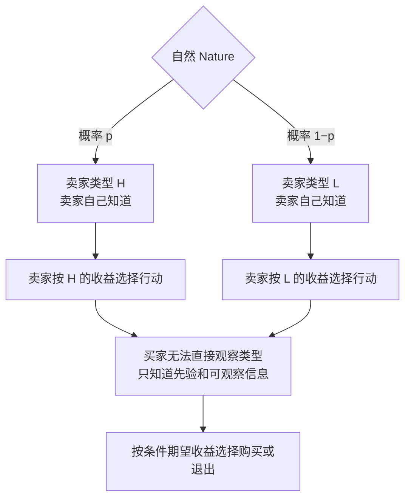
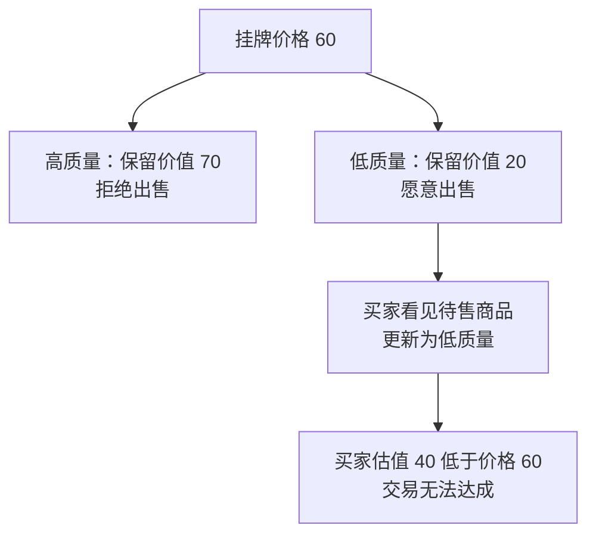

# 图解 07｜贝叶斯博弈：自然决定类型，玩家根据信念行动

[图解目录](README.md) · [第七讲完整笔记](../notes/lecture-07-bayesian-games.md) · [第七讲习题](../exercises/lecture-07-exercises.md)

## 一、谁知道类型，谁只知道概率

卖家的纯策略不是只写“出售”或“不出售”一个动作，而是要写<strong>面对 H 型时怎么做、面对 L 型时怎么做</strong>。买家如果无法观察类型，就不能分别针对真实类型采取两个不同动作；其选择依据是自己掌握的信念和可观察信息。

## 二、先验不等于交易样本的质量分布

如果高质量卖家最低愿收 70，低质量卖家最低愿收 20，买家对两类的估值分别为 100 和 40，且两类先验概率各为 $`1/2`$，则在统一价格 60 时：

原先的平均买家估值为 70，但在<strong>卖家选择是否进入市场之后</strong>，实际待售商品的质量发生了选择性变化。贝叶斯分析关键就在于考虑参与人的类型依赖决策，而不是盲目使用总体平均值。

## 三、从静态 BNE 到动态 PBE

静态 BNE 要求每一种类型的行动在信念下都是最优。若之后还会发信号、观察消息、更新后验并作出行动，就需要采用动态信念与序贯理性分析，见[图解 08｜信号博弈](08-signaling-games.md)。
