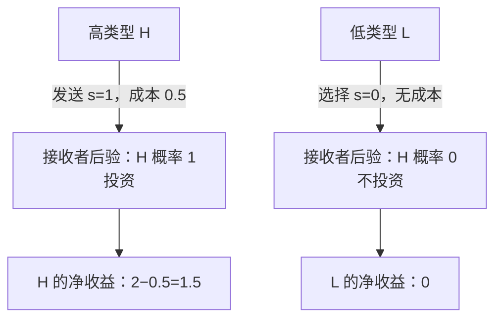
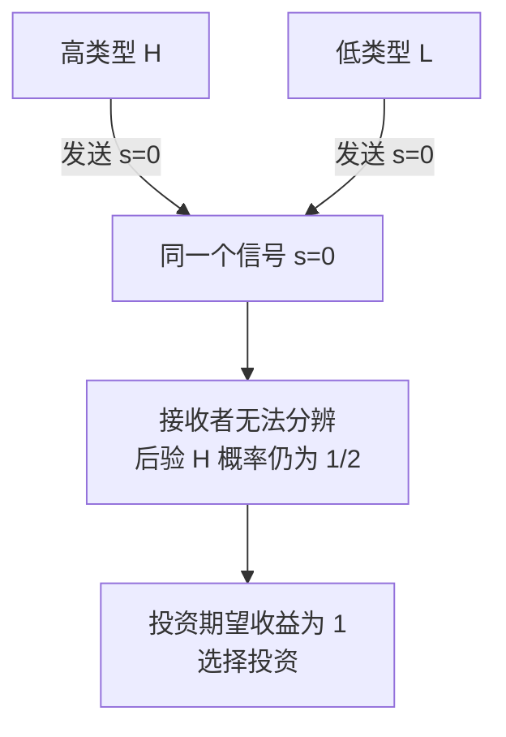

# 图解 08｜动态贝叶斯博弈：分离、混同与后验信念

[图解目录](README.md) · [第八讲完整笔记](../notes/lecture-08-dynamic-bayesian-games.md) · [第八讲习题](../exercises/lecture-08-exercises.md)

## 一、分离均衡（Separating）

发送者有高低两种类型且先验各为 $`1/2`$。高类型发送高成本信号的成本为 $`0.5`$，低类型发送同一信号的成本为 3。接收者见到信号后决定是否投资，投资给发送者的毛收益是 2。

要成为 PBE，除接收者行为合理外，还须检查两类发送者都不愿意模仿：高类型改为不发信号只得 0；低类型冒充高类型发送 $`s=1`$ 的净收益为 $`2-3=-1`$。因此在给定支付下，该分离策略满足激励约束。

## 二、混同均衡（Pooling）

在混同均衡中，观察到均衡路径上的共同信号后，信念一般不能自动变成 0 或 1。对均衡路径上**不会出现**的其他信号，还需要明确路径外信念，并检验它是否支持接收者行为和发送者不偏离。

## 三、两项检验缺一不可

**信念一致性**：路径上按 Bayes 法则更新。**序贯理性**：接收者在每个信息集选择最佳反应，发送者每种类型也不会从既定信号偏离。这比只在博弈初期求一个普通 NE 更严格。
