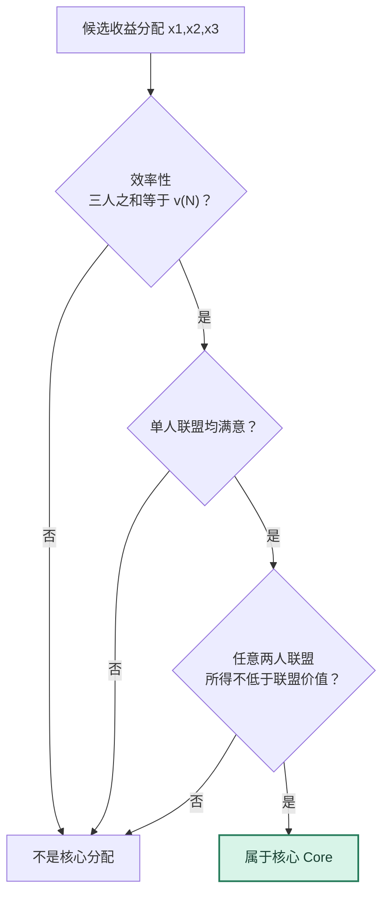
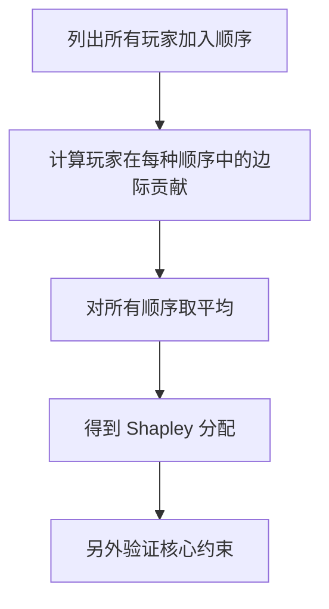

# 图解 09｜合作博弈：联盟约束、核心与 Shapley 值

[图解目录](README.md) · [第九讲完整笔记](../notes/lecture-09-cooperative-games.md) · [第九讲习题](../exercises/lecture-09-exercises.md)

## 一、一个分配方案需要经过两种检验



收益博弈的核心既要求<strong>大联盟收益分配完毕</strong>，又要求任何成员小组都不会发现“离开之后更划算”。仅看总收益相等并不足够。

## 二、为什么三人多数联盟博弈核心为空

假设任何单人联盟价值为 0，任意两人联盟价值为 1，三人联盟价值也是 1。每两人都希望至少拿到 1：

```math
x_1+x_2\ge1,\qquad
x_1+x_3\ge1,\qquad
x_2+x_3\ge1.
```

三式相加得到 $`2(x_1+x_2+x_3)\ge3`$，但有效率的分配必须满足 $`x_1+x_2+x_3=1`$，左侧只能是 2，矛盾。即使三人很愿意合作，也<strong>没有任何具体的收益分配能同时稳定所有双人联盟</strong>。

## 三、Shapley 是平均贡献，核心是稳定性



对于刚才完全对称的三人多数联盟博弈，Shapley 值为每人 $`1/3`$。然而任意两人合计只有 $`2/3<1`$，所以 Shapley 值<strong>不属于核心</strong>。Shapley 值的公平公理不会自动保证所有联盟都满意。

如果允许每个联盟最多存在 $`1/3`$ 的稳定性缺口，这个对称分配恰好达到<strong>最小核心（Least Core）</strong>的最优缺口。
