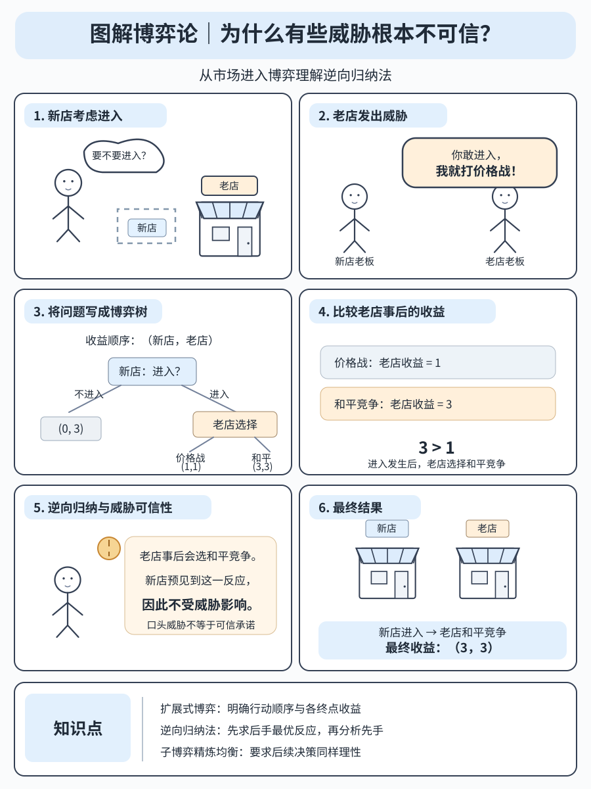
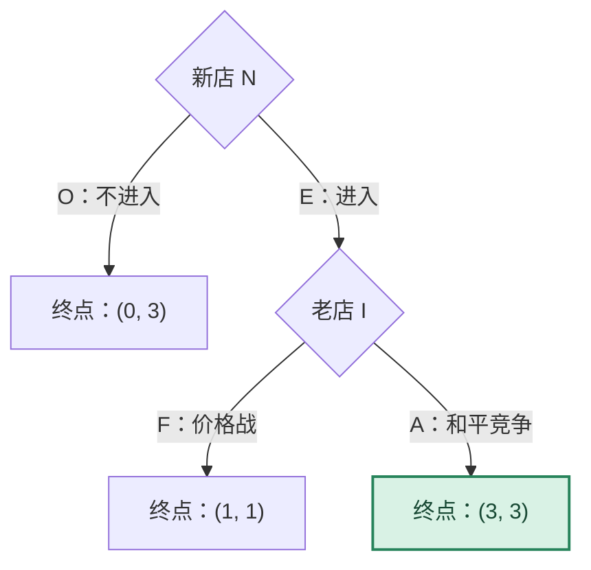

# 为什么有些威胁根本不可信？｜市场进入博弈专题

[图解博弈论目录](README.md) · [扩展式博弈图解](04-extensive-form.md) · [Lecture 04 笔记](../notes/lecture-04-extensive-form-games.md)

本专题讨论有限、完全且完美信息的市场进入博弈。依次给出收益结构、博弈树、完整纯策略、纳什均衡、子博弈精炼纳什均衡，以及两道附详细解析的练习题。所有收益均为教学假设，不代表现实行业利润。

## 一、漫画：市场进入与价格战威胁



上图是本专题的仓库内矢量配图。其收益顺序固定为<strong>（新店，老店）</strong>。下文第一组模型与图中的数字一致：

| 行动历史 | 新店收益 | 老店收益 |
| --- | ---: | ---: |
| 新店不进入（O） | 0 | 3 |
| 新店进入（E），老店价格战（F） | 1 | 1 |
| 新店进入（E），老店和平竞争（A） | 3 | 3 |

需要注意：本组收益下，新店即使遭遇价格战也能得到 1，高于不进入的 0。所以“价格战威胁不可信”与“价格战威胁会阻止进入”是两个不同的命题。前者成立，后者在该组数字中不成立。下面先严格求解本模型，再用第二组收益讨论纳什均衡中可能出现的非可信威胁。

## 二、正式博弈模型

### 2.1 参与人、行动与信息

参与人分别为潜在进入者新店 # 为什么有些威胁根本不可信？｜市场进入博弈专题

[图解博弈论目录](README.md) · [扩展式博弈图解](04-extensive-form.md) · [Lecture 04 笔记](../notes/lecture-04-extensive-form-games.md)

本专题讨论有限、完全且完美信息的市场进入博弈。依次给出收益结构、博弈树、完整纯策略、纳什均衡、子博弈精炼纳什均衡，以及两道附详细解析的练习题。所有收益均为教学假设，不代表现实行业利润。

## 一、漫画：市场进入与价格战威胁


上图是本专题的仓库内矢量配图。其收益顺序固定为<strong>（新店，老店）</strong>。下文第一组模型与图中的数字一致：

| 行动历史 | 新店收益 | 老店收益 |
| --- | ---: | ---: |
| 新店不进入（O） | 0 | 3 |
| 新店进入（E），老店价格战（F） | 1 | 1 |
| 新店进入（E），老店和平竞争（A） | 3 | 3 |

需要注意：本组收益下，新店即使遭遇价格战也能得到 1，高于不进入的 0。所以“价格战威胁不可信”与“价格战威胁会阻止进入”是两个不同的命题。前者成立，后者在该组数字中不成立。下面先严格求解本模型，再用第二组收益讨论纳什均衡中可能出现的非可信威胁。

## 二、正式博弈模型

### 2.1 参与人、行动与信息

参与人分别为潜在进入者新店 N`$ 和在位企业老店 # 为什么有些威胁根本不可信？｜市场进入博弈专题

[图解博弈论目录](README.md) · [扩展式博弈图解](04-extensive-form.md) · [Lecture 04 笔记](../notes/lecture-04-extensive-form-games.md)

本专题讨论有限、完全且完美信息的市场进入博弈。依次给出收益结构、博弈树、完整纯策略、纳什均衡、子博弈精炼纳什均衡，以及两道附详细解析的练习题。所有收益均为教学假设，不代表现实行业利润。

## 一、漫画：市场进入与价格战威胁


上图是本专题的仓库内矢量配图。其收益顺序固定为<strong>（新店，老店）</strong>。下文第一组模型与图中的数字一致：

| 行动历史 | 新店收益 | 老店收益 |
| --- | ---: | ---: |
| 新店不进入（O） | 0 | 3 |
| 新店进入（E），老店价格战（F） | 1 | 1 |
| 新店进入（E），老店和平竞争（A） | 3 | 3 |

需要注意：本组收益下，新店即使遭遇价格战也能得到 1，高于不进入的 0。所以“价格战威胁不可信”与“价格战威胁会阻止进入”是两个不同的命题。前者成立，后者在该组数字中不成立。下面先严格求解本模型，再用第二组收益讨论纳什均衡中可能出现的非可信威胁。

## 二、正式博弈模型

### 2.1 参与人、行动与信息

参与人分别为潜在进入者新店 $\`N`$ 和在位企业老店 I`$。新店先选择进入 # 为什么有些威胁根本不可信？｜市场进入博弈专题

[图解博弈论目录](README.md) · [扩展式博弈图解](04-extensive-form.md) · [Lecture 04 笔记](../notes/lecture-04-extensive-form-games.md)

本专题讨论有限、完全且完美信息的市场进入博弈。依次给出收益结构、博弈树、完整纯策略、纳什均衡、子博弈精炼纳什均衡，以及两道附详细解析的练习题。所有收益均为教学假设，不代表现实行业利润。

## 一、漫画：市场进入与价格战威胁


上图是本专题的仓库内矢量配图。其收益顺序固定为<strong>（新店，老店）</strong>。下文第一组模型与图中的数字一致：

| 行动历史 | 新店收益 | 老店收益 |
| --- | ---: | ---: |
| 新店不进入（O） | 0 | 3 |
| 新店进入（E），老店价格战（F） | 1 | 1 |
| 新店进入（E），老店和平竞争（A） | 3 | 3 |

需要注意：本组收益下，新店即使遭遇价格战也能得到 1，高于不进入的 0。所以“价格战威胁不可信”与“价格战威胁会阻止进入”是两个不同的命题。前者成立，后者在该组数字中不成立。下面先严格求解本模型，再用第二组收益讨论纳什均衡中可能出现的非可信威胁。

## 二、正式博弈模型

### 2.1 参与人、行动与信息

参与人分别为潜在进入者新店 $\`N`$ 和在位企业老店 $\`I`$。新店先选择进入 E`$ 或不进入 # 为什么有些威胁根本不可信？｜市场进入博弈专题

[图解博弈论目录](README.md) · [扩展式博弈图解](04-extensive-form.md) · [Lecture 04 笔记](../notes/lecture-04-extensive-form-games.md)

本专题讨论有限、完全且完美信息的市场进入博弈。依次给出收益结构、博弈树、完整纯策略、纳什均衡、子博弈精炼纳什均衡，以及两道附详细解析的练习题。所有收益均为教学假设，不代表现实行业利润。

## 一、漫画：市场进入与价格战威胁


上图是本专题的仓库内矢量配图。其收益顺序固定为<strong>（新店，老店）</strong>。下文第一组模型与图中的数字一致：

| 行动历史 | 新店收益 | 老店收益 |
| --- | ---: | ---: |
| 新店不进入（O） | 0 | 3 |
| 新店进入（E），老店价格战（F） | 1 | 1 |
| 新店进入（E），老店和平竞争（A） | 3 | 3 |

需要注意：本组收益下，新店即使遭遇价格战也能得到 1，高于不进入的 0。所以“价格战威胁不可信”与“价格战威胁会阻止进入”是两个不同的命题。前者成立，后者在该组数字中不成立。下面先严格求解本模型，再用第二组收益讨论纳什均衡中可能出现的非可信威胁。

## 二、正式博弈模型

### 2.1 参与人、行动与信息

参与人分别为潜在进入者新店 $\`N`$ 和在位企业老店 $\`I`$。新店先选择进入 $\`E`$ 或不进入 O`$。如果选择 # 为什么有些威胁根本不可信？｜市场进入博弈专题

[图解博弈论目录](README.md) · [扩展式博弈图解](04-extensive-form.md) · [Lecture 04 笔记](../notes/lecture-04-extensive-form-games.md)

本专题讨论有限、完全且完美信息的市场进入博弈。依次给出收益结构、博弈树、完整纯策略、纳什均衡、子博弈精炼纳什均衡，以及两道附详细解析的练习题。所有收益均为教学假设，不代表现实行业利润。

## 一、漫画：市场进入与价格战威胁


上图是本专题的仓库内矢量配图。其收益顺序固定为<strong>（新店，老店）</strong>。下文第一组模型与图中的数字一致：

| 行动历史 | 新店收益 | 老店收益 |
| --- | ---: | ---: |
| 新店不进入（O） | 0 | 3 |
| 新店进入（E），老店价格战（F） | 1 | 1 |
| 新店进入（E），老店和平竞争（A） | 3 | 3 |

需要注意：本组收益下，新店即使遭遇价格战也能得到 1，高于不进入的 0。所以“价格战威胁不可信”与“价格战威胁会阻止进入”是两个不同的命题。前者成立，后者在该组数字中不成立。下面先严格求解本模型，再用第二组收益讨论纳什均衡中可能出现的非可信威胁。

## 二、正式博弈模型

### 2.1 参与人、行动与信息

参与人分别为潜在进入者新店 $\`N`$ 和在位企业老店 $\`I`$。新店先选择进入 $\`E`$ 或不进入 $\`O`$。如果选择 O`$，博弈结束；如果选择 # 为什么有些威胁根本不可信？｜市场进入博弈专题

[图解博弈论目录](README.md) · [扩展式博弈图解](04-extensive-form.md) · [Lecture 04 笔记](../notes/lecture-04-extensive-form-games.md)

本专题讨论有限、完全且完美信息的市场进入博弈。依次给出收益结构、博弈树、完整纯策略、纳什均衡、子博弈精炼纳什均衡，以及两道附详细解析的练习题。所有收益均为教学假设，不代表现实行业利润。

## 一、漫画：市场进入与价格战威胁


上图是本专题的仓库内矢量配图。其收益顺序固定为<strong>（新店，老店）</strong>。下文第一组模型与图中的数字一致：

| 行动历史 | 新店收益 | 老店收益 |
| --- | ---: | ---: |
| 新店不进入（O） | 0 | 3 |
| 新店进入（E），老店价格战（F） | 1 | 1 |
| 新店进入（E），老店和平竞争（A） | 3 | 3 |

需要注意：本组收益下，新店即使遭遇价格战也能得到 1，高于不进入的 0。所以“价格战威胁不可信”与“价格战威胁会阻止进入”是两个不同的命题。前者成立，后者在该组数字中不成立。下面先严格求解本模型，再用第二组收益讨论纳什均衡中可能出现的非可信威胁。

## 二、正式博弈模型

### 2.1 参与人、行动与信息

参与人分别为潜在进入者新店 $\`N`$ 和在位企业老店 $\`I`$。新店先选择进入 $\`E`$ 或不进入 $\`O`$。如果选择 $\`O`$，博弈结束；如果选择 E`$，老店观察到进入后，选择价格战 # 为什么有些威胁根本不可信？｜市场进入博弈专题

[图解博弈论目录](README.md) · [扩展式博弈图解](04-extensive-form.md) · [Lecture 04 笔记](../notes/lecture-04-extensive-form-games.md)

本专题讨论有限、完全且完美信息的市场进入博弈。依次给出收益结构、博弈树、完整纯策略、纳什均衡、子博弈精炼纳什均衡，以及两道附详细解析的练习题。所有收益均为教学假设，不代表现实行业利润。

## 一、漫画：市场进入与价格战威胁


上图是本专题的仓库内矢量配图。其收益顺序固定为<strong>（新店，老店）</strong>。下文第一组模型与图中的数字一致：

| 行动历史 | 新店收益 | 老店收益 |
| --- | ---: | ---: |
| 新店不进入（O） | 0 | 3 |
| 新店进入（E），老店价格战（F） | 1 | 1 |
| 新店进入（E），老店和平竞争（A） | 3 | 3 |

需要注意：本组收益下，新店即使遭遇价格战也能得到 1，高于不进入的 0。所以“价格战威胁不可信”与“价格战威胁会阻止进入”是两个不同的命题。前者成立，后者在该组数字中不成立。下面先严格求解本模型，再用第二组收益讨论纳什均衡中可能出现的非可信威胁。

## 二、正式博弈模型

### 2.1 参与人、行动与信息

参与人分别为潜在进入者新店 $\`N`$ 和在位企业老店 $\`I`$。新店先选择进入 $\`E`$ 或不进入 $\`O`$。如果选择 $\`O`$，博弈结束；如果选择 $\`E`$，老店观察到进入后，选择价格战 F`$ 或和平竞争 # 为什么有些威胁根本不可信？｜市场进入博弈专题

[图解博弈论目录](README.md) · [扩展式博弈图解](04-extensive-form.md) · [Lecture 04 笔记](../notes/lecture-04-extensive-form-games.md)

本专题讨论有限、完全且完美信息的市场进入博弈。依次给出收益结构、博弈树、完整纯策略、纳什均衡、子博弈精炼纳什均衡，以及两道附详细解析的练习题。所有收益均为教学假设，不代表现实行业利润。

## 一、漫画：市场进入与价格战威胁


上图是本专题的仓库内矢量配图。其收益顺序固定为<strong>（新店，老店）</strong>。下文第一组模型与图中的数字一致：

| 行动历史 | 新店收益 | 老店收益 |
| --- | ---: | ---: |
| 新店不进入（O） | 0 | 3 |
| 新店进入（E），老店价格战（F） | 1 | 1 |
| 新店进入（E），老店和平竞争（A） | 3 | 3 |

需要注意：本组收益下，新店即使遭遇价格战也能得到 1，高于不进入的 0。所以“价格战威胁不可信”与“价格战威胁会阻止进入”是两个不同的命题。前者成立，后者在该组数字中不成立。下面先严格求解本模型，再用第二组收益讨论纳什均衡中可能出现的非可信威胁。

## 二、正式博弈模型

### 2.1 参与人、行动与信息

参与人分别为潜在进入者新店 $\`N`$ 和在位企业老店 $\`I`$。新店先选择进入 $\`E`$ 或不进入 $\`O`$。如果选择 $\`O`$，博弈结束；如果选择 $\`E`$，老店观察到进入后，选择价格战 $\`F`$ 或和平竞争 A`$。

两名参与人知道行动顺序、可选行动和所有终点收益；老店能够观察新店是否进入。由此形成一个有限完美信息博弈，不存在自然节点和非单点信息集。



### 2.2 行动、策略和路径的区别

行动指参与人在某个节点采取的选择；纯策略则规定该参与人在<strong>每个可能到达的信息集</strong>上的行动。

本模型中新店只有根节点，因此纯策略集合为 # 为什么有些威胁根本不可信？｜市场进入博弈专题

[图解博弈论目录](README.md) · [扩展式博弈图解](04-extensive-form.md) · [Lecture 04 笔记](../notes/lecture-04-extensive-form-games.md)

本专题讨论有限、完全且完美信息的市场进入博弈。依次给出收益结构、博弈树、完整纯策略、纳什均衡、子博弈精炼纳什均衡，以及两道附详细解析的练习题。所有收益均为教学假设，不代表现实行业利润。

## 一、漫画：市场进入与价格战威胁


上图是本专题的仓库内矢量配图。其收益顺序固定为<strong>（新店，老店）</strong>。下文第一组模型与图中的数字一致：

| 行动历史 | 新店收益 | 老店收益 |
| --- | ---: | ---: |
| 新店不进入（O） | 0 | 3 |
| 新店进入（E），老店价格战（F） | 1 | 1 |
| 新店进入（E），老店和平竞争（A） | 3 | 3 |

需要注意：本组收益下，新店即使遭遇价格战也能得到 1，高于不进入的 0。所以“价格战威胁不可信”与“价格战威胁会阻止进入”是两个不同的命题。前者成立，后者在该组数字中不成立。下面先严格求解本模型，再用第二组收益讨论纳什均衡中可能出现的非可信威胁。

## 二、正式博弈模型

### 2.1 参与人、行动与信息

参与人分别为潜在进入者新店 $\`N`$ 和在位企业老店 $\`I`$。新店先选择进入 $\`E`$ 或不进入 $\`O`$。如果选择 $\`O`$，博弈结束；如果选择 $\`E`$，老店观察到进入后，选择价格战 $\`F`$ 或和平竞争 $\`A`$。

两名参与人知道行动顺序、可选行动和所有终点收益；老店能够观察新店是否进入。由此形成一个有限完美信息博弈，不存在自然节点和非单点信息集。


### 2.2 行动、策略和路径的区别

行动指参与人在某个节点采取的选择；纯策略则规定该参与人在<strong>每个可能到达的信息集</strong>上的行动。

本模型中新店只有根节点，因此纯策略集合为 S_N=\{O,E\}`$。老店只有一个决策节点，因此纯策略集合为 # 为什么有些威胁根本不可信？｜市场进入博弈专题

[图解博弈论目录](README.md) · [扩展式博弈图解](04-extensive-form.md) · [Lecture 04 笔记](../notes/lecture-04-extensive-form-games.md)

本专题讨论有限、完全且完美信息的市场进入博弈。依次给出收益结构、博弈树、完整纯策略、纳什均衡、子博弈精炼纳什均衡，以及两道附详细解析的练习题。所有收益均为教学假设，不代表现实行业利润。

## 一、漫画：市场进入与价格战威胁


上图是本专题的仓库内矢量配图。其收益顺序固定为<strong>（新店，老店）</strong>。下文第一组模型与图中的数字一致：

| 行动历史 | 新店收益 | 老店收益 |
| --- | ---: | ---: |
| 新店不进入（O） | 0 | 3 |
| 新店进入（E），老店价格战（F） | 1 | 1 |
| 新店进入（E），老店和平竞争（A） | 3 | 3 |

需要注意：本组收益下，新店即使遭遇价格战也能得到 1，高于不进入的 0。所以“价格战威胁不可信”与“价格战威胁会阻止进入”是两个不同的命题。前者成立，后者在该组数字中不成立。下面先严格求解本模型，再用第二组收益讨论纳什均衡中可能出现的非可信威胁。

## 二、正式博弈模型

### 2.1 参与人、行动与信息

参与人分别为潜在进入者新店 $\`N`$ 和在位企业老店 $\`I`$。新店先选择进入 $\`E`$ 或不进入 $\`O`$。如果选择 $\`O`$，博弈结束；如果选择 $\`E`$，老店观察到进入后，选择价格战 $\`F`$ 或和平竞争 $\`A`$。

两名参与人知道行动顺序、可选行动和所有终点收益；老店能够观察新店是否进入。由此形成一个有限完美信息博弈，不存在自然节点和非单点信息集。


### 2.2 行动、策略和路径的区别

行动指参与人在某个节点采取的选择；纯策略则规定该参与人在<strong>每个可能到达的信息集</strong>上的行动。

本模型中新店只有根节点，因此纯策略集合为 $\`S_N=\{O,E\}`$。老店只有一个决策节点，因此纯策略集合为 S_I=\{F,A\}`$。

完整的纯策略组合为 # 为什么有些威胁根本不可信？｜市场进入博弈专题

[图解博弈论目录](README.md) · [扩展式博弈图解](04-extensive-form.md) · [Lecture 04 笔记](../notes/lecture-04-extensive-form-games.md)

本专题讨论有限、完全且完美信息的市场进入博弈。依次给出收益结构、博弈树、完整纯策略、纳什均衡、子博弈精炼纳什均衡，以及两道附详细解析的练习题。所有收益均为教学假设，不代表现实行业利润。

## 一、漫画：市场进入与价格战威胁


上图是本专题的仓库内矢量配图。其收益顺序固定为<strong>（新店，老店）</strong>。下文第一组模型与图中的数字一致：

| 行动历史 | 新店收益 | 老店收益 |
| --- | ---: | ---: |
| 新店不进入（O） | 0 | 3 |
| 新店进入（E），老店价格战（F） | 1 | 1 |
| 新店进入（E），老店和平竞争（A） | 3 | 3 |

需要注意：本组收益下，新店即使遭遇价格战也能得到 1，高于不进入的 0。所以“价格战威胁不可信”与“价格战威胁会阻止进入”是两个不同的命题。前者成立，后者在该组数字中不成立。下面先严格求解本模型，再用第二组收益讨论纳什均衡中可能出现的非可信威胁。

## 二、正式博弈模型

### 2.1 参与人、行动与信息

参与人分别为潜在进入者新店 $\`N`$ 和在位企业老店 $\`I`$。新店先选择进入 $\`E`$ 或不进入 $\`O`$。如果选择 $\`O`$，博弈结束；如果选择 $\`E`$，老店观察到进入后，选择价格战 $\`F`$ 或和平竞争 $\`A`$。

两名参与人知道行动顺序、可选行动和所有终点收益；老店能够观察新店是否进入。由此形成一个有限完美信息博弈，不存在自然节点和非单点信息集。


### 2.2 行动、策略和路径的区别

行动指参与人在某个节点采取的选择；纯策略则规定该参与人在<strong>每个可能到达的信息集</strong>上的行动。

本模型中新店只有根节点，因此纯策略集合为 $\`S_N=\{O,E\}`$。老店只有一个决策节点，因此纯策略集合为 $\`S_I=\{F,A\}`$。

完整的纯策略组合为 (O,F),(O,A),(E,F),(E,A)`$。即使新店不进入，老店的策略仍须说明“如果新店进入，自己会选什么”。这类未实际执行的行动称为路径外行动。

实际路径与策略组合不可混同。例如，在 # 为什么有些威胁根本不可信？｜市场进入博弈专题

[图解博弈论目录](README.md) · [扩展式博弈图解](04-extensive-form.md) · [Lecture 04 笔记](../notes/lecture-04-extensive-form-games.md)

本专题讨论有限、完全且完美信息的市场进入博弈。依次给出收益结构、博弈树、完整纯策略、纳什均衡、子博弈精炼纳什均衡，以及两道附详细解析的练习题。所有收益均为教学假设，不代表现实行业利润。

## 一、漫画：市场进入与价格战威胁


上图是本专题的仓库内矢量配图。其收益顺序固定为<strong>（新店，老店）</strong>。下文第一组模型与图中的数字一致：

| 行动历史 | 新店收益 | 老店收益 |
| --- | ---: | ---: |
| 新店不进入（O） | 0 | 3 |
| 新店进入（E），老店价格战（F） | 1 | 1 |
| 新店进入（E），老店和平竞争（A） | 3 | 3 |

需要注意：本组收益下，新店即使遭遇价格战也能得到 1，高于不进入的 0。所以“价格战威胁不可信”与“价格战威胁会阻止进入”是两个不同的命题。前者成立，后者在该组数字中不成立。下面先严格求解本模型，再用第二组收益讨论纳什均衡中可能出现的非可信威胁。

## 二、正式博弈模型

### 2.1 参与人、行动与信息

参与人分别为潜在进入者新店 $\`N`$ 和在位企业老店 $\`I`$。新店先选择进入 $\`E`$ 或不进入 $\`O`$。如果选择 $\`O`$，博弈结束；如果选择 $\`E`$，老店观察到进入后，选择价格战 $\`F`$ 或和平竞争 $\`A`$。

两名参与人知道行动顺序、可选行动和所有终点收益；老店能够观察新店是否进入。由此形成一个有限完美信息博弈，不存在自然节点和非单点信息集。


### 2.2 行动、策略和路径的区别

行动指参与人在某个节点采取的选择；纯策略则规定该参与人在<strong>每个可能到达的信息集</strong>上的行动。

本模型中新店只有根节点，因此纯策略集合为 $\`S_N=\{O,E\}`$。老店只有一个决策节点，因此纯策略集合为 $\`S_I=\{F,A\}`$。

完整的纯策略组合为 $\`(O,F),(O,A),(E,F),(E,A)`$。即使新店不进入，老店的策略仍须说明“如果新店进入，自己会选什么”。这类未实际执行的行动称为路径外行动。

实际路径与策略组合不可混同。例如，在 (O,F)`$ 中，真实发生的是“不进入”，而不是“价格战”；老店的 # 为什么有些威胁根本不可信？｜市场进入博弈专题

[图解博弈论目录](README.md) · [扩展式博弈图解](04-extensive-form.md) · [Lecture 04 笔记](../notes/lecture-04-extensive-form-games.md)

本专题讨论有限、完全且完美信息的市场进入博弈。依次给出收益结构、博弈树、完整纯策略、纳什均衡、子博弈精炼纳什均衡，以及两道附详细解析的练习题。所有收益均为教学假设，不代表现实行业利润。

## 一、漫画：市场进入与价格战威胁


上图是本专题的仓库内矢量配图。其收益顺序固定为<strong>（新店，老店）</strong>。下文第一组模型与图中的数字一致：

| 行动历史 | 新店收益 | 老店收益 |
| --- | ---: | ---: |
| 新店不进入（O） | 0 | 3 |
| 新店进入（E），老店价格战（F） | 1 | 1 |
| 新店进入（E），老店和平竞争（A） | 3 | 3 |

需要注意：本组收益下，新店即使遭遇价格战也能得到 1，高于不进入的 0。所以“价格战威胁不可信”与“价格战威胁会阻止进入”是两个不同的命题。前者成立，后者在该组数字中不成立。下面先严格求解本模型，再用第二组收益讨论纳什均衡中可能出现的非可信威胁。

## 二、正式博弈模型

### 2.1 参与人、行动与信息

参与人分别为潜在进入者新店 $\`N`$ 和在位企业老店 $\`I`$。新店先选择进入 $\`E`$ 或不进入 $\`O`$。如果选择 $\`O`$，博弈结束；如果选择 $\`E`$，老店观察到进入后，选择价格战 $\`F`$ 或和平竞争 $\`A`$。

两名参与人知道行动顺序、可选行动和所有终点收益；老店能够观察新店是否进入。由此形成一个有限完美信息博弈，不存在自然节点和非单点信息集。


### 2.2 行动、策略和路径的区别

行动指参与人在某个节点采取的选择；纯策略则规定该参与人在<strong>每个可能到达的信息集</strong>上的行动。

本模型中新店只有根节点，因此纯策略集合为 $\`S_N=\{O,E\}`$。老店只有一个决策节点，因此纯策略集合为 $\`S_I=\{F,A\}`$。

完整的纯策略组合为 $\`(O,F),(O,A),(E,F),(E,A)`$。即使新店不进入，老店的策略仍须说明“如果新店进入，自己会选什么”。这类未实际执行的行动称为路径外行动。

实际路径与策略组合不可混同。例如，在 $\`(O,F)`$ 中，真实发生的是“不进入”，而不是“价格战”；老店的 F`$ 只是一个条件行动计划。

## 三、逆向归纳法与均衡

### 3.1 后行动者的最优反应

如果新店已经进入，老店需要比较两个终点上自己的收益：

```math
u_I(E,F)=1,\qquad u_I(E,A)=3.
```

由于 # 为什么有些威胁根本不可信？｜市场进入博弈专题

[图解博弈论目录](README.md) · [扩展式博弈图解](04-extensive-form.md) · [Lecture 04 笔记](../notes/lecture-04-extensive-form-games.md)

本专题讨论有限、完全且完美信息的市场进入博弈。依次给出收益结构、博弈树、完整纯策略、纳什均衡、子博弈精炼纳什均衡，以及两道附详细解析的练习题。所有收益均为教学假设，不代表现实行业利润。

## 一、漫画：市场进入与价格战威胁


上图是本专题的仓库内矢量配图。其收益顺序固定为<strong>（新店，老店）</strong>。下文第一组模型与图中的数字一致：

| 行动历史 | 新店收益 | 老店收益 |
| --- | ---: | ---: |
| 新店不进入（O） | 0 | 3 |
| 新店进入（E），老店价格战（F） | 1 | 1 |
| 新店进入（E），老店和平竞争（A） | 3 | 3 |

需要注意：本组收益下，新店即使遭遇价格战也能得到 1，高于不进入的 0。所以“价格战威胁不可信”与“价格战威胁会阻止进入”是两个不同的命题。前者成立，后者在该组数字中不成立。下面先严格求解本模型，再用第二组收益讨论纳什均衡中可能出现的非可信威胁。

## 二、正式博弈模型

### 2.1 参与人、行动与信息

参与人分别为潜在进入者新店 $\`N`$ 和在位企业老店 $\`I`$。新店先选择进入 $\`E`$ 或不进入 $\`O`$。如果选择 $\`O`$，博弈结束；如果选择 $\`E`$，老店观察到进入后，选择价格战 $\`F`$ 或和平竞争 $\`A`$。

两名参与人知道行动顺序、可选行动和所有终点收益；老店能够观察新店是否进入。由此形成一个有限完美信息博弈，不存在自然节点和非单点信息集。


### 2.2 行动、策略和路径的区别

行动指参与人在某个节点采取的选择；纯策略则规定该参与人在<strong>每个可能到达的信息集</strong>上的行动。

本模型中新店只有根节点，因此纯策略集合为 $\`S_N=\{O,E\}`$。老店只有一个决策节点，因此纯策略集合为 $\`S_I=\{F,A\}`$。

完整的纯策略组合为 $\`(O,F),(O,A),(E,F),(E,A)`$。即使新店不进入，老店的策略仍须说明“如果新店进入，自己会选什么”。这类未实际执行的行动称为路径外行动。

实际路径与策略组合不可混同。例如，在 $\`(O,F)`$ 中，真实发生的是“不进入”，而不是“价格战”；老店的 $\`F`$ 只是一个条件行动计划。

## 三、逆向归纳法与均衡

### 3.1 后行动者的最优反应

如果新店已经进入，老店需要比较两个终点上自己的收益：

```math
u_I(E,F)=1,\qquad u_I(E,A)=3.
```

由于 3>1`$，老店在该节点的唯一最优行动为 # 为什么有些威胁根本不可信？｜市场进入博弈专题

[图解博弈论目录](README.md) · [扩展式博弈图解](04-extensive-form.md) · [Lecture 04 笔记](../notes/lecture-04-extensive-form-games.md)

本专题讨论有限、完全且完美信息的市场进入博弈。依次给出收益结构、博弈树、完整纯策略、纳什均衡、子博弈精炼纳什均衡，以及两道附详细解析的练习题。所有收益均为教学假设，不代表现实行业利润。

## 一、漫画：市场进入与价格战威胁


上图是本专题的仓库内矢量配图。其收益顺序固定为<strong>（新店，老店）</strong>。下文第一组模型与图中的数字一致：

| 行动历史 | 新店收益 | 老店收益 |
| --- | ---: | ---: |
| 新店不进入（O） | 0 | 3 |
| 新店进入（E），老店价格战（F） | 1 | 1 |
| 新店进入（E），老店和平竞争（A） | 3 | 3 |

需要注意：本组收益下，新店即使遭遇价格战也能得到 1，高于不进入的 0。所以“价格战威胁不可信”与“价格战威胁会阻止进入”是两个不同的命题。前者成立，后者在该组数字中不成立。下面先严格求解本模型，再用第二组收益讨论纳什均衡中可能出现的非可信威胁。

## 二、正式博弈模型

### 2.1 参与人、行动与信息

参与人分别为潜在进入者新店 $\`N`$ 和在位企业老店 $\`I`$。新店先选择进入 $\`E`$ 或不进入 $\`O`$。如果选择 $\`O`$，博弈结束；如果选择 $\`E`$，老店观察到进入后，选择价格战 $\`F`$ 或和平竞争 $\`A`$。

两名参与人知道行动顺序、可选行动和所有终点收益；老店能够观察新店是否进入。由此形成一个有限完美信息博弈，不存在自然节点和非单点信息集。


### 2.2 行动、策略和路径的区别

行动指参与人在某个节点采取的选择；纯策略则规定该参与人在<strong>每个可能到达的信息集</strong>上的行动。

本模型中新店只有根节点，因此纯策略集合为 $\`S_N=\{O,E\}`$。老店只有一个决策节点，因此纯策略集合为 $\`S_I=\{F,A\}`$。

完整的纯策略组合为 $\`(O,F),(O,A),(E,F),(E,A)`$。即使新店不进入，老店的策略仍须说明“如果新店进入，自己会选什么”。这类未实际执行的行动称为路径外行动。

实际路径与策略组合不可混同。例如，在 $\`(O,F)`$ 中，真实发生的是“不进入”，而不是“价格战”；老店的 $\`F`$ 只是一个条件行动计划。

## 三、逆向归纳法与均衡

### 3.1 后行动者的最优反应

如果新店已经进入，老店需要比较两个终点上自己的收益：

```math
u_I(E,F)=1,\qquad u_I(E,A)=3.
```

由于 $\`3>1`$，老店在该节点的唯一最优行动为 A`$（和平竞争）。因此，价格战威胁在进入真正发生后不符合老店的自身利益，属于非可信威胁。

### 3.2 先行动者的最优选择

新店知道老店将选择 # 为什么有些威胁根本不可信？｜市场进入博弈专题

[图解博弈论目录](README.md) · [扩展式博弈图解](04-extensive-form.md) · [Lecture 04 笔记](../notes/lecture-04-extensive-form-games.md)

本专题讨论有限、完全且完美信息的市场进入博弈。依次给出收益结构、博弈树、完整纯策略、纳什均衡、子博弈精炼纳什均衡，以及两道附详细解析的练习题。所有收益均为教学假设，不代表现实行业利润。

## 一、漫画：市场进入与价格战威胁


上图是本专题的仓库内矢量配图。其收益顺序固定为<strong>（新店，老店）</strong>。下文第一组模型与图中的数字一致：

| 行动历史 | 新店收益 | 老店收益 |
| --- | ---: | ---: |
| 新店不进入（O） | 0 | 3 |
| 新店进入（E），老店价格战（F） | 1 | 1 |
| 新店进入（E），老店和平竞争（A） | 3 | 3 |

需要注意：本组收益下，新店即使遭遇价格战也能得到 1，高于不进入的 0。所以“价格战威胁不可信”与“价格战威胁会阻止进入”是两个不同的命题。前者成立，后者在该组数字中不成立。下面先严格求解本模型，再用第二组收益讨论纳什均衡中可能出现的非可信威胁。

## 二、正式博弈模型

### 2.1 参与人、行动与信息

参与人分别为潜在进入者新店 $\`N`$ 和在位企业老店 $\`I`$。新店先选择进入 $\`E`$ 或不进入 $\`O`$。如果选择 $\`O`$，博弈结束；如果选择 $\`E`$，老店观察到进入后，选择价格战 $\`F`$ 或和平竞争 $\`A`$。

两名参与人知道行动顺序、可选行动和所有终点收益；老店能够观察新店是否进入。由此形成一个有限完美信息博弈，不存在自然节点和非单点信息集。


### 2.2 行动、策略和路径的区别

行动指参与人在某个节点采取的选择；纯策略则规定该参与人在<strong>每个可能到达的信息集</strong>上的行动。

本模型中新店只有根节点，因此纯策略集合为 $\`S_N=\{O,E\}`$。老店只有一个决策节点，因此纯策略集合为 $\`S_I=\{F,A\}`$。

完整的纯策略组合为 $\`(O,F),(O,A),(E,F),(E,A)`$。即使新店不进入，老店的策略仍须说明“如果新店进入，自己会选什么”。这类未实际执行的行动称为路径外行动。

实际路径与策略组合不可混同。例如，在 $\`(O,F)`$ 中，真实发生的是“不进入”，而不是“价格战”；老店的 $\`F`$ 只是一个条件行动计划。

## 三、逆向归纳法与均衡

### 3.1 后行动者的最优反应

如果新店已经进入，老店需要比较两个终点上自己的收益：

```math
u_I(E,F)=1,\qquad u_I(E,A)=3.
```

由于 $\`3>1`$，老店在该节点的唯一最优行动为 $\`A`$（和平竞争）。因此，价格战威胁在进入真正发生后不符合老店的自身利益，属于非可信威胁。

### 3.2 先行动者的最优选择

新店知道老店将选择 A`$。于是比较：

```math
u_N(O)=0,\qquad u_N(E,A)=3.
```

由于 # 为什么有些威胁根本不可信？｜市场进入博弈专题

[图解博弈论目录](README.md) · [扩展式博弈图解](04-extensive-form.md) · [Lecture 04 笔记](../notes/lecture-04-extensive-form-games.md)

本专题讨论有限、完全且完美信息的市场进入博弈。依次给出收益结构、博弈树、完整纯策略、纳什均衡、子博弈精炼纳什均衡，以及两道附详细解析的练习题。所有收益均为教学假设，不代表现实行业利润。

## 一、漫画：市场进入与价格战威胁


上图是本专题的仓库内矢量配图。其收益顺序固定为<strong>（新店，老店）</strong>。下文第一组模型与图中的数字一致：

| 行动历史 | 新店收益 | 老店收益 |
| --- | ---: | ---: |
| 新店不进入（O） | 0 | 3 |
| 新店进入（E），老店价格战（F） | 1 | 1 |
| 新店进入（E），老店和平竞争（A） | 3 | 3 |

需要注意：本组收益下，新店即使遭遇价格战也能得到 1，高于不进入的 0。所以“价格战威胁不可信”与“价格战威胁会阻止进入”是两个不同的命题。前者成立，后者在该组数字中不成立。下面先严格求解本模型，再用第二组收益讨论纳什均衡中可能出现的非可信威胁。

## 二、正式博弈模型

### 2.1 参与人、行动与信息

参与人分别为潜在进入者新店 $\`N`$ 和在位企业老店 $\`I`$。新店先选择进入 $\`E`$ 或不进入 $\`O`$。如果选择 $\`O`$，博弈结束；如果选择 $\`E`$，老店观察到进入后，选择价格战 $\`F`$ 或和平竞争 $\`A`$。

两名参与人知道行动顺序、可选行动和所有终点收益；老店能够观察新店是否进入。由此形成一个有限完美信息博弈，不存在自然节点和非单点信息集。


### 2.2 行动、策略和路径的区别

行动指参与人在某个节点采取的选择；纯策略则规定该参与人在<strong>每个可能到达的信息集</strong>上的行动。

本模型中新店只有根节点，因此纯策略集合为 $\`S_N=\{O,E\}`$。老店只有一个决策节点，因此纯策略集合为 $\`S_I=\{F,A\}`$。

完整的纯策略组合为 $\`(O,F),(O,A),(E,F),(E,A)`$。即使新店不进入，老店的策略仍须说明“如果新店进入，自己会选什么”。这类未实际执行的行动称为路径外行动。

实际路径与策略组合不可混同。例如，在 $\`(O,F)`$ 中，真实发生的是“不进入”，而不是“价格战”；老店的 $\`F`$ 只是一个条件行动计划。

## 三、逆向归纳法与均衡

### 3.1 后行动者的最优反应

如果新店已经进入，老店需要比较两个终点上自己的收益：

```math
u_I(E,F)=1,\qquad u_I(E,A)=3.
```

由于 $\`3>1`$，老店在该节点的唯一最优行动为 $\`A`$（和平竞争）。因此，价格战威胁在进入真正发生后不符合老店的自身利益，属于非可信威胁。

### 3.2 先行动者的最优选择

新店知道老店将选择 $\`A`$。于是比较：

```math
u_N(O)=0,\qquad u_N(E,A)=3.
```

由于 3>0`$，新店选择 # 为什么有些威胁根本不可信？｜市场进入博弈专题

[图解博弈论目录](README.md) · [扩展式博弈图解](04-extensive-form.md) · [Lecture 04 笔记](../notes/lecture-04-extensive-form-games.md)

本专题讨论有限、完全且完美信息的市场进入博弈。依次给出收益结构、博弈树、完整纯策略、纳什均衡、子博弈精炼纳什均衡，以及两道附详细解析的练习题。所有收益均为教学假设，不代表现实行业利润。

## 一、漫画：市场进入与价格战威胁


上图是本专题的仓库内矢量配图。其收益顺序固定为<strong>（新店，老店）</strong>。下文第一组模型与图中的数字一致：

| 行动历史 | 新店收益 | 老店收益 |
| --- | ---: | ---: |
| 新店不进入（O） | 0 | 3 |
| 新店进入（E），老店价格战（F） | 1 | 1 |
| 新店进入（E），老店和平竞争（A） | 3 | 3 |

需要注意：本组收益下，新店即使遭遇价格战也能得到 1，高于不进入的 0。所以“价格战威胁不可信”与“价格战威胁会阻止进入”是两个不同的命题。前者成立，后者在该组数字中不成立。下面先严格求解本模型，再用第二组收益讨论纳什均衡中可能出现的非可信威胁。

## 二、正式博弈模型

### 2.1 参与人、行动与信息

参与人分别为潜在进入者新店 $\`N`$ 和在位企业老店 $\`I`$。新店先选择进入 $\`E`$ 或不进入 $\`O`$。如果选择 $\`O`$，博弈结束；如果选择 $\`E`$，老店观察到进入后，选择价格战 $\`F`$ 或和平竞争 $\`A`$。

两名参与人知道行动顺序、可选行动和所有终点收益；老店能够观察新店是否进入。由此形成一个有限完美信息博弈，不存在自然节点和非单点信息集。


### 2.2 行动、策略和路径的区别

行动指参与人在某个节点采取的选择；纯策略则规定该参与人在<strong>每个可能到达的信息集</strong>上的行动。

本模型中新店只有根节点，因此纯策略集合为 $\`S_N=\{O,E\}`$。老店只有一个决策节点，因此纯策略集合为 $\`S_I=\{F,A\}`$。

完整的纯策略组合为 $\`(O,F),(O,A),(E,F),(E,A)`$。即使新店不进入，老店的策略仍须说明“如果新店进入，自己会选什么”。这类未实际执行的行动称为路径外行动。

实际路径与策略组合不可混同。例如，在 $\`(O,F)`$ 中，真实发生的是“不进入”，而不是“价格战”；老店的 $\`F`$ 只是一个条件行动计划。

## 三、逆向归纳法与均衡

### 3.1 后行动者的最优反应

如果新店已经进入，老店需要比较两个终点上自己的收益：

```math
u_I(E,F)=1,\qquad u_I(E,A)=3.
```

由于 $\`3>1`$，老店在该节点的唯一最优行动为 $\`A`$（和平竞争）。因此，价格战威胁在进入真正发生后不符合老店的自身利益，属于非可信威胁。

### 3.2 先行动者的最优选择

新店知道老店将选择 $\`A`$。于是比较：

```math
u_N(O)=0,\qquad u_N(E,A)=3.
```

由于 $\`3>0`$，新店选择 E`$。逆向归纳所得完整策略组合为：

```math
\boxed{(E,A),\qquad\text{均衡路径：进入}\to\text{和平竞争},\qquad (u_N,u_I)=(3,3).}
```

### 3.3 策略式表示与全部纯策略纳什均衡

将扩展式表示转为策略式支付矩阵：

| 新店 / 老店 | 价格战 F | 和平竞争 A |
| --- | --- | --- |
| 不进入 O | (0, 3) | (0, 3) |
| 进入 E | (1, 1) | (3, 3) |

最优反应检验如下。

对新店而言，如果老店计划 # 为什么有些威胁根本不可信？｜市场进入博弈专题

[图解博弈论目录](README.md) · [扩展式博弈图解](04-extensive-form.md) · [Lecture 04 笔记](../notes/lecture-04-extensive-form-games.md)

本专题讨论有限、完全且完美信息的市场进入博弈。依次给出收益结构、博弈树、完整纯策略、纳什均衡、子博弈精炼纳什均衡，以及两道附详细解析的练习题。所有收益均为教学假设，不代表现实行业利润。

## 一、漫画：市场进入与价格战威胁


上图是本专题的仓库内矢量配图。其收益顺序固定为<strong>（新店，老店）</strong>。下文第一组模型与图中的数字一致：

| 行动历史 | 新店收益 | 老店收益 |
| --- | ---: | ---: |
| 新店不进入（O） | 0 | 3 |
| 新店进入（E），老店价格战（F） | 1 | 1 |
| 新店进入（E），老店和平竞争（A） | 3 | 3 |

需要注意：本组收益下，新店即使遭遇价格战也能得到 1，高于不进入的 0。所以“价格战威胁不可信”与“价格战威胁会阻止进入”是两个不同的命题。前者成立，后者在该组数字中不成立。下面先严格求解本模型，再用第二组收益讨论纳什均衡中可能出现的非可信威胁。

## 二、正式博弈模型

### 2.1 参与人、行动与信息

参与人分别为潜在进入者新店 $\`N`$ 和在位企业老店 $\`I`$。新店先选择进入 $\`E`$ 或不进入 $\`O`$。如果选择 $\`O`$，博弈结束；如果选择 $\`E`$，老店观察到进入后，选择价格战 $\`F`$ 或和平竞争 $\`A`$。

两名参与人知道行动顺序、可选行动和所有终点收益；老店能够观察新店是否进入。由此形成一个有限完美信息博弈，不存在自然节点和非单点信息集。


### 2.2 行动、策略和路径的区别

行动指参与人在某个节点采取的选择；纯策略则规定该参与人在<strong>每个可能到达的信息集</strong>上的行动。

本模型中新店只有根节点，因此纯策略集合为 $\`S_N=\{O,E\}`$。老店只有一个决策节点，因此纯策略集合为 $\`S_I=\{F,A\}`$。

完整的纯策略组合为 $\`(O,F),(O,A),(E,F),(E,A)`$。即使新店不进入，老店的策略仍须说明“如果新店进入，自己会选什么”。这类未实际执行的行动称为路径外行动。

实际路径与策略组合不可混同。例如，在 $\`(O,F)`$ 中，真实发生的是“不进入”，而不是“价格战”；老店的 $\`F`$ 只是一个条件行动计划。

## 三、逆向归纳法与均衡

### 3.1 后行动者的最优反应

如果新店已经进入，老店需要比较两个终点上自己的收益：

```math
u_I(E,F)=1,\qquad u_I(E,A)=3.
```

由于 $\`3>1`$，老店在该节点的唯一最优行动为 $\`A`$（和平竞争）。因此，价格战威胁在进入真正发生后不符合老店的自身利益，属于非可信威胁。

### 3.2 先行动者的最优选择

新店知道老店将选择 $\`A`$。于是比较：

```math
u_N(O)=0,\qquad u_N(E,A)=3.
```

由于 $\`3>0`$，新店选择 $\`E`$。逆向归纳所得完整策略组合为：

```math
\boxed{(E,A),\qquad\text{均衡路径：进入}\to\text{和平竞争},\qquad (u_N,u_I)=(3,3).}
```

### 3.3 策略式表示与全部纯策略纳什均衡

将扩展式表示转为策略式支付矩阵：

| 新店 / 老店 | 价格战 F | 和平竞争 A |
| --- | --- | --- |
| 不进入 O | (0, 3) | (0, 3) |
| 进入 E | (1, 1) | (3, 3) |

最优反应检验如下。

对新店而言，如果老店计划 F`$，则进入得 1，不进入得 0，因此最优反应为 # 为什么有些威胁根本不可信？｜市场进入博弈专题

[图解博弈论目录](README.md) · [扩展式博弈图解](04-extensive-form.md) · [Lecture 04 笔记](../notes/lecture-04-extensive-form-games.md)

本专题讨论有限、完全且完美信息的市场进入博弈。依次给出收益结构、博弈树、完整纯策略、纳什均衡、子博弈精炼纳什均衡，以及两道附详细解析的练习题。所有收益均为教学假设，不代表现实行业利润。

## 一、漫画：市场进入与价格战威胁


上图是本专题的仓库内矢量配图。其收益顺序固定为<strong>（新店，老店）</strong>。下文第一组模型与图中的数字一致：

| 行动历史 | 新店收益 | 老店收益 |
| --- | ---: | ---: |
| 新店不进入（O） | 0 | 3 |
| 新店进入（E），老店价格战（F） | 1 | 1 |
| 新店进入（E），老店和平竞争（A） | 3 | 3 |

需要注意：本组收益下，新店即使遭遇价格战也能得到 1，高于不进入的 0。所以“价格战威胁不可信”与“价格战威胁会阻止进入”是两个不同的命题。前者成立，后者在该组数字中不成立。下面先严格求解本模型，再用第二组收益讨论纳什均衡中可能出现的非可信威胁。

## 二、正式博弈模型

### 2.1 参与人、行动与信息

参与人分别为潜在进入者新店 $\`N`$ 和在位企业老店 $\`I`$。新店先选择进入 $\`E`$ 或不进入 $\`O`$。如果选择 $\`O`$，博弈结束；如果选择 $\`E`$，老店观察到进入后，选择价格战 $\`F`$ 或和平竞争 $\`A`$。

两名参与人知道行动顺序、可选行动和所有终点收益；老店能够观察新店是否进入。由此形成一个有限完美信息博弈，不存在自然节点和非单点信息集。


### 2.2 行动、策略和路径的区别

行动指参与人在某个节点采取的选择；纯策略则规定该参与人在<strong>每个可能到达的信息集</strong>上的行动。

本模型中新店只有根节点，因此纯策略集合为 $\`S_N=\{O,E\}`$。老店只有一个决策节点，因此纯策略集合为 $\`S_I=\{F,A\}`$。

完整的纯策略组合为 $\`(O,F),(O,A),(E,F),(E,A)`$。即使新店不进入，老店的策略仍须说明“如果新店进入，自己会选什么”。这类未实际执行的行动称为路径外行动。

实际路径与策略组合不可混同。例如，在 $\`(O,F)`$ 中，真实发生的是“不进入”，而不是“价格战”；老店的 $\`F`$ 只是一个条件行动计划。

## 三、逆向归纳法与均衡

### 3.1 后行动者的最优反应

如果新店已经进入，老店需要比较两个终点上自己的收益：

```math
u_I(E,F)=1,\qquad u_I(E,A)=3.
```

由于 $\`3>1`$，老店在该节点的唯一最优行动为 $\`A`$（和平竞争）。因此，价格战威胁在进入真正发生后不符合老店的自身利益，属于非可信威胁。

### 3.2 先行动者的最优选择

新店知道老店将选择 $\`A`$。于是比较：

```math
u_N(O)=0,\qquad u_N(E,A)=3.
```

由于 $\`3>0`$，新店选择 $\`E`$。逆向归纳所得完整策略组合为：

```math
\boxed{(E,A),\qquad\text{均衡路径：进入}\to\text{和平竞争},\qquad (u_N,u_I)=(3,3).}
```

### 3.3 策略式表示与全部纯策略纳什均衡

将扩展式表示转为策略式支付矩阵：

| 新店 / 老店 | 价格战 F | 和平竞争 A |
| --- | --- | --- |
| 不进入 O | (0, 3) | (0, 3) |
| 进入 E | (1, 1) | (3, 3) |

最优反应检验如下。

对新店而言，如果老店计划 $\`F`$，则进入得 1，不进入得 0，因此最优反应为 E`$；如果老店计划 # 为什么有些威胁根本不可信？｜市场进入博弈专题

[图解博弈论目录](README.md) · [扩展式博弈图解](04-extensive-form.md) · [Lecture 04 笔记](../notes/lecture-04-extensive-form-games.md)

本专题讨论有限、完全且完美信息的市场进入博弈。依次给出收益结构、博弈树、完整纯策略、纳什均衡、子博弈精炼纳什均衡，以及两道附详细解析的练习题。所有收益均为教学假设，不代表现实行业利润。

## 一、漫画：市场进入与价格战威胁


上图是本专题的仓库内矢量配图。其收益顺序固定为<strong>（新店，老店）</strong>。下文第一组模型与图中的数字一致：

| 行动历史 | 新店收益 | 老店收益 |
| --- | ---: | ---: |
| 新店不进入（O） | 0 | 3 |
| 新店进入（E），老店价格战（F） | 1 | 1 |
| 新店进入（E），老店和平竞争（A） | 3 | 3 |

需要注意：本组收益下，新店即使遭遇价格战也能得到 1，高于不进入的 0。所以“价格战威胁不可信”与“价格战威胁会阻止进入”是两个不同的命题。前者成立，后者在该组数字中不成立。下面先严格求解本模型，再用第二组收益讨论纳什均衡中可能出现的非可信威胁。

## 二、正式博弈模型

### 2.1 参与人、行动与信息

参与人分别为潜在进入者新店 $\`N`$ 和在位企业老店 $\`I`$。新店先选择进入 $\`E`$ 或不进入 $\`O`$。如果选择 $\`O`$，博弈结束；如果选择 $\`E`$，老店观察到进入后，选择价格战 $\`F`$ 或和平竞争 $\`A`$。

两名参与人知道行动顺序、可选行动和所有终点收益；老店能够观察新店是否进入。由此形成一个有限完美信息博弈，不存在自然节点和非单点信息集。


### 2.2 行动、策略和路径的区别

行动指参与人在某个节点采取的选择；纯策略则规定该参与人在<strong>每个可能到达的信息集</strong>上的行动。

本模型中新店只有根节点，因此纯策略集合为 $\`S_N=\{O,E\}`$。老店只有一个决策节点，因此纯策略集合为 $\`S_I=\{F,A\}`$。

完整的纯策略组合为 $\`(O,F),(O,A),(E,F),(E,A)`$。即使新店不进入，老店的策略仍须说明“如果新店进入，自己会选什么”。这类未实际执行的行动称为路径外行动。

实际路径与策略组合不可混同。例如，在 $\`(O,F)`$ 中，真实发生的是“不进入”，而不是“价格战”；老店的 $\`F`$ 只是一个条件行动计划。

## 三、逆向归纳法与均衡

### 3.1 后行动者的最优反应

如果新店已经进入，老店需要比较两个终点上自己的收益：

```math
u_I(E,F)=1,\qquad u_I(E,A)=3.
```

由于 $\`3>1`$，老店在该节点的唯一最优行动为 $\`A`$（和平竞争）。因此，价格战威胁在进入真正发生后不符合老店的自身利益，属于非可信威胁。

### 3.2 先行动者的最优选择

新店知道老店将选择 $\`A`$。于是比较：

```math
u_N(O)=0,\qquad u_N(E,A)=3.
```

由于 $\`3>0`$，新店选择 $\`E`$。逆向归纳所得完整策略组合为：

```math
\boxed{(E,A),\qquad\text{均衡路径：进入}\to\text{和平竞争},\qquad (u_N,u_I)=(3,3).}
```

### 3.3 策略式表示与全部纯策略纳什均衡

将扩展式表示转为策略式支付矩阵：

| 新店 / 老店 | 价格战 F | 和平竞争 A |
| --- | --- | --- |
| 不进入 O | (0, 3) | (0, 3) |
| 进入 E | (1, 1) | (3, 3) |

最优反应检验如下。

对新店而言，如果老店计划 $\`F`$，则进入得 1，不进入得 0，因此最优反应为 $\`E`$；如果老店计划 A`$，进入得 3，不进入得 0，最优反应仍为 # 为什么有些威胁根本不可信？｜市场进入博弈专题

[图解博弈论目录](README.md) · [扩展式博弈图解](04-extensive-form.md) · [Lecture 04 笔记](../notes/lecture-04-extensive-form-games.md)

本专题讨论有限、完全且完美信息的市场进入博弈。依次给出收益结构、博弈树、完整纯策略、纳什均衡、子博弈精炼纳什均衡，以及两道附详细解析的练习题。所有收益均为教学假设，不代表现实行业利润。

## 一、漫画：市场进入与价格战威胁


上图是本专题的仓库内矢量配图。其收益顺序固定为<strong>（新店，老店）</strong>。下文第一组模型与图中的数字一致：

| 行动历史 | 新店收益 | 老店收益 |
| --- | ---: | ---: |
| 新店不进入（O） | 0 | 3 |
| 新店进入（E），老店价格战（F） | 1 | 1 |
| 新店进入（E），老店和平竞争（A） | 3 | 3 |

需要注意：本组收益下，新店即使遭遇价格战也能得到 1，高于不进入的 0。所以“价格战威胁不可信”与“价格战威胁会阻止进入”是两个不同的命题。前者成立，后者在该组数字中不成立。下面先严格求解本模型，再用第二组收益讨论纳什均衡中可能出现的非可信威胁。

## 二、正式博弈模型

### 2.1 参与人、行动与信息

参与人分别为潜在进入者新店 $\`N`$ 和在位企业老店 $\`I`$。新店先选择进入 $\`E`$ 或不进入 $\`O`$。如果选择 $\`O`$，博弈结束；如果选择 $\`E`$，老店观察到进入后，选择价格战 $\`F`$ 或和平竞争 $\`A`$。

两名参与人知道行动顺序、可选行动和所有终点收益；老店能够观察新店是否进入。由此形成一个有限完美信息博弈，不存在自然节点和非单点信息集。


### 2.2 行动、策略和路径的区别

行动指参与人在某个节点采取的选择；纯策略则规定该参与人在<strong>每个可能到达的信息集</strong>上的行动。

本模型中新店只有根节点，因此纯策略集合为 $\`S_N=\{O,E\}`$。老店只有一个决策节点，因此纯策略集合为 $\`S_I=\{F,A\}`$。

完整的纯策略组合为 $\`(O,F),(O,A),(E,F),(E,A)`$。即使新店不进入，老店的策略仍须说明“如果新店进入，自己会选什么”。这类未实际执行的行动称为路径外行动。

实际路径与策略组合不可混同。例如，在 $\`(O,F)`$ 中，真实发生的是“不进入”，而不是“价格战”；老店的 $\`F`$ 只是一个条件行动计划。

## 三、逆向归纳法与均衡

### 3.1 后行动者的最优反应

如果新店已经进入，老店需要比较两个终点上自己的收益：

```math
u_I(E,F)=1,\qquad u_I(E,A)=3.
```

由于 $\`3>1`$，老店在该节点的唯一最优行动为 $\`A`$（和平竞争）。因此，价格战威胁在进入真正发生后不符合老店的自身利益，属于非可信威胁。

### 3.2 先行动者的最优选择

新店知道老店将选择 $\`A`$。于是比较：

```math
u_N(O)=0,\qquad u_N(E,A)=3.
```

由于 $\`3>0`$，新店选择 $\`E`$。逆向归纳所得完整策略组合为：

```math
\boxed{(E,A),\qquad\text{均衡路径：进入}\to\text{和平竞争},\qquad (u_N,u_I)=(3,3).}
```

### 3.3 策略式表示与全部纯策略纳什均衡

将扩展式表示转为策略式支付矩阵：

| 新店 / 老店 | 价格战 F | 和平竞争 A |
| --- | --- | --- |
| 不进入 O | (0, 3) | (0, 3) |
| 进入 E | (1, 1) | (3, 3) |

最优反应检验如下。

对新店而言，如果老店计划 $\`F`$，则进入得 1，不进入得 0，因此最优反应为 $\`E`$；如果老店计划 $\`A`$，进入得 3，不进入得 0，最优反应仍为 E`$。在这组收益下，进入是新店的严格占优策略。

对老店而言，如果新店选择 # 为什么有些威胁根本不可信？｜市场进入博弈专题

[图解博弈论目录](README.md) · [扩展式博弈图解](04-extensive-form.md) · [Lecture 04 笔记](../notes/lecture-04-extensive-form-games.md)

本专题讨论有限、完全且完美信息的市场进入博弈。依次给出收益结构、博弈树、完整纯策略、纳什均衡、子博弈精炼纳什均衡，以及两道附详细解析的练习题。所有收益均为教学假设，不代表现实行业利润。

## 一、漫画：市场进入与价格战威胁


上图是本专题的仓库内矢量配图。其收益顺序固定为<strong>（新店，老店）</strong>。下文第一组模型与图中的数字一致：

| 行动历史 | 新店收益 | 老店收益 |
| --- | ---: | ---: |
| 新店不进入（O） | 0 | 3 |
| 新店进入（E），老店价格战（F） | 1 | 1 |
| 新店进入（E），老店和平竞争（A） | 3 | 3 |

需要注意：本组收益下，新店即使遭遇价格战也能得到 1，高于不进入的 0。所以“价格战威胁不可信”与“价格战威胁会阻止进入”是两个不同的命题。前者成立，后者在该组数字中不成立。下面先严格求解本模型，再用第二组收益讨论纳什均衡中可能出现的非可信威胁。

## 二、正式博弈模型

### 2.1 参与人、行动与信息

参与人分别为潜在进入者新店 $\`N`$ 和在位企业老店 $\`I`$。新店先选择进入 $\`E`$ 或不进入 $\`O`$。如果选择 $\`O`$，博弈结束；如果选择 $\`E`$，老店观察到进入后，选择价格战 $\`F`$ 或和平竞争 $\`A`$。

两名参与人知道行动顺序、可选行动和所有终点收益；老店能够观察新店是否进入。由此形成一个有限完美信息博弈，不存在自然节点和非单点信息集。


### 2.2 行动、策略和路径的区别

行动指参与人在某个节点采取的选择；纯策略则规定该参与人在<strong>每个可能到达的信息集</strong>上的行动。

本模型中新店只有根节点，因此纯策略集合为 $\`S_N=\{O,E\}`$。老店只有一个决策节点，因此纯策略集合为 $\`S_I=\{F,A\}`$。

完整的纯策略组合为 $\`(O,F),(O,A),(E,F),(E,A)`$。即使新店不进入，老店的策略仍须说明“如果新店进入，自己会选什么”。这类未实际执行的行动称为路径外行动。

实际路径与策略组合不可混同。例如，在 $\`(O,F)`$ 中，真实发生的是“不进入”，而不是“价格战”；老店的 $\`F`$ 只是一个条件行动计划。

## 三、逆向归纳法与均衡

### 3.1 后行动者的最优反应

如果新店已经进入，老店需要比较两个终点上自己的收益：

```math
u_I(E,F)=1,\qquad u_I(E,A)=3.
```

由于 $\`3>1`$，老店在该节点的唯一最优行动为 $\`A`$（和平竞争）。因此，价格战威胁在进入真正发生后不符合老店的自身利益，属于非可信威胁。

### 3.2 先行动者的最优选择

新店知道老店将选择 $\`A`$。于是比较：

```math
u_N(O)=0,\qquad u_N(E,A)=3.
```

由于 $\`3>0`$，新店选择 $\`E`$。逆向归纳所得完整策略组合为：

```math
\boxed{(E,A),\qquad\text{均衡路径：进入}\to\text{和平竞争},\qquad (u_N,u_I)=(3,3).}
```

### 3.3 策略式表示与全部纯策略纳什均衡

将扩展式表示转为策略式支付矩阵：

| 新店 / 老店 | 价格战 F | 和平竞争 A |
| --- | --- | --- |
| 不进入 O | (0, 3) | (0, 3) |
| 进入 E | (1, 1) | (3, 3) |

最优反应检验如下。

对新店而言，如果老店计划 $\`F`$，则进入得 1，不进入得 0，因此最优反应为 $\`E`$；如果老店计划 $\`A`$，进入得 3，不进入得 0，最优反应仍为 $\`E`$。在这组收益下，进入是新店的严格占优策略。

对老店而言，如果新店选择 E`$，其最优反应是 # 为什么有些威胁根本不可信？｜市场进入博弈专题

[图解博弈论目录](README.md) · [扩展式博弈图解](04-extensive-form.md) · [Lecture 04 笔记](../notes/lecture-04-extensive-form-games.md)

本专题讨论有限、完全且完美信息的市场进入博弈。依次给出收益结构、博弈树、完整纯策略、纳什均衡、子博弈精炼纳什均衡，以及两道附详细解析的练习题。所有收益均为教学假设，不代表现实行业利润。

## 一、漫画：市场进入与价格战威胁


上图是本专题的仓库内矢量配图。其收益顺序固定为<strong>（新店，老店）</strong>。下文第一组模型与图中的数字一致：

| 行动历史 | 新店收益 | 老店收益 |
| --- | ---: | ---: |
| 新店不进入（O） | 0 | 3 |
| 新店进入（E），老店价格战（F） | 1 | 1 |
| 新店进入（E），老店和平竞争（A） | 3 | 3 |

需要注意：本组收益下，新店即使遭遇价格战也能得到 1，高于不进入的 0。所以“价格战威胁不可信”与“价格战威胁会阻止进入”是两个不同的命题。前者成立，后者在该组数字中不成立。下面先严格求解本模型，再用第二组收益讨论纳什均衡中可能出现的非可信威胁。

## 二、正式博弈模型

### 2.1 参与人、行动与信息

参与人分别为潜在进入者新店 $\`N`$ 和在位企业老店 $\`I`$。新店先选择进入 $\`E`$ 或不进入 $\`O`$。如果选择 $\`O`$，博弈结束；如果选择 $\`E`$，老店观察到进入后，选择价格战 $\`F`$ 或和平竞争 $\`A`$。

两名参与人知道行动顺序、可选行动和所有终点收益；老店能够观察新店是否进入。由此形成一个有限完美信息博弈，不存在自然节点和非单点信息集。


### 2.2 行动、策略和路径的区别

行动指参与人在某个节点采取的选择；纯策略则规定该参与人在<strong>每个可能到达的信息集</strong>上的行动。

本模型中新店只有根节点，因此纯策略集合为 $\`S_N=\{O,E\}`$。老店只有一个决策节点，因此纯策略集合为 $\`S_I=\{F,A\}`$。

完整的纯策略组合为 $\`(O,F),(O,A),(E,F),(E,A)`$。即使新店不进入，老店的策略仍须说明“如果新店进入，自己会选什么”。这类未实际执行的行动称为路径外行动。

实际路径与策略组合不可混同。例如，在 $\`(O,F)`$ 中，真实发生的是“不进入”，而不是“价格战”；老店的 $\`F`$ 只是一个条件行动计划。

## 三、逆向归纳法与均衡

### 3.1 后行动者的最优反应

如果新店已经进入，老店需要比较两个终点上自己的收益：

```math
u_I(E,F)=1,\qquad u_I(E,A)=3.
```

由于 $\`3>1`$，老店在该节点的唯一最优行动为 $\`A`$（和平竞争）。因此，价格战威胁在进入真正发生后不符合老店的自身利益，属于非可信威胁。

### 3.2 先行动者的最优选择

新店知道老店将选择 $\`A`$。于是比较：

```math
u_N(O)=0,\qquad u_N(E,A)=3.
```

由于 $\`3>0`$，新店选择 $\`E`$。逆向归纳所得完整策略组合为：

```math
\boxed{(E,A),\qquad\text{均衡路径：进入}\to\text{和平竞争},\qquad (u_N,u_I)=(3,3).}
```

### 3.3 策略式表示与全部纯策略纳什均衡

将扩展式表示转为策略式支付矩阵：

| 新店 / 老店 | 价格战 F | 和平竞争 A |
| --- | --- | --- |
| 不进入 O | (0, 3) | (0, 3) |
| 进入 E | (1, 1) | (3, 3) |

最优反应检验如下。

对新店而言，如果老店计划 $\`F`$，则进入得 1，不进入得 0，因此最优反应为 $\`E`$；如果老店计划 $\`A`$，进入得 3，不进入得 0，最优反应仍为 $\`E`$。在这组收益下，进入是新店的严格占优策略。

对老店而言，如果新店选择 $\`E`$，其最优反应是 A`$；如果新店选择 # 为什么有些威胁根本不可信？｜市场进入博弈专题

[图解博弈论目录](README.md) · [扩展式博弈图解](04-extensive-form.md) · [Lecture 04 笔记](../notes/lecture-04-extensive-form-games.md)

本专题讨论有限、完全且完美信息的市场进入博弈。依次给出收益结构、博弈树、完整纯策略、纳什均衡、子博弈精炼纳什均衡，以及两道附详细解析的练习题。所有收益均为教学假设，不代表现实行业利润。

## 一、漫画：市场进入与价格战威胁


上图是本专题的仓库内矢量配图。其收益顺序固定为<strong>（新店，老店）</strong>。下文第一组模型与图中的数字一致：

| 行动历史 | 新店收益 | 老店收益 |
| --- | ---: | ---: |
| 新店不进入（O） | 0 | 3 |
| 新店进入（E），老店价格战（F） | 1 | 1 |
| 新店进入（E），老店和平竞争（A） | 3 | 3 |

需要注意：本组收益下，新店即使遭遇价格战也能得到 1，高于不进入的 0。所以“价格战威胁不可信”与“价格战威胁会阻止进入”是两个不同的命题。前者成立，后者在该组数字中不成立。下面先严格求解本模型，再用第二组收益讨论纳什均衡中可能出现的非可信威胁。

## 二、正式博弈模型

### 2.1 参与人、行动与信息

参与人分别为潜在进入者新店 $\`N`$ 和在位企业老店 $\`I`$。新店先选择进入 $\`E`$ 或不进入 $\`O`$。如果选择 $\`O`$，博弈结束；如果选择 $\`E`$，老店观察到进入后，选择价格战 $\`F`$ 或和平竞争 $\`A`$。

两名参与人知道行动顺序、可选行动和所有终点收益；老店能够观察新店是否进入。由此形成一个有限完美信息博弈，不存在自然节点和非单点信息集。


### 2.2 行动、策略和路径的区别

行动指参与人在某个节点采取的选择；纯策略则规定该参与人在<strong>每个可能到达的信息集</strong>上的行动。

本模型中新店只有根节点，因此纯策略集合为 $\`S_N=\{O,E\}`$。老店只有一个决策节点，因此纯策略集合为 $\`S_I=\{F,A\}`$。

完整的纯策略组合为 $\`(O,F),(O,A),(E,F),(E,A)`$。即使新店不进入，老店的策略仍须说明“如果新店进入，自己会选什么”。这类未实际执行的行动称为路径外行动。

实际路径与策略组合不可混同。例如，在 $\`(O,F)`$ 中，真实发生的是“不进入”，而不是“价格战”；老店的 $\`F`$ 只是一个条件行动计划。

## 三、逆向归纳法与均衡

### 3.1 后行动者的最优反应

如果新店已经进入，老店需要比较两个终点上自己的收益：

```math
u_I(E,F)=1,\qquad u_I(E,A)=3.
```

由于 $\`3>1`$，老店在该节点的唯一最优行动为 $\`A`$（和平竞争）。因此，价格战威胁在进入真正发生后不符合老店的自身利益，属于非可信威胁。

### 3.2 先行动者的最优选择

新店知道老店将选择 $\`A`$。于是比较：

```math
u_N(O)=0,\qquad u_N(E,A)=3.
```

由于 $\`3>0`$，新店选择 $\`E`$。逆向归纳所得完整策略组合为：

```math
\boxed{(E,A),\qquad\text{均衡路径：进入}\to\text{和平竞争},\qquad (u_N,u_I)=(3,3).}
```

### 3.3 策略式表示与全部纯策略纳什均衡

将扩展式表示转为策略式支付矩阵：

| 新店 / 老店 | 价格战 F | 和平竞争 A |
| --- | --- | --- |
| 不进入 O | (0, 3) | (0, 3) |
| 进入 E | (1, 1) | (3, 3) |

最优反应检验如下。

对新店而言，如果老店计划 $\`F`$，则进入得 1，不进入得 0，因此最优反应为 $\`E`$；如果老店计划 $\`A`$，进入得 3，不进入得 0，最优反应仍为 $\`E`$。在这组收益下，进入是新店的严格占优策略。

对老店而言，如果新店选择 $\`E`$，其最优反应是 $\`A`$；如果新店选择 O`$，老店实际收益恒为 3，因此 # 为什么有些威胁根本不可信？｜市场进入博弈专题

[图解博弈论目录](README.md) · [扩展式博弈图解](04-extensive-form.md) · [Lecture 04 笔记](../notes/lecture-04-extensive-form-games.md)

本专题讨论有限、完全且完美信息的市场进入博弈。依次给出收益结构、博弈树、完整纯策略、纳什均衡、子博弈精炼纳什均衡，以及两道附详细解析的练习题。所有收益均为教学假设，不代表现实行业利润。

## 一、漫画：市场进入与价格战威胁


上图是本专题的仓库内矢量配图。其收益顺序固定为<strong>（新店，老店）</strong>。下文第一组模型与图中的数字一致：

| 行动历史 | 新店收益 | 老店收益 |
| --- | ---: | ---: |
| 新店不进入（O） | 0 | 3 |
| 新店进入（E），老店价格战（F） | 1 | 1 |
| 新店进入（E），老店和平竞争（A） | 3 | 3 |

需要注意：本组收益下，新店即使遭遇价格战也能得到 1，高于不进入的 0。所以“价格战威胁不可信”与“价格战威胁会阻止进入”是两个不同的命题。前者成立，后者在该组数字中不成立。下面先严格求解本模型，再用第二组收益讨论纳什均衡中可能出现的非可信威胁。

## 二、正式博弈模型

### 2.1 参与人、行动与信息

参与人分别为潜在进入者新店 $\`N`$ 和在位企业老店 $\`I`$。新店先选择进入 $\`E`$ 或不进入 $\`O`$。如果选择 $\`O`$，博弈结束；如果选择 $\`E`$，老店观察到进入后，选择价格战 $\`F`$ 或和平竞争 $\`A`$。

两名参与人知道行动顺序、可选行动和所有终点收益；老店能够观察新店是否进入。由此形成一个有限完美信息博弈，不存在自然节点和非单点信息集。


### 2.2 行动、策略和路径的区别

行动指参与人在某个节点采取的选择；纯策略则规定该参与人在<strong>每个可能到达的信息集</strong>上的行动。

本模型中新店只有根节点，因此纯策略集合为 $\`S_N=\{O,E\}`$。老店只有一个决策节点，因此纯策略集合为 $\`S_I=\{F,A\}`$。

完整的纯策略组合为 $\`(O,F),(O,A),(E,F),(E,A)`$。即使新店不进入，老店的策略仍须说明“如果新店进入，自己会选什么”。这类未实际执行的行动称为路径外行动。

实际路径与策略组合不可混同。例如，在 $\`(O,F)`$ 中，真实发生的是“不进入”，而不是“价格战”；老店的 $\`F`$ 只是一个条件行动计划。

## 三、逆向归纳法与均衡

### 3.1 后行动者的最优反应

如果新店已经进入，老店需要比较两个终点上自己的收益：

```math
u_I(E,F)=1,\qquad u_I(E,A)=3.
```

由于 $\`3>1`$，老店在该节点的唯一最优行动为 $\`A`$（和平竞争）。因此，价格战威胁在进入真正发生后不符合老店的自身利益，属于非可信威胁。

### 3.2 先行动者的最优选择

新店知道老店将选择 $\`A`$。于是比较：

```math
u_N(O)=0,\qquad u_N(E,A)=3.
```

由于 $\`3>0`$，新店选择 $\`E`$。逆向归纳所得完整策略组合为：

```math
\boxed{(E,A),\qquad\text{均衡路径：进入}\to\text{和平竞争},\qquad (u_N,u_I)=(3,3).}
```

### 3.3 策略式表示与全部纯策略纳什均衡

将扩展式表示转为策略式支付矩阵：

| 新店 / 老店 | 价格战 F | 和平竞争 A |
| --- | --- | --- |
| 不进入 O | (0, 3) | (0, 3) |
| 进入 E | (1, 1) | (3, 3) |

最优反应检验如下。

对新店而言，如果老店计划 $\`F`$，则进入得 1，不进入得 0，因此最优反应为 $\`E`$；如果老店计划 $\`A`$，进入得 3，不进入得 0，最优反应仍为 $\`E`$。在这组收益下，进入是新店的严格占优策略。

对老店而言，如果新店选择 $\`E`$，其最优反应是 $\`A`$；如果新店选择 $\`O`$，老店实际收益恒为 3，因此 F`$ 和 # 为什么有些威胁根本不可信？｜市场进入博弈专题

[图解博弈论目录](README.md) · [扩展式博弈图解](04-extensive-form.md) · [Lecture 04 笔记](../notes/lecture-04-extensive-form-games.md)

本专题讨论有限、完全且完美信息的市场进入博弈。依次给出收益结构、博弈树、完整纯策略、纳什均衡、子博弈精炼纳什均衡，以及两道附详细解析的练习题。所有收益均为教学假设，不代表现实行业利润。

## 一、漫画：市场进入与价格战威胁


上图是本专题的仓库内矢量配图。其收益顺序固定为<strong>（新店，老店）</strong>。下文第一组模型与图中的数字一致：

| 行动历史 | 新店收益 | 老店收益 |
| --- | ---: | ---: |
| 新店不进入（O） | 0 | 3 |
| 新店进入（E），老店价格战（F） | 1 | 1 |
| 新店进入（E），老店和平竞争（A） | 3 | 3 |

需要注意：本组收益下，新店即使遭遇价格战也能得到 1，高于不进入的 0。所以“价格战威胁不可信”与“价格战威胁会阻止进入”是两个不同的命题。前者成立，后者在该组数字中不成立。下面先严格求解本模型，再用第二组收益讨论纳什均衡中可能出现的非可信威胁。

## 二、正式博弈模型

### 2.1 参与人、行动与信息

参与人分别为潜在进入者新店 $\`N`$ 和在位企业老店 $\`I`$。新店先选择进入 $\`E`$ 或不进入 $\`O`$。如果选择 $\`O`$，博弈结束；如果选择 $\`E`$，老店观察到进入后，选择价格战 $\`F`$ 或和平竞争 $\`A`$。

两名参与人知道行动顺序、可选行动和所有终点收益；老店能够观察新店是否进入。由此形成一个有限完美信息博弈，不存在自然节点和非单点信息集。


### 2.2 行动、策略和路径的区别

行动指参与人在某个节点采取的选择；纯策略则规定该参与人在<strong>每个可能到达的信息集</strong>上的行动。

本模型中新店只有根节点，因此纯策略集合为 $\`S_N=\{O,E\}`$。老店只有一个决策节点，因此纯策略集合为 $\`S_I=\{F,A\}`$。

完整的纯策略组合为 $\`(O,F),(O,A),(E,F),(E,A)`$。即使新店不进入，老店的策略仍须说明“如果新店进入，自己会选什么”。这类未实际执行的行动称为路径外行动。

实际路径与策略组合不可混同。例如，在 $\`(O,F)`$ 中，真实发生的是“不进入”，而不是“价格战”；老店的 $\`F`$ 只是一个条件行动计划。

## 三、逆向归纳法与均衡

### 3.1 后行动者的最优反应

如果新店已经进入，老店需要比较两个终点上自己的收益：

```math
u_I(E,F)=1,\qquad u_I(E,A)=3.
```

由于 $\`3>1`$，老店在该节点的唯一最优行动为 $\`A`$（和平竞争）。因此，价格战威胁在进入真正发生后不符合老店的自身利益，属于非可信威胁。

### 3.2 先行动者的最优选择

新店知道老店将选择 $\`A`$。于是比较：

```math
u_N(O)=0,\qquad u_N(E,A)=3.
```

由于 $\`3>0`$，新店选择 $\`E`$。逆向归纳所得完整策略组合为：

```math
\boxed{(E,A),\qquad\text{均衡路径：进入}\to\text{和平竞争},\qquad (u_N,u_I)=(3,3).}
```

### 3.3 策略式表示与全部纯策略纳什均衡

将扩展式表示转为策略式支付矩阵：

| 新店 / 老店 | 价格战 F | 和平竞争 A |
| --- | --- | --- |
| 不进入 O | (0, 3) | (0, 3) |
| 进入 E | (1, 1) | (3, 3) |

最优反应检验如下。

对新店而言，如果老店计划 $\`F`$，则进入得 1，不进入得 0，因此最优反应为 $\`E`$；如果老店计划 $\`A`$，进入得 3，不进入得 0，最优反应仍为 $\`E`$。在这组收益下，进入是新店的严格占优策略。

对老店而言，如果新店选择 $\`E`$，其最优反应是 $\`A`$；如果新店选择 $\`O`$，老店实际收益恒为 3，因此 $\`F`$ 和 A`$ 均为最优反应。

双方最优反应的唯一交点为：

```math
\boxed{NE_{\text{pure}}=\{(E,A)\}.}
```

该博弈的唯一真子博弈从老店的决策节点开始。在其中老店必须选择 # 为什么有些威胁根本不可信？｜市场进入博弈专题

[图解博弈论目录](README.md) · [扩展式博弈图解](04-extensive-form.md) · [Lecture 04 笔记](../notes/lecture-04-extensive-form-games.md)

本专题讨论有限、完全且完美信息的市场进入博弈。依次给出收益结构、博弈树、完整纯策略、纳什均衡、子博弈精炼纳什均衡，以及两道附详细解析的练习题。所有收益均为教学假设，不代表现实行业利润。

## 一、漫画：市场进入与价格战威胁


上图是本专题的仓库内矢量配图。其收益顺序固定为<strong>（新店，老店）</strong>。下文第一组模型与图中的数字一致：

| 行动历史 | 新店收益 | 老店收益 |
| --- | ---: | ---: |
| 新店不进入（O） | 0 | 3 |
| 新店进入（E），老店价格战（F） | 1 | 1 |
| 新店进入（E），老店和平竞争（A） | 3 | 3 |

需要注意：本组收益下，新店即使遭遇价格战也能得到 1，高于不进入的 0。所以“价格战威胁不可信”与“价格战威胁会阻止进入”是两个不同的命题。前者成立，后者在该组数字中不成立。下面先严格求解本模型，再用第二组收益讨论纳什均衡中可能出现的非可信威胁。

## 二、正式博弈模型

### 2.1 参与人、行动与信息

参与人分别为潜在进入者新店 $\`N`$ 和在位企业老店 $\`I`$。新店先选择进入 $\`E`$ 或不进入 $\`O`$。如果选择 $\`O`$，博弈结束；如果选择 $\`E`$，老店观察到进入后，选择价格战 $\`F`$ 或和平竞争 $\`A`$。

两名参与人知道行动顺序、可选行动和所有终点收益；老店能够观察新店是否进入。由此形成一个有限完美信息博弈，不存在自然节点和非单点信息集。

```mermaid
flowchart TD
    N{"新店 N"}
    N -->|"O：不进入"| O["终点：(0, 3)"]
    N -->|"E：进入"| I{"老店 I"}
    I -->|"F：价格战"| F["终点：(1, 1)"]
    I -->|"A：和平竞争"| A["终点：(3, 3)"]
    classDef eq fill:#d9f2e5,stroke:#27845b,color:#174833,stroke-width:2px
    class A eq
```

### 2.2 行动、策略和路径的区别

行动指参与人在某个节点采取的选择；纯策略则规定该参与人在<strong>每个可能到达的信息集</strong>上的行动。

本模型中新店只有根节点，因此纯策略集合为 $\`S_N=\{O,E\}`$。老店只有一个决策节点，因此纯策略集合为 $\`S_I=\{F,A\}`$。

完整的纯策略组合为 $\`(O,F),(O,A),(E,F),(E,A)`$。即使新店不进入，老店的策略仍须说明“如果新店进入，自己会选什么”。这类未实际执行的行动称为路径外行动。

实际路径与策略组合不可混同。例如，在 $\`(O,F)`$ 中，真实发生的是“不进入”，而不是“价格战”；老店的 $\`F`$ 只是一个条件行动计划。

## 三、逆向归纳法与均衡

### 3.1 后行动者的最优反应

如果新店已经进入，老店需要比较两个终点上自己的收益：

```math
u_I(E,F)=1,\qquad u_I(E,A)=3.
```

由于 $\`3>1`$，老店在该节点的唯一最优行动为 $\`A`$（和平竞争）。因此，价格战威胁在进入真正发生后不符合老店的自身利益，属于非可信威胁。

### 3.2 先行动者的最优选择

新店知道老店将选择 $\`A`$。于是比较：

```math
u_N(O)=0,\qquad u_N(E,A)=3.
```

由于 $\`3>0`$，新店选择 $\`E`$。逆向归纳所得完整策略组合为：

```math
\boxed{(E,A),\qquad\text{均衡路径：进入}\to\text{和平竞争},\qquad (u_N,u_I)=(3,3).}
```

### 3.3 策略式表示与全部纯策略纳什均衡

将扩展式表示转为策略式支付矩阵：

| 新店 / 老店 | 价格战 F | 和平竞争 A |
| --- | --- | --- |
| 不进入 O | (0, 3) | (0, 3) |
| 进入 E | (1, 1) | (3, 3) |

最优反应检验如下。

对新店而言，如果老店计划 $\`F`$，则进入得 1，不进入得 0，因此最优反应为 $\`E`$；如果老店计划 $\`A`$，进入得 3，不进入得 0，最优反应仍为 $\`E`$。在这组收益下，进入是新店的严格占优策略。

对老店而言，如果新店选择 $\`E`$，其最优反应是 $\`A`$；如果新店选择 $\`O`$，老店实际收益恒为 3，因此 $\`F`$ 和 $\`A`$ 均为最优反应。

双方最优反应的唯一交点为：

```math
\boxed{NE_{\text{pure}}=\{(E,A)\}.}
```

该博弈的唯一真子博弈从老店的决策节点开始。在其中老店必须选择 A`$。因此：

```math
\boxed{SPNE_{\text{pure}}=\{(E,A)\}.}
```

<strong>准确的结论：</strong> 此例的价格战威胁确实不可信，但是它并不能阻止进入；全部纯策略纳什均衡与子博弈精炼纳什均衡恰好相同。不能把“威胁不可信”直接写成“必定存在一个被 SPNE 排除的纳什均衡”。

## 四、知识点整理

### 4.1 扩展式博弈

扩展式博弈描述参与人、行动顺序、历史、信息集及终点收益。完美信息要求每个决策信息集均为单节点；完全信息是关于博弈结构及收益等相关信息的共同知识。二者不能互相代替。

### 4.2 完整策略

纯策略是一份完整的条件行动计划，需要在行动者的每个信息集规定行动。在没有到达的节点上规定行动，并不意味着该行动实际发生。

### 4.3 逆向归纳法

对于有限完美信息博弈，从终点之前的最后一个决策节点开始，先确定后行动者的最优行动，再将相应收益代回前一阶段。若存在多个最优行动，需要保留相应分支并检验，不得任意断言均衡唯一。

### 4.4 纳什均衡（NE）

给定其他参与人的完整策略，每个参与人均无法通过单方面调整自己的完整策略提高收益。NE 不一定要求路径外的条件行动在到达后仍然最优。

### 4.5 子博弈精炼纳什均衡（SPNE）

一个策略组合是 SPNE，当且仅当它在每个子博弈中都诱导纳什均衡。有限完美信息博弈可通过逆向归纳法求 SPNE。所有 SPNE 都是 NE，反过来一般不成立。

### 4.6 可信威胁与可信承诺

威胁可信与否，取决于所威胁的历史一旦真的发生，执行威胁是否符合行动者当时的最优利益。事前宣布某项行动、表现得强硬，或仅仅付出沉没成本，都不足以保证承诺可信。必须分析未来行动集合或未来收益是否实际改变。

## 五、练习题与详解

### 练习一：非可信威胁为何可能成为纳什均衡的一部分？

<strong>题目</strong>

仍由新店先选择进入 # 为什么有些威胁根本不可信？｜市场进入博弈专题

[图解博弈论目录](README.md) · [扩展式博弈图解](04-extensive-form.md) · [Lecture 04 笔记](../notes/lecture-04-extensive-form-games.md)

本专题讨论有限、完全且完美信息的市场进入博弈。依次给出收益结构、博弈树、完整纯策略、纳什均衡、子博弈精炼纳什均衡，以及两道附详细解析的练习题。所有收益均为教学假设，不代表现实行业利润。

## 一、漫画：市场进入与价格战威胁


上图是本专题的仓库内矢量配图。其收益顺序固定为<strong>（新店，老店）</strong>。下文第一组模型与图中的数字一致：

| 行动历史 | 新店收益 | 老店收益 |
| --- | ---: | ---: |
| 新店不进入（O） | 0 | 3 |
| 新店进入（E），老店价格战（F） | 1 | 1 |
| 新店进入（E），老店和平竞争（A） | 3 | 3 |

需要注意：本组收益下，新店即使遭遇价格战也能得到 1，高于不进入的 0。所以“价格战威胁不可信”与“价格战威胁会阻止进入”是两个不同的命题。前者成立，后者在该组数字中不成立。下面先严格求解本模型，再用第二组收益讨论纳什均衡中可能出现的非可信威胁。

## 二、正式博弈模型

### 2.1 参与人、行动与信息

参与人分别为潜在进入者新店 $\`N`$ 和在位企业老店 $\`I`$。新店先选择进入 $\`E`$ 或不进入 $\`O`$。如果选择 $\`O`$，博弈结束；如果选择 $\`E`$，老店观察到进入后，选择价格战 $\`F`$ 或和平竞争 $\`A`$。

两名参与人知道行动顺序、可选行动和所有终点收益；老店能够观察新店是否进入。由此形成一个有限完美信息博弈，不存在自然节点和非单点信息集。

```mermaid
flowchart TD
    N{"新店 N"}
    N -->|"O：不进入"| O["终点：(0, 3)"]
    N -->|"E：进入"| I{"老店 I"}
    I -->|"F：价格战"| F["终点：(1, 1)"]
    I -->|"A：和平竞争"| A["终点：(3, 3)"]
    classDef eq fill:#d9f2e5,stroke:#27845b,color:#174833,stroke-width:2px
    class A eq
```

### 2.2 行动、策略和路径的区别

行动指参与人在某个节点采取的选择；纯策略则规定该参与人在<strong>每个可能到达的信息集</strong>上的行动。

本模型中新店只有根节点，因此纯策略集合为 $\`S_N=\{O,E\}`$。老店只有一个决策节点，因此纯策略集合为 $\`S_I=\{F,A\}`$。

完整的纯策略组合为 $\`(O,F),(O,A),(E,F),(E,A)`$。即使新店不进入，老店的策略仍须说明“如果新店进入，自己会选什么”。这类未实际执行的行动称为路径外行动。

实际路径与策略组合不可混同。例如，在 $\`(O,F)`$ 中，真实发生的是“不进入”，而不是“价格战”；老店的 $\`F`$ 只是一个条件行动计划。

## 三、逆向归纳法与均衡

### 3.1 后行动者的最优反应

如果新店已经进入，老店需要比较两个终点上自己的收益：

```math
u_I(E,F)=1,\qquad u_I(E,A)=3.
```

由于 $\`3>1`$，老店在该节点的唯一最优行动为 $\`A`$（和平竞争）。因此，价格战威胁在进入真正发生后不符合老店的自身利益，属于非可信威胁。

### 3.2 先行动者的最优选择

新店知道老店将选择 $\`A`$。于是比较：

```math
u_N(O)=0,\qquad u_N(E,A)=3.
```

由于 $\`3>0`$，新店选择 $\`E`$。逆向归纳所得完整策略组合为：

```math
\boxed{(E,A),\qquad\text{均衡路径：进入}\to\text{和平竞争},\qquad (u_N,u_I)=(3,3).}
```

### 3.3 策略式表示与全部纯策略纳什均衡

将扩展式表示转为策略式支付矩阵：

| 新店 / 老店 | 价格战 F | 和平竞争 A |
| --- | --- | --- |
| 不进入 O | (0, 3) | (0, 3) |
| 进入 E | (1, 1) | (3, 3) |

最优反应检验如下。

对新店而言，如果老店计划 $\`F`$，则进入得 1，不进入得 0，因此最优反应为 $\`E`$；如果老店计划 $\`A`$，进入得 3，不进入得 0，最优反应仍为 $\`E`$。在这组收益下，进入是新店的严格占优策略。

对老店而言，如果新店选择 $\`E`$，其最优反应是 $\`A`$；如果新店选择 $\`O`$，老店实际收益恒为 3，因此 $\`F`$ 和 $\`A`$ 均为最优反应。

双方最优反应的唯一交点为：

```math
\boxed{NE_{\text{pure}}=\{(E,A)\}.}
```

该博弈的唯一真子博弈从老店的决策节点开始。在其中老店必须选择 $\`A`$。因此：

```math
\boxed{SPNE_{\text{pure}}=\{(E,A)\}.}
```

<strong>准确的结论：</strong> 此例的价格战威胁确实不可信，但是它并不能阻止进入；全部纯策略纳什均衡与子博弈精炼纳什均衡恰好相同。不能把“威胁不可信”直接写成“必定存在一个被 SPNE 排除的纳什均衡”。

## 四、知识点整理

### 4.1 扩展式博弈

扩展式博弈描述参与人、行动顺序、历史、信息集及终点收益。完美信息要求每个决策信息集均为单节点；完全信息是关于博弈结构及收益等相关信息的共同知识。二者不能互相代替。

### 4.2 完整策略

纯策略是一份完整的条件行动计划，需要在行动者的每个信息集规定行动。在没有到达的节点上规定行动，并不意味着该行动实际发生。

### 4.3 逆向归纳法

对于有限完美信息博弈，从终点之前的最后一个决策节点开始，先确定后行动者的最优行动，再将相应收益代回前一阶段。若存在多个最优行动，需要保留相应分支并检验，不得任意断言均衡唯一。

### 4.4 纳什均衡（NE）

给定其他参与人的完整策略，每个参与人均无法通过单方面调整自己的完整策略提高收益。NE 不一定要求路径外的条件行动在到达后仍然最优。

### 4.5 子博弈精炼纳什均衡（SPNE）

一个策略组合是 SPNE，当且仅当它在每个子博弈中都诱导纳什均衡。有限完美信息博弈可通过逆向归纳法求 SPNE。所有 SPNE 都是 NE，反过来一般不成立。

### 4.6 可信威胁与可信承诺

威胁可信与否，取决于所威胁的历史一旦真的发生，执行威胁是否符合行动者当时的最优利益。事前宣布某项行动、表现得强硬，或仅仅付出沉没成本，都不足以保证承诺可信。必须分析未来行动集合或未来收益是否实际改变。

## 五、练习题与详解

### 练习一：非可信威胁为何可能成为纳什均衡的一部分？

<strong>题目</strong>

仍由新店先选择进入 E`$ 或不进入 # 为什么有些威胁根本不可信？｜市场进入博弈专题

[图解博弈论目录](README.md) · [扩展式博弈图解](04-extensive-form.md) · [Lecture 04 笔记](../notes/lecture-04-extensive-form-games.md)

本专题讨论有限、完全且完美信息的市场进入博弈。依次给出收益结构、博弈树、完整纯策略、纳什均衡、子博弈精炼纳什均衡，以及两道附详细解析的练习题。所有收益均为教学假设，不代表现实行业利润。

## 一、漫画：市场进入与价格战威胁


上图是本专题的仓库内矢量配图。其收益顺序固定为<strong>（新店，老店）</strong>。下文第一组模型与图中的数字一致：

| 行动历史 | 新店收益 | 老店收益 |
| --- | ---: | ---: |
| 新店不进入（O） | 0 | 3 |
| 新店进入（E），老店价格战（F） | 1 | 1 |
| 新店进入（E），老店和平竞争（A） | 3 | 3 |

需要注意：本组收益下，新店即使遭遇价格战也能得到 1，高于不进入的 0。所以“价格战威胁不可信”与“价格战威胁会阻止进入”是两个不同的命题。前者成立，后者在该组数字中不成立。下面先严格求解本模型，再用第二组收益讨论纳什均衡中可能出现的非可信威胁。

## 二、正式博弈模型

### 2.1 参与人、行动与信息

参与人分别为潜在进入者新店 $\`N`$ 和在位企业老店 $\`I`$。新店先选择进入 $\`E`$ 或不进入 $\`O`$。如果选择 $\`O`$，博弈结束；如果选择 $\`E`$，老店观察到进入后，选择价格战 $\`F`$ 或和平竞争 $\`A`$。

两名参与人知道行动顺序、可选行动和所有终点收益；老店能够观察新店是否进入。由此形成一个有限完美信息博弈，不存在自然节点和非单点信息集。

```mermaid
flowchart TD
    N{"新店 N"}
    N -->|"O：不进入"| O["终点：(0, 3)"]
    N -->|"E：进入"| I{"老店 I"}
    I -->|"F：价格战"| F["终点：(1, 1)"]
    I -->|"A：和平竞争"| A["终点：(3, 3)"]
    classDef eq fill:#d9f2e5,stroke:#27845b,color:#174833,stroke-width:2px
    class A eq
```

### 2.2 行动、策略和路径的区别

行动指参与人在某个节点采取的选择；纯策略则规定该参与人在<strong>每个可能到达的信息集</strong>上的行动。

本模型中新店只有根节点，因此纯策略集合为 $\`S_N=\{O,E\}`$。老店只有一个决策节点，因此纯策略集合为 $\`S_I=\{F,A\}`$。

完整的纯策略组合为 $\`(O,F),(O,A),(E,F),(E,A)`$。即使新店不进入，老店的策略仍须说明“如果新店进入，自己会选什么”。这类未实际执行的行动称为路径外行动。

实际路径与策略组合不可混同。例如，在 $\`(O,F)`$ 中，真实发生的是“不进入”，而不是“价格战”；老店的 $\`F`$ 只是一个条件行动计划。

## 三、逆向归纳法与均衡

### 3.1 后行动者的最优反应

如果新店已经进入，老店需要比较两个终点上自己的收益：

```math
u_I(E,F)=1,\qquad u_I(E,A)=3.
```

由于 $\`3>1`$，老店在该节点的唯一最优行动为 $\`A`$（和平竞争）。因此，价格战威胁在进入真正发生后不符合老店的自身利益，属于非可信威胁。

### 3.2 先行动者的最优选择

新店知道老店将选择 $\`A`$。于是比较：

```math
u_N(O)=0,\qquad u_N(E,A)=3.
```

由于 $\`3>0`$，新店选择 $\`E`$。逆向归纳所得完整策略组合为：

```math
\boxed{(E,A),\qquad\text{均衡路径：进入}\to\text{和平竞争},\qquad (u_N,u_I)=(3,3).}
```

### 3.3 策略式表示与全部纯策略纳什均衡

将扩展式表示转为策略式支付矩阵：

| 新店 / 老店 | 价格战 F | 和平竞争 A |
| --- | --- | --- |
| 不进入 O | (0, 3) | (0, 3) |
| 进入 E | (1, 1) | (3, 3) |

最优反应检验如下。

对新店而言，如果老店计划 $\`F`$，则进入得 1，不进入得 0，因此最优反应为 $\`E`$；如果老店计划 $\`A`$，进入得 3，不进入得 0，最优反应仍为 $\`E`$。在这组收益下，进入是新店的严格占优策略。

对老店而言，如果新店选择 $\`E`$，其最优反应是 $\`A`$；如果新店选择 $\`O`$，老店实际收益恒为 3，因此 $\`F`$ 和 $\`A`$ 均为最优反应。

双方最优反应的唯一交点为：

```math
\boxed{NE_{\text{pure}}=\{(E,A)\}.}
```

该博弈的唯一真子博弈从老店的决策节点开始。在其中老店必须选择 $\`A`$。因此：

```math
\boxed{SPNE_{\text{pure}}=\{(E,A)\}.}
```

<strong>准确的结论：</strong> 此例的价格战威胁确实不可信，但是它并不能阻止进入；全部纯策略纳什均衡与子博弈精炼纳什均衡恰好相同。不能把“威胁不可信”直接写成“必定存在一个被 SPNE 排除的纳什均衡”。

## 四、知识点整理

### 4.1 扩展式博弈

扩展式博弈描述参与人、行动顺序、历史、信息集及终点收益。完美信息要求每个决策信息集均为单节点；完全信息是关于博弈结构及收益等相关信息的共同知识。二者不能互相代替。

### 4.2 完整策略

纯策略是一份完整的条件行动计划，需要在行动者的每个信息集规定行动。在没有到达的节点上规定行动，并不意味着该行动实际发生。

### 4.3 逆向归纳法

对于有限完美信息博弈，从终点之前的最后一个决策节点开始，先确定后行动者的最优行动，再将相应收益代回前一阶段。若存在多个最优行动，需要保留相应分支并检验，不得任意断言均衡唯一。

### 4.4 纳什均衡（NE）

给定其他参与人的完整策略，每个参与人均无法通过单方面调整自己的完整策略提高收益。NE 不一定要求路径外的条件行动在到达后仍然最优。

### 4.5 子博弈精炼纳什均衡（SPNE）

一个策略组合是 SPNE，当且仅当它在每个子博弈中都诱导纳什均衡。有限完美信息博弈可通过逆向归纳法求 SPNE。所有 SPNE 都是 NE，反过来一般不成立。

### 4.6 可信威胁与可信承诺

威胁可信与否，取决于所威胁的历史一旦真的发生，执行威胁是否符合行动者当时的最优利益。事前宣布某项行动、表现得强硬，或仅仅付出沉没成本，都不足以保证承诺可信。必须分析未来行动集合或未来收益是否实际改变。

## 五、练习题与详解

### 练习一：非可信威胁为何可能成为纳什均衡的一部分？

<strong>题目</strong>

仍由新店先选择进入 $\`E`$ 或不进入 O`$；若进入，老店选择价格战 # 为什么有些威胁根本不可信？｜市场进入博弈专题

[图解博弈论目录](README.md) · [扩展式博弈图解](04-extensive-form.md) · [Lecture 04 笔记](../notes/lecture-04-extensive-form-games.md)

本专题讨论有限、完全且完美信息的市场进入博弈。依次给出收益结构、博弈树、完整纯策略、纳什均衡、子博弈精炼纳什均衡，以及两道附详细解析的练习题。所有收益均为教学假设，不代表现实行业利润。

## 一、漫画：市场进入与价格战威胁


上图是本专题的仓库内矢量配图。其收益顺序固定为<strong>（新店，老店）</strong>。下文第一组模型与图中的数字一致：

| 行动历史 | 新店收益 | 老店收益 |
| --- | ---: | ---: |
| 新店不进入（O） | 0 | 3 |
| 新店进入（E），老店价格战（F） | 1 | 1 |
| 新店进入（E），老店和平竞争（A） | 3 | 3 |

需要注意：本组收益下，新店即使遭遇价格战也能得到 1，高于不进入的 0。所以“价格战威胁不可信”与“价格战威胁会阻止进入”是两个不同的命题。前者成立，后者在该组数字中不成立。下面先严格求解本模型，再用第二组收益讨论纳什均衡中可能出现的非可信威胁。

## 二、正式博弈模型

### 2.1 参与人、行动与信息

参与人分别为潜在进入者新店 $\`N`$ 和在位企业老店 $\`I`$。新店先选择进入 $\`E`$ 或不进入 $\`O`$。如果选择 $\`O`$，博弈结束；如果选择 $\`E`$，老店观察到进入后，选择价格战 $\`F`$ 或和平竞争 $\`A`$。

两名参与人知道行动顺序、可选行动和所有终点收益；老店能够观察新店是否进入。由此形成一个有限完美信息博弈，不存在自然节点和非单点信息集。

```mermaid
flowchart TD
    N{"新店 N"}
    N -->|"O：不进入"| O["终点：(0, 3)"]
    N -->|"E：进入"| I{"老店 I"}
    I -->|"F：价格战"| F["终点：(1, 1)"]
    I -->|"A：和平竞争"| A["终点：(3, 3)"]
    classDef eq fill:#d9f2e5,stroke:#27845b,color:#174833,stroke-width:2px
    class A eq
```

### 2.2 行动、策略和路径的区别

行动指参与人在某个节点采取的选择；纯策略则规定该参与人在<strong>每个可能到达的信息集</strong>上的行动。

本模型中新店只有根节点，因此纯策略集合为 $\`S_N=\{O,E\}`$。老店只有一个决策节点，因此纯策略集合为 $\`S_I=\{F,A\}`$。

完整的纯策略组合为 $\`(O,F),(O,A),(E,F),(E,A)`$。即使新店不进入，老店的策略仍须说明“如果新店进入，自己会选什么”。这类未实际执行的行动称为路径外行动。

实际路径与策略组合不可混同。例如，在 $\`(O,F)`$ 中，真实发生的是“不进入”，而不是“价格战”；老店的 $\`F`$ 只是一个条件行动计划。

## 三、逆向归纳法与均衡

### 3.1 后行动者的最优反应

如果新店已经进入，老店需要比较两个终点上自己的收益：

```math
u_I(E,F)=1,\qquad u_I(E,A)=3.
```

由于 $\`3>1`$，老店在该节点的唯一最优行动为 $\`A`$（和平竞争）。因此，价格战威胁在进入真正发生后不符合老店的自身利益，属于非可信威胁。

### 3.2 先行动者的最优选择

新店知道老店将选择 $\`A`$。于是比较：

```math
u_N(O)=0,\qquad u_N(E,A)=3.
```

由于 $\`3>0`$，新店选择 $\`E`$。逆向归纳所得完整策略组合为：

```math
\boxed{(E,A),\qquad\text{均衡路径：进入}\to\text{和平竞争},\qquad (u_N,u_I)=(3,3).}
```

### 3.3 策略式表示与全部纯策略纳什均衡

将扩展式表示转为策略式支付矩阵：

| 新店 / 老店 | 价格战 F | 和平竞争 A |
| --- | --- | --- |
| 不进入 O | (0, 3) | (0, 3) |
| 进入 E | (1, 1) | (3, 3) |

最优反应检验如下。

对新店而言，如果老店计划 $\`F`$，则进入得 1，不进入得 0，因此最优反应为 $\`E`$；如果老店计划 $\`A`$，进入得 3，不进入得 0，最优反应仍为 $\`E`$。在这组收益下，进入是新店的严格占优策略。

对老店而言，如果新店选择 $\`E`$，其最优反应是 $\`A`$；如果新店选择 $\`O`$，老店实际收益恒为 3，因此 $\`F`$ 和 $\`A`$ 均为最优反应。

双方最优反应的唯一交点为：

```math
\boxed{NE_{\text{pure}}=\{(E,A)\}.}
```

该博弈的唯一真子博弈从老店的决策节点开始。在其中老店必须选择 $\`A`$。因此：

```math
\boxed{SPNE_{\text{pure}}=\{(E,A)\}.}
```

<strong>准确的结论：</strong> 此例的价格战威胁确实不可信，但是它并不能阻止进入；全部纯策略纳什均衡与子博弈精炼纳什均衡恰好相同。不能把“威胁不可信”直接写成“必定存在一个被 SPNE 排除的纳什均衡”。

## 四、知识点整理

### 4.1 扩展式博弈

扩展式博弈描述参与人、行动顺序、历史、信息集及终点收益。完美信息要求每个决策信息集均为单节点；完全信息是关于博弈结构及收益等相关信息的共同知识。二者不能互相代替。

### 4.2 完整策略

纯策略是一份完整的条件行动计划，需要在行动者的每个信息集规定行动。在没有到达的节点上规定行动，并不意味着该行动实际发生。

### 4.3 逆向归纳法

对于有限完美信息博弈，从终点之前的最后一个决策节点开始，先确定后行动者的最优行动，再将相应收益代回前一阶段。若存在多个最优行动，需要保留相应分支并检验，不得任意断言均衡唯一。

### 4.4 纳什均衡（NE）

给定其他参与人的完整策略，每个参与人均无法通过单方面调整自己的完整策略提高收益。NE 不一定要求路径外的条件行动在到达后仍然最优。

### 4.5 子博弈精炼纳什均衡（SPNE）

一个策略组合是 SPNE，当且仅当它在每个子博弈中都诱导纳什均衡。有限完美信息博弈可通过逆向归纳法求 SPNE。所有 SPNE 都是 NE，反过来一般不成立。

### 4.6 可信威胁与可信承诺

威胁可信与否，取决于所威胁的历史一旦真的发生，执行威胁是否符合行动者当时的最优利益。事前宣布某项行动、表现得强硬，或仅仅付出沉没成本，都不足以保证承诺可信。必须分析未来行动集合或未来收益是否实际改变。

## 五、练习题与详解

### 练习一：非可信威胁为何可能成为纳什均衡的一部分？

<strong>题目</strong>

仍由新店先选择进入 $\`E`$ 或不进入 $\`O`$；若进入，老店选择价格战 F`$ 或和平竞争 # 为什么有些威胁根本不可信？｜市场进入博弈专题

[图解博弈论目录](README.md) · [扩展式博弈图解](04-extensive-form.md) · [Lecture 04 笔记](../notes/lecture-04-extensive-form-games.md)

本专题讨论有限、完全且完美信息的市场进入博弈。依次给出收益结构、博弈树、完整纯策略、纳什均衡、子博弈精炼纳什均衡，以及两道附详细解析的练习题。所有收益均为教学假设，不代表现实行业利润。

## 一、漫画：市场进入与价格战威胁


上图是本专题的仓库内矢量配图。其收益顺序固定为<strong>（新店，老店）</strong>。下文第一组模型与图中的数字一致：

| 行动历史 | 新店收益 | 老店收益 |
| --- | ---: | ---: |
| 新店不进入（O） | 0 | 3 |
| 新店进入（E），老店价格战（F） | 1 | 1 |
| 新店进入（E），老店和平竞争（A） | 3 | 3 |

需要注意：本组收益下，新店即使遭遇价格战也能得到 1，高于不进入的 0。所以“价格战威胁不可信”与“价格战威胁会阻止进入”是两个不同的命题。前者成立，后者在该组数字中不成立。下面先严格求解本模型，再用第二组收益讨论纳什均衡中可能出现的非可信威胁。

## 二、正式博弈模型

### 2.1 参与人、行动与信息

参与人分别为潜在进入者新店 $\`N`$ 和在位企业老店 $\`I`$。新店先选择进入 $\`E`$ 或不进入 $\`O`$。如果选择 $\`O`$，博弈结束；如果选择 $\`E`$，老店观察到进入后，选择价格战 $\`F`$ 或和平竞争 $\`A`$。

两名参与人知道行动顺序、可选行动和所有终点收益；老店能够观察新店是否进入。由此形成一个有限完美信息博弈，不存在自然节点和非单点信息集。

```mermaid
flowchart TD
    N{"新店 N"}
    N -->|"O：不进入"| O["终点：(0, 3)"]
    N -->|"E：进入"| I{"老店 I"}
    I -->|"F：价格战"| F["终点：(1, 1)"]
    I -->|"A：和平竞争"| A["终点：(3, 3)"]
    classDef eq fill:#d9f2e5,stroke:#27845b,color:#174833,stroke-width:2px
    class A eq
```

### 2.2 行动、策略和路径的区别

行动指参与人在某个节点采取的选择；纯策略则规定该参与人在<strong>每个可能到达的信息集</strong>上的行动。

本模型中新店只有根节点，因此纯策略集合为 $\`S_N=\{O,E\}`$。老店只有一个决策节点，因此纯策略集合为 $\`S_I=\{F,A\}`$。

完整的纯策略组合为 $\`(O,F),(O,A),(E,F),(E,A)`$。即使新店不进入，老店的策略仍须说明“如果新店进入，自己会选什么”。这类未实际执行的行动称为路径外行动。

实际路径与策略组合不可混同。例如，在 $\`(O,F)`$ 中，真实发生的是“不进入”，而不是“价格战”；老店的 $\`F`$ 只是一个条件行动计划。

## 三、逆向归纳法与均衡

### 3.1 后行动者的最优反应

如果新店已经进入，老店需要比较两个终点上自己的收益：

```math
u_I(E,F)=1,\qquad u_I(E,A)=3.
```

由于 $\`3>1`$，老店在该节点的唯一最优行动为 $\`A`$（和平竞争）。因此，价格战威胁在进入真正发生后不符合老店的自身利益，属于非可信威胁。

### 3.2 先行动者的最优选择

新店知道老店将选择 $\`A`$。于是比较：

```math
u_N(O)=0,\qquad u_N(E,A)=3.
```

由于 $\`3>0`$，新店选择 $\`E`$。逆向归纳所得完整策略组合为：

```math
\boxed{(E,A),\qquad\text{均衡路径：进入}\to\text{和平竞争},\qquad (u_N,u_I)=(3,3).}
```

### 3.3 策略式表示与全部纯策略纳什均衡

将扩展式表示转为策略式支付矩阵：

| 新店 / 老店 | 价格战 F | 和平竞争 A |
| --- | --- | --- |
| 不进入 O | (0, 3) | (0, 3) |
| 进入 E | (1, 1) | (3, 3) |

最优反应检验如下。

对新店而言，如果老店计划 $\`F`$，则进入得 1，不进入得 0，因此最优反应为 $\`E`$；如果老店计划 $\`A`$，进入得 3，不进入得 0，最优反应仍为 $\`E`$。在这组收益下，进入是新店的严格占优策略。

对老店而言，如果新店选择 $\`E`$，其最优反应是 $\`A`$；如果新店选择 $\`O`$，老店实际收益恒为 3，因此 $\`F`$ 和 $\`A`$ 均为最优反应。

双方最优反应的唯一交点为：

```math
\boxed{NE_{\text{pure}}=\{(E,A)\}.}
```

该博弈的唯一真子博弈从老店的决策节点开始。在其中老店必须选择 $\`A`$。因此：

```math
\boxed{SPNE_{\text{pure}}=\{(E,A)\}.}
```

<strong>准确的结论：</strong> 此例的价格战威胁确实不可信，但是它并不能阻止进入；全部纯策略纳什均衡与子博弈精炼纳什均衡恰好相同。不能把“威胁不可信”直接写成“必定存在一个被 SPNE 排除的纳什均衡”。

## 四、知识点整理

### 4.1 扩展式博弈

扩展式博弈描述参与人、行动顺序、历史、信息集及终点收益。完美信息要求每个决策信息集均为单节点；完全信息是关于博弈结构及收益等相关信息的共同知识。二者不能互相代替。

### 4.2 完整策略

纯策略是一份完整的条件行动计划，需要在行动者的每个信息集规定行动。在没有到达的节点上规定行动，并不意味着该行动实际发生。

### 4.3 逆向归纳法

对于有限完美信息博弈，从终点之前的最后一个决策节点开始，先确定后行动者的最优行动，再将相应收益代回前一阶段。若存在多个最优行动，需要保留相应分支并检验，不得任意断言均衡唯一。

### 4.4 纳什均衡（NE）

给定其他参与人的完整策略，每个参与人均无法通过单方面调整自己的完整策略提高收益。NE 不一定要求路径外的条件行动在到达后仍然最优。

### 4.5 子博弈精炼纳什均衡（SPNE）

一个策略组合是 SPNE，当且仅当它在每个子博弈中都诱导纳什均衡。有限完美信息博弈可通过逆向归纳法求 SPNE。所有 SPNE 都是 NE，反过来一般不成立。

### 4.6 可信威胁与可信承诺

威胁可信与否，取决于所威胁的历史一旦真的发生，执行威胁是否符合行动者当时的最优利益。事前宣布某项行动、表现得强硬，或仅仅付出沉没成本，都不足以保证承诺可信。必须分析未来行动集合或未来收益是否实际改变。

## 五、练习题与详解

### 练习一：非可信威胁为何可能成为纳什均衡的一部分？

<strong>题目</strong>

仍由新店先选择进入 $\`E`$ 或不进入 $\`O`$；若进入，老店选择价格战 $\`F`$ 或和平竞争 A`$。将上面的收益改为：

| 行动历史 | 支付（新店，老店） |
| --- | --- |
| 不进入 O | (0, 4) |
| 进入 E、价格战 F | (-1, 1) |
| 进入 E、和平竞争 A | (3, 3) |

要求：（1）列出完整纯策略及策略式矩阵；（2）求全部纯策略纳什均衡；（3）求 SPNE；（4）解释二者为何不同。

<strong>答案与完整解析</strong>

<strong>第一步：列出纯策略与支付矩阵。</strong> 新店的纯策略为 # 为什么有些威胁根本不可信？｜市场进入博弈专题

[图解博弈论目录](README.md) · [扩展式博弈图解](04-extensive-form.md) · [Lecture 04 笔记](../notes/lecture-04-extensive-form-games.md)

本专题讨论有限、完全且完美信息的市场进入博弈。依次给出收益结构、博弈树、完整纯策略、纳什均衡、子博弈精炼纳什均衡，以及两道附详细解析的练习题。所有收益均为教学假设，不代表现实行业利润。

## 一、漫画：市场进入与价格战威胁


上图是本专题的仓库内矢量配图。其收益顺序固定为<strong>（新店，老店）</strong>。下文第一组模型与图中的数字一致：

| 行动历史 | 新店收益 | 老店收益 |
| --- | ---: | ---: |
| 新店不进入（O） | 0 | 3 |
| 新店进入（E），老店价格战（F） | 1 | 1 |
| 新店进入（E），老店和平竞争（A） | 3 | 3 |

需要注意：本组收益下，新店即使遭遇价格战也能得到 1，高于不进入的 0。所以“价格战威胁不可信”与“价格战威胁会阻止进入”是两个不同的命题。前者成立，后者在该组数字中不成立。下面先严格求解本模型，再用第二组收益讨论纳什均衡中可能出现的非可信威胁。

## 二、正式博弈模型

### 2.1 参与人、行动与信息

参与人分别为潜在进入者新店 $\`N`$ 和在位企业老店 $\`I`$。新店先选择进入 $\`E`$ 或不进入 $\`O`$。如果选择 $\`O`$，博弈结束；如果选择 $\`E`$，老店观察到进入后，选择价格战 $\`F`$ 或和平竞争 $\`A`$。

两名参与人知道行动顺序、可选行动和所有终点收益；老店能够观察新店是否进入。由此形成一个有限完美信息博弈，不存在自然节点和非单点信息集。

```mermaid
flowchart TD
    N{"新店 N"}
    N -->|"O：不进入"| O["终点：(0, 3)"]
    N -->|"E：进入"| I{"老店 I"}
    I -->|"F：价格战"| F["终点：(1, 1)"]
    I -->|"A：和平竞争"| A["终点：(3, 3)"]
    classDef eq fill:#d9f2e5,stroke:#27845b,color:#174833,stroke-width:2px
    class A eq
```

### 2.2 行动、策略和路径的区别

行动指参与人在某个节点采取的选择；纯策略则规定该参与人在<strong>每个可能到达的信息集</strong>上的行动。

本模型中新店只有根节点，因此纯策略集合为 $\`S_N=\{O,E\}`$。老店只有一个决策节点，因此纯策略集合为 $\`S_I=\{F,A\}`$。

完整的纯策略组合为 $\`(O,F),(O,A),(E,F),(E,A)`$。即使新店不进入，老店的策略仍须说明“如果新店进入，自己会选什么”。这类未实际执行的行动称为路径外行动。

实际路径与策略组合不可混同。例如，在 $\`(O,F)`$ 中，真实发生的是“不进入”，而不是“价格战”；老店的 $\`F`$ 只是一个条件行动计划。

## 三、逆向归纳法与均衡

### 3.1 后行动者的最优反应

如果新店已经进入，老店需要比较两个终点上自己的收益：

```math
u_I(E,F)=1,\qquad u_I(E,A)=3.
```

由于 $\`3>1`$，老店在该节点的唯一最优行动为 $\`A`$（和平竞争）。因此，价格战威胁在进入真正发生后不符合老店的自身利益，属于非可信威胁。

### 3.2 先行动者的最优选择

新店知道老店将选择 $\`A`$。于是比较：

```math
u_N(O)=0,\qquad u_N(E,A)=3.
```

由于 $\`3>0`$，新店选择 $\`E`$。逆向归纳所得完整策略组合为：

```math
\boxed{(E,A),\qquad\text{均衡路径：进入}\to\text{和平竞争},\qquad (u_N,u_I)=(3,3).}
```

### 3.3 策略式表示与全部纯策略纳什均衡

将扩展式表示转为策略式支付矩阵：

| 新店 / 老店 | 价格战 F | 和平竞争 A |
| --- | --- | --- |
| 不进入 O | (0, 3) | (0, 3) |
| 进入 E | (1, 1) | (3, 3) |

最优反应检验如下。

对新店而言，如果老店计划 $\`F`$，则进入得 1，不进入得 0，因此最优反应为 $\`E`$；如果老店计划 $\`A`$，进入得 3，不进入得 0，最优反应仍为 $\`E`$。在这组收益下，进入是新店的严格占优策略。

对老店而言，如果新店选择 $\`E`$，其最优反应是 $\`A`$；如果新店选择 $\`O`$，老店实际收益恒为 3，因此 $\`F`$ 和 $\`A`$ 均为最优反应。

双方最优反应的唯一交点为：

```math
\boxed{NE_{\text{pure}}=\{(E,A)\}.}
```

该博弈的唯一真子博弈从老店的决策节点开始。在其中老店必须选择 $\`A`$。因此：

```math
\boxed{SPNE_{\text{pure}}=\{(E,A)\}.}
```

<strong>准确的结论：</strong> 此例的价格战威胁确实不可信，但是它并不能阻止进入；全部纯策略纳什均衡与子博弈精炼纳什均衡恰好相同。不能把“威胁不可信”直接写成“必定存在一个被 SPNE 排除的纳什均衡”。

## 四、知识点整理

### 4.1 扩展式博弈

扩展式博弈描述参与人、行动顺序、历史、信息集及终点收益。完美信息要求每个决策信息集均为单节点；完全信息是关于博弈结构及收益等相关信息的共同知识。二者不能互相代替。

### 4.2 完整策略

纯策略是一份完整的条件行动计划，需要在行动者的每个信息集规定行动。在没有到达的节点上规定行动，并不意味着该行动实际发生。

### 4.3 逆向归纳法

对于有限完美信息博弈，从终点之前的最后一个决策节点开始，先确定后行动者的最优行动，再将相应收益代回前一阶段。若存在多个最优行动，需要保留相应分支并检验，不得任意断言均衡唯一。

### 4.4 纳什均衡（NE）

给定其他参与人的完整策略，每个参与人均无法通过单方面调整自己的完整策略提高收益。NE 不一定要求路径外的条件行动在到达后仍然最优。

### 4.5 子博弈精炼纳什均衡（SPNE）

一个策略组合是 SPNE，当且仅当它在每个子博弈中都诱导纳什均衡。有限完美信息博弈可通过逆向归纳法求 SPNE。所有 SPNE 都是 NE，反过来一般不成立。

### 4.6 可信威胁与可信承诺

威胁可信与否，取决于所威胁的历史一旦真的发生，执行威胁是否符合行动者当时的最优利益。事前宣布某项行动、表现得强硬，或仅仅付出沉没成本，都不足以保证承诺可信。必须分析未来行动集合或未来收益是否实际改变。

## 五、练习题与详解

### 练习一：非可信威胁为何可能成为纳什均衡的一部分？

<strong>题目</strong>

仍由新店先选择进入 $\`E`$ 或不进入 $\`O`$；若进入，老店选择价格战 $\`F`$ 或和平竞争 $\`A`$。将上面的收益改为：

| 行动历史 | 支付（新店，老店） |
| --- | --- |
| 不进入 O | (0, 4) |
| 进入 E、价格战 F | (-1, 1) |
| 进入 E、和平竞争 A | (3, 3) |

要求：（1）列出完整纯策略及策略式矩阵；（2）求全部纯策略纳什均衡；（3）求 SPNE；（4）解释二者为何不同。

<strong>答案与完整解析</strong>

<strong>第一步：列出纯策略与支付矩阵。</strong> 新店的纯策略为 \{O,E\}`$，老店的纯策略为 # 为什么有些威胁根本不可信？｜市场进入博弈专题

[图解博弈论目录](README.md) · [扩展式博弈图解](04-extensive-form.md) · [Lecture 04 笔记](../notes/lecture-04-extensive-form-games.md)

本专题讨论有限、完全且完美信息的市场进入博弈。依次给出收益结构、博弈树、完整纯策略、纳什均衡、子博弈精炼纳什均衡，以及两道附详细解析的练习题。所有收益均为教学假设，不代表现实行业利润。

## 一、漫画：市场进入与价格战威胁


上图是本专题的仓库内矢量配图。其收益顺序固定为<strong>（新店，老店）</strong>。下文第一组模型与图中的数字一致：

| 行动历史 | 新店收益 | 老店收益 |
| --- | ---: | ---: |
| 新店不进入（O） | 0 | 3 |
| 新店进入（E），老店价格战（F） | 1 | 1 |
| 新店进入（E），老店和平竞争（A） | 3 | 3 |

需要注意：本组收益下，新店即使遭遇价格战也能得到 1，高于不进入的 0。所以“价格战威胁不可信”与“价格战威胁会阻止进入”是两个不同的命题。前者成立，后者在该组数字中不成立。下面先严格求解本模型，再用第二组收益讨论纳什均衡中可能出现的非可信威胁。

## 二、正式博弈模型

### 2.1 参与人、行动与信息

参与人分别为潜在进入者新店 $\`N`$ 和在位企业老店 $\`I`$。新店先选择进入 $\`E`$ 或不进入 $\`O`$。如果选择 $\`O`$，博弈结束；如果选择 $\`E`$，老店观察到进入后，选择价格战 $\`F`$ 或和平竞争 $\`A`$。

两名参与人知道行动顺序、可选行动和所有终点收益；老店能够观察新店是否进入。由此形成一个有限完美信息博弈，不存在自然节点和非单点信息集。

```mermaid
flowchart TD
    N{"新店 N"}
    N -->|"O：不进入"| O["终点：(0, 3)"]
    N -->|"E：进入"| I{"老店 I"}
    I -->|"F：价格战"| F["终点：(1, 1)"]
    I -->|"A：和平竞争"| A["终点：(3, 3)"]
    classDef eq fill:#d9f2e5,stroke:#27845b,color:#174833,stroke-width:2px
    class A eq
```

### 2.2 行动、策略和路径的区别

行动指参与人在某个节点采取的选择；纯策略则规定该参与人在<strong>每个可能到达的信息集</strong>上的行动。

本模型中新店只有根节点，因此纯策略集合为 $\`S_N=\{O,E\}`$。老店只有一个决策节点，因此纯策略集合为 $\`S_I=\{F,A\}`$。

完整的纯策略组合为 $\`(O,F),(O,A),(E,F),(E,A)`$。即使新店不进入，老店的策略仍须说明“如果新店进入，自己会选什么”。这类未实际执行的行动称为路径外行动。

实际路径与策略组合不可混同。例如，在 $\`(O,F)`$ 中，真实发生的是“不进入”，而不是“价格战”；老店的 $\`F`$ 只是一个条件行动计划。

## 三、逆向归纳法与均衡

### 3.1 后行动者的最优反应

如果新店已经进入，老店需要比较两个终点上自己的收益：

```math
u_I(E,F)=1,\qquad u_I(E,A)=3.
```

由于 $\`3>1`$，老店在该节点的唯一最优行动为 $\`A`$（和平竞争）。因此，价格战威胁在进入真正发生后不符合老店的自身利益，属于非可信威胁。

### 3.2 先行动者的最优选择

新店知道老店将选择 $\`A`$。于是比较：

```math
u_N(O)=0,\qquad u_N(E,A)=3.
```

由于 $\`3>0`$，新店选择 $\`E`$。逆向归纳所得完整策略组合为：

```math
\boxed{(E,A),\qquad\text{均衡路径：进入}\to\text{和平竞争},\qquad (u_N,u_I)=(3,3).}
```

### 3.3 策略式表示与全部纯策略纳什均衡

将扩展式表示转为策略式支付矩阵：

| 新店 / 老店 | 价格战 F | 和平竞争 A |
| --- | --- | --- |
| 不进入 O | (0, 3) | (0, 3) |
| 进入 E | (1, 1) | (3, 3) |

最优反应检验如下。

对新店而言，如果老店计划 $\`F`$，则进入得 1，不进入得 0，因此最优反应为 $\`E`$；如果老店计划 $\`A`$，进入得 3，不进入得 0，最优反应仍为 $\`E`$。在这组收益下，进入是新店的严格占优策略。

对老店而言，如果新店选择 $\`E`$，其最优反应是 $\`A`$；如果新店选择 $\`O`$，老店实际收益恒为 3，因此 $\`F`$ 和 $\`A`$ 均为最优反应。

双方最优反应的唯一交点为：

```math
\boxed{NE_{\text{pure}}=\{(E,A)\}.}
```

该博弈的唯一真子博弈从老店的决策节点开始。在其中老店必须选择 $\`A`$。因此：

```math
\boxed{SPNE_{\text{pure}}=\{(E,A)\}.}
```

<strong>准确的结论：</strong> 此例的价格战威胁确实不可信，但是它并不能阻止进入；全部纯策略纳什均衡与子博弈精炼纳什均衡恰好相同。不能把“威胁不可信”直接写成“必定存在一个被 SPNE 排除的纳什均衡”。

## 四、知识点整理

### 4.1 扩展式博弈

扩展式博弈描述参与人、行动顺序、历史、信息集及终点收益。完美信息要求每个决策信息集均为单节点；完全信息是关于博弈结构及收益等相关信息的共同知识。二者不能互相代替。

### 4.2 完整策略

纯策略是一份完整的条件行动计划，需要在行动者的每个信息集规定行动。在没有到达的节点上规定行动，并不意味着该行动实际发生。

### 4.3 逆向归纳法

对于有限完美信息博弈，从终点之前的最后一个决策节点开始，先确定后行动者的最优行动，再将相应收益代回前一阶段。若存在多个最优行动，需要保留相应分支并检验，不得任意断言均衡唯一。

### 4.4 纳什均衡（NE）

给定其他参与人的完整策略，每个参与人均无法通过单方面调整自己的完整策略提高收益。NE 不一定要求路径外的条件行动在到达后仍然最优。

### 4.5 子博弈精炼纳什均衡（SPNE）

一个策略组合是 SPNE，当且仅当它在每个子博弈中都诱导纳什均衡。有限完美信息博弈可通过逆向归纳法求 SPNE。所有 SPNE 都是 NE，反过来一般不成立。

### 4.6 可信威胁与可信承诺

威胁可信与否，取决于所威胁的历史一旦真的发生，执行威胁是否符合行动者当时的最优利益。事前宣布某项行动、表现得强硬，或仅仅付出沉没成本，都不足以保证承诺可信。必须分析未来行动集合或未来收益是否实际改变。

## 五、练习题与详解

### 练习一：非可信威胁为何可能成为纳什均衡的一部分？

<strong>题目</strong>

仍由新店先选择进入 $\`E`$ 或不进入 $\`O`$；若进入，老店选择价格战 $\`F`$ 或和平竞争 $\`A`$。将上面的收益改为：

| 行动历史 | 支付（新店，老店） |
| --- | --- |
| 不进入 O | (0, 4) |
| 进入 E、价格战 F | (-1, 1) |
| 进入 E、和平竞争 A | (3, 3) |

要求：（1）列出完整纯策略及策略式矩阵；（2）求全部纯策略纳什均衡；（3）求 SPNE；（4）解释二者为何不同。

<strong>答案与完整解析</strong>

<strong>第一步：列出纯策略与支付矩阵。</strong> 新店的纯策略为 $\`\{O,E\}`$，老店的纯策略为 \{F,A\}`$：

| 新店 / 老店 | F | A |
| --- | --- | --- |
| O | (0, 4) | (0, 4) |
| E | (-1, 1) | (3, 3) |

<strong>第二步：寻找新店的最优反应。</strong> 老店计划 # 为什么有些威胁根本不可信？｜市场进入博弈专题

[图解博弈论目录](README.md) · [扩展式博弈图解](04-extensive-form.md) · [Lecture 04 笔记](../notes/lecture-04-extensive-form-games.md)

本专题讨论有限、完全且完美信息的市场进入博弈。依次给出收益结构、博弈树、完整纯策略、纳什均衡、子博弈精炼纳什均衡，以及两道附详细解析的练习题。所有收益均为教学假设，不代表现实行业利润。

## 一、漫画：市场进入与价格战威胁


上图是本专题的仓库内矢量配图。其收益顺序固定为<strong>（新店，老店）</strong>。下文第一组模型与图中的数字一致：

| 行动历史 | 新店收益 | 老店收益 |
| --- | ---: | ---: |
| 新店不进入（O） | 0 | 3 |
| 新店进入（E），老店价格战（F） | 1 | 1 |
| 新店进入（E），老店和平竞争（A） | 3 | 3 |

需要注意：本组收益下，新店即使遭遇价格战也能得到 1，高于不进入的 0。所以“价格战威胁不可信”与“价格战威胁会阻止进入”是两个不同的命题。前者成立，后者在该组数字中不成立。下面先严格求解本模型，再用第二组收益讨论纳什均衡中可能出现的非可信威胁。

## 二、正式博弈模型

### 2.1 参与人、行动与信息

参与人分别为潜在进入者新店 $\`N`$ 和在位企业老店 $\`I`$。新店先选择进入 $\`E`$ 或不进入 $\`O`$。如果选择 $\`O`$，博弈结束；如果选择 $\`E`$，老店观察到进入后，选择价格战 $\`F`$ 或和平竞争 $\`A`$。

两名参与人知道行动顺序、可选行动和所有终点收益；老店能够观察新店是否进入。由此形成一个有限完美信息博弈，不存在自然节点和非单点信息集。

```mermaid
flowchart TD
    N{"新店 N"}
    N -->|"O：不进入"| O["终点：(0, 3)"]
    N -->|"E：进入"| I{"老店 I"}
    I -->|"F：价格战"| F["终点：(1, 1)"]
    I -->|"A：和平竞争"| A["终点：(3, 3)"]
    classDef eq fill:#d9f2e5,stroke:#27845b,color:#174833,stroke-width:2px
    class A eq
```

### 2.2 行动、策略和路径的区别

行动指参与人在某个节点采取的选择；纯策略则规定该参与人在<strong>每个可能到达的信息集</strong>上的行动。

本模型中新店只有根节点，因此纯策略集合为 $\`S_N=\{O,E\}`$。老店只有一个决策节点，因此纯策略集合为 $\`S_I=\{F,A\}`$。

完整的纯策略组合为 $\`(O,F),(O,A),(E,F),(E,A)`$。即使新店不进入，老店的策略仍须说明“如果新店进入，自己会选什么”。这类未实际执行的行动称为路径外行动。

实际路径与策略组合不可混同。例如，在 $\`(O,F)`$ 中，真实发生的是“不进入”，而不是“价格战”；老店的 $\`F`$ 只是一个条件行动计划。

## 三、逆向归纳法与均衡

### 3.1 后行动者的最优反应

如果新店已经进入，老店需要比较两个终点上自己的收益：

```math
u_I(E,F)=1,\qquad u_I(E,A)=3.
```

由于 $\`3>1`$，老店在该节点的唯一最优行动为 $\`A`$（和平竞争）。因此，价格战威胁在进入真正发生后不符合老店的自身利益，属于非可信威胁。

### 3.2 先行动者的最优选择

新店知道老店将选择 $\`A`$。于是比较：

```math
u_N(O)=0,\qquad u_N(E,A)=3.
```

由于 $\`3>0`$，新店选择 $\`E`$。逆向归纳所得完整策略组合为：

```math
\boxed{(E,A),\qquad\text{均衡路径：进入}\to\text{和平竞争},\qquad (u_N,u_I)=(3,3).}
```

### 3.3 策略式表示与全部纯策略纳什均衡

将扩展式表示转为策略式支付矩阵：

| 新店 / 老店 | 价格战 F | 和平竞争 A |
| --- | --- | --- |
| 不进入 O | (0, 3) | (0, 3) |
| 进入 E | (1, 1) | (3, 3) |

最优反应检验如下。

对新店而言，如果老店计划 $\`F`$，则进入得 1，不进入得 0，因此最优反应为 $\`E`$；如果老店计划 $\`A`$，进入得 3，不进入得 0，最优反应仍为 $\`E`$。在这组收益下，进入是新店的严格占优策略。

对老店而言，如果新店选择 $\`E`$，其最优反应是 $\`A`$；如果新店选择 $\`O`$，老店实际收益恒为 3，因此 $\`F`$ 和 $\`A`$ 均为最优反应。

双方最优反应的唯一交点为：

```math
\boxed{NE_{\text{pure}}=\{(E,A)\}.}
```

该博弈的唯一真子博弈从老店的决策节点开始。在其中老店必须选择 $\`A`$。因此：

```math
\boxed{SPNE_{\text{pure}}=\{(E,A)\}.}
```

<strong>准确的结论：</strong> 此例的价格战威胁确实不可信，但是它并不能阻止进入；全部纯策略纳什均衡与子博弈精炼纳什均衡恰好相同。不能把“威胁不可信”直接写成“必定存在一个被 SPNE 排除的纳什均衡”。

## 四、知识点整理

### 4.1 扩展式博弈

扩展式博弈描述参与人、行动顺序、历史、信息集及终点收益。完美信息要求每个决策信息集均为单节点；完全信息是关于博弈结构及收益等相关信息的共同知识。二者不能互相代替。

### 4.2 完整策略

纯策略是一份完整的条件行动计划，需要在行动者的每个信息集规定行动。在没有到达的节点上规定行动，并不意味着该行动实际发生。

### 4.3 逆向归纳法

对于有限完美信息博弈，从终点之前的最后一个决策节点开始，先确定后行动者的最优行动，再将相应收益代回前一阶段。若存在多个最优行动，需要保留相应分支并检验，不得任意断言均衡唯一。

### 4.4 纳什均衡（NE）

给定其他参与人的完整策略，每个参与人均无法通过单方面调整自己的完整策略提高收益。NE 不一定要求路径外的条件行动在到达后仍然最优。

### 4.5 子博弈精炼纳什均衡（SPNE）

一个策略组合是 SPNE，当且仅当它在每个子博弈中都诱导纳什均衡。有限完美信息博弈可通过逆向归纳法求 SPNE。所有 SPNE 都是 NE，反过来一般不成立。

### 4.6 可信威胁与可信承诺

威胁可信与否，取决于所威胁的历史一旦真的发生，执行威胁是否符合行动者当时的最优利益。事前宣布某项行动、表现得强硬，或仅仅付出沉没成本，都不足以保证承诺可信。必须分析未来行动集合或未来收益是否实际改变。

## 五、练习题与详解

### 练习一：非可信威胁为何可能成为纳什均衡的一部分？

<strong>题目</strong>

仍由新店先选择进入 $\`E`$ 或不进入 $\`O`$；若进入，老店选择价格战 $\`F`$ 或和平竞争 $\`A`$。将上面的收益改为：

| 行动历史 | 支付（新店，老店） |
| --- | --- |
| 不进入 O | (0, 4) |
| 进入 E、价格战 F | (-1, 1) |
| 进入 E、和平竞争 A | (3, 3) |

要求：（1）列出完整纯策略及策略式矩阵；（2）求全部纯策略纳什均衡；（3）求 SPNE；（4）解释二者为何不同。

<strong>答案与完整解析</strong>

<strong>第一步：列出纯策略与支付矩阵。</strong> 新店的纯策略为 $\`\{O,E\}`$，老店的纯策略为 $\`\{F,A\}`$：

| 新店 / 老店 | F | A |
| --- | --- | --- |
| O | (0, 4) | (0, 4) |
| E | (-1, 1) | (3, 3) |

<strong>第二步：寻找新店的最优反应。</strong> 老店计划 F`$ 时，新店不进入得 0，进入得 -1，故选择 # 为什么有些威胁根本不可信？｜市场进入博弈专题

[图解博弈论目录](README.md) · [扩展式博弈图解](04-extensive-form.md) · [Lecture 04 笔记](../notes/lecture-04-extensive-form-games.md)

本专题讨论有限、完全且完美信息的市场进入博弈。依次给出收益结构、博弈树、完整纯策略、纳什均衡、子博弈精炼纳什均衡，以及两道附详细解析的练习题。所有收益均为教学假设，不代表现实行业利润。

## 一、漫画：市场进入与价格战威胁


上图是本专题的仓库内矢量配图。其收益顺序固定为<strong>（新店，老店）</strong>。下文第一组模型与图中的数字一致：

| 行动历史 | 新店收益 | 老店收益 |
| --- | ---: | ---: |
| 新店不进入（O） | 0 | 3 |
| 新店进入（E），老店价格战（F） | 1 | 1 |
| 新店进入（E），老店和平竞争（A） | 3 | 3 |

需要注意：本组收益下，新店即使遭遇价格战也能得到 1，高于不进入的 0。所以“价格战威胁不可信”与“价格战威胁会阻止进入”是两个不同的命题。前者成立，后者在该组数字中不成立。下面先严格求解本模型，再用第二组收益讨论纳什均衡中可能出现的非可信威胁。

## 二、正式博弈模型

### 2.1 参与人、行动与信息

参与人分别为潜在进入者新店 $\`N`$ 和在位企业老店 $\`I`$。新店先选择进入 $\`E`$ 或不进入 $\`O`$。如果选择 $\`O`$，博弈结束；如果选择 $\`E`$，老店观察到进入后，选择价格战 $\`F`$ 或和平竞争 $\`A`$。

两名参与人知道行动顺序、可选行动和所有终点收益；老店能够观察新店是否进入。由此形成一个有限完美信息博弈，不存在自然节点和非单点信息集。

```mermaid
flowchart TD
    N{"新店 N"}
    N -->|"O：不进入"| O["终点：(0, 3)"]
    N -->|"E：进入"| I{"老店 I"}
    I -->|"F：价格战"| F["终点：(1, 1)"]
    I -->|"A：和平竞争"| A["终点：(3, 3)"]
    classDef eq fill:#d9f2e5,stroke:#27845b,color:#174833,stroke-width:2px
    class A eq
```

### 2.2 行动、策略和路径的区别

行动指参与人在某个节点采取的选择；纯策略则规定该参与人在<strong>每个可能到达的信息集</strong>上的行动。

本模型中新店只有根节点，因此纯策略集合为 $\`S_N=\{O,E\}`$。老店只有一个决策节点，因此纯策略集合为 $\`S_I=\{F,A\}`$。

完整的纯策略组合为 $\`(O,F),(O,A),(E,F),(E,A)`$。即使新店不进入，老店的策略仍须说明“如果新店进入，自己会选什么”。这类未实际执行的行动称为路径外行动。

实际路径与策略组合不可混同。例如，在 $\`(O,F)`$ 中，真实发生的是“不进入”，而不是“价格战”；老店的 $\`F`$ 只是一个条件行动计划。

## 三、逆向归纳法与均衡

### 3.1 后行动者的最优反应

如果新店已经进入，老店需要比较两个终点上自己的收益：

```math
u_I(E,F)=1,\qquad u_I(E,A)=3.
```

由于 $\`3>1`$，老店在该节点的唯一最优行动为 $\`A`$（和平竞争）。因此，价格战威胁在进入真正发生后不符合老店的自身利益，属于非可信威胁。

### 3.2 先行动者的最优选择

新店知道老店将选择 $\`A`$。于是比较：

```math
u_N(O)=0,\qquad u_N(E,A)=3.
```

由于 $\`3>0`$，新店选择 $\`E`$。逆向归纳所得完整策略组合为：

```math
\boxed{(E,A),\qquad\text{均衡路径：进入}\to\text{和平竞争},\qquad (u_N,u_I)=(3,3).}
```

### 3.3 策略式表示与全部纯策略纳什均衡

将扩展式表示转为策略式支付矩阵：

| 新店 / 老店 | 价格战 F | 和平竞争 A |
| --- | --- | --- |
| 不进入 O | (0, 3) | (0, 3) |
| 进入 E | (1, 1) | (3, 3) |

最优反应检验如下。

对新店而言，如果老店计划 $\`F`$，则进入得 1，不进入得 0，因此最优反应为 $\`E`$；如果老店计划 $\`A`$，进入得 3，不进入得 0，最优反应仍为 $\`E`$。在这组收益下，进入是新店的严格占优策略。

对老店而言，如果新店选择 $\`E`$，其最优反应是 $\`A`$；如果新店选择 $\`O`$，老店实际收益恒为 3，因此 $\`F`$ 和 $\`A`$ 均为最优反应。

双方最优反应的唯一交点为：

```math
\boxed{NE_{\text{pure}}=\{(E,A)\}.}
```

该博弈的唯一真子博弈从老店的决策节点开始。在其中老店必须选择 $\`A`$。因此：

```math
\boxed{SPNE_{\text{pure}}=\{(E,A)\}.}
```

<strong>准确的结论：</strong> 此例的价格战威胁确实不可信，但是它并不能阻止进入；全部纯策略纳什均衡与子博弈精炼纳什均衡恰好相同。不能把“威胁不可信”直接写成“必定存在一个被 SPNE 排除的纳什均衡”。

## 四、知识点整理

### 4.1 扩展式博弈

扩展式博弈描述参与人、行动顺序、历史、信息集及终点收益。完美信息要求每个决策信息集均为单节点；完全信息是关于博弈结构及收益等相关信息的共同知识。二者不能互相代替。

### 4.2 完整策略

纯策略是一份完整的条件行动计划，需要在行动者的每个信息集规定行动。在没有到达的节点上规定行动，并不意味着该行动实际发生。

### 4.3 逆向归纳法

对于有限完美信息博弈，从终点之前的最后一个决策节点开始，先确定后行动者的最优行动，再将相应收益代回前一阶段。若存在多个最优行动，需要保留相应分支并检验，不得任意断言均衡唯一。

### 4.4 纳什均衡（NE）

给定其他参与人的完整策略，每个参与人均无法通过单方面调整自己的完整策略提高收益。NE 不一定要求路径外的条件行动在到达后仍然最优。

### 4.5 子博弈精炼纳什均衡（SPNE）

一个策略组合是 SPNE，当且仅当它在每个子博弈中都诱导纳什均衡。有限完美信息博弈可通过逆向归纳法求 SPNE。所有 SPNE 都是 NE，反过来一般不成立。

### 4.6 可信威胁与可信承诺

威胁可信与否，取决于所威胁的历史一旦真的发生，执行威胁是否符合行动者当时的最优利益。事前宣布某项行动、表现得强硬，或仅仅付出沉没成本，都不足以保证承诺可信。必须分析未来行动集合或未来收益是否实际改变。

## 五、练习题与详解

### 练习一：非可信威胁为何可能成为纳什均衡的一部分？

<strong>题目</strong>

仍由新店先选择进入 $\`E`$ 或不进入 $\`O`$；若进入，老店选择价格战 $\`F`$ 或和平竞争 $\`A`$。将上面的收益改为：

| 行动历史 | 支付（新店，老店） |
| --- | --- |
| 不进入 O | (0, 4) |
| 进入 E、价格战 F | (-1, 1) |
| 进入 E、和平竞争 A | (3, 3) |

要求：（1）列出完整纯策略及策略式矩阵；（2）求全部纯策略纳什均衡；（3）求 SPNE；（4）解释二者为何不同。

<strong>答案与完整解析</strong>

<strong>第一步：列出纯策略与支付矩阵。</strong> 新店的纯策略为 $\`\{O,E\}`$，老店的纯策略为 $\`\{F,A\}`$：

| 新店 / 老店 | F | A |
| --- | --- | --- |
| O | (0, 4) | (0, 4) |
| E | (-1, 1) | (3, 3) |

<strong>第二步：寻找新店的最优反应。</strong> 老店计划 $\`F`$ 时，新店不进入得 0，进入得 -1，故选择 O`$。老店计划 # 为什么有些威胁根本不可信？｜市场进入博弈专题

[图解博弈论目录](README.md) · [扩展式博弈图解](04-extensive-form.md) · [Lecture 04 笔记](../notes/lecture-04-extensive-form-games.md)

本专题讨论有限、完全且完美信息的市场进入博弈。依次给出收益结构、博弈树、完整纯策略、纳什均衡、子博弈精炼纳什均衡，以及两道附详细解析的练习题。所有收益均为教学假设，不代表现实行业利润。

## 一、漫画：市场进入与价格战威胁


上图是本专题的仓库内矢量配图。其收益顺序固定为<strong>（新店，老店）</strong>。下文第一组模型与图中的数字一致：

| 行动历史 | 新店收益 | 老店收益 |
| --- | ---: | ---: |
| 新店不进入（O） | 0 | 3 |
| 新店进入（E），老店价格战（F） | 1 | 1 |
| 新店进入（E），老店和平竞争（A） | 3 | 3 |

需要注意：本组收益下，新店即使遭遇价格战也能得到 1，高于不进入的 0。所以“价格战威胁不可信”与“价格战威胁会阻止进入”是两个不同的命题。前者成立，后者在该组数字中不成立。下面先严格求解本模型，再用第二组收益讨论纳什均衡中可能出现的非可信威胁。

## 二、正式博弈模型

### 2.1 参与人、行动与信息

参与人分别为潜在进入者新店 $\`N`$ 和在位企业老店 $\`I`$。新店先选择进入 $\`E`$ 或不进入 $\`O`$。如果选择 $\`O`$，博弈结束；如果选择 $\`E`$，老店观察到进入后，选择价格战 $\`F`$ 或和平竞争 $\`A`$。

两名参与人知道行动顺序、可选行动和所有终点收益；老店能够观察新店是否进入。由此形成一个有限完美信息博弈，不存在自然节点和非单点信息集。

```mermaid
flowchart TD
    N{"新店 N"}
    N -->|"O：不进入"| O["终点：(0, 3)"]
    N -->|"E：进入"| I{"老店 I"}
    I -->|"F：价格战"| F["终点：(1, 1)"]
    I -->|"A：和平竞争"| A["终点：(3, 3)"]
    classDef eq fill:#d9f2e5,stroke:#27845b,color:#174833,stroke-width:2px
    class A eq
```

### 2.2 行动、策略和路径的区别

行动指参与人在某个节点采取的选择；纯策略则规定该参与人在<strong>每个可能到达的信息集</strong>上的行动。

本模型中新店只有根节点，因此纯策略集合为 $\`S_N=\{O,E\}`$。老店只有一个决策节点，因此纯策略集合为 $\`S_I=\{F,A\}`$。

完整的纯策略组合为 $\`(O,F),(O,A),(E,F),(E,A)`$。即使新店不进入，老店的策略仍须说明“如果新店进入，自己会选什么”。这类未实际执行的行动称为路径外行动。

实际路径与策略组合不可混同。例如，在 $\`(O,F)`$ 中，真实发生的是“不进入”，而不是“价格战”；老店的 $\`F`$ 只是一个条件行动计划。

## 三、逆向归纳法与均衡

### 3.1 后行动者的最优反应

如果新店已经进入，老店需要比较两个终点上自己的收益：

```math
u_I(E,F)=1,\qquad u_I(E,A)=3.
```

由于 $\`3>1`$，老店在该节点的唯一最优行动为 $\`A`$（和平竞争）。因此，价格战威胁在进入真正发生后不符合老店的自身利益，属于非可信威胁。

### 3.2 先行动者的最优选择

新店知道老店将选择 $\`A`$。于是比较：

```math
u_N(O)=0,\qquad u_N(E,A)=3.
```

由于 $\`3>0`$，新店选择 $\`E`$。逆向归纳所得完整策略组合为：

```math
\boxed{(E,A),\qquad\text{均衡路径：进入}\to\text{和平竞争},\qquad (u_N,u_I)=(3,3).}
```

### 3.3 策略式表示与全部纯策略纳什均衡

将扩展式表示转为策略式支付矩阵：

| 新店 / 老店 | 价格战 F | 和平竞争 A |
| --- | --- | --- |
| 不进入 O | (0, 3) | (0, 3) |
| 进入 E | (1, 1) | (3, 3) |

最优反应检验如下。

对新店而言，如果老店计划 $\`F`$，则进入得 1，不进入得 0，因此最优反应为 $\`E`$；如果老店计划 $\`A`$，进入得 3，不进入得 0，最优反应仍为 $\`E`$。在这组收益下，进入是新店的严格占优策略。

对老店而言，如果新店选择 $\`E`$，其最优反应是 $\`A`$；如果新店选择 $\`O`$，老店实际收益恒为 3，因此 $\`F`$ 和 $\`A`$ 均为最优反应。

双方最优反应的唯一交点为：

```math
\boxed{NE_{\text{pure}}=\{(E,A)\}.}
```

该博弈的唯一真子博弈从老店的决策节点开始。在其中老店必须选择 $\`A`$。因此：

```math
\boxed{SPNE_{\text{pure}}=\{(E,A)\}.}
```

<strong>准确的结论：</strong> 此例的价格战威胁确实不可信，但是它并不能阻止进入；全部纯策略纳什均衡与子博弈精炼纳什均衡恰好相同。不能把“威胁不可信”直接写成“必定存在一个被 SPNE 排除的纳什均衡”。

## 四、知识点整理

### 4.1 扩展式博弈

扩展式博弈描述参与人、行动顺序、历史、信息集及终点收益。完美信息要求每个决策信息集均为单节点；完全信息是关于博弈结构及收益等相关信息的共同知识。二者不能互相代替。

### 4.2 完整策略

纯策略是一份完整的条件行动计划，需要在行动者的每个信息集规定行动。在没有到达的节点上规定行动，并不意味着该行动实际发生。

### 4.3 逆向归纳法

对于有限完美信息博弈，从终点之前的最后一个决策节点开始，先确定后行动者的最优行动，再将相应收益代回前一阶段。若存在多个最优行动，需要保留相应分支并检验，不得任意断言均衡唯一。

### 4.4 纳什均衡（NE）

给定其他参与人的完整策略，每个参与人均无法通过单方面调整自己的完整策略提高收益。NE 不一定要求路径外的条件行动在到达后仍然最优。

### 4.5 子博弈精炼纳什均衡（SPNE）

一个策略组合是 SPNE，当且仅当它在每个子博弈中都诱导纳什均衡。有限完美信息博弈可通过逆向归纳法求 SPNE。所有 SPNE 都是 NE，反过来一般不成立。

### 4.6 可信威胁与可信承诺

威胁可信与否，取决于所威胁的历史一旦真的发生，执行威胁是否符合行动者当时的最优利益。事前宣布某项行动、表现得强硬，或仅仅付出沉没成本，都不足以保证承诺可信。必须分析未来行动集合或未来收益是否实际改变。

## 五、练习题与详解

### 练习一：非可信威胁为何可能成为纳什均衡的一部分？

<strong>题目</strong>

仍由新店先选择进入 $\`E`$ 或不进入 $\`O`$；若进入，老店选择价格战 $\`F`$ 或和平竞争 $\`A`$。将上面的收益改为：

| 行动历史 | 支付（新店，老店） |
| --- | --- |
| 不进入 O | (0, 4) |
| 进入 E、价格战 F | (-1, 1) |
| 进入 E、和平竞争 A | (3, 3) |

要求：（1）列出完整纯策略及策略式矩阵；（2）求全部纯策略纳什均衡；（3）求 SPNE；（4）解释二者为何不同。

<strong>答案与完整解析</strong>

<strong>第一步：列出纯策略与支付矩阵。</strong> 新店的纯策略为 $\`\{O,E\}`$，老店的纯策略为 $\`\{F,A\}`$：

| 新店 / 老店 | F | A |
| --- | --- | --- |
| O | (0, 4) | (0, 4) |
| E | (-1, 1) | (3, 3) |

<strong>第二步：寻找新店的最优反应。</strong> 老店计划 $\`F`$ 时，新店不进入得 0，进入得 -1，故选择 $\`O`$。老店计划 A`$ 时，新店进入得 3，不进入得 0，故选择 # 为什么有些威胁根本不可信？｜市场进入博弈专题

[图解博弈论目录](README.md) · [扩展式博弈图解](04-extensive-form.md) · [Lecture 04 笔记](../notes/lecture-04-extensive-form-games.md)

本专题讨论有限、完全且完美信息的市场进入博弈。依次给出收益结构、博弈树、完整纯策略、纳什均衡、子博弈精炼纳什均衡，以及两道附详细解析的练习题。所有收益均为教学假设，不代表现实行业利润。

## 一、漫画：市场进入与价格战威胁


上图是本专题的仓库内矢量配图。其收益顺序固定为<strong>（新店，老店）</strong>。下文第一组模型与图中的数字一致：

| 行动历史 | 新店收益 | 老店收益 |
| --- | ---: | ---: |
| 新店不进入（O） | 0 | 3 |
| 新店进入（E），老店价格战（F） | 1 | 1 |
| 新店进入（E），老店和平竞争（A） | 3 | 3 |

需要注意：本组收益下，新店即使遭遇价格战也能得到 1，高于不进入的 0。所以“价格战威胁不可信”与“价格战威胁会阻止进入”是两个不同的命题。前者成立，后者在该组数字中不成立。下面先严格求解本模型，再用第二组收益讨论纳什均衡中可能出现的非可信威胁。

## 二、正式博弈模型

### 2.1 参与人、行动与信息

参与人分别为潜在进入者新店 $\`N`$ 和在位企业老店 $\`I`$。新店先选择进入 $\`E`$ 或不进入 $\`O`$。如果选择 $\`O`$，博弈结束；如果选择 $\`E`$，老店观察到进入后，选择价格战 $\`F`$ 或和平竞争 $\`A`$。

两名参与人知道行动顺序、可选行动和所有终点收益；老店能够观察新店是否进入。由此形成一个有限完美信息博弈，不存在自然节点和非单点信息集。

```mermaid
flowchart TD
    N{"新店 N"}
    N -->|"O：不进入"| O["终点：(0, 3)"]
    N -->|"E：进入"| I{"老店 I"}
    I -->|"F：价格战"| F["终点：(1, 1)"]
    I -->|"A：和平竞争"| A["终点：(3, 3)"]
    classDef eq fill:#d9f2e5,stroke:#27845b,color:#174833,stroke-width:2px
    class A eq
```

### 2.2 行动、策略和路径的区别

行动指参与人在某个节点采取的选择；纯策略则规定该参与人在<strong>每个可能到达的信息集</strong>上的行动。

本模型中新店只有根节点，因此纯策略集合为 $\`S_N=\{O,E\}`$。老店只有一个决策节点，因此纯策略集合为 $\`S_I=\{F,A\}`$。

完整的纯策略组合为 $\`(O,F),(O,A),(E,F),(E,A)`$。即使新店不进入，老店的策略仍须说明“如果新店进入，自己会选什么”。这类未实际执行的行动称为路径外行动。

实际路径与策略组合不可混同。例如，在 $\`(O,F)`$ 中，真实发生的是“不进入”，而不是“价格战”；老店的 $\`F`$ 只是一个条件行动计划。

## 三、逆向归纳法与均衡

### 3.1 后行动者的最优反应

如果新店已经进入，老店需要比较两个终点上自己的收益：

```math
u_I(E,F)=1,\qquad u_I(E,A)=3.
```

由于 $\`3>1`$，老店在该节点的唯一最优行动为 $\`A`$（和平竞争）。因此，价格战威胁在进入真正发生后不符合老店的自身利益，属于非可信威胁。

### 3.2 先行动者的最优选择

新店知道老店将选择 $\`A`$。于是比较：

```math
u_N(O)=0,\qquad u_N(E,A)=3.
```

由于 $\`3>0`$，新店选择 $\`E`$。逆向归纳所得完整策略组合为：

```math
\boxed{(E,A),\qquad\text{均衡路径：进入}\to\text{和平竞争},\qquad (u_N,u_I)=(3,3).}
```

### 3.3 策略式表示与全部纯策略纳什均衡

将扩展式表示转为策略式支付矩阵：

| 新店 / 老店 | 价格战 F | 和平竞争 A |
| --- | --- | --- |
| 不进入 O | (0, 3) | (0, 3) |
| 进入 E | (1, 1) | (3, 3) |

最优反应检验如下。

对新店而言，如果老店计划 $\`F`$，则进入得 1，不进入得 0，因此最优反应为 $\`E`$；如果老店计划 $\`A`$，进入得 3，不进入得 0，最优反应仍为 $\`E`$。在这组收益下，进入是新店的严格占优策略。

对老店而言，如果新店选择 $\`E`$，其最优反应是 $\`A`$；如果新店选择 $\`O`$，老店实际收益恒为 3，因此 $\`F`$ 和 $\`A`$ 均为最优反应。

双方最优反应的唯一交点为：

```math
\boxed{NE_{\text{pure}}=\{(E,A)\}.}
```

该博弈的唯一真子博弈从老店的决策节点开始。在其中老店必须选择 $\`A`$。因此：

```math
\boxed{SPNE_{\text{pure}}=\{(E,A)\}.}
```

<strong>准确的结论：</strong> 此例的价格战威胁确实不可信，但是它并不能阻止进入；全部纯策略纳什均衡与子博弈精炼纳什均衡恰好相同。不能把“威胁不可信”直接写成“必定存在一个被 SPNE 排除的纳什均衡”。

## 四、知识点整理

### 4.1 扩展式博弈

扩展式博弈描述参与人、行动顺序、历史、信息集及终点收益。完美信息要求每个决策信息集均为单节点；完全信息是关于博弈结构及收益等相关信息的共同知识。二者不能互相代替。

### 4.2 完整策略

纯策略是一份完整的条件行动计划，需要在行动者的每个信息集规定行动。在没有到达的节点上规定行动，并不意味着该行动实际发生。

### 4.3 逆向归纳法

对于有限完美信息博弈，从终点之前的最后一个决策节点开始，先确定后行动者的最优行动，再将相应收益代回前一阶段。若存在多个最优行动，需要保留相应分支并检验，不得任意断言均衡唯一。

### 4.4 纳什均衡（NE）

给定其他参与人的完整策略，每个参与人均无法通过单方面调整自己的完整策略提高收益。NE 不一定要求路径外的条件行动在到达后仍然最优。

### 4.5 子博弈精炼纳什均衡（SPNE）

一个策略组合是 SPNE，当且仅当它在每个子博弈中都诱导纳什均衡。有限完美信息博弈可通过逆向归纳法求 SPNE。所有 SPNE 都是 NE，反过来一般不成立。

### 4.6 可信威胁与可信承诺

威胁可信与否，取决于所威胁的历史一旦真的发生，执行威胁是否符合行动者当时的最优利益。事前宣布某项行动、表现得强硬，或仅仅付出沉没成本，都不足以保证承诺可信。必须分析未来行动集合或未来收益是否实际改变。

## 五、练习题与详解

### 练习一：非可信威胁为何可能成为纳什均衡的一部分？

<strong>题目</strong>

仍由新店先选择进入 $\`E`$ 或不进入 $\`O`$；若进入，老店选择价格战 $\`F`$ 或和平竞争 $\`A`$。将上面的收益改为：

| 行动历史 | 支付（新店，老店） |
| --- | --- |
| 不进入 O | (0, 4) |
| 进入 E、价格战 F | (-1, 1) |
| 进入 E、和平竞争 A | (3, 3) |

要求：（1）列出完整纯策略及策略式矩阵；（2）求全部纯策略纳什均衡；（3）求 SPNE；（4）解释二者为何不同。

<strong>答案与完整解析</strong>

<strong>第一步：列出纯策略与支付矩阵。</strong> 新店的纯策略为 $\`\{O,E\}`$，老店的纯策略为 $\`\{F,A\}`$：

| 新店 / 老店 | F | A |
| --- | --- | --- |
| O | (0, 4) | (0, 4) |
| E | (-1, 1) | (3, 3) |

<strong>第二步：寻找新店的最优反应。</strong> 老店计划 $\`F`$ 时，新店不进入得 0，进入得 -1，故选择 $\`O`$。老店计划 $\`A`$ 时，新店进入得 3，不进入得 0，故选择 E`$。

<strong>第三步：寻找老店的最优反应。</strong> 新店进入时，老店选择 # 为什么有些威胁根本不可信？｜市场进入博弈专题

[图解博弈论目录](README.md) · [扩展式博弈图解](04-extensive-form.md) · [Lecture 04 笔记](../notes/lecture-04-extensive-form-games.md)

本专题讨论有限、完全且完美信息的市场进入博弈。依次给出收益结构、博弈树、完整纯策略、纳什均衡、子博弈精炼纳什均衡，以及两道附详细解析的练习题。所有收益均为教学假设，不代表现实行业利润。

## 一、漫画：市场进入与价格战威胁


上图是本专题的仓库内矢量配图。其收益顺序固定为<strong>（新店，老店）</strong>。下文第一组模型与图中的数字一致：

| 行动历史 | 新店收益 | 老店收益 |
| --- | ---: | ---: |
| 新店不进入（O） | 0 | 3 |
| 新店进入（E），老店价格战（F） | 1 | 1 |
| 新店进入（E），老店和平竞争（A） | 3 | 3 |

需要注意：本组收益下，新店即使遭遇价格战也能得到 1，高于不进入的 0。所以“价格战威胁不可信”与“价格战威胁会阻止进入”是两个不同的命题。前者成立，后者在该组数字中不成立。下面先严格求解本模型，再用第二组收益讨论纳什均衡中可能出现的非可信威胁。

## 二、正式博弈模型

### 2.1 参与人、行动与信息

参与人分别为潜在进入者新店 $\`N`$ 和在位企业老店 $\`I`$。新店先选择进入 $\`E`$ 或不进入 $\`O`$。如果选择 $\`O`$，博弈结束；如果选择 $\`E`$，老店观察到进入后，选择价格战 $\`F`$ 或和平竞争 $\`A`$。

两名参与人知道行动顺序、可选行动和所有终点收益；老店能够观察新店是否进入。由此形成一个有限完美信息博弈，不存在自然节点和非单点信息集。

```mermaid
flowchart TD
    N{"新店 N"}
    N -->|"O：不进入"| O["终点：(0, 3)"]
    N -->|"E：进入"| I{"老店 I"}
    I -->|"F：价格战"| F["终点：(1, 1)"]
    I -->|"A：和平竞争"| A["终点：(3, 3)"]
    classDef eq fill:#d9f2e5,stroke:#27845b,color:#174833,stroke-width:2px
    class A eq
```

### 2.2 行动、策略和路径的区别

行动指参与人在某个节点采取的选择；纯策略则规定该参与人在<strong>每个可能到达的信息集</strong>上的行动。

本模型中新店只有根节点，因此纯策略集合为 $\`S_N=\{O,E\}`$。老店只有一个决策节点，因此纯策略集合为 $\`S_I=\{F,A\}`$。

完整的纯策略组合为 $\`(O,F),(O,A),(E,F),(E,A)`$。即使新店不进入，老店的策略仍须说明“如果新店进入，自己会选什么”。这类未实际执行的行动称为路径外行动。

实际路径与策略组合不可混同。例如，在 $\`(O,F)`$ 中，真实发生的是“不进入”，而不是“价格战”；老店的 $\`F`$ 只是一个条件行动计划。

## 三、逆向归纳法与均衡

### 3.1 后行动者的最优反应

如果新店已经进入，老店需要比较两个终点上自己的收益：

```math
u_I(E,F)=1,\qquad u_I(E,A)=3.
```

由于 $\`3>1`$，老店在该节点的唯一最优行动为 $\`A`$（和平竞争）。因此，价格战威胁在进入真正发生后不符合老店的自身利益，属于非可信威胁。

### 3.2 先行动者的最优选择

新店知道老店将选择 $\`A`$。于是比较：

```math
u_N(O)=0,\qquad u_N(E,A)=3.
```

由于 $\`3>0`$，新店选择 $\`E`$。逆向归纳所得完整策略组合为：

```math
\boxed{(E,A),\qquad\text{均衡路径：进入}\to\text{和平竞争},\qquad (u_N,u_I)=(3,3).}
```

### 3.3 策略式表示与全部纯策略纳什均衡

将扩展式表示转为策略式支付矩阵：

| 新店 / 老店 | 价格战 F | 和平竞争 A |
| --- | --- | --- |
| 不进入 O | (0, 3) | (0, 3) |
| 进入 E | (1, 1) | (3, 3) |

最优反应检验如下。

对新店而言，如果老店计划 $\`F`$，则进入得 1，不进入得 0，因此最优反应为 $\`E`$；如果老店计划 $\`A`$，进入得 3，不进入得 0，最优反应仍为 $\`E`$。在这组收益下，进入是新店的严格占优策略。

对老店而言，如果新店选择 $\`E`$，其最优反应是 $\`A`$；如果新店选择 $\`O`$，老店实际收益恒为 3，因此 $\`F`$ 和 $\`A`$ 均为最优反应。

双方最优反应的唯一交点为：

```math
\boxed{NE_{\text{pure}}=\{(E,A)\}.}
```

该博弈的唯一真子博弈从老店的决策节点开始。在其中老店必须选择 $\`A`$。因此：

```math
\boxed{SPNE_{\text{pure}}=\{(E,A)\}.}
```

<strong>准确的结论：</strong> 此例的价格战威胁确实不可信，但是它并不能阻止进入；全部纯策略纳什均衡与子博弈精炼纳什均衡恰好相同。不能把“威胁不可信”直接写成“必定存在一个被 SPNE 排除的纳什均衡”。

## 四、知识点整理

### 4.1 扩展式博弈

扩展式博弈描述参与人、行动顺序、历史、信息集及终点收益。完美信息要求每个决策信息集均为单节点；完全信息是关于博弈结构及收益等相关信息的共同知识。二者不能互相代替。

### 4.2 完整策略

纯策略是一份完整的条件行动计划，需要在行动者的每个信息集规定行动。在没有到达的节点上规定行动，并不意味着该行动实际发生。

### 4.3 逆向归纳法

对于有限完美信息博弈，从终点之前的最后一个决策节点开始，先确定后行动者的最优行动，再将相应收益代回前一阶段。若存在多个最优行动，需要保留相应分支并检验，不得任意断言均衡唯一。

### 4.4 纳什均衡（NE）

给定其他参与人的完整策略，每个参与人均无法通过单方面调整自己的完整策略提高收益。NE 不一定要求路径外的条件行动在到达后仍然最优。

### 4.5 子博弈精炼纳什均衡（SPNE）

一个策略组合是 SPNE，当且仅当它在每个子博弈中都诱导纳什均衡。有限完美信息博弈可通过逆向归纳法求 SPNE。所有 SPNE 都是 NE，反过来一般不成立。

### 4.6 可信威胁与可信承诺

威胁可信与否，取决于所威胁的历史一旦真的发生，执行威胁是否符合行动者当时的最优利益。事前宣布某项行动、表现得强硬，或仅仅付出沉没成本，都不足以保证承诺可信。必须分析未来行动集合或未来收益是否实际改变。

## 五、练习题与详解

### 练习一：非可信威胁为何可能成为纳什均衡的一部分？

<strong>题目</strong>

仍由新店先选择进入 $\`E`$ 或不进入 $\`O`$；若进入，老店选择价格战 $\`F`$ 或和平竞争 $\`A`$。将上面的收益改为：

| 行动历史 | 支付（新店，老店） |
| --- | --- |
| 不进入 O | (0, 4) |
| 进入 E、价格战 F | (-1, 1) |
| 进入 E、和平竞争 A | (3, 3) |

要求：（1）列出完整纯策略及策略式矩阵；（2）求全部纯策略纳什均衡；（3）求 SPNE；（4）解释二者为何不同。

<strong>答案与完整解析</strong>

<strong>第一步：列出纯策略与支付矩阵。</strong> 新店的纯策略为 $\`\{O,E\}`$，老店的纯策略为 $\`\{F,A\}`$：

| 新店 / 老店 | F | A |
| --- | --- | --- |
| O | (0, 4) | (0, 4) |
| E | (-1, 1) | (3, 3) |

<strong>第二步：寻找新店的最优反应。</strong> 老店计划 $\`F`$ 时，新店不进入得 0，进入得 -1，故选择 $\`O`$。老店计划 $\`A`$ 时，新店进入得 3，不进入得 0，故选择 $\`E`$。

<strong>第三步：寻找老店的最优反应。</strong> 新店进入时，老店选择 F`$ 得 1，选 # 为什么有些威胁根本不可信？｜市场进入博弈专题

[图解博弈论目录](README.md) · [扩展式博弈图解](04-extensive-form.md) · [Lecture 04 笔记](../notes/lecture-04-extensive-form-games.md)

本专题讨论有限、完全且完美信息的市场进入博弈。依次给出收益结构、博弈树、完整纯策略、纳什均衡、子博弈精炼纳什均衡，以及两道附详细解析的练习题。所有收益均为教学假设，不代表现实行业利润。

## 一、漫画：市场进入与价格战威胁


上图是本专题的仓库内矢量配图。其收益顺序固定为<strong>（新店，老店）</strong>。下文第一组模型与图中的数字一致：

| 行动历史 | 新店收益 | 老店收益 |
| --- | ---: | ---: |
| 新店不进入（O） | 0 | 3 |
| 新店进入（E），老店价格战（F） | 1 | 1 |
| 新店进入（E），老店和平竞争（A） | 3 | 3 |

需要注意：本组收益下，新店即使遭遇价格战也能得到 1，高于不进入的 0。所以“价格战威胁不可信”与“价格战威胁会阻止进入”是两个不同的命题。前者成立，后者在该组数字中不成立。下面先严格求解本模型，再用第二组收益讨论纳什均衡中可能出现的非可信威胁。

## 二、正式博弈模型

### 2.1 参与人、行动与信息

参与人分别为潜在进入者新店 $\`N`$ 和在位企业老店 $\`I`$。新店先选择进入 $\`E`$ 或不进入 $\`O`$。如果选择 $\`O`$，博弈结束；如果选择 $\`E`$，老店观察到进入后，选择价格战 $\`F`$ 或和平竞争 $\`A`$。

两名参与人知道行动顺序、可选行动和所有终点收益；老店能够观察新店是否进入。由此形成一个有限完美信息博弈，不存在自然节点和非单点信息集。

```mermaid
flowchart TD
    N{"新店 N"}
    N -->|"O：不进入"| O["终点：(0, 3)"]
    N -->|"E：进入"| I{"老店 I"}
    I -->|"F：价格战"| F["终点：(1, 1)"]
    I -->|"A：和平竞争"| A["终点：(3, 3)"]
    classDef eq fill:#d9f2e5,stroke:#27845b,color:#174833,stroke-width:2px
    class A eq
```

### 2.2 行动、策略和路径的区别

行动指参与人在某个节点采取的选择；纯策略则规定该参与人在<strong>每个可能到达的信息集</strong>上的行动。

本模型中新店只有根节点，因此纯策略集合为 $\`S_N=\{O,E\}`$。老店只有一个决策节点，因此纯策略集合为 $\`S_I=\{F,A\}`$。

完整的纯策略组合为 $\`(O,F),(O,A),(E,F),(E,A)`$。即使新店不进入，老店的策略仍须说明“如果新店进入，自己会选什么”。这类未实际执行的行动称为路径外行动。

实际路径与策略组合不可混同。例如，在 $\`(O,F)`$ 中，真实发生的是“不进入”，而不是“价格战”；老店的 $\`F`$ 只是一个条件行动计划。

## 三、逆向归纳法与均衡

### 3.1 后行动者的最优反应

如果新店已经进入，老店需要比较两个终点上自己的收益：

```math
u_I(E,F)=1,\qquad u_I(E,A)=3.
```

由于 $\`3>1`$，老店在该节点的唯一最优行动为 $\`A`$（和平竞争）。因此，价格战威胁在进入真正发生后不符合老店的自身利益，属于非可信威胁。

### 3.2 先行动者的最优选择

新店知道老店将选择 $\`A`$。于是比较：

```math
u_N(O)=0,\qquad u_N(E,A)=3.
```

由于 $\`3>0`$，新店选择 $\`E`$。逆向归纳所得完整策略组合为：

```math
\boxed{(E,A),\qquad\text{均衡路径：进入}\to\text{和平竞争},\qquad (u_N,u_I)=(3,3).}
```

### 3.3 策略式表示与全部纯策略纳什均衡

将扩展式表示转为策略式支付矩阵：

| 新店 / 老店 | 价格战 F | 和平竞争 A |
| --- | --- | --- |
| 不进入 O | (0, 3) | (0, 3) |
| 进入 E | (1, 1) | (3, 3) |

最优反应检验如下。

对新店而言，如果老店计划 $\`F`$，则进入得 1，不进入得 0，因此最优反应为 $\`E`$；如果老店计划 $\`A`$，进入得 3，不进入得 0，最优反应仍为 $\`E`$。在这组收益下，进入是新店的严格占优策略。

对老店而言，如果新店选择 $\`E`$，其最优反应是 $\`A`$；如果新店选择 $\`O`$，老店实际收益恒为 3，因此 $\`F`$ 和 $\`A`$ 均为最优反应。

双方最优反应的唯一交点为：

```math
\boxed{NE_{\text{pure}}=\{(E,A)\}.}
```

该博弈的唯一真子博弈从老店的决策节点开始。在其中老店必须选择 $\`A`$。因此：

```math
\boxed{SPNE_{\text{pure}}=\{(E,A)\}.}
```

<strong>准确的结论：</strong> 此例的价格战威胁确实不可信，但是它并不能阻止进入；全部纯策略纳什均衡与子博弈精炼纳什均衡恰好相同。不能把“威胁不可信”直接写成“必定存在一个被 SPNE 排除的纳什均衡”。

## 四、知识点整理

### 4.1 扩展式博弈

扩展式博弈描述参与人、行动顺序、历史、信息集及终点收益。完美信息要求每个决策信息集均为单节点；完全信息是关于博弈结构及收益等相关信息的共同知识。二者不能互相代替。

### 4.2 完整策略

纯策略是一份完整的条件行动计划，需要在行动者的每个信息集规定行动。在没有到达的节点上规定行动，并不意味着该行动实际发生。

### 4.3 逆向归纳法

对于有限完美信息博弈，从终点之前的最后一个决策节点开始，先确定后行动者的最优行动，再将相应收益代回前一阶段。若存在多个最优行动，需要保留相应分支并检验，不得任意断言均衡唯一。

### 4.4 纳什均衡（NE）

给定其他参与人的完整策略，每个参与人均无法通过单方面调整自己的完整策略提高收益。NE 不一定要求路径外的条件行动在到达后仍然最优。

### 4.5 子博弈精炼纳什均衡（SPNE）

一个策略组合是 SPNE，当且仅当它在每个子博弈中都诱导纳什均衡。有限完美信息博弈可通过逆向归纳法求 SPNE。所有 SPNE 都是 NE，反过来一般不成立。

### 4.6 可信威胁与可信承诺

威胁可信与否，取决于所威胁的历史一旦真的发生，执行威胁是否符合行动者当时的最优利益。事前宣布某项行动、表现得强硬，或仅仅付出沉没成本，都不足以保证承诺可信。必须分析未来行动集合或未来收益是否实际改变。

## 五、练习题与详解

### 练习一：非可信威胁为何可能成为纳什均衡的一部分？

<strong>题目</strong>

仍由新店先选择进入 $\`E`$ 或不进入 $\`O`$；若进入，老店选择价格战 $\`F`$ 或和平竞争 $\`A`$。将上面的收益改为：

| 行动历史 | 支付（新店，老店） |
| --- | --- |
| 不进入 O | (0, 4) |
| 进入 E、价格战 F | (-1, 1) |
| 进入 E、和平竞争 A | (3, 3) |

要求：（1）列出完整纯策略及策略式矩阵；（2）求全部纯策略纳什均衡；（3）求 SPNE；（4）解释二者为何不同。

<strong>答案与完整解析</strong>

<strong>第一步：列出纯策略与支付矩阵。</strong> 新店的纯策略为 $\`\{O,E\}`$，老店的纯策略为 $\`\{F,A\}`$：

| 新店 / 老店 | F | A |
| --- | --- | --- |
| O | (0, 4) | (0, 4) |
| E | (-1, 1) | (3, 3) |

<strong>第二步：寻找新店的最优反应。</strong> 老店计划 $\`F`$ 时，新店不进入得 0，进入得 -1，故选择 $\`O`$。老店计划 $\`A`$ 时，新店进入得 3，不进入得 0，故选择 $\`E`$。

<strong>第三步：寻找老店的最优反应。</strong> 新店进入时，老店选择 $\`F`$ 得 1，选 A`$ 得 3，故最优反应为 # 为什么有些威胁根本不可信？｜市场进入博弈专题

[图解博弈论目录](README.md) · [扩展式博弈图解](04-extensive-form.md) · [Lecture 04 笔记](../notes/lecture-04-extensive-form-games.md)

本专题讨论有限、完全且完美信息的市场进入博弈。依次给出收益结构、博弈树、完整纯策略、纳什均衡、子博弈精炼纳什均衡，以及两道附详细解析的练习题。所有收益均为教学假设，不代表现实行业利润。

## 一、漫画：市场进入与价格战威胁


上图是本专题的仓库内矢量配图。其收益顺序固定为<strong>（新店，老店）</strong>。下文第一组模型与图中的数字一致：

| 行动历史 | 新店收益 | 老店收益 |
| --- | ---: | ---: |
| 新店不进入（O） | 0 | 3 |
| 新店进入（E），老店价格战（F） | 1 | 1 |
| 新店进入（E），老店和平竞争（A） | 3 | 3 |

需要注意：本组收益下，新店即使遭遇价格战也能得到 1，高于不进入的 0。所以“价格战威胁不可信”与“价格战威胁会阻止进入”是两个不同的命题。前者成立，后者在该组数字中不成立。下面先严格求解本模型，再用第二组收益讨论纳什均衡中可能出现的非可信威胁。

## 二、正式博弈模型

### 2.1 参与人、行动与信息

参与人分别为潜在进入者新店 $\`N`$ 和在位企业老店 $\`I`$。新店先选择进入 $\`E`$ 或不进入 $\`O`$。如果选择 $\`O`$，博弈结束；如果选择 $\`E`$，老店观察到进入后，选择价格战 $\`F`$ 或和平竞争 $\`A`$。

两名参与人知道行动顺序、可选行动和所有终点收益；老店能够观察新店是否进入。由此形成一个有限完美信息博弈，不存在自然节点和非单点信息集。

```mermaid
flowchart TD
    N{"新店 N"}
    N -->|"O：不进入"| O["终点：(0, 3)"]
    N -->|"E：进入"| I{"老店 I"}
    I -->|"F：价格战"| F["终点：(1, 1)"]
    I -->|"A：和平竞争"| A["终点：(3, 3)"]
    classDef eq fill:#d9f2e5,stroke:#27845b,color:#174833,stroke-width:2px
    class A eq
```

### 2.2 行动、策略和路径的区别

行动指参与人在某个节点采取的选择；纯策略则规定该参与人在<strong>每个可能到达的信息集</strong>上的行动。

本模型中新店只有根节点，因此纯策略集合为 $\`S_N=\{O,E\}`$。老店只有一个决策节点，因此纯策略集合为 $\`S_I=\{F,A\}`$。

完整的纯策略组合为 $\`(O,F),(O,A),(E,F),(E,A)`$。即使新店不进入，老店的策略仍须说明“如果新店进入，自己会选什么”。这类未实际执行的行动称为路径外行动。

实际路径与策略组合不可混同。例如，在 $\`(O,F)`$ 中，真实发生的是“不进入”，而不是“价格战”；老店的 $\`F`$ 只是一个条件行动计划。

## 三、逆向归纳法与均衡

### 3.1 后行动者的最优反应

如果新店已经进入，老店需要比较两个终点上自己的收益：

```math
u_I(E,F)=1,\qquad u_I(E,A)=3.
```

由于 $\`3>1`$，老店在该节点的唯一最优行动为 $\`A`$（和平竞争）。因此，价格战威胁在进入真正发生后不符合老店的自身利益，属于非可信威胁。

### 3.2 先行动者的最优选择

新店知道老店将选择 $\`A`$。于是比较：

```math
u_N(O)=0,\qquad u_N(E,A)=3.
```

由于 $\`3>0`$，新店选择 $\`E`$。逆向归纳所得完整策略组合为：

```math
\boxed{(E,A),\qquad\text{均衡路径：进入}\to\text{和平竞争},\qquad (u_N,u_I)=(3,3).}
```

### 3.3 策略式表示与全部纯策略纳什均衡

将扩展式表示转为策略式支付矩阵：

| 新店 / 老店 | 价格战 F | 和平竞争 A |
| --- | --- | --- |
| 不进入 O | (0, 3) | (0, 3) |
| 进入 E | (1, 1) | (3, 3) |

最优反应检验如下。

对新店而言，如果老店计划 $\`F`$，则进入得 1，不进入得 0，因此最优反应为 $\`E`$；如果老店计划 $\`A`$，进入得 3，不进入得 0，最优反应仍为 $\`E`$。在这组收益下，进入是新店的严格占优策略。

对老店而言，如果新店选择 $\`E`$，其最优反应是 $\`A`$；如果新店选择 $\`O`$，老店实际收益恒为 3，因此 $\`F`$ 和 $\`A`$ 均为最优反应。

双方最优反应的唯一交点为：

```math
\boxed{NE_{\text{pure}}=\{(E,A)\}.}
```

该博弈的唯一真子博弈从老店的决策节点开始。在其中老店必须选择 $\`A`$。因此：

```math
\boxed{SPNE_{\text{pure}}=\{(E,A)\}.}
```

<strong>准确的结论：</strong> 此例的价格战威胁确实不可信，但是它并不能阻止进入；全部纯策略纳什均衡与子博弈精炼纳什均衡恰好相同。不能把“威胁不可信”直接写成“必定存在一个被 SPNE 排除的纳什均衡”。

## 四、知识点整理

### 4.1 扩展式博弈

扩展式博弈描述参与人、行动顺序、历史、信息集及终点收益。完美信息要求每个决策信息集均为单节点；完全信息是关于博弈结构及收益等相关信息的共同知识。二者不能互相代替。

### 4.2 完整策略

纯策略是一份完整的条件行动计划，需要在行动者的每个信息集规定行动。在没有到达的节点上规定行动，并不意味着该行动实际发生。

### 4.3 逆向归纳法

对于有限完美信息博弈，从终点之前的最后一个决策节点开始，先确定后行动者的最优行动，再将相应收益代回前一阶段。若存在多个最优行动，需要保留相应分支并检验，不得任意断言均衡唯一。

### 4.4 纳什均衡（NE）

给定其他参与人的完整策略，每个参与人均无法通过单方面调整自己的完整策略提高收益。NE 不一定要求路径外的条件行动在到达后仍然最优。

### 4.5 子博弈精炼纳什均衡（SPNE）

一个策略组合是 SPNE，当且仅当它在每个子博弈中都诱导纳什均衡。有限完美信息博弈可通过逆向归纳法求 SPNE。所有 SPNE 都是 NE，反过来一般不成立。

### 4.6 可信威胁与可信承诺

威胁可信与否，取决于所威胁的历史一旦真的发生，执行威胁是否符合行动者当时的最优利益。事前宣布某项行动、表现得强硬，或仅仅付出沉没成本，都不足以保证承诺可信。必须分析未来行动集合或未来收益是否实际改变。

## 五、练习题与详解

### 练习一：非可信威胁为何可能成为纳什均衡的一部分？

<strong>题目</strong>

仍由新店先选择进入 $\`E`$ 或不进入 $\`O`$；若进入，老店选择价格战 $\`F`$ 或和平竞争 $\`A`$。将上面的收益改为：

| 行动历史 | 支付（新店，老店） |
| --- | --- |
| 不进入 O | (0, 4) |
| 进入 E、价格战 F | (-1, 1) |
| 进入 E、和平竞争 A | (3, 3) |

要求：（1）列出完整纯策略及策略式矩阵；（2）求全部纯策略纳什均衡；（3）求 SPNE；（4）解释二者为何不同。

<strong>答案与完整解析</strong>

<strong>第一步：列出纯策略与支付矩阵。</strong> 新店的纯策略为 $\`\{O,E\}`$，老店的纯策略为 $\`\{F,A\}`$：

| 新店 / 老店 | F | A |
| --- | --- | --- |
| O | (0, 4) | (0, 4) |
| E | (-1, 1) | (3, 3) |

<strong>第二步：寻找新店的最优反应。</strong> 老店计划 $\`F`$ 时，新店不进入得 0，进入得 -1，故选择 $\`O`$。老店计划 $\`A`$ 时，新店进入得 3，不进入得 0，故选择 $\`E`$。

<strong>第三步：寻找老店的最优反应。</strong> 新店进入时，老店选择 $\`F`$ 得 1，选 $\`A`$ 得 3，故最优反应为 A`$。新店不进入时，老店收益固定为 4，# 为什么有些威胁根本不可信？｜市场进入博弈专题

[图解博弈论目录](README.md) · [扩展式博弈图解](04-extensive-form.md) · [Lecture 04 笔记](../notes/lecture-04-extensive-form-games.md)

本专题讨论有限、完全且完美信息的市场进入博弈。依次给出收益结构、博弈树、完整纯策略、纳什均衡、子博弈精炼纳什均衡，以及两道附详细解析的练习题。所有收益均为教学假设，不代表现实行业利润。

## 一、漫画：市场进入与价格战威胁


上图是本专题的仓库内矢量配图。其收益顺序固定为<strong>（新店，老店）</strong>。下文第一组模型与图中的数字一致：

| 行动历史 | 新店收益 | 老店收益 |
| --- | ---: | ---: |
| 新店不进入（O） | 0 | 3 |
| 新店进入（E），老店价格战（F） | 1 | 1 |
| 新店进入（E），老店和平竞争（A） | 3 | 3 |

需要注意：本组收益下，新店即使遭遇价格战也能得到 1，高于不进入的 0。所以“价格战威胁不可信”与“价格战威胁会阻止进入”是两个不同的命题。前者成立，后者在该组数字中不成立。下面先严格求解本模型，再用第二组收益讨论纳什均衡中可能出现的非可信威胁。

## 二、正式博弈模型

### 2.1 参与人、行动与信息

参与人分别为潜在进入者新店 $\`N`$ 和在位企业老店 $\`I`$。新店先选择进入 $\`E`$ 或不进入 $\`O`$。如果选择 $\`O`$，博弈结束；如果选择 $\`E`$，老店观察到进入后，选择价格战 $\`F`$ 或和平竞争 $\`A`$。

两名参与人知道行动顺序、可选行动和所有终点收益；老店能够观察新店是否进入。由此形成一个有限完美信息博弈，不存在自然节点和非单点信息集。

```mermaid
flowchart TD
    N{"新店 N"}
    N -->|"O：不进入"| O["终点：(0, 3)"]
    N -->|"E：进入"| I{"老店 I"}
    I -->|"F：价格战"| F["终点：(1, 1)"]
    I -->|"A：和平竞争"| A["终点：(3, 3)"]
    classDef eq fill:#d9f2e5,stroke:#27845b,color:#174833,stroke-width:2px
    class A eq
```

### 2.2 行动、策略和路径的区别

行动指参与人在某个节点采取的选择；纯策略则规定该参与人在<strong>每个可能到达的信息集</strong>上的行动。

本模型中新店只有根节点，因此纯策略集合为 $\`S_N=\{O,E\}`$。老店只有一个决策节点，因此纯策略集合为 $\`S_I=\{F,A\}`$。

完整的纯策略组合为 $\`(O,F),(O,A),(E,F),(E,A)`$。即使新店不进入，老店的策略仍须说明“如果新店进入，自己会选什么”。这类未实际执行的行动称为路径外行动。

实际路径与策略组合不可混同。例如，在 $\`(O,F)`$ 中，真实发生的是“不进入”，而不是“价格战”；老店的 $\`F`$ 只是一个条件行动计划。

## 三、逆向归纳法与均衡

### 3.1 后行动者的最优反应

如果新店已经进入，老店需要比较两个终点上自己的收益：

```math
u_I(E,F)=1,\qquad u_I(E,A)=3.
```

由于 $\`3>1`$，老店在该节点的唯一最优行动为 $\`A`$（和平竞争）。因此，价格战威胁在进入真正发生后不符合老店的自身利益，属于非可信威胁。

### 3.2 先行动者的最优选择

新店知道老店将选择 $\`A`$。于是比较：

```math
u_N(O)=0,\qquad u_N(E,A)=3.
```

由于 $\`3>0`$，新店选择 $\`E`$。逆向归纳所得完整策略组合为：

```math
\boxed{(E,A),\qquad\text{均衡路径：进入}\to\text{和平竞争},\qquad (u_N,u_I)=(3,3).}
```

### 3.3 策略式表示与全部纯策略纳什均衡

将扩展式表示转为策略式支付矩阵：

| 新店 / 老店 | 价格战 F | 和平竞争 A |
| --- | --- | --- |
| 不进入 O | (0, 3) | (0, 3) |
| 进入 E | (1, 1) | (3, 3) |

最优反应检验如下。

对新店而言，如果老店计划 $\`F`$，则进入得 1，不进入得 0，因此最优反应为 $\`E`$；如果老店计划 $\`A`$，进入得 3，不进入得 0，最优反应仍为 $\`E`$。在这组收益下，进入是新店的严格占优策略。

对老店而言，如果新店选择 $\`E`$，其最优反应是 $\`A`$；如果新店选择 $\`O`$，老店实际收益恒为 3，因此 $\`F`$ 和 $\`A`$ 均为最优反应。

双方最优反应的唯一交点为：

```math
\boxed{NE_{\text{pure}}=\{(E,A)\}.}
```

该博弈的唯一真子博弈从老店的决策节点开始。在其中老店必须选择 $\`A`$。因此：

```math
\boxed{SPNE_{\text{pure}}=\{(E,A)\}.}
```

<strong>准确的结论：</strong> 此例的价格战威胁确实不可信，但是它并不能阻止进入；全部纯策略纳什均衡与子博弈精炼纳什均衡恰好相同。不能把“威胁不可信”直接写成“必定存在一个被 SPNE 排除的纳什均衡”。

## 四、知识点整理

### 4.1 扩展式博弈

扩展式博弈描述参与人、行动顺序、历史、信息集及终点收益。完美信息要求每个决策信息集均为单节点；完全信息是关于博弈结构及收益等相关信息的共同知识。二者不能互相代替。

### 4.2 完整策略

纯策略是一份完整的条件行动计划，需要在行动者的每个信息集规定行动。在没有到达的节点上规定行动，并不意味着该行动实际发生。

### 4.3 逆向归纳法

对于有限完美信息博弈，从终点之前的最后一个决策节点开始，先确定后行动者的最优行动，再将相应收益代回前一阶段。若存在多个最优行动，需要保留相应分支并检验，不得任意断言均衡唯一。

### 4.4 纳什均衡（NE）

给定其他参与人的完整策略，每个参与人均无法通过单方面调整自己的完整策略提高收益。NE 不一定要求路径外的条件行动在到达后仍然最优。

### 4.5 子博弈精炼纳什均衡（SPNE）

一个策略组合是 SPNE，当且仅当它在每个子博弈中都诱导纳什均衡。有限完美信息博弈可通过逆向归纳法求 SPNE。所有 SPNE 都是 NE，反过来一般不成立。

### 4.6 可信威胁与可信承诺

威胁可信与否，取决于所威胁的历史一旦真的发生，执行威胁是否符合行动者当时的最优利益。事前宣布某项行动、表现得强硬，或仅仅付出沉没成本，都不足以保证承诺可信。必须分析未来行动集合或未来收益是否实际改变。

## 五、练习题与详解

### 练习一：非可信威胁为何可能成为纳什均衡的一部分？

<strong>题目</strong>

仍由新店先选择进入 $\`E`$ 或不进入 $\`O`$；若进入，老店选择价格战 $\`F`$ 或和平竞争 $\`A`$。将上面的收益改为：

| 行动历史 | 支付（新店，老店） |
| --- | --- |
| 不进入 O | (0, 4) |
| 进入 E、价格战 F | (-1, 1) |
| 进入 E、和平竞争 A | (3, 3) |

要求：（1）列出完整纯策略及策略式矩阵；（2）求全部纯策略纳什均衡；（3）求 SPNE；（4）解释二者为何不同。

<strong>答案与完整解析</strong>

<strong>第一步：列出纯策略与支付矩阵。</strong> 新店的纯策略为 $\`\{O,E\}`$，老店的纯策略为 $\`\{F,A\}`$：

| 新店 / 老店 | F | A |
| --- | --- | --- |
| O | (0, 4) | (0, 4) |
| E | (-1, 1) | (3, 3) |

<strong>第二步：寻找新店的最优反应。</strong> 老店计划 $\`F`$ 时，新店不进入得 0，进入得 -1，故选择 $\`O`$。老店计划 $\`A`$ 时，新店进入得 3，不进入得 0，故选择 $\`E`$。

<strong>第三步：寻找老店的最优反应。</strong> 新店进入时，老店选择 $\`F`$ 得 1，选 $\`A`$ 得 3，故最优反应为 $\`A`$。新店不进入时，老店收益固定为 4，F`$ 与 # 为什么有些威胁根本不可信？｜市场进入博弈专题

[图解博弈论目录](README.md) · [扩展式博弈图解](04-extensive-form.md) · [Lecture 04 笔记](../notes/lecture-04-extensive-form-games.md)

本专题讨论有限、完全且完美信息的市场进入博弈。依次给出收益结构、博弈树、完整纯策略、纳什均衡、子博弈精炼纳什均衡，以及两道附详细解析的练习题。所有收益均为教学假设，不代表现实行业利润。

## 一、漫画：市场进入与价格战威胁


上图是本专题的仓库内矢量配图。其收益顺序固定为<strong>（新店，老店）</strong>。下文第一组模型与图中的数字一致：

| 行动历史 | 新店收益 | 老店收益 |
| --- | ---: | ---: |
| 新店不进入（O） | 0 | 3 |
| 新店进入（E），老店价格战（F） | 1 | 1 |
| 新店进入（E），老店和平竞争（A） | 3 | 3 |

需要注意：本组收益下，新店即使遭遇价格战也能得到 1，高于不进入的 0。所以“价格战威胁不可信”与“价格战威胁会阻止进入”是两个不同的命题。前者成立，后者在该组数字中不成立。下面先严格求解本模型，再用第二组收益讨论纳什均衡中可能出现的非可信威胁。

## 二、正式博弈模型

### 2.1 参与人、行动与信息

参与人分别为潜在进入者新店 $\`N`$ 和在位企业老店 $\`I`$。新店先选择进入 $\`E`$ 或不进入 $\`O`$。如果选择 $\`O`$，博弈结束；如果选择 $\`E`$，老店观察到进入后，选择价格战 $\`F`$ 或和平竞争 $\`A`$。

两名参与人知道行动顺序、可选行动和所有终点收益；老店能够观察新店是否进入。由此形成一个有限完美信息博弈，不存在自然节点和非单点信息集。

```mermaid
flowchart TD
    N{"新店 N"}
    N -->|"O：不进入"| O["终点：(0, 3)"]
    N -->|"E：进入"| I{"老店 I"}
    I -->|"F：价格战"| F["终点：(1, 1)"]
    I -->|"A：和平竞争"| A["终点：(3, 3)"]
    classDef eq fill:#d9f2e5,stroke:#27845b,color:#174833,stroke-width:2px
    class A eq
```

### 2.2 行动、策略和路径的区别

行动指参与人在某个节点采取的选择；纯策略则规定该参与人在<strong>每个可能到达的信息集</strong>上的行动。

本模型中新店只有根节点，因此纯策略集合为 $\`S_N=\{O,E\}`$。老店只有一个决策节点，因此纯策略集合为 $\`S_I=\{F,A\}`$。

完整的纯策略组合为 $\`(O,F),(O,A),(E,F),(E,A)`$。即使新店不进入，老店的策略仍须说明“如果新店进入，自己会选什么”。这类未实际执行的行动称为路径外行动。

实际路径与策略组合不可混同。例如，在 $\`(O,F)`$ 中，真实发生的是“不进入”，而不是“价格战”；老店的 $\`F`$ 只是一个条件行动计划。

## 三、逆向归纳法与均衡

### 3.1 后行动者的最优反应

如果新店已经进入，老店需要比较两个终点上自己的收益：

```math
u_I(E,F)=1,\qquad u_I(E,A)=3.
```

由于 $\`3>1`$，老店在该节点的唯一最优行动为 $\`A`$（和平竞争）。因此，价格战威胁在进入真正发生后不符合老店的自身利益，属于非可信威胁。

### 3.2 先行动者的最优选择

新店知道老店将选择 $\`A`$。于是比较：

```math
u_N(O)=0,\qquad u_N(E,A)=3.
```

由于 $\`3>0`$，新店选择 $\`E`$。逆向归纳所得完整策略组合为：

```math
\boxed{(E,A),\qquad\text{均衡路径：进入}\to\text{和平竞争},\qquad (u_N,u_I)=(3,3).}
```

### 3.3 策略式表示与全部纯策略纳什均衡

将扩展式表示转为策略式支付矩阵：

| 新店 / 老店 | 价格战 F | 和平竞争 A |
| --- | --- | --- |
| 不进入 O | (0, 3) | (0, 3) |
| 进入 E | (1, 1) | (3, 3) |

最优反应检验如下。

对新店而言，如果老店计划 $\`F`$，则进入得 1，不进入得 0，因此最优反应为 $\`E`$；如果老店计划 $\`A`$，进入得 3，不进入得 0，最优反应仍为 $\`E`$。在这组收益下，进入是新店的严格占优策略。

对老店而言，如果新店选择 $\`E`$，其最优反应是 $\`A`$；如果新店选择 $\`O`$，老店实际收益恒为 3，因此 $\`F`$ 和 $\`A`$ 均为最优反应。

双方最优反应的唯一交点为：

```math
\boxed{NE_{\text{pure}}=\{(E,A)\}.}
```

该博弈的唯一真子博弈从老店的决策节点开始。在其中老店必须选择 $\`A`$。因此：

```math
\boxed{SPNE_{\text{pure}}=\{(E,A)\}.}
```

<strong>准确的结论：</strong> 此例的价格战威胁确实不可信，但是它并不能阻止进入；全部纯策略纳什均衡与子博弈精炼纳什均衡恰好相同。不能把“威胁不可信”直接写成“必定存在一个被 SPNE 排除的纳什均衡”。

## 四、知识点整理

### 4.1 扩展式博弈

扩展式博弈描述参与人、行动顺序、历史、信息集及终点收益。完美信息要求每个决策信息集均为单节点；完全信息是关于博弈结构及收益等相关信息的共同知识。二者不能互相代替。

### 4.2 完整策略

纯策略是一份完整的条件行动计划，需要在行动者的每个信息集规定行动。在没有到达的节点上规定行动，并不意味着该行动实际发生。

### 4.3 逆向归纳法

对于有限完美信息博弈，从终点之前的最后一个决策节点开始，先确定后行动者的最优行动，再将相应收益代回前一阶段。若存在多个最优行动，需要保留相应分支并检验，不得任意断言均衡唯一。

### 4.4 纳什均衡（NE）

给定其他参与人的完整策略，每个参与人均无法通过单方面调整自己的完整策略提高收益。NE 不一定要求路径外的条件行动在到达后仍然最优。

### 4.5 子博弈精炼纳什均衡（SPNE）

一个策略组合是 SPNE，当且仅当它在每个子博弈中都诱导纳什均衡。有限完美信息博弈可通过逆向归纳法求 SPNE。所有 SPNE 都是 NE，反过来一般不成立。

### 4.6 可信威胁与可信承诺

威胁可信与否，取决于所威胁的历史一旦真的发生，执行威胁是否符合行动者当时的最优利益。事前宣布某项行动、表现得强硬，或仅仅付出沉没成本，都不足以保证承诺可信。必须分析未来行动集合或未来收益是否实际改变。

## 五、练习题与详解

### 练习一：非可信威胁为何可能成为纳什均衡的一部分？

<strong>题目</strong>

仍由新店先选择进入 $\`E`$ 或不进入 $\`O`$；若进入，老店选择价格战 $\`F`$ 或和平竞争 $\`A`$。将上面的收益改为：

| 行动历史 | 支付（新店，老店） |
| --- | --- |
| 不进入 O | (0, 4) |
| 进入 E、价格战 F | (-1, 1) |
| 进入 E、和平竞争 A | (3, 3) |

要求：（1）列出完整纯策略及策略式矩阵；（2）求全部纯策略纳什均衡；（3）求 SPNE；（4）解释二者为何不同。

<strong>答案与完整解析</strong>

<strong>第一步：列出纯策略与支付矩阵。</strong> 新店的纯策略为 $\`\{O,E\}`$，老店的纯策略为 $\`\{F,A\}`$：

| 新店 / 老店 | F | A |
| --- | --- | --- |
| O | (0, 4) | (0, 4) |
| E | (-1, 1) | (3, 3) |

<strong>第二步：寻找新店的最优反应。</strong> 老店计划 $\`F`$ 时，新店不进入得 0，进入得 -1，故选择 $\`O`$。老店计划 $\`A`$ 时，新店进入得 3，不进入得 0，故选择 $\`E`$。

<strong>第三步：寻找老店的最优反应。</strong> 新店进入时，老店选择 $\`F`$ 得 1，选 $\`A`$ 得 3，故最优反应为 $\`A`$。新店不进入时，老店收益固定为 4，$\`F`$ 与 A`$ 均为最优反应。

<strong>第四步：结合双方最优反应。</strong> 两个纯策略组合同时满足最优反应要求：

```math
\boxed{NE_{\text{pure}}=\{(O,F),(E,A)\}.}
```

其中 # 为什么有些威胁根本不可信？｜市场进入博弈专题

[图解博弈论目录](README.md) · [扩展式博弈图解](04-extensive-form.md) · [Lecture 04 笔记](../notes/lecture-04-extensive-form-games.md)

本专题讨论有限、完全且完美信息的市场进入博弈。依次给出收益结构、博弈树、完整纯策略、纳什均衡、子博弈精炼纳什均衡，以及两道附详细解析的练习题。所有收益均为教学假设，不代表现实行业利润。

## 一、漫画：市场进入与价格战威胁


上图是本专题的仓库内矢量配图。其收益顺序固定为<strong>（新店，老店）</strong>。下文第一组模型与图中的数字一致：

| 行动历史 | 新店收益 | 老店收益 |
| --- | ---: | ---: |
| 新店不进入（O） | 0 | 3 |
| 新店进入（E），老店价格战（F） | 1 | 1 |
| 新店进入（E），老店和平竞争（A） | 3 | 3 |

需要注意：本组收益下，新店即使遭遇价格战也能得到 1，高于不进入的 0。所以“价格战威胁不可信”与“价格战威胁会阻止进入”是两个不同的命题。前者成立，后者在该组数字中不成立。下面先严格求解本模型，再用第二组收益讨论纳什均衡中可能出现的非可信威胁。

## 二、正式博弈模型

### 2.1 参与人、行动与信息

参与人分别为潜在进入者新店 $\`N`$ 和在位企业老店 $\`I`$。新店先选择进入 $\`E`$ 或不进入 $\`O`$。如果选择 $\`O`$，博弈结束；如果选择 $\`E`$，老店观察到进入后，选择价格战 $\`F`$ 或和平竞争 $\`A`$。

两名参与人知道行动顺序、可选行动和所有终点收益；老店能够观察新店是否进入。由此形成一个有限完美信息博弈，不存在自然节点和非单点信息集。

```mermaid
flowchart TD
    N{"新店 N"}
    N -->|"O：不进入"| O["终点：(0, 3)"]
    N -->|"E：进入"| I{"老店 I"}
    I -->|"F：价格战"| F["终点：(1, 1)"]
    I -->|"A：和平竞争"| A["终点：(3, 3)"]
    classDef eq fill:#d9f2e5,stroke:#27845b,color:#174833,stroke-width:2px
    class A eq
```

### 2.2 行动、策略和路径的区别

行动指参与人在某个节点采取的选择；纯策略则规定该参与人在<strong>每个可能到达的信息集</strong>上的行动。

本模型中新店只有根节点，因此纯策略集合为 $\`S_N=\{O,E\}`$。老店只有一个决策节点，因此纯策略集合为 $\`S_I=\{F,A\}`$。

完整的纯策略组合为 $\`(O,F),(O,A),(E,F),(E,A)`$。即使新店不进入，老店的策略仍须说明“如果新店进入，自己会选什么”。这类未实际执行的行动称为路径外行动。

实际路径与策略组合不可混同。例如，在 $\`(O,F)`$ 中，真实发生的是“不进入”，而不是“价格战”；老店的 $\`F`$ 只是一个条件行动计划。

## 三、逆向归纳法与均衡

### 3.1 后行动者的最优反应

如果新店已经进入，老店需要比较两个终点上自己的收益：

```math
u_I(E,F)=1,\qquad u_I(E,A)=3.
```

由于 $\`3>1`$，老店在该节点的唯一最优行动为 $\`A`$（和平竞争）。因此，价格战威胁在进入真正发生后不符合老店的自身利益，属于非可信威胁。

### 3.2 先行动者的最优选择

新店知道老店将选择 $\`A`$。于是比较：

```math
u_N(O)=0,\qquad u_N(E,A)=3.
```

由于 $\`3>0`$，新店选择 $\`E`$。逆向归纳所得完整策略组合为：

```math
\boxed{(E,A),\qquad\text{均衡路径：进入}\to\text{和平竞争},\qquad (u_N,u_I)=(3,3).}
```

### 3.3 策略式表示与全部纯策略纳什均衡

将扩展式表示转为策略式支付矩阵：

| 新店 / 老店 | 价格战 F | 和平竞争 A |
| --- | --- | --- |
| 不进入 O | (0, 3) | (0, 3) |
| 进入 E | (1, 1) | (3, 3) |

最优反应检验如下。

对新店而言，如果老店计划 $\`F`$，则进入得 1，不进入得 0，因此最优反应为 $\`E`$；如果老店计划 $\`A`$，进入得 3，不进入得 0，最优反应仍为 $\`E`$。在这组收益下，进入是新店的严格占优策略。

对老店而言，如果新店选择 $\`E`$，其最优反应是 $\`A`$；如果新店选择 $\`O`$，老店实际收益恒为 3，因此 $\`F`$ 和 $\`A`$ 均为最优反应。

双方最优反应的唯一交点为：

```math
\boxed{NE_{\text{pure}}=\{(E,A)\}.}
```

该博弈的唯一真子博弈从老店的决策节点开始。在其中老店必须选择 $\`A`$。因此：

```math
\boxed{SPNE_{\text{pure}}=\{(E,A)\}.}
```

<strong>准确的结论：</strong> 此例的价格战威胁确实不可信，但是它并不能阻止进入；全部纯策略纳什均衡与子博弈精炼纳什均衡恰好相同。不能把“威胁不可信”直接写成“必定存在一个被 SPNE 排除的纳什均衡”。

## 四、知识点整理

### 4.1 扩展式博弈

扩展式博弈描述参与人、行动顺序、历史、信息集及终点收益。完美信息要求每个决策信息集均为单节点；完全信息是关于博弈结构及收益等相关信息的共同知识。二者不能互相代替。

### 4.2 完整策略

纯策略是一份完整的条件行动计划，需要在行动者的每个信息集规定行动。在没有到达的节点上规定行动，并不意味着该行动实际发生。

### 4.3 逆向归纳法

对于有限完美信息博弈，从终点之前的最后一个决策节点开始，先确定后行动者的最优行动，再将相应收益代回前一阶段。若存在多个最优行动，需要保留相应分支并检验，不得任意断言均衡唯一。

### 4.4 纳什均衡（NE）

给定其他参与人的完整策略，每个参与人均无法通过单方面调整自己的完整策略提高收益。NE 不一定要求路径外的条件行动在到达后仍然最优。

### 4.5 子博弈精炼纳什均衡（SPNE）

一个策略组合是 SPNE，当且仅当它在每个子博弈中都诱导纳什均衡。有限完美信息博弈可通过逆向归纳法求 SPNE。所有 SPNE 都是 NE，反过来一般不成立。

### 4.6 可信威胁与可信承诺

威胁可信与否，取决于所威胁的历史一旦真的发生，执行威胁是否符合行动者当时的最优利益。事前宣布某项行动、表现得强硬，或仅仅付出沉没成本，都不足以保证承诺可信。必须分析未来行动集合或未来收益是否实际改变。

## 五、练习题与详解

### 练习一：非可信威胁为何可能成为纳什均衡的一部分？

<strong>题目</strong>

仍由新店先选择进入 $\`E`$ 或不进入 $\`O`$；若进入，老店选择价格战 $\`F`$ 或和平竞争 $\`A`$。将上面的收益改为：

| 行动历史 | 支付（新店，老店） |
| --- | --- |
| 不进入 O | (0, 4) |
| 进入 E、价格战 F | (-1, 1) |
| 进入 E、和平竞争 A | (3, 3) |

要求：（1）列出完整纯策略及策略式矩阵；（2）求全部纯策略纳什均衡；（3）求 SPNE；（4）解释二者为何不同。

<strong>答案与完整解析</strong>

<strong>第一步：列出纯策略与支付矩阵。</strong> 新店的纯策略为 $\`\{O,E\}`$，老店的纯策略为 $\`\{F,A\}`$：

| 新店 / 老店 | F | A |
| --- | --- | --- |
| O | (0, 4) | (0, 4) |
| E | (-1, 1) | (3, 3) |

<strong>第二步：寻找新店的最优反应。</strong> 老店计划 $\`F`$ 时，新店不进入得 0，进入得 -1，故选择 $\`O`$。老店计划 $\`A`$ 时，新店进入得 3，不进入得 0，故选择 $\`E`$。

<strong>第三步：寻找老店的最优反应。</strong> 新店进入时，老店选择 $\`F`$ 得 1，选 $\`A`$ 得 3，故最优反应为 $\`A`$。新店不进入时，老店收益固定为 4，$\`F`$ 与 $\`A`$ 均为最优反应。

<strong>第四步：结合双方最优反应。</strong> 两个纯策略组合同时满足最优反应要求：

```math
\boxed{NE_{\text{pure}}=\{(O,F),(E,A)\}.}
```

其中 (O,F)`$ 是 NE：给定老店“进入后价格战”的条件策略，新店不愿进入；由于新店并未进入，老店改变路径外的策略也不能改变自己的实际收益。

<strong>第五步：求子博弈精炼纳什均衡。</strong> 进入发生后的真子博弈中，老店必须比较价格战收益 1 与和平竞争收益 3。由于 # 为什么有些威胁根本不可信？｜市场进入博弈专题

[图解博弈论目录](README.md) · [扩展式博弈图解](04-extensive-form.md) · [Lecture 04 笔记](../notes/lecture-04-extensive-form-games.md)

本专题讨论有限、完全且完美信息的市场进入博弈。依次给出收益结构、博弈树、完整纯策略、纳什均衡、子博弈精炼纳什均衡，以及两道附详细解析的练习题。所有收益均为教学假设，不代表现实行业利润。

## 一、漫画：市场进入与价格战威胁


上图是本专题的仓库内矢量配图。其收益顺序固定为<strong>（新店，老店）</strong>。下文第一组模型与图中的数字一致：

| 行动历史 | 新店收益 | 老店收益 |
| --- | ---: | ---: |
| 新店不进入（O） | 0 | 3 |
| 新店进入（E），老店价格战（F） | 1 | 1 |
| 新店进入（E），老店和平竞争（A） | 3 | 3 |

需要注意：本组收益下，新店即使遭遇价格战也能得到 1，高于不进入的 0。所以“价格战威胁不可信”与“价格战威胁会阻止进入”是两个不同的命题。前者成立，后者在该组数字中不成立。下面先严格求解本模型，再用第二组收益讨论纳什均衡中可能出现的非可信威胁。

## 二、正式博弈模型

### 2.1 参与人、行动与信息

参与人分别为潜在进入者新店 $\`N`$ 和在位企业老店 $\`I`$。新店先选择进入 $\`E`$ 或不进入 $\`O`$。如果选择 $\`O`$，博弈结束；如果选择 $\`E`$，老店观察到进入后，选择价格战 $\`F`$ 或和平竞争 $\`A`$。

两名参与人知道行动顺序、可选行动和所有终点收益；老店能够观察新店是否进入。由此形成一个有限完美信息博弈，不存在自然节点和非单点信息集。

```mermaid
flowchart TD
    N{"新店 N"}
    N -->|"O：不进入"| O["终点：(0, 3)"]
    N -->|"E：进入"| I{"老店 I"}
    I -->|"F：价格战"| F["终点：(1, 1)"]
    I -->|"A：和平竞争"| A["终点：(3, 3)"]
    classDef eq fill:#d9f2e5,stroke:#27845b,color:#174833,stroke-width:2px
    class A eq
```

### 2.2 行动、策略和路径的区别

行动指参与人在某个节点采取的选择；纯策略则规定该参与人在<strong>每个可能到达的信息集</strong>上的行动。

本模型中新店只有根节点，因此纯策略集合为 $\`S_N=\{O,E\}`$。老店只有一个决策节点，因此纯策略集合为 $\`S_I=\{F,A\}`$。

完整的纯策略组合为 $\`(O,F),(O,A),(E,F),(E,A)`$。即使新店不进入，老店的策略仍须说明“如果新店进入，自己会选什么”。这类未实际执行的行动称为路径外行动。

实际路径与策略组合不可混同。例如，在 $\`(O,F)`$ 中，真实发生的是“不进入”，而不是“价格战”；老店的 $\`F`$ 只是一个条件行动计划。

## 三、逆向归纳法与均衡

### 3.1 后行动者的最优反应

如果新店已经进入，老店需要比较两个终点上自己的收益：

```math
u_I(E,F)=1,\qquad u_I(E,A)=3.
```

由于 $\`3>1`$，老店在该节点的唯一最优行动为 $\`A`$（和平竞争）。因此，价格战威胁在进入真正发生后不符合老店的自身利益，属于非可信威胁。

### 3.2 先行动者的最优选择

新店知道老店将选择 $\`A`$。于是比较：

```math
u_N(O)=0,\qquad u_N(E,A)=3.
```

由于 $\`3>0`$，新店选择 $\`E`$。逆向归纳所得完整策略组合为：

```math
\boxed{(E,A),\qquad\text{均衡路径：进入}\to\text{和平竞争},\qquad (u_N,u_I)=(3,3).}
```

### 3.3 策略式表示与全部纯策略纳什均衡

将扩展式表示转为策略式支付矩阵：

| 新店 / 老店 | 价格战 F | 和平竞争 A |
| --- | --- | --- |
| 不进入 O | (0, 3) | (0, 3) |
| 进入 E | (1, 1) | (3, 3) |

最优反应检验如下。

对新店而言，如果老店计划 $\`F`$，则进入得 1，不进入得 0，因此最优反应为 $\`E`$；如果老店计划 $\`A`$，进入得 3，不进入得 0，最优反应仍为 $\`E`$。在这组收益下，进入是新店的严格占优策略。

对老店而言，如果新店选择 $\`E`$，其最优反应是 $\`A`$；如果新店选择 $\`O`$，老店实际收益恒为 3，因此 $\`F`$ 和 $\`A`$ 均为最优反应。

双方最优反应的唯一交点为：

```math
\boxed{NE_{\text{pure}}=\{(E,A)\}.}
```

该博弈的唯一真子博弈从老店的决策节点开始。在其中老店必须选择 $\`A`$。因此：

```math
\boxed{SPNE_{\text{pure}}=\{(E,A)\}.}
```

<strong>准确的结论：</strong> 此例的价格战威胁确实不可信，但是它并不能阻止进入；全部纯策略纳什均衡与子博弈精炼纳什均衡恰好相同。不能把“威胁不可信”直接写成“必定存在一个被 SPNE 排除的纳什均衡”。

## 四、知识点整理

### 4.1 扩展式博弈

扩展式博弈描述参与人、行动顺序、历史、信息集及终点收益。完美信息要求每个决策信息集均为单节点；完全信息是关于博弈结构及收益等相关信息的共同知识。二者不能互相代替。

### 4.2 完整策略

纯策略是一份完整的条件行动计划，需要在行动者的每个信息集规定行动。在没有到达的节点上规定行动，并不意味着该行动实际发生。

### 4.3 逆向归纳法

对于有限完美信息博弈，从终点之前的最后一个决策节点开始，先确定后行动者的最优行动，再将相应收益代回前一阶段。若存在多个最优行动，需要保留相应分支并检验，不得任意断言均衡唯一。

### 4.4 纳什均衡（NE）

给定其他参与人的完整策略，每个参与人均无法通过单方面调整自己的完整策略提高收益。NE 不一定要求路径外的条件行动在到达后仍然最优。

### 4.5 子博弈精炼纳什均衡（SPNE）

一个策略组合是 SPNE，当且仅当它在每个子博弈中都诱导纳什均衡。有限完美信息博弈可通过逆向归纳法求 SPNE。所有 SPNE 都是 NE，反过来一般不成立。

### 4.6 可信威胁与可信承诺

威胁可信与否，取决于所威胁的历史一旦真的发生，执行威胁是否符合行动者当时的最优利益。事前宣布某项行动、表现得强硬，或仅仅付出沉没成本，都不足以保证承诺可信。必须分析未来行动集合或未来收益是否实际改变。

## 五、练习题与详解

### 练习一：非可信威胁为何可能成为纳什均衡的一部分？

<strong>题目</strong>

仍由新店先选择进入 $\`E`$ 或不进入 $\`O`$；若进入，老店选择价格战 $\`F`$ 或和平竞争 $\`A`$。将上面的收益改为：

| 行动历史 | 支付（新店，老店） |
| --- | --- |
| 不进入 O | (0, 4) |
| 进入 E、价格战 F | (-1, 1) |
| 进入 E、和平竞争 A | (3, 3) |

要求：（1）列出完整纯策略及策略式矩阵；（2）求全部纯策略纳什均衡；（3）求 SPNE；（4）解释二者为何不同。

<strong>答案与完整解析</strong>

<strong>第一步：列出纯策略与支付矩阵。</strong> 新店的纯策略为 $\`\{O,E\}`$，老店的纯策略为 $\`\{F,A\}`$：

| 新店 / 老店 | F | A |
| --- | --- | --- |
| O | (0, 4) | (0, 4) |
| E | (-1, 1) | (3, 3) |

<strong>第二步：寻找新店的最优反应。</strong> 老店计划 $\`F`$ 时，新店不进入得 0，进入得 -1，故选择 $\`O`$。老店计划 $\`A`$ 时，新店进入得 3，不进入得 0，故选择 $\`E`$。

<strong>第三步：寻找老店的最优反应。</strong> 新店进入时，老店选择 $\`F`$ 得 1，选 $\`A`$ 得 3，故最优反应为 $\`A`$。新店不进入时，老店收益固定为 4，$\`F`$ 与 $\`A`$ 均为最优反应。

<strong>第四步：结合双方最优反应。</strong> 两个纯策略组合同时满足最优反应要求：

```math
\boxed{NE_{\text{pure}}=\{(O,F),(E,A)\}.}
```

其中 $\`(O,F)`$ 是 NE：给定老店“进入后价格战”的条件策略，新店不愿进入；由于新店并未进入，老店改变路径外的策略也不能改变自己的实际收益。

<strong>第五步：求子博弈精炼纳什均衡。</strong> 进入发生后的真子博弈中，老店必须比较价格战收益 1 与和平竞争收益 3。由于 3>1`$，它会选择 # 为什么有些威胁根本不可信？｜市场进入博弈专题

[图解博弈论目录](README.md) · [扩展式博弈图解](04-extensive-form.md) · [Lecture 04 笔记](../notes/lecture-04-extensive-form-games.md)

本专题讨论有限、完全且完美信息的市场进入博弈。依次给出收益结构、博弈树、完整纯策略、纳什均衡、子博弈精炼纳什均衡，以及两道附详细解析的练习题。所有收益均为教学假设，不代表现实行业利润。

## 一、漫画：市场进入与价格战威胁


上图是本专题的仓库内矢量配图。其收益顺序固定为<strong>（新店，老店）</strong>。下文第一组模型与图中的数字一致：

| 行动历史 | 新店收益 | 老店收益 |
| --- | ---: | ---: |
| 新店不进入（O） | 0 | 3 |
| 新店进入（E），老店价格战（F） | 1 | 1 |
| 新店进入（E），老店和平竞争（A） | 3 | 3 |

需要注意：本组收益下，新店即使遭遇价格战也能得到 1，高于不进入的 0。所以“价格战威胁不可信”与“价格战威胁会阻止进入”是两个不同的命题。前者成立，后者在该组数字中不成立。下面先严格求解本模型，再用第二组收益讨论纳什均衡中可能出现的非可信威胁。

## 二、正式博弈模型

### 2.1 参与人、行动与信息

参与人分别为潜在进入者新店 $\`N`$ 和在位企业老店 $\`I`$。新店先选择进入 $\`E`$ 或不进入 $\`O`$。如果选择 $\`O`$，博弈结束；如果选择 $\`E`$，老店观察到进入后，选择价格战 $\`F`$ 或和平竞争 $\`A`$。

两名参与人知道行动顺序、可选行动和所有终点收益；老店能够观察新店是否进入。由此形成一个有限完美信息博弈，不存在自然节点和非单点信息集。

```mermaid
flowchart TD
    N{"新店 N"}
    N -->|"O：不进入"| O["终点：(0, 3)"]
    N -->|"E：进入"| I{"老店 I"}
    I -->|"F：价格战"| F["终点：(1, 1)"]
    I -->|"A：和平竞争"| A["终点：(3, 3)"]
    classDef eq fill:#d9f2e5,stroke:#27845b,color:#174833,stroke-width:2px
    class A eq
```

### 2.2 行动、策略和路径的区别

行动指参与人在某个节点采取的选择；纯策略则规定该参与人在<strong>每个可能到达的信息集</strong>上的行动。

本模型中新店只有根节点，因此纯策略集合为 $\`S_N=\{O,E\}`$。老店只有一个决策节点，因此纯策略集合为 $\`S_I=\{F,A\}`$。

完整的纯策略组合为 $\`(O,F),(O,A),(E,F),(E,A)`$。即使新店不进入，老店的策略仍须说明“如果新店进入，自己会选什么”。这类未实际执行的行动称为路径外行动。

实际路径与策略组合不可混同。例如，在 $\`(O,F)`$ 中，真实发生的是“不进入”，而不是“价格战”；老店的 $\`F`$ 只是一个条件行动计划。

## 三、逆向归纳法与均衡

### 3.1 后行动者的最优反应

如果新店已经进入，老店需要比较两个终点上自己的收益：

```math
u_I(E,F)=1,\qquad u_I(E,A)=3.
```

由于 $\`3>1`$，老店在该节点的唯一最优行动为 $\`A`$（和平竞争）。因此，价格战威胁在进入真正发生后不符合老店的自身利益，属于非可信威胁。

### 3.2 先行动者的最优选择

新店知道老店将选择 $\`A`$。于是比较：

```math
u_N(O)=0,\qquad u_N(E,A)=3.
```

由于 $\`3>0`$，新店选择 $\`E`$。逆向归纳所得完整策略组合为：

```math
\boxed{(E,A),\qquad\text{均衡路径：进入}\to\text{和平竞争},\qquad (u_N,u_I)=(3,3).}
```

### 3.3 策略式表示与全部纯策略纳什均衡

将扩展式表示转为策略式支付矩阵：

| 新店 / 老店 | 价格战 F | 和平竞争 A |
| --- | --- | --- |
| 不进入 O | (0, 3) | (0, 3) |
| 进入 E | (1, 1) | (3, 3) |

最优反应检验如下。

对新店而言，如果老店计划 $\`F`$，则进入得 1，不进入得 0，因此最优反应为 $\`E`$；如果老店计划 $\`A`$，进入得 3，不进入得 0，最优反应仍为 $\`E`$。在这组收益下，进入是新店的严格占优策略。

对老店而言，如果新店选择 $\`E`$，其最优反应是 $\`A`$；如果新店选择 $\`O`$，老店实际收益恒为 3，因此 $\`F`$ 和 $\`A`$ 均为最优反应。

双方最优反应的唯一交点为：

```math
\boxed{NE_{\text{pure}}=\{(E,A)\}.}
```

该博弈的唯一真子博弈从老店的决策节点开始。在其中老店必须选择 $\`A`$。因此：

```math
\boxed{SPNE_{\text{pure}}=\{(E,A)\}.}
```

<strong>准确的结论：</strong> 此例的价格战威胁确实不可信，但是它并不能阻止进入；全部纯策略纳什均衡与子博弈精炼纳什均衡恰好相同。不能把“威胁不可信”直接写成“必定存在一个被 SPNE 排除的纳什均衡”。

## 四、知识点整理

### 4.1 扩展式博弈

扩展式博弈描述参与人、行动顺序、历史、信息集及终点收益。完美信息要求每个决策信息集均为单节点；完全信息是关于博弈结构及收益等相关信息的共同知识。二者不能互相代替。

### 4.2 完整策略

纯策略是一份完整的条件行动计划，需要在行动者的每个信息集规定行动。在没有到达的节点上规定行动，并不意味着该行动实际发生。

### 4.3 逆向归纳法

对于有限完美信息博弈，从终点之前的最后一个决策节点开始，先确定后行动者的最优行动，再将相应收益代回前一阶段。若存在多个最优行动，需要保留相应分支并检验，不得任意断言均衡唯一。

### 4.4 纳什均衡（NE）

给定其他参与人的完整策略，每个参与人均无法通过单方面调整自己的完整策略提高收益。NE 不一定要求路径外的条件行动在到达后仍然最优。

### 4.5 子博弈精炼纳什均衡（SPNE）

一个策略组合是 SPNE，当且仅当它在每个子博弈中都诱导纳什均衡。有限完美信息博弈可通过逆向归纳法求 SPNE。所有 SPNE 都是 NE，反过来一般不成立。

### 4.6 可信威胁与可信承诺

威胁可信与否，取决于所威胁的历史一旦真的发生，执行威胁是否符合行动者当时的最优利益。事前宣布某项行动、表现得强硬，或仅仅付出沉没成本，都不足以保证承诺可信。必须分析未来行动集合或未来收益是否实际改变。

## 五、练习题与详解

### 练习一：非可信威胁为何可能成为纳什均衡的一部分？

<strong>题目</strong>

仍由新店先选择进入 $\`E`$ 或不进入 $\`O`$；若进入，老店选择价格战 $\`F`$ 或和平竞争 $\`A`$。将上面的收益改为：

| 行动历史 | 支付（新店，老店） |
| --- | --- |
| 不进入 O | (0, 4) |
| 进入 E、价格战 F | (-1, 1) |
| 进入 E、和平竞争 A | (3, 3) |

要求：（1）列出完整纯策略及策略式矩阵；（2）求全部纯策略纳什均衡；（3）求 SPNE；（4）解释二者为何不同。

<strong>答案与完整解析</strong>

<strong>第一步：列出纯策略与支付矩阵。</strong> 新店的纯策略为 $\`\{O,E\}`$，老店的纯策略为 $\`\{F,A\}`$：

| 新店 / 老店 | F | A |
| --- | --- | --- |
| O | (0, 4) | (0, 4) |
| E | (-1, 1) | (3, 3) |

<strong>第二步：寻找新店的最优反应。</strong> 老店计划 $\`F`$ 时，新店不进入得 0，进入得 -1，故选择 $\`O`$。老店计划 $\`A`$ 时，新店进入得 3，不进入得 0，故选择 $\`E`$。

<strong>第三步：寻找老店的最优反应。</strong> 新店进入时，老店选择 $\`F`$ 得 1，选 $\`A`$ 得 3，故最优反应为 $\`A`$。新店不进入时，老店收益固定为 4，$\`F`$ 与 $\`A`$ 均为最优反应。

<strong>第四步：结合双方最优反应。</strong> 两个纯策略组合同时满足最优反应要求：

```math
\boxed{NE_{\text{pure}}=\{(O,F),(E,A)\}.}
```

其中 $\`(O,F)`$ 是 NE：给定老店“进入后价格战”的条件策略，新店不愿进入；由于新店并未进入，老店改变路径外的策略也不能改变自己的实际收益。

<strong>第五步：求子博弈精炼纳什均衡。</strong> 进入发生后的真子博弈中，老店必须比较价格战收益 1 与和平竞争收益 3。由于 $\`3>1`$，它会选择 A`$。新店预见到这一点，进入得 3，优于不进入的 0，故选择 # 为什么有些威胁根本不可信？｜市场进入博弈专题

[图解博弈论目录](README.md) · [扩展式博弈图解](04-extensive-form.md) · [Lecture 04 笔记](../notes/lecture-04-extensive-form-games.md)

本专题讨论有限、完全且完美信息的市场进入博弈。依次给出收益结构、博弈树、完整纯策略、纳什均衡、子博弈精炼纳什均衡，以及两道附详细解析的练习题。所有收益均为教学假设，不代表现实行业利润。

## 一、漫画：市场进入与价格战威胁


上图是本专题的仓库内矢量配图。其收益顺序固定为<strong>（新店，老店）</strong>。下文第一组模型与图中的数字一致：

| 行动历史 | 新店收益 | 老店收益 |
| --- | ---: | ---: |
| 新店不进入（O） | 0 | 3 |
| 新店进入（E），老店价格战（F） | 1 | 1 |
| 新店进入（E），老店和平竞争（A） | 3 | 3 |

需要注意：本组收益下，新店即使遭遇价格战也能得到 1，高于不进入的 0。所以“价格战威胁不可信”与“价格战威胁会阻止进入”是两个不同的命题。前者成立，后者在该组数字中不成立。下面先严格求解本模型，再用第二组收益讨论纳什均衡中可能出现的非可信威胁。

## 二、正式博弈模型

### 2.1 参与人、行动与信息

参与人分别为潜在进入者新店 $\`N`$ 和在位企业老店 $\`I`$。新店先选择进入 $\`E`$ 或不进入 $\`O`$。如果选择 $\`O`$，博弈结束；如果选择 $\`E`$，老店观察到进入后，选择价格战 $\`F`$ 或和平竞争 $\`A`$。

两名参与人知道行动顺序、可选行动和所有终点收益；老店能够观察新店是否进入。由此形成一个有限完美信息博弈，不存在自然节点和非单点信息集。

```mermaid
flowchart TD
    N{"新店 N"}
    N -->|"O：不进入"| O["终点：(0, 3)"]
    N -->|"E：进入"| I{"老店 I"}
    I -->|"F：价格战"| F["终点：(1, 1)"]
    I -->|"A：和平竞争"| A["终点：(3, 3)"]
    classDef eq fill:#d9f2e5,stroke:#27845b,color:#174833,stroke-width:2px
    class A eq
```

### 2.2 行动、策略和路径的区别

行动指参与人在某个节点采取的选择；纯策略则规定该参与人在<strong>每个可能到达的信息集</strong>上的行动。

本模型中新店只有根节点，因此纯策略集合为 $\`S_N=\{O,E\}`$。老店只有一个决策节点，因此纯策略集合为 $\`S_I=\{F,A\}`$。

完整的纯策略组合为 $\`(O,F),(O,A),(E,F),(E,A)`$。即使新店不进入，老店的策略仍须说明“如果新店进入，自己会选什么”。这类未实际执行的行动称为路径外行动。

实际路径与策略组合不可混同。例如，在 $\`(O,F)`$ 中，真实发生的是“不进入”，而不是“价格战”；老店的 $\`F`$ 只是一个条件行动计划。

## 三、逆向归纳法与均衡

### 3.1 后行动者的最优反应

如果新店已经进入，老店需要比较两个终点上自己的收益：

```math
u_I(E,F)=1,\qquad u_I(E,A)=3.
```

由于 $\`3>1`$，老店在该节点的唯一最优行动为 $\`A`$（和平竞争）。因此，价格战威胁在进入真正发生后不符合老店的自身利益，属于非可信威胁。

### 3.2 先行动者的最优选择

新店知道老店将选择 $\`A`$。于是比较：

```math
u_N(O)=0,\qquad u_N(E,A)=3.
```

由于 $\`3>0`$，新店选择 $\`E`$。逆向归纳所得完整策略组合为：

```math
\boxed{(E,A),\qquad\text{均衡路径：进入}\to\text{和平竞争},\qquad (u_N,u_I)=(3,3).}
```

### 3.3 策略式表示与全部纯策略纳什均衡

将扩展式表示转为策略式支付矩阵：

| 新店 / 老店 | 价格战 F | 和平竞争 A |
| --- | --- | --- |
| 不进入 O | (0, 3) | (0, 3) |
| 进入 E | (1, 1) | (3, 3) |

最优反应检验如下。

对新店而言，如果老店计划 $\`F`$，则进入得 1，不进入得 0，因此最优反应为 $\`E`$；如果老店计划 $\`A`$，进入得 3，不进入得 0，最优反应仍为 $\`E`$。在这组收益下，进入是新店的严格占优策略。

对老店而言，如果新店选择 $\`E`$，其最优反应是 $\`A`$；如果新店选择 $\`O`$，老店实际收益恒为 3，因此 $\`F`$ 和 $\`A`$ 均为最优反应。

双方最优反应的唯一交点为：

```math
\boxed{NE_{\text{pure}}=\{(E,A)\}.}
```

该博弈的唯一真子博弈从老店的决策节点开始。在其中老店必须选择 $\`A`$。因此：

```math
\boxed{SPNE_{\text{pure}}=\{(E,A)\}.}
```

<strong>准确的结论：</strong> 此例的价格战威胁确实不可信，但是它并不能阻止进入；全部纯策略纳什均衡与子博弈精炼纳什均衡恰好相同。不能把“威胁不可信”直接写成“必定存在一个被 SPNE 排除的纳什均衡”。

## 四、知识点整理

### 4.1 扩展式博弈

扩展式博弈描述参与人、行动顺序、历史、信息集及终点收益。完美信息要求每个决策信息集均为单节点；完全信息是关于博弈结构及收益等相关信息的共同知识。二者不能互相代替。

### 4.2 完整策略

纯策略是一份完整的条件行动计划，需要在行动者的每个信息集规定行动。在没有到达的节点上规定行动，并不意味着该行动实际发生。

### 4.3 逆向归纳法

对于有限完美信息博弈，从终点之前的最后一个决策节点开始，先确定后行动者的最优行动，再将相应收益代回前一阶段。若存在多个最优行动，需要保留相应分支并检验，不得任意断言均衡唯一。

### 4.4 纳什均衡（NE）

给定其他参与人的完整策略，每个参与人均无法通过单方面调整自己的完整策略提高收益。NE 不一定要求路径外的条件行动在到达后仍然最优。

### 4.5 子博弈精炼纳什均衡（SPNE）

一个策略组合是 SPNE，当且仅当它在每个子博弈中都诱导纳什均衡。有限完美信息博弈可通过逆向归纳法求 SPNE。所有 SPNE 都是 NE，反过来一般不成立。

### 4.6 可信威胁与可信承诺

威胁可信与否，取决于所威胁的历史一旦真的发生，执行威胁是否符合行动者当时的最优利益。事前宣布某项行动、表现得强硬，或仅仅付出沉没成本，都不足以保证承诺可信。必须分析未来行动集合或未来收益是否实际改变。

## 五、练习题与详解

### 练习一：非可信威胁为何可能成为纳什均衡的一部分？

<strong>题目</strong>

仍由新店先选择进入 $\`E`$ 或不进入 $\`O`$；若进入，老店选择价格战 $\`F`$ 或和平竞争 $\`A`$。将上面的收益改为：

| 行动历史 | 支付（新店，老店） |
| --- | --- |
| 不进入 O | (0, 4) |
| 进入 E、价格战 F | (-1, 1) |
| 进入 E、和平竞争 A | (3, 3) |

要求：（1）列出完整纯策略及策略式矩阵；（2）求全部纯策略纳什均衡；（3）求 SPNE；（4）解释二者为何不同。

<strong>答案与完整解析</strong>

<strong>第一步：列出纯策略与支付矩阵。</strong> 新店的纯策略为 $\`\{O,E\}`$，老店的纯策略为 $\`\{F,A\}`$：

| 新店 / 老店 | F | A |
| --- | --- | --- |
| O | (0, 4) | (0, 4) |
| E | (-1, 1) | (3, 3) |

<strong>第二步：寻找新店的最优反应。</strong> 老店计划 $\`F`$ 时，新店不进入得 0，进入得 -1，故选择 $\`O`$。老店计划 $\`A`$ 时，新店进入得 3，不进入得 0，故选择 $\`E`$。

<strong>第三步：寻找老店的最优反应。</strong> 新店进入时，老店选择 $\`F`$ 得 1，选 $\`A`$ 得 3，故最优反应为 $\`A`$。新店不进入时，老店收益固定为 4，$\`F`$ 与 $\`A`$ 均为最优反应。

<strong>第四步：结合双方最优反应。</strong> 两个纯策略组合同时满足最优反应要求：

```math
\boxed{NE_{\text{pure}}=\{(O,F),(E,A)\}.}
```

其中 $\`(O,F)`$ 是 NE：给定老店“进入后价格战”的条件策略，新店不愿进入；由于新店并未进入，老店改变路径外的策略也不能改变自己的实际收益。

<strong>第五步：求子博弈精炼纳什均衡。</strong> 进入发生后的真子博弈中，老店必须比较价格战收益 1 与和平竞争收益 3。由于 $\`3>1`$，它会选择 $\`A`$。新店预见到这一点，进入得 3，优于不进入的 0，故选择 E`$：

```math
\boxed{SPNE_{\text{pure}}=\{(E,A)\}.}
```

<strong>第六步：解释差异。</strong> # 为什么有些威胁根本不可信？｜市场进入博弈专题

[图解博弈论目录](README.md) · [扩展式博弈图解](04-extensive-form.md) · [Lecture 04 笔记](../notes/lecture-04-extensive-form-games.md)

本专题讨论有限、完全且完美信息的市场进入博弈。依次给出收益结构、博弈树、完整纯策略、纳什均衡、子博弈精炼纳什均衡，以及两道附详细解析的练习题。所有收益均为教学假设，不代表现实行业利润。

## 一、漫画：市场进入与价格战威胁


上图是本专题的仓库内矢量配图。其收益顺序固定为<strong>（新店，老店）</strong>。下文第一组模型与图中的数字一致：

| 行动历史 | 新店收益 | 老店收益 |
| --- | ---: | ---: |
| 新店不进入（O） | 0 | 3 |
| 新店进入（E），老店价格战（F） | 1 | 1 |
| 新店进入（E），老店和平竞争（A） | 3 | 3 |

需要注意：本组收益下，新店即使遭遇价格战也能得到 1，高于不进入的 0。所以“价格战威胁不可信”与“价格战威胁会阻止进入”是两个不同的命题。前者成立，后者在该组数字中不成立。下面先严格求解本模型，再用第二组收益讨论纳什均衡中可能出现的非可信威胁。

## 二、正式博弈模型

### 2.1 参与人、行动与信息

参与人分别为潜在进入者新店 $\`N`$ 和在位企业老店 $\`I`$。新店先选择进入 $\`E`$ 或不进入 $\`O`$。如果选择 $\`O`$，博弈结束；如果选择 $\`E`$，老店观察到进入后，选择价格战 $\`F`$ 或和平竞争 $\`A`$。

两名参与人知道行动顺序、可选行动和所有终点收益；老店能够观察新店是否进入。由此形成一个有限完美信息博弈，不存在自然节点和非单点信息集。

```mermaid
flowchart TD
    N{"新店 N"}
    N -->|"O：不进入"| O["终点：(0, 3)"]
    N -->|"E：进入"| I{"老店 I"}
    I -->|"F：价格战"| F["终点：(1, 1)"]
    I -->|"A：和平竞争"| A["终点：(3, 3)"]
    classDef eq fill:#d9f2e5,stroke:#27845b,color:#174833,stroke-width:2px
    class A eq
```

### 2.2 行动、策略和路径的区别

行动指参与人在某个节点采取的选择；纯策略则规定该参与人在<strong>每个可能到达的信息集</strong>上的行动。

本模型中新店只有根节点，因此纯策略集合为 $\`S_N=\{O,E\}`$。老店只有一个决策节点，因此纯策略集合为 $\`S_I=\{F,A\}`$。

完整的纯策略组合为 $\`(O,F),(O,A),(E,F),(E,A)`$。即使新店不进入，老店的策略仍须说明“如果新店进入，自己会选什么”。这类未实际执行的行动称为路径外行动。

实际路径与策略组合不可混同。例如，在 $\`(O,F)`$ 中，真实发生的是“不进入”，而不是“价格战”；老店的 $\`F`$ 只是一个条件行动计划。

## 三、逆向归纳法与均衡

### 3.1 后行动者的最优反应

如果新店已经进入，老店需要比较两个终点上自己的收益：

```math
u_I(E,F)=1,\qquad u_I(E,A)=3.
```

由于 $\`3>1`$，老店在该节点的唯一最优行动为 $\`A`$（和平竞争）。因此，价格战威胁在进入真正发生后不符合老店的自身利益，属于非可信威胁。

### 3.2 先行动者的最优选择

新店知道老店将选择 $\`A`$。于是比较：

```math
u_N(O)=0,\qquad u_N(E,A)=3.
```

由于 $\`3>0`$，新店选择 $\`E`$。逆向归纳所得完整策略组合为：

```math
\boxed{(E,A),\qquad\text{均衡路径：进入}\to\text{和平竞争},\qquad (u_N,u_I)=(3,3).}
```

### 3.3 策略式表示与全部纯策略纳什均衡

将扩展式表示转为策略式支付矩阵：

| 新店 / 老店 | 价格战 F | 和平竞争 A |
| --- | --- | --- |
| 不进入 O | (0, 3) | (0, 3) |
| 进入 E | (1, 1) | (3, 3) |

最优反应检验如下。

对新店而言，如果老店计划 $\`F`$，则进入得 1，不进入得 0，因此最优反应为 $\`E`$；如果老店计划 $\`A`$，进入得 3，不进入得 0，最优反应仍为 $\`E`$。在这组收益下，进入是新店的严格占优策略。

对老店而言，如果新店选择 $\`E`$，其最优反应是 $\`A`$；如果新店选择 $\`O`$，老店实际收益恒为 3，因此 $\`F`$ 和 $\`A`$ 均为最优反应。

双方最优反应的唯一交点为：

```math
\boxed{NE_{\text{pure}}=\{(E,A)\}.}
```

该博弈的唯一真子博弈从老店的决策节点开始。在其中老店必须选择 $\`A`$。因此：

```math
\boxed{SPNE_{\text{pure}}=\{(E,A)\}.}
```

<strong>准确的结论：</strong> 此例的价格战威胁确实不可信，但是它并不能阻止进入；全部纯策略纳什均衡与子博弈精炼纳什均衡恰好相同。不能把“威胁不可信”直接写成“必定存在一个被 SPNE 排除的纳什均衡”。

## 四、知识点整理

### 4.1 扩展式博弈

扩展式博弈描述参与人、行动顺序、历史、信息集及终点收益。完美信息要求每个决策信息集均为单节点；完全信息是关于博弈结构及收益等相关信息的共同知识。二者不能互相代替。

### 4.2 完整策略

纯策略是一份完整的条件行动计划，需要在行动者的每个信息集规定行动。在没有到达的节点上规定行动，并不意味着该行动实际发生。

### 4.3 逆向归纳法

对于有限完美信息博弈，从终点之前的最后一个决策节点开始，先确定后行动者的最优行动，再将相应收益代回前一阶段。若存在多个最优行动，需要保留相应分支并检验，不得任意断言均衡唯一。

### 4.4 纳什均衡（NE）

给定其他参与人的完整策略，每个参与人均无法通过单方面调整自己的完整策略提高收益。NE 不一定要求路径外的条件行动在到达后仍然最优。

### 4.5 子博弈精炼纳什均衡（SPNE）

一个策略组合是 SPNE，当且仅当它在每个子博弈中都诱导纳什均衡。有限完美信息博弈可通过逆向归纳法求 SPNE。所有 SPNE 都是 NE，反过来一般不成立。

### 4.6 可信威胁与可信承诺

威胁可信与否，取决于所威胁的历史一旦真的发生，执行威胁是否符合行动者当时的最优利益。事前宣布某项行动、表现得强硬，或仅仅付出沉没成本，都不足以保证承诺可信。必须分析未来行动集合或未来收益是否实际改变。

## 五、练习题与详解

### 练习一：非可信威胁为何可能成为纳什均衡的一部分？

<strong>题目</strong>

仍由新店先选择进入 $\`E`$ 或不进入 $\`O`$；若进入，老店选择价格战 $\`F`$ 或和平竞争 $\`A`$。将上面的收益改为：

| 行动历史 | 支付（新店，老店） |
| --- | --- |
| 不进入 O | (0, 4) |
| 进入 E、价格战 F | (-1, 1) |
| 进入 E、和平竞争 A | (3, 3) |

要求：（1）列出完整纯策略及策略式矩阵；（2）求全部纯策略纳什均衡；（3）求 SPNE；（4）解释二者为何不同。

<strong>答案与完整解析</strong>

<strong>第一步：列出纯策略与支付矩阵。</strong> 新店的纯策略为 $\`\{O,E\}`$，老店的纯策略为 $\`\{F,A\}`$：

| 新店 / 老店 | F | A |
| --- | --- | --- |
| O | (0, 4) | (0, 4) |
| E | (-1, 1) | (3, 3) |

<strong>第二步：寻找新店的最优反应。</strong> 老店计划 $\`F`$ 时，新店不进入得 0，进入得 -1，故选择 $\`O`$。老店计划 $\`A`$ 时，新店进入得 3，不进入得 0，故选择 $\`E`$。

<strong>第三步：寻找老店的最优反应。</strong> 新店进入时，老店选择 $\`F`$ 得 1，选 $\`A`$ 得 3，故最优反应为 $\`A`$。新店不进入时，老店收益固定为 4，$\`F`$ 与 $\`A`$ 均为最优反应。

<strong>第四步：结合双方最优反应。</strong> 两个纯策略组合同时满足最优反应要求：

```math
\boxed{NE_{\text{pure}}=\{(O,F),(E,A)\}.}
```

其中 $\`(O,F)`$ 是 NE：给定老店“进入后价格战”的条件策略，新店不愿进入；由于新店并未进入，老店改变路径外的策略也不能改变自己的实际收益。

<strong>第五步：求子博弈精炼纳什均衡。</strong> 进入发生后的真子博弈中，老店必须比较价格战收益 1 与和平竞争收益 3。由于 $\`3>1`$，它会选择 $\`A`$。新店预见到这一点，进入得 3，优于不进入的 0，故选择 $\`E`$：

```math
\boxed{SPNE_{\text{pure}}=\{(E,A)\}.}
```

<strong>第六步：解释差异。</strong> (O,F)`$ 中的价格战没有实际发生，因而不会破坏整个策略组合的 NE 条件；但若进入已经发生，执行价格战并非老店最优选择，所以该组合不能满足进入后子博弈的均衡条件。这是 NE 与 SPNE 可能不同的标准情形。

### 练习二：改变价格战的收益，什么时候威胁能够可信地阻止进入？

<strong>题目</strong>

采用练习一的博弈。假设一项可观察、事前确定且在价格战发生后支付的机制，使老店选择价格战时额外获得 # 为什么有些威胁根本不可信？｜市场进入博弈专题

[图解博弈论目录](README.md) · [扩展式博弈图解](04-extensive-form.md) · [Lecture 04 笔记](../notes/lecture-04-extensive-form-games.md)

本专题讨论有限、完全且完美信息的市场进入博弈。依次给出收益结构、博弈树、完整纯策略、纳什均衡、子博弈精炼纳什均衡，以及两道附详细解析的练习题。所有收益均为教学假设，不代表现实行业利润。

## 一、漫画：市场进入与价格战威胁


上图是本专题的仓库内矢量配图。其收益顺序固定为<strong>（新店，老店）</strong>。下文第一组模型与图中的数字一致：

| 行动历史 | 新店收益 | 老店收益 |
| --- | ---: | ---: |
| 新店不进入（O） | 0 | 3 |
| 新店进入（E），老店价格战（F） | 1 | 1 |
| 新店进入（E），老店和平竞争（A） | 3 | 3 |

需要注意：本组收益下，新店即使遭遇价格战也能得到 1，高于不进入的 0。所以“价格战威胁不可信”与“价格战威胁会阻止进入”是两个不同的命题。前者成立，后者在该组数字中不成立。下面先严格求解本模型，再用第二组收益讨论纳什均衡中可能出现的非可信威胁。

## 二、正式博弈模型

### 2.1 参与人、行动与信息

参与人分别为潜在进入者新店 $\`N`$ 和在位企业老店 $\`I`$。新店先选择进入 $\`E`$ 或不进入 $\`O`$。如果选择 $\`O`$，博弈结束；如果选择 $\`E`$，老店观察到进入后，选择价格战 $\`F`$ 或和平竞争 $\`A`$。

两名参与人知道行动顺序、可选行动和所有终点收益；老店能够观察新店是否进入。由此形成一个有限完美信息博弈，不存在自然节点和非单点信息集。

```mermaid
flowchart TD
    N{"新店 N"}
    N -->|"O：不进入"| O["终点：(0, 3)"]
    N -->|"E：进入"| I{"老店 I"}
    I -->|"F：价格战"| F["终点：(1, 1)"]
    I -->|"A：和平竞争"| A["终点：(3, 3)"]
    classDef eq fill:#d9f2e5,stroke:#27845b,color:#174833,stroke-width:2px
    class A eq
```

### 2.2 行动、策略和路径的区别

行动指参与人在某个节点采取的选择；纯策略则规定该参与人在<strong>每个可能到达的信息集</strong>上的行动。

本模型中新店只有根节点，因此纯策略集合为 $\`S_N=\{O,E\}`$。老店只有一个决策节点，因此纯策略集合为 $\`S_I=\{F,A\}`$。

完整的纯策略组合为 $\`(O,F),(O,A),(E,F),(E,A)`$。即使新店不进入，老店的策略仍须说明“如果新店进入，自己会选什么”。这类未实际执行的行动称为路径外行动。

实际路径与策略组合不可混同。例如，在 $\`(O,F)`$ 中，真实发生的是“不进入”，而不是“价格战”；老店的 $\`F`$ 只是一个条件行动计划。

## 三、逆向归纳法与均衡

### 3.1 后行动者的最优反应

如果新店已经进入，老店需要比较两个终点上自己的收益：

```math
u_I(E,F)=1,\qquad u_I(E,A)=3.
```

由于 $\`3>1`$，老店在该节点的唯一最优行动为 $\`A`$（和平竞争）。因此，价格战威胁在进入真正发生后不符合老店的自身利益，属于非可信威胁。

### 3.2 先行动者的最优选择

新店知道老店将选择 $\`A`$。于是比较：

```math
u_N(O)=0,\qquad u_N(E,A)=3.
```

由于 $\`3>0`$，新店选择 $\`E`$。逆向归纳所得完整策略组合为：

```math
\boxed{(E,A),\qquad\text{均衡路径：进入}\to\text{和平竞争},\qquad (u_N,u_I)=(3,3).}
```

### 3.3 策略式表示与全部纯策略纳什均衡

将扩展式表示转为策略式支付矩阵：

| 新店 / 老店 | 价格战 F | 和平竞争 A |
| --- | --- | --- |
| 不进入 O | (0, 3) | (0, 3) |
| 进入 E | (1, 1) | (3, 3) |

最优反应检验如下。

对新店而言，如果老店计划 $\`F`$，则进入得 1，不进入得 0，因此最优反应为 $\`E`$；如果老店计划 $\`A`$，进入得 3，不进入得 0，最优反应仍为 $\`E`$。在这组收益下，进入是新店的严格占优策略。

对老店而言，如果新店选择 $\`E`$，其最优反应是 $\`A`$；如果新店选择 $\`O`$，老店实际收益恒为 3，因此 $\`F`$ 和 $\`A`$ 均为最优反应。

双方最优反应的唯一交点为：

```math
\boxed{NE_{\text{pure}}=\{(E,A)\}.}
```

该博弈的唯一真子博弈从老店的决策节点开始。在其中老店必须选择 $\`A`$。因此：

```math
\boxed{SPNE_{\text{pure}}=\{(E,A)\}.}
```

<strong>准确的结论：</strong> 此例的价格战威胁确实不可信，但是它并不能阻止进入；全部纯策略纳什均衡与子博弈精炼纳什均衡恰好相同。不能把“威胁不可信”直接写成“必定存在一个被 SPNE 排除的纳什均衡”。

## 四、知识点整理

### 4.1 扩展式博弈

扩展式博弈描述参与人、行动顺序、历史、信息集及终点收益。完美信息要求每个决策信息集均为单节点；完全信息是关于博弈结构及收益等相关信息的共同知识。二者不能互相代替。

### 4.2 完整策略

纯策略是一份完整的条件行动计划，需要在行动者的每个信息集规定行动。在没有到达的节点上规定行动，并不意味着该行动实际发生。

### 4.3 逆向归纳法

对于有限完美信息博弈，从终点之前的最后一个决策节点开始，先确定后行动者的最优行动，再将相应收益代回前一阶段。若存在多个最优行动，需要保留相应分支并检验，不得任意断言均衡唯一。

### 4.4 纳什均衡（NE）

给定其他参与人的完整策略，每个参与人均无法通过单方面调整自己的完整策略提高收益。NE 不一定要求路径外的条件行动在到达后仍然最优。

### 4.5 子博弈精炼纳什均衡（SPNE）

一个策略组合是 SPNE，当且仅当它在每个子博弈中都诱导纳什均衡。有限完美信息博弈可通过逆向归纳法求 SPNE。所有 SPNE 都是 NE，反过来一般不成立。

### 4.6 可信威胁与可信承诺

威胁可信与否，取决于所威胁的历史一旦真的发生，执行威胁是否符合行动者当时的最优利益。事前宣布某项行动、表现得强硬，或仅仅付出沉没成本，都不足以保证承诺可信。必须分析未来行动集合或未来收益是否实际改变。

## 五、练习题与详解

### 练习一：非可信威胁为何可能成为纳什均衡的一部分？

<strong>题目</strong>

仍由新店先选择进入 $\`E`$ 或不进入 $\`O`$；若进入，老店选择价格战 $\`F`$ 或和平竞争 $\`A`$。将上面的收益改为：

| 行动历史 | 支付（新店，老店） |
| --- | --- |
| 不进入 O | (0, 4) |
| 进入 E、价格战 F | (-1, 1) |
| 进入 E、和平竞争 A | (3, 3) |

要求：（1）列出完整纯策略及策略式矩阵；（2）求全部纯策略纳什均衡；（3）求 SPNE；（4）解释二者为何不同。

<strong>答案与完整解析</strong>

<strong>第一步：列出纯策略与支付矩阵。</strong> 新店的纯策略为 $\`\{O,E\}`$，老店的纯策略为 $\`\{F,A\}`$：

| 新店 / 老店 | F | A |
| --- | --- | --- |
| O | (0, 4) | (0, 4) |
| E | (-1, 1) | (3, 3) |

<strong>第二步：寻找新店的最优反应。</strong> 老店计划 $\`F`$ 时，新店不进入得 0，进入得 -1，故选择 $\`O`$。老店计划 $\`A`$ 时，新店进入得 3，不进入得 0，故选择 $\`E`$。

<strong>第三步：寻找老店的最优反应。</strong> 新店进入时，老店选择 $\`F`$ 得 1，选 $\`A`$ 得 3，故最优反应为 $\`A`$。新店不进入时，老店收益固定为 4，$\`F`$ 与 $\`A`$ 均为最优反应。

<strong>第四步：结合双方最优反应。</strong> 两个纯策略组合同时满足最优反应要求：

```math
\boxed{NE_{\text{pure}}=\{(O,F),(E,A)\}.}
```

其中 $\`(O,F)`$ 是 NE：给定老店“进入后价格战”的条件策略，新店不愿进入；由于新店并未进入，老店改变路径外的策略也不能改变自己的实际收益。

<strong>第五步：求子博弈精炼纳什均衡。</strong> 进入发生后的真子博弈中，老店必须比较价格战收益 1 与和平竞争收益 3。由于 $\`3>1`$，它会选择 $\`A`$。新店预见到这一点，进入得 3，优于不进入的 0，故选择 $\`E`$：

```math
\boxed{SPNE_{\text{pure}}=\{(E,A)\}.}
```

<strong>第六步：解释差异。</strong> $\`(O,F)`$ 中的价格战没有实际发生，因而不会破坏整个策略组合的 NE 条件；但若进入已经发生，执行价格战并非老店最优选择，所以该组合不能满足进入后子博弈的均衡条件。这是 NE 与 SPNE 可能不同的标准情形。

### 练习二：改变价格战的收益，什么时候威胁能够可信地阻止进入？

<strong>题目</strong>

采用练习一的博弈。假设一项可观察、事前确定且在价格战发生后支付的机制，使老店选择价格战时额外获得 t\ge0`$ 的收益。于是进入并选择价格战时的支付变成 # 为什么有些威胁根本不可信？｜市场进入博弈专题

[图解博弈论目录](README.md) · [扩展式博弈图解](04-extensive-form.md) · [Lecture 04 笔记](../notes/lecture-04-extensive-form-games.md)

本专题讨论有限、完全且完美信息的市场进入博弈。依次给出收益结构、博弈树、完整纯策略、纳什均衡、子博弈精炼纳什均衡，以及两道附详细解析的练习题。所有收益均为教学假设，不代表现实行业利润。

## 一、漫画：市场进入与价格战威胁


上图是本专题的仓库内矢量配图。其收益顺序固定为<strong>（新店，老店）</strong>。下文第一组模型与图中的数字一致：

| 行动历史 | 新店收益 | 老店收益 |
| --- | ---: | ---: |
| 新店不进入（O） | 0 | 3 |
| 新店进入（E），老店价格战（F） | 1 | 1 |
| 新店进入（E），老店和平竞争（A） | 3 | 3 |

需要注意：本组收益下，新店即使遭遇价格战也能得到 1，高于不进入的 0。所以“价格战威胁不可信”与“价格战威胁会阻止进入”是两个不同的命题。前者成立，后者在该组数字中不成立。下面先严格求解本模型，再用第二组收益讨论纳什均衡中可能出现的非可信威胁。

## 二、正式博弈模型

### 2.1 参与人、行动与信息

参与人分别为潜在进入者新店 $\`N`$ 和在位企业老店 $\`I`$。新店先选择进入 $\`E`$ 或不进入 $\`O`$。如果选择 $\`O`$，博弈结束；如果选择 $\`E`$，老店观察到进入后，选择价格战 $\`F`$ 或和平竞争 $\`A`$。

两名参与人知道行动顺序、可选行动和所有终点收益；老店能够观察新店是否进入。由此形成一个有限完美信息博弈，不存在自然节点和非单点信息集。

```mermaid
flowchart TD
    N{"新店 N"}
    N -->|"O：不进入"| O["终点：(0, 3)"]
    N -->|"E：进入"| I{"老店 I"}
    I -->|"F：价格战"| F["终点：(1, 1)"]
    I -->|"A：和平竞争"| A["终点：(3, 3)"]
    classDef eq fill:#d9f2e5,stroke:#27845b,color:#174833,stroke-width:2px
    class A eq
```

### 2.2 行动、策略和路径的区别

行动指参与人在某个节点采取的选择；纯策略则规定该参与人在<strong>每个可能到达的信息集</strong>上的行动。

本模型中新店只有根节点，因此纯策略集合为 $\`S_N=\{O,E\}`$。老店只有一个决策节点，因此纯策略集合为 $\`S_I=\{F,A\}`$。

完整的纯策略组合为 $\`(O,F),(O,A),(E,F),(E,A)`$。即使新店不进入，老店的策略仍须说明“如果新店进入，自己会选什么”。这类未实际执行的行动称为路径外行动。

实际路径与策略组合不可混同。例如，在 $\`(O,F)`$ 中，真实发生的是“不进入”，而不是“价格战”；老店的 $\`F`$ 只是一个条件行动计划。

## 三、逆向归纳法与均衡

### 3.1 后行动者的最优反应

如果新店已经进入，老店需要比较两个终点上自己的收益：

```math
u_I(E,F)=1,\qquad u_I(E,A)=3.
```

由于 $\`3>1`$，老店在该节点的唯一最优行动为 $\`A`$（和平竞争）。因此，价格战威胁在进入真正发生后不符合老店的自身利益，属于非可信威胁。

### 3.2 先行动者的最优选择

新店知道老店将选择 $\`A`$。于是比较：

```math
u_N(O)=0,\qquad u_N(E,A)=3.
```

由于 $\`3>0`$，新店选择 $\`E`$。逆向归纳所得完整策略组合为：

```math
\boxed{(E,A),\qquad\text{均衡路径：进入}\to\text{和平竞争},\qquad (u_N,u_I)=(3,3).}
```

### 3.3 策略式表示与全部纯策略纳什均衡

将扩展式表示转为策略式支付矩阵：

| 新店 / 老店 | 价格战 F | 和平竞争 A |
| --- | --- | --- |
| 不进入 O | (0, 3) | (0, 3) |
| 进入 E | (1, 1) | (3, 3) |

最优反应检验如下。

对新店而言，如果老店计划 $\`F`$，则进入得 1，不进入得 0，因此最优反应为 $\`E`$；如果老店计划 $\`A`$，进入得 3，不进入得 0，最优反应仍为 $\`E`$。在这组收益下，进入是新店的严格占优策略。

对老店而言，如果新店选择 $\`E`$，其最优反应是 $\`A`$；如果新店选择 $\`O`$，老店实际收益恒为 3，因此 $\`F`$ 和 $\`A`$ 均为最优反应。

双方最优反应的唯一交点为：

```math
\boxed{NE_{\text{pure}}=\{(E,A)\}.}
```

该博弈的唯一真子博弈从老店的决策节点开始。在其中老店必须选择 $\`A`$。因此：

```math
\boxed{SPNE_{\text{pure}}=\{(E,A)\}.}
```

<strong>准确的结论：</strong> 此例的价格战威胁确实不可信，但是它并不能阻止进入；全部纯策略纳什均衡与子博弈精炼纳什均衡恰好相同。不能把“威胁不可信”直接写成“必定存在一个被 SPNE 排除的纳什均衡”。

## 四、知识点整理

### 4.1 扩展式博弈

扩展式博弈描述参与人、行动顺序、历史、信息集及终点收益。完美信息要求每个决策信息集均为单节点；完全信息是关于博弈结构及收益等相关信息的共同知识。二者不能互相代替。

### 4.2 完整策略

纯策略是一份完整的条件行动计划，需要在行动者的每个信息集规定行动。在没有到达的节点上规定行动，并不意味着该行动实际发生。

### 4.3 逆向归纳法

对于有限完美信息博弈，从终点之前的最后一个决策节点开始，先确定后行动者的最优行动，再将相应收益代回前一阶段。若存在多个最优行动，需要保留相应分支并检验，不得任意断言均衡唯一。

### 4.4 纳什均衡（NE）

给定其他参与人的完整策略，每个参与人均无法通过单方面调整自己的完整策略提高收益。NE 不一定要求路径外的条件行动在到达后仍然最优。

### 4.5 子博弈精炼纳什均衡（SPNE）

一个策略组合是 SPNE，当且仅当它在每个子博弈中都诱导纳什均衡。有限完美信息博弈可通过逆向归纳法求 SPNE。所有 SPNE 都是 NE，反过来一般不成立。

### 4.6 可信威胁与可信承诺

威胁可信与否，取决于所威胁的历史一旦真的发生，执行威胁是否符合行动者当时的最优利益。事前宣布某项行动、表现得强硬，或仅仅付出沉没成本，都不足以保证承诺可信。必须分析未来行动集合或未来收益是否实际改变。

## 五、练习题与详解

### 练习一：非可信威胁为何可能成为纳什均衡的一部分？

<strong>题目</strong>

仍由新店先选择进入 $\`E`$ 或不进入 $\`O`$；若进入，老店选择价格战 $\`F`$ 或和平竞争 $\`A`$。将上面的收益改为：

| 行动历史 | 支付（新店，老店） |
| --- | --- |
| 不进入 O | (0, 4) |
| 进入 E、价格战 F | (-1, 1) |
| 进入 E、和平竞争 A | (3, 3) |

要求：（1）列出完整纯策略及策略式矩阵；（2）求全部纯策略纳什均衡；（3）求 SPNE；（4）解释二者为何不同。

<strong>答案与完整解析</strong>

<strong>第一步：列出纯策略与支付矩阵。</strong> 新店的纯策略为 $\`\{O,E\}`$，老店的纯策略为 $\`\{F,A\}`$：

| 新店 / 老店 | F | A |
| --- | --- | --- |
| O | (0, 4) | (0, 4) |
| E | (-1, 1) | (3, 3) |

<strong>第二步：寻找新店的最优反应。</strong> 老店计划 $\`F`$ 时，新店不进入得 0，进入得 -1，故选择 $\`O`$。老店计划 $\`A`$ 时，新店进入得 3，不进入得 0，故选择 $\`E`$。

<strong>第三步：寻找老店的最优反应。</strong> 新店进入时，老店选择 $\`F`$ 得 1，选 $\`A`$ 得 3，故最优反应为 $\`A`$。新店不进入时，老店收益固定为 4，$\`F`$ 与 $\`A`$ 均为最优反应。

<strong>第四步：结合双方最优反应。</strong> 两个纯策略组合同时满足最优反应要求：

```math
\boxed{NE_{\text{pure}}=\{(O,F),(E,A)\}.}
```

其中 $\`(O,F)`$ 是 NE：给定老店“进入后价格战”的条件策略，新店不愿进入；由于新店并未进入，老店改变路径外的策略也不能改变自己的实际收益。

<strong>第五步：求子博弈精炼纳什均衡。</strong> 进入发生后的真子博弈中，老店必须比较价格战收益 1 与和平竞争收益 3。由于 $\`3>1`$，它会选择 $\`A`$。新店预见到这一点，进入得 3，优于不进入的 0，故选择 $\`E`$：

```math
\boxed{SPNE_{\text{pure}}=\{(E,A)\}.}
```

<strong>第六步：解释差异。</strong> $\`(O,F)`$ 中的价格战没有实际发生，因而不会破坏整个策略组合的 NE 条件；但若进入已经发生，执行价格战并非老店最优选择，所以该组合不能满足进入后子博弈的均衡条件。这是 NE 与 SPNE 可能不同的标准情形。

### 练习二：改变价格战的收益，什么时候威胁能够可信地阻止进入？

<strong>题目</strong>

采用练习一的博弈。假设一项可观察、事前确定且在价格战发生后支付的机制，使老店选择价格战时额外获得 $\`t\ge0`$ 的收益。于是进入并选择价格战时的支付变成 (-1,1+t)`$；其他终点支付不变。

要求：讨论 # 为什么有些威胁根本不可信？｜市场进入博弈专题

[图解博弈论目录](README.md) · [扩展式博弈图解](04-extensive-form.md) · [Lecture 04 笔记](../notes/lecture-04-extensive-form-games.md)

本专题讨论有限、完全且完美信息的市场进入博弈。依次给出收益结构、博弈树、完整纯策略、纳什均衡、子博弈精炼纳什均衡，以及两道附详细解析的练习题。所有收益均为教学假设，不代表现实行业利润。

## 一、漫画：市场进入与价格战威胁


上图是本专题的仓库内矢量配图。其收益顺序固定为<strong>（新店，老店）</strong>。下文第一组模型与图中的数字一致：

| 行动历史 | 新店收益 | 老店收益 |
| --- | ---: | ---: |
| 新店不进入（O） | 0 | 3 |
| 新店进入（E），老店价格战（F） | 1 | 1 |
| 新店进入（E），老店和平竞争（A） | 3 | 3 |

需要注意：本组收益下，新店即使遭遇价格战也能得到 1，高于不进入的 0。所以“价格战威胁不可信”与“价格战威胁会阻止进入”是两个不同的命题。前者成立，后者在该组数字中不成立。下面先严格求解本模型，再用第二组收益讨论纳什均衡中可能出现的非可信威胁。

## 二、正式博弈模型

### 2.1 参与人、行动与信息

参与人分别为潜在进入者新店 $\`N`$ 和在位企业老店 $\`I`$。新店先选择进入 $\`E`$ 或不进入 $\`O`$。如果选择 $\`O`$，博弈结束；如果选择 $\`E`$，老店观察到进入后，选择价格战 $\`F`$ 或和平竞争 $\`A`$。

两名参与人知道行动顺序、可选行动和所有终点收益；老店能够观察新店是否进入。由此形成一个有限完美信息博弈，不存在自然节点和非单点信息集。

```mermaid
flowchart TD
    N{"新店 N"}
    N -->|"O：不进入"| O["终点：(0, 3)"]
    N -->|"E：进入"| I{"老店 I"}
    I -->|"F：价格战"| F["终点：(1, 1)"]
    I -->|"A：和平竞争"| A["终点：(3, 3)"]
    classDef eq fill:#d9f2e5,stroke:#27845b,color:#174833,stroke-width:2px
    class A eq
```

### 2.2 行动、策略和路径的区别

行动指参与人在某个节点采取的选择；纯策略则规定该参与人在<strong>每个可能到达的信息集</strong>上的行动。

本模型中新店只有根节点，因此纯策略集合为 $\`S_N=\{O,E\}`$。老店只有一个决策节点，因此纯策略集合为 $\`S_I=\{F,A\}`$。

完整的纯策略组合为 $\`(O,F),(O,A),(E,F),(E,A)`$。即使新店不进入，老店的策略仍须说明“如果新店进入，自己会选什么”。这类未实际执行的行动称为路径外行动。

实际路径与策略组合不可混同。例如，在 $\`(O,F)`$ 中，真实发生的是“不进入”，而不是“价格战”；老店的 $\`F`$ 只是一个条件行动计划。

## 三、逆向归纳法与均衡

### 3.1 后行动者的最优反应

如果新店已经进入，老店需要比较两个终点上自己的收益：

```math
u_I(E,F)=1,\qquad u_I(E,A)=3.
```

由于 $\`3>1`$，老店在该节点的唯一最优行动为 $\`A`$（和平竞争）。因此，价格战威胁在进入真正发生后不符合老店的自身利益，属于非可信威胁。

### 3.2 先行动者的最优选择

新店知道老店将选择 $\`A`$。于是比较：

```math
u_N(O)=0,\qquad u_N(E,A)=3.
```

由于 $\`3>0`$，新店选择 $\`E`$。逆向归纳所得完整策略组合为：

```math
\boxed{(E,A),\qquad\text{均衡路径：进入}\to\text{和平竞争},\qquad (u_N,u_I)=(3,3).}
```

### 3.3 策略式表示与全部纯策略纳什均衡

将扩展式表示转为策略式支付矩阵：

| 新店 / 老店 | 价格战 F | 和平竞争 A |
| --- | --- | --- |
| 不进入 O | (0, 3) | (0, 3) |
| 进入 E | (1, 1) | (3, 3) |

最优反应检验如下。

对新店而言，如果老店计划 $\`F`$，则进入得 1，不进入得 0，因此最优反应为 $\`E`$；如果老店计划 $\`A`$，进入得 3，不进入得 0，最优反应仍为 $\`E`$。在这组收益下，进入是新店的严格占优策略。

对老店而言，如果新店选择 $\`E`$，其最优反应是 $\`A`$；如果新店选择 $\`O`$，老店实际收益恒为 3，因此 $\`F`$ 和 $\`A`$ 均为最优反应。

双方最优反应的唯一交点为：

```math
\boxed{NE_{\text{pure}}=\{(E,A)\}.}
```

该博弈的唯一真子博弈从老店的决策节点开始。在其中老店必须选择 $\`A`$。因此：

```math
\boxed{SPNE_{\text{pure}}=\{(E,A)\}.}
```

<strong>准确的结论：</strong> 此例的价格战威胁确实不可信，但是它并不能阻止进入；全部纯策略纳什均衡与子博弈精炼纳什均衡恰好相同。不能把“威胁不可信”直接写成“必定存在一个被 SPNE 排除的纳什均衡”。

## 四、知识点整理

### 4.1 扩展式博弈

扩展式博弈描述参与人、行动顺序、历史、信息集及终点收益。完美信息要求每个决策信息集均为单节点；完全信息是关于博弈结构及收益等相关信息的共同知识。二者不能互相代替。

### 4.2 完整策略

纯策略是一份完整的条件行动计划，需要在行动者的每个信息集规定行动。在没有到达的节点上规定行动，并不意味着该行动实际发生。

### 4.3 逆向归纳法

对于有限完美信息博弈，从终点之前的最后一个决策节点开始，先确定后行动者的最优行动，再将相应收益代回前一阶段。若存在多个最优行动，需要保留相应分支并检验，不得任意断言均衡唯一。

### 4.4 纳什均衡（NE）

给定其他参与人的完整策略，每个参与人均无法通过单方面调整自己的完整策略提高收益。NE 不一定要求路径外的条件行动在到达后仍然最优。

### 4.5 子博弈精炼纳什均衡（SPNE）

一个策略组合是 SPNE，当且仅当它在每个子博弈中都诱导纳什均衡。有限完美信息博弈可通过逆向归纳法求 SPNE。所有 SPNE 都是 NE，反过来一般不成立。

### 4.6 可信威胁与可信承诺

威胁可信与否，取决于所威胁的历史一旦真的发生，执行威胁是否符合行动者当时的最优利益。事前宣布某项行动、表现得强硬，或仅仅付出沉没成本，都不足以保证承诺可信。必须分析未来行动集合或未来收益是否实际改变。

## 五、练习题与详解

### 练习一：非可信威胁为何可能成为纳什均衡的一部分？

<strong>题目</strong>

仍由新店先选择进入 $\`E`$ 或不进入 $\`O`$；若进入，老店选择价格战 $\`F`$ 或和平竞争 $\`A`$。将上面的收益改为：

| 行动历史 | 支付（新店，老店） |
| --- | --- |
| 不进入 O | (0, 4) |
| 进入 E、价格战 F | (-1, 1) |
| 进入 E、和平竞争 A | (3, 3) |

要求：（1）列出完整纯策略及策略式矩阵；（2）求全部纯策略纳什均衡；（3）求 SPNE；（4）解释二者为何不同。

<strong>答案与完整解析</strong>

<strong>第一步：列出纯策略与支付矩阵。</strong> 新店的纯策略为 $\`\{O,E\}`$，老店的纯策略为 $\`\{F,A\}`$：

| 新店 / 老店 | F | A |
| --- | --- | --- |
| O | (0, 4) | (0, 4) |
| E | (-1, 1) | (3, 3) |

<strong>第二步：寻找新店的最优反应。</strong> 老店计划 $\`F`$ 时，新店不进入得 0，进入得 -1，故选择 $\`O`$。老店计划 $\`A`$ 时，新店进入得 3，不进入得 0，故选择 $\`E`$。

<strong>第三步：寻找老店的最优反应。</strong> 新店进入时，老店选择 $\`F`$ 得 1，选 $\`A`$ 得 3，故最优反应为 $\`A`$。新店不进入时，老店收益固定为 4，$\`F`$ 与 $\`A`$ 均为最优反应。

<strong>第四步：结合双方最优反应。</strong> 两个纯策略组合同时满足最优反应要求：

```math
\boxed{NE_{\text{pure}}=\{(O,F),(E,A)\}.}
```

其中 $\`(O,F)`$ 是 NE：给定老店“进入后价格战”的条件策略，新店不愿进入；由于新店并未进入，老店改变路径外的策略也不能改变自己的实际收益。

<strong>第五步：求子博弈精炼纳什均衡。</strong> 进入发生后的真子博弈中，老店必须比较价格战收益 1 与和平竞争收益 3。由于 $\`3>1`$，它会选择 $\`A`$。新店预见到这一点，进入得 3，优于不进入的 0，故选择 $\`E`$：

```math
\boxed{SPNE_{\text{pure}}=\{(E,A)\}.}
```

<strong>第六步：解释差异。</strong> $\`(O,F)`$ 中的价格战没有实际发生，因而不会破坏整个策略组合的 NE 条件；但若进入已经发生，执行价格战并非老店最优选择，所以该组合不能满足进入后子博弈的均衡条件。这是 NE 与 SPNE 可能不同的标准情形。

### 练习二：改变价格战的收益，什么时候威胁能够可信地阻止进入？

<strong>题目</strong>

采用练习一的博弈。假设一项可观察、事前确定且在价格战发生后支付的机制，使老店选择价格战时额外获得 $\`t\ge0`$ 的收益。于是进入并选择价格战时的支付变成 $\`(-1,1+t)`$；其他终点支付不变。

要求：讨论 t<2`$、# 为什么有些威胁根本不可信？｜市场进入博弈专题

[图解博弈论目录](README.md) · [扩展式博弈图解](04-extensive-form.md) · [Lecture 04 笔记](../notes/lecture-04-extensive-form-games.md)

本专题讨论有限、完全且完美信息的市场进入博弈。依次给出收益结构、博弈树、完整纯策略、纳什均衡、子博弈精炼纳什均衡，以及两道附详细解析的练习题。所有收益均为教学假设，不代表现实行业利润。

## 一、漫画：市场进入与价格战威胁


上图是本专题的仓库内矢量配图。其收益顺序固定为<strong>（新店，老店）</strong>。下文第一组模型与图中的数字一致：

| 行动历史 | 新店收益 | 老店收益 |
| --- | ---: | ---: |
| 新店不进入（O） | 0 | 3 |
| 新店进入（E），老店价格战（F） | 1 | 1 |
| 新店进入（E），老店和平竞争（A） | 3 | 3 |

需要注意：本组收益下，新店即使遭遇价格战也能得到 1，高于不进入的 0。所以“价格战威胁不可信”与“价格战威胁会阻止进入”是两个不同的命题。前者成立，后者在该组数字中不成立。下面先严格求解本模型，再用第二组收益讨论纳什均衡中可能出现的非可信威胁。

## 二、正式博弈模型

### 2.1 参与人、行动与信息

参与人分别为潜在进入者新店 $\`N`$ 和在位企业老店 $\`I`$。新店先选择进入 $\`E`$ 或不进入 $\`O`$。如果选择 $\`O`$，博弈结束；如果选择 $\`E`$，老店观察到进入后，选择价格战 $\`F`$ 或和平竞争 $\`A`$。

两名参与人知道行动顺序、可选行动和所有终点收益；老店能够观察新店是否进入。由此形成一个有限完美信息博弈，不存在自然节点和非单点信息集。

```mermaid
flowchart TD
    N{"新店 N"}
    N -->|"O：不进入"| O["终点：(0, 3)"]
    N -->|"E：进入"| I{"老店 I"}
    I -->|"F：价格战"| F["终点：(1, 1)"]
    I -->|"A：和平竞争"| A["终点：(3, 3)"]
    classDef eq fill:#d9f2e5,stroke:#27845b,color:#174833,stroke-width:2px
    class A eq
```

### 2.2 行动、策略和路径的区别

行动指参与人在某个节点采取的选择；纯策略则规定该参与人在<strong>每个可能到达的信息集</strong>上的行动。

本模型中新店只有根节点，因此纯策略集合为 $\`S_N=\{O,E\}`$。老店只有一个决策节点，因此纯策略集合为 $\`S_I=\{F,A\}`$。

完整的纯策略组合为 $\`(O,F),(O,A),(E,F),(E,A)`$。即使新店不进入，老店的策略仍须说明“如果新店进入，自己会选什么”。这类未实际执行的行动称为路径外行动。

实际路径与策略组合不可混同。例如，在 $\`(O,F)`$ 中，真实发生的是“不进入”，而不是“价格战”；老店的 $\`F`$ 只是一个条件行动计划。

## 三、逆向归纳法与均衡

### 3.1 后行动者的最优反应

如果新店已经进入，老店需要比较两个终点上自己的收益：

```math
u_I(E,F)=1,\qquad u_I(E,A)=3.
```

由于 $\`3>1`$，老店在该节点的唯一最优行动为 $\`A`$（和平竞争）。因此，价格战威胁在进入真正发生后不符合老店的自身利益，属于非可信威胁。

### 3.2 先行动者的最优选择

新店知道老店将选择 $\`A`$。于是比较：

```math
u_N(O)=0,\qquad u_N(E,A)=3.
```

由于 $\`3>0`$，新店选择 $\`E`$。逆向归纳所得完整策略组合为：

```math
\boxed{(E,A),\qquad\text{均衡路径：进入}\to\text{和平竞争},\qquad (u_N,u_I)=(3,3).}
```

### 3.3 策略式表示与全部纯策略纳什均衡

将扩展式表示转为策略式支付矩阵：

| 新店 / 老店 | 价格战 F | 和平竞争 A |
| --- | --- | --- |
| 不进入 O | (0, 3) | (0, 3) |
| 进入 E | (1, 1) | (3, 3) |

最优反应检验如下。

对新店而言，如果老店计划 $\`F`$，则进入得 1，不进入得 0，因此最优反应为 $\`E`$；如果老店计划 $\`A`$，进入得 3，不进入得 0，最优反应仍为 $\`E`$。在这组收益下，进入是新店的严格占优策略。

对老店而言，如果新店选择 $\`E`$，其最优反应是 $\`A`$；如果新店选择 $\`O`$，老店实际收益恒为 3，因此 $\`F`$ 和 $\`A`$ 均为最优反应。

双方最优反应的唯一交点为：

```math
\boxed{NE_{\text{pure}}=\{(E,A)\}.}
```

该博弈的唯一真子博弈从老店的决策节点开始。在其中老店必须选择 $\`A`$。因此：

```math
\boxed{SPNE_{\text{pure}}=\{(E,A)\}.}
```

<strong>准确的结论：</strong> 此例的价格战威胁确实不可信，但是它并不能阻止进入；全部纯策略纳什均衡与子博弈精炼纳什均衡恰好相同。不能把“威胁不可信”直接写成“必定存在一个被 SPNE 排除的纳什均衡”。

## 四、知识点整理

### 4.1 扩展式博弈

扩展式博弈描述参与人、行动顺序、历史、信息集及终点收益。完美信息要求每个决策信息集均为单节点；完全信息是关于博弈结构及收益等相关信息的共同知识。二者不能互相代替。

### 4.2 完整策略

纯策略是一份完整的条件行动计划，需要在行动者的每个信息集规定行动。在没有到达的节点上规定行动，并不意味着该行动实际发生。

### 4.3 逆向归纳法

对于有限完美信息博弈，从终点之前的最后一个决策节点开始，先确定后行动者的最优行动，再将相应收益代回前一阶段。若存在多个最优行动，需要保留相应分支并检验，不得任意断言均衡唯一。

### 4.4 纳什均衡（NE）

给定其他参与人的完整策略，每个参与人均无法通过单方面调整自己的完整策略提高收益。NE 不一定要求路径外的条件行动在到达后仍然最优。

### 4.5 子博弈精炼纳什均衡（SPNE）

一个策略组合是 SPNE，当且仅当它在每个子博弈中都诱导纳什均衡。有限完美信息博弈可通过逆向归纳法求 SPNE。所有 SPNE 都是 NE，反过来一般不成立。

### 4.6 可信威胁与可信承诺

威胁可信与否，取决于所威胁的历史一旦真的发生，执行威胁是否符合行动者当时的最优利益。事前宣布某项行动、表现得强硬，或仅仅付出沉没成本，都不足以保证承诺可信。必须分析未来行动集合或未来收益是否实际改变。

## 五、练习题与详解

### 练习一：非可信威胁为何可能成为纳什均衡的一部分？

<strong>题目</strong>

仍由新店先选择进入 $\`E`$ 或不进入 $\`O`$；若进入，老店选择价格战 $\`F`$ 或和平竞争 $\`A`$。将上面的收益改为：

| 行动历史 | 支付（新店，老店） |
| --- | --- |
| 不进入 O | (0, 4) |
| 进入 E、价格战 F | (-1, 1) |
| 进入 E、和平竞争 A | (3, 3) |

要求：（1）列出完整纯策略及策略式矩阵；（2）求全部纯策略纳什均衡；（3）求 SPNE；（4）解释二者为何不同。

<strong>答案与完整解析</strong>

<strong>第一步：列出纯策略与支付矩阵。</strong> 新店的纯策略为 $\`\{O,E\}`$，老店的纯策略为 $\`\{F,A\}`$：

| 新店 / 老店 | F | A |
| --- | --- | --- |
| O | (0, 4) | (0, 4) |
| E | (-1, 1) | (3, 3) |

<strong>第二步：寻找新店的最优反应。</strong> 老店计划 $\`F`$ 时，新店不进入得 0，进入得 -1，故选择 $\`O`$。老店计划 $\`A`$ 时，新店进入得 3，不进入得 0，故选择 $\`E`$。

<strong>第三步：寻找老店的最优反应。</strong> 新店进入时，老店选择 $\`F`$ 得 1，选 $\`A`$ 得 3，故最优反应为 $\`A`$。新店不进入时，老店收益固定为 4，$\`F`$ 与 $\`A`$ 均为最优反应。

<strong>第四步：结合双方最优反应。</strong> 两个纯策略组合同时满足最优反应要求：

```math
\boxed{NE_{\text{pure}}=\{(O,F),(E,A)\}.}
```

其中 $\`(O,F)`$ 是 NE：给定老店“进入后价格战”的条件策略，新店不愿进入；由于新店并未进入，老店改变路径外的策略也不能改变自己的实际收益。

<strong>第五步：求子博弈精炼纳什均衡。</strong> 进入发生后的真子博弈中，老店必须比较价格战收益 1 与和平竞争收益 3。由于 $\`3>1`$，它会选择 $\`A`$。新店预见到这一点，进入得 3，优于不进入的 0，故选择 $\`E`$：

```math
\boxed{SPNE_{\text{pure}}=\{(E,A)\}.}
```

<strong>第六步：解释差异。</strong> $\`(O,F)`$ 中的价格战没有实际发生，因而不会破坏整个策略组合的 NE 条件；但若进入已经发生，执行价格战并非老店最优选择，所以该组合不能满足进入后子博弈的均衡条件。这是 NE 与 SPNE 可能不同的标准情形。

### 练习二：改变价格战的收益，什么时候威胁能够可信地阻止进入？

<strong>题目</strong>

采用练习一的博弈。假设一项可观察、事前确定且在价格战发生后支付的机制，使老店选择价格战时额外获得 $\`t\ge0`$ 的收益。于是进入并选择价格战时的支付变成 $\`(-1,1+t)`$；其他终点支付不变。

要求：讨论 $\`t<2`$、t=2`$ 和 # 为什么有些威胁根本不可信？｜市场进入博弈专题

[图解博弈论目录](README.md) · [扩展式博弈图解](04-extensive-form.md) · [Lecture 04 笔记](../notes/lecture-04-extensive-form-games.md)

本专题讨论有限、完全且完美信息的市场进入博弈。依次给出收益结构、博弈树、完整纯策略、纳什均衡、子博弈精炼纳什均衡，以及两道附详细解析的练习题。所有收益均为教学假设，不代表现实行业利润。

## 一、漫画：市场进入与价格战威胁


上图是本专题的仓库内矢量配图。其收益顺序固定为<strong>（新店，老店）</strong>。下文第一组模型与图中的数字一致：

| 行动历史 | 新店收益 | 老店收益 |
| --- | ---: | ---: |
| 新店不进入（O） | 0 | 3 |
| 新店进入（E），老店价格战（F） | 1 | 1 |
| 新店进入（E），老店和平竞争（A） | 3 | 3 |

需要注意：本组收益下，新店即使遭遇价格战也能得到 1，高于不进入的 0。所以“价格战威胁不可信”与“价格战威胁会阻止进入”是两个不同的命题。前者成立，后者在该组数字中不成立。下面先严格求解本模型，再用第二组收益讨论纳什均衡中可能出现的非可信威胁。

## 二、正式博弈模型

### 2.1 参与人、行动与信息

参与人分别为潜在进入者新店 $\`N`$ 和在位企业老店 $\`I`$。新店先选择进入 $\`E`$ 或不进入 $\`O`$。如果选择 $\`O`$，博弈结束；如果选择 $\`E`$，老店观察到进入后，选择价格战 $\`F`$ 或和平竞争 $\`A`$。

两名参与人知道行动顺序、可选行动和所有终点收益；老店能够观察新店是否进入。由此形成一个有限完美信息博弈，不存在自然节点和非单点信息集。

```mermaid
flowchart TD
    N{"新店 N"}
    N -->|"O：不进入"| O["终点：(0, 3)"]
    N -->|"E：进入"| I{"老店 I"}
    I -->|"F：价格战"| F["终点：(1, 1)"]
    I -->|"A：和平竞争"| A["终点：(3, 3)"]
    classDef eq fill:#d9f2e5,stroke:#27845b,color:#174833,stroke-width:2px
    class A eq
```

### 2.2 行动、策略和路径的区别

行动指参与人在某个节点采取的选择；纯策略则规定该参与人在<strong>每个可能到达的信息集</strong>上的行动。

本模型中新店只有根节点，因此纯策略集合为 $\`S_N=\{O,E\}`$。老店只有一个决策节点，因此纯策略集合为 $\`S_I=\{F,A\}`$。

完整的纯策略组合为 $\`(O,F),(O,A),(E,F),(E,A)`$。即使新店不进入，老店的策略仍须说明“如果新店进入，自己会选什么”。这类未实际执行的行动称为路径外行动。

实际路径与策略组合不可混同。例如，在 $\`(O,F)`$ 中，真实发生的是“不进入”，而不是“价格战”；老店的 $\`F`$ 只是一个条件行动计划。

## 三、逆向归纳法与均衡

### 3.1 后行动者的最优反应

如果新店已经进入，老店需要比较两个终点上自己的收益：

```math
u_I(E,F)=1,\qquad u_I(E,A)=3.
```

由于 $\`3>1`$，老店在该节点的唯一最优行动为 $\`A`$（和平竞争）。因此，价格战威胁在进入真正发生后不符合老店的自身利益，属于非可信威胁。

### 3.2 先行动者的最优选择

新店知道老店将选择 $\`A`$。于是比较：

```math
u_N(O)=0,\qquad u_N(E,A)=3.
```

由于 $\`3>0`$，新店选择 $\`E`$。逆向归纳所得完整策略组合为：

```math
\boxed{(E,A),\qquad\text{均衡路径：进入}\to\text{和平竞争},\qquad (u_N,u_I)=(3,3).}
```

### 3.3 策略式表示与全部纯策略纳什均衡

将扩展式表示转为策略式支付矩阵：

| 新店 / 老店 | 价格战 F | 和平竞争 A |
| --- | --- | --- |
| 不进入 O | (0, 3) | (0, 3) |
| 进入 E | (1, 1) | (3, 3) |

最优反应检验如下。

对新店而言，如果老店计划 $\`F`$，则进入得 1，不进入得 0，因此最优反应为 $\`E`$；如果老店计划 $\`A`$，进入得 3，不进入得 0，最优反应仍为 $\`E`$。在这组收益下，进入是新店的严格占优策略。

对老店而言，如果新店选择 $\`E`$，其最优反应是 $\`A`$；如果新店选择 $\`O`$，老店实际收益恒为 3，因此 $\`F`$ 和 $\`A`$ 均为最优反应。

双方最优反应的唯一交点为：

```math
\boxed{NE_{\text{pure}}=\{(E,A)\}.}
```

该博弈的唯一真子博弈从老店的决策节点开始。在其中老店必须选择 $\`A`$。因此：

```math
\boxed{SPNE_{\text{pure}}=\{(E,A)\}.}
```

<strong>准确的结论：</strong> 此例的价格战威胁确实不可信，但是它并不能阻止进入；全部纯策略纳什均衡与子博弈精炼纳什均衡恰好相同。不能把“威胁不可信”直接写成“必定存在一个被 SPNE 排除的纳什均衡”。

## 四、知识点整理

### 4.1 扩展式博弈

扩展式博弈描述参与人、行动顺序、历史、信息集及终点收益。完美信息要求每个决策信息集均为单节点；完全信息是关于博弈结构及收益等相关信息的共同知识。二者不能互相代替。

### 4.2 完整策略

纯策略是一份完整的条件行动计划，需要在行动者的每个信息集规定行动。在没有到达的节点上规定行动，并不意味着该行动实际发生。

### 4.3 逆向归纳法

对于有限完美信息博弈，从终点之前的最后一个决策节点开始，先确定后行动者的最优行动，再将相应收益代回前一阶段。若存在多个最优行动，需要保留相应分支并检验，不得任意断言均衡唯一。

### 4.4 纳什均衡（NE）

给定其他参与人的完整策略，每个参与人均无法通过单方面调整自己的完整策略提高收益。NE 不一定要求路径外的条件行动在到达后仍然最优。

### 4.5 子博弈精炼纳什均衡（SPNE）

一个策略组合是 SPNE，当且仅当它在每个子博弈中都诱导纳什均衡。有限完美信息博弈可通过逆向归纳法求 SPNE。所有 SPNE 都是 NE，反过来一般不成立。

### 4.6 可信威胁与可信承诺

威胁可信与否，取决于所威胁的历史一旦真的发生，执行威胁是否符合行动者当时的最优利益。事前宣布某项行动、表现得强硬，或仅仅付出沉没成本，都不足以保证承诺可信。必须分析未来行动集合或未来收益是否实际改变。

## 五、练习题与详解

### 练习一：非可信威胁为何可能成为纳什均衡的一部分？

<strong>题目</strong>

仍由新店先选择进入 $\`E`$ 或不进入 $\`O`$；若进入，老店选择价格战 $\`F`$ 或和平竞争 $\`A`$。将上面的收益改为：

| 行动历史 | 支付（新店，老店） |
| --- | --- |
| 不进入 O | (0, 4) |
| 进入 E、价格战 F | (-1, 1) |
| 进入 E、和平竞争 A | (3, 3) |

要求：（1）列出完整纯策略及策略式矩阵；（2）求全部纯策略纳什均衡；（3）求 SPNE；（4）解释二者为何不同。

<strong>答案与完整解析</strong>

<strong>第一步：列出纯策略与支付矩阵。</strong> 新店的纯策略为 $\`\{O,E\}`$，老店的纯策略为 $\`\{F,A\}`$：

| 新店 / 老店 | F | A |
| --- | --- | --- |
| O | (0, 4) | (0, 4) |
| E | (-1, 1) | (3, 3) |

<strong>第二步：寻找新店的最优反应。</strong> 老店计划 $\`F`$ 时，新店不进入得 0，进入得 -1，故选择 $\`O`$。老店计划 $\`A`$ 时，新店进入得 3，不进入得 0，故选择 $\`E`$。

<strong>第三步：寻找老店的最优反应。</strong> 新店进入时，老店选择 $\`F`$ 得 1，选 $\`A`$ 得 3，故最优反应为 $\`A`$。新店不进入时，老店收益固定为 4，$\`F`$ 与 $\`A`$ 均为最优反应。

<strong>第四步：结合双方最优反应。</strong> 两个纯策略组合同时满足最优反应要求：

```math
\boxed{NE_{\text{pure}}=\{(O,F),(E,A)\}.}
```

其中 $\`(O,F)`$ 是 NE：给定老店“进入后价格战”的条件策略，新店不愿进入；由于新店并未进入，老店改变路径外的策略也不能改变自己的实际收益。

<strong>第五步：求子博弈精炼纳什均衡。</strong> 进入发生后的真子博弈中，老店必须比较价格战收益 1 与和平竞争收益 3。由于 $\`3>1`$，它会选择 $\`A`$。新店预见到这一点，进入得 3，优于不进入的 0，故选择 $\`E`$：

```math
\boxed{SPNE_{\text{pure}}=\{(E,A)\}.}
```

<strong>第六步：解释差异。</strong> $\`(O,F)`$ 中的价格战没有实际发生，因而不会破坏整个策略组合的 NE 条件；但若进入已经发生，执行价格战并非老店最优选择，所以该组合不能满足进入后子博弈的均衡条件。这是 NE 与 SPNE 可能不同的标准情形。

### 练习二：改变价格战的收益，什么时候威胁能够可信地阻止进入？

<strong>题目</strong>

采用练习一的博弈。假设一项可观察、事前确定且在价格战发生后支付的机制，使老店选择价格战时额外获得 $\`t\ge0`$ 的收益。于是进入并选择价格战时的支付变成 $\`(-1,1+t)`$；其他终点支付不变。

要求：讨论 $\`t<2`$、$\`t=2`$ 和 t>2`$ 时的全部<strong>纯策略</strong> NE 与 SPNE。

<strong>答案与完整解析</strong>

<strong>第一步：写出新支付矩阵。</strong>

| 新店 / 老店 | F | A |
| --- | --- | --- |
| O | (0, 4) | (0, 4) |
| E | (-1, 1+t) | (3, 3) |

<strong>第二步：在老店实际决策节点比较两种行动。</strong> 价格战收益为 # 为什么有些威胁根本不可信？｜市场进入博弈专题

[图解博弈论目录](README.md) · [扩展式博弈图解](04-extensive-form.md) · [Lecture 04 笔记](../notes/lecture-04-extensive-form-games.md)

本专题讨论有限、完全且完美信息的市场进入博弈。依次给出收益结构、博弈树、完整纯策略、纳什均衡、子博弈精炼纳什均衡，以及两道附详细解析的练习题。所有收益均为教学假设，不代表现实行业利润。

## 一、漫画：市场进入与价格战威胁


上图是本专题的仓库内矢量配图。其收益顺序固定为<strong>（新店，老店）</strong>。下文第一组模型与图中的数字一致：

| 行动历史 | 新店收益 | 老店收益 |
| --- | ---: | ---: |
| 新店不进入（O） | 0 | 3 |
| 新店进入（E），老店价格战（F） | 1 | 1 |
| 新店进入（E），老店和平竞争（A） | 3 | 3 |

需要注意：本组收益下，新店即使遭遇价格战也能得到 1，高于不进入的 0。所以“价格战威胁不可信”与“价格战威胁会阻止进入”是两个不同的命题。前者成立，后者在该组数字中不成立。下面先严格求解本模型，再用第二组收益讨论纳什均衡中可能出现的非可信威胁。

## 二、正式博弈模型

### 2.1 参与人、行动与信息

参与人分别为潜在进入者新店 $\`N`$ 和在位企业老店 $\`I`$。新店先选择进入 $\`E`$ 或不进入 $\`O`$。如果选择 $\`O`$，博弈结束；如果选择 $\`E`$，老店观察到进入后，选择价格战 $\`F`$ 或和平竞争 $\`A`$。

两名参与人知道行动顺序、可选行动和所有终点收益；老店能够观察新店是否进入。由此形成一个有限完美信息博弈，不存在自然节点和非单点信息集。

```mermaid
flowchart TD
    N{"新店 N"}
    N -->|"O：不进入"| O["终点：(0, 3)"]
    N -->|"E：进入"| I{"老店 I"}
    I -->|"F：价格战"| F["终点：(1, 1)"]
    I -->|"A：和平竞争"| A["终点：(3, 3)"]
    classDef eq fill:#d9f2e5,stroke:#27845b,color:#174833,stroke-width:2px
    class A eq
```

### 2.2 行动、策略和路径的区别

行动指参与人在某个节点采取的选择；纯策略则规定该参与人在<strong>每个可能到达的信息集</strong>上的行动。

本模型中新店只有根节点，因此纯策略集合为 $\`S_N=\{O,E\}`$。老店只有一个决策节点，因此纯策略集合为 $\`S_I=\{F,A\}`$。

完整的纯策略组合为 $\`(O,F),(O,A),(E,F),(E,A)`$。即使新店不进入，老店的策略仍须说明“如果新店进入，自己会选什么”。这类未实际执行的行动称为路径外行动。

实际路径与策略组合不可混同。例如，在 $\`(O,F)`$ 中，真实发生的是“不进入”，而不是“价格战”；老店的 $\`F`$ 只是一个条件行动计划。

## 三、逆向归纳法与均衡

### 3.1 后行动者的最优反应

如果新店已经进入，老店需要比较两个终点上自己的收益：

```math
u_I(E,F)=1,\qquad u_I(E,A)=3.
```

由于 $\`3>1`$，老店在该节点的唯一最优行动为 $\`A`$（和平竞争）。因此，价格战威胁在进入真正发生后不符合老店的自身利益，属于非可信威胁。

### 3.2 先行动者的最优选择

新店知道老店将选择 $\`A`$。于是比较：

```math
u_N(O)=0,\qquad u_N(E,A)=3.
```

由于 $\`3>0`$，新店选择 $\`E`$。逆向归纳所得完整策略组合为：

```math
\boxed{(E,A),\qquad\text{均衡路径：进入}\to\text{和平竞争},\qquad (u_N,u_I)=(3,3).}
```

### 3.3 策略式表示与全部纯策略纳什均衡

将扩展式表示转为策略式支付矩阵：

| 新店 / 老店 | 价格战 F | 和平竞争 A |
| --- | --- | --- |
| 不进入 O | (0, 3) | (0, 3) |
| 进入 E | (1, 1) | (3, 3) |

最优反应检验如下。

对新店而言，如果老店计划 $\`F`$，则进入得 1，不进入得 0，因此最优反应为 $\`E`$；如果老店计划 $\`A`$，进入得 3，不进入得 0，最优反应仍为 $\`E`$。在这组收益下，进入是新店的严格占优策略。

对老店而言，如果新店选择 $\`E`$，其最优反应是 $\`A`$；如果新店选择 $\`O`$，老店实际收益恒为 3，因此 $\`F`$ 和 $\`A`$ 均为最优反应。

双方最优反应的唯一交点为：

```math
\boxed{NE_{\text{pure}}=\{(E,A)\}.}
```

该博弈的唯一真子博弈从老店的决策节点开始。在其中老店必须选择 $\`A`$。因此：

```math
\boxed{SPNE_{\text{pure}}=\{(E,A)\}.}
```

<strong>准确的结论：</strong> 此例的价格战威胁确实不可信，但是它并不能阻止进入；全部纯策略纳什均衡与子博弈精炼纳什均衡恰好相同。不能把“威胁不可信”直接写成“必定存在一个被 SPNE 排除的纳什均衡”。

## 四、知识点整理

### 4.1 扩展式博弈

扩展式博弈描述参与人、行动顺序、历史、信息集及终点收益。完美信息要求每个决策信息集均为单节点；完全信息是关于博弈结构及收益等相关信息的共同知识。二者不能互相代替。

### 4.2 完整策略

纯策略是一份完整的条件行动计划，需要在行动者的每个信息集规定行动。在没有到达的节点上规定行动，并不意味着该行动实际发生。

### 4.3 逆向归纳法

对于有限完美信息博弈，从终点之前的最后一个决策节点开始，先确定后行动者的最优行动，再将相应收益代回前一阶段。若存在多个最优行动，需要保留相应分支并检验，不得任意断言均衡唯一。

### 4.4 纳什均衡（NE）

给定其他参与人的完整策略，每个参与人均无法通过单方面调整自己的完整策略提高收益。NE 不一定要求路径外的条件行动在到达后仍然最优。

### 4.5 子博弈精炼纳什均衡（SPNE）

一个策略组合是 SPNE，当且仅当它在每个子博弈中都诱导纳什均衡。有限完美信息博弈可通过逆向归纳法求 SPNE。所有 SPNE 都是 NE，反过来一般不成立。

### 4.6 可信威胁与可信承诺

威胁可信与否，取决于所威胁的历史一旦真的发生，执行威胁是否符合行动者当时的最优利益。事前宣布某项行动、表现得强硬，或仅仅付出沉没成本，都不足以保证承诺可信。必须分析未来行动集合或未来收益是否实际改变。

## 五、练习题与详解

### 练习一：非可信威胁为何可能成为纳什均衡的一部分？

<strong>题目</strong>

仍由新店先选择进入 $\`E`$ 或不进入 $\`O`$；若进入，老店选择价格战 $\`F`$ 或和平竞争 $\`A`$。将上面的收益改为：

| 行动历史 | 支付（新店，老店） |
| --- | --- |
| 不进入 O | (0, 4) |
| 进入 E、价格战 F | (-1, 1) |
| 进入 E、和平竞争 A | (3, 3) |

要求：（1）列出完整纯策略及策略式矩阵；（2）求全部纯策略纳什均衡；（3）求 SPNE；（4）解释二者为何不同。

<strong>答案与完整解析</strong>

<strong>第一步：列出纯策略与支付矩阵。</strong> 新店的纯策略为 $\`\{O,E\}`$，老店的纯策略为 $\`\{F,A\}`$：

| 新店 / 老店 | F | A |
| --- | --- | --- |
| O | (0, 4) | (0, 4) |
| E | (-1, 1) | (3, 3) |

<strong>第二步：寻找新店的最优反应。</strong> 老店计划 $\`F`$ 时，新店不进入得 0，进入得 -1，故选择 $\`O`$。老店计划 $\`A`$ 时，新店进入得 3，不进入得 0，故选择 $\`E`$。

<strong>第三步：寻找老店的最优反应。</strong> 新店进入时，老店选择 $\`F`$ 得 1，选 $\`A`$ 得 3，故最优反应为 $\`A`$。新店不进入时，老店收益固定为 4，$\`F`$ 与 $\`A`$ 均为最优反应。

<strong>第四步：结合双方最优反应。</strong> 两个纯策略组合同时满足最优反应要求：

```math
\boxed{NE_{\text{pure}}=\{(O,F),(E,A)\}.}
```

其中 $\`(O,F)`$ 是 NE：给定老店“进入后价格战”的条件策略，新店不愿进入；由于新店并未进入，老店改变路径外的策略也不能改变自己的实际收益。

<strong>第五步：求子博弈精炼纳什均衡。</strong> 进入发生后的真子博弈中，老店必须比较价格战收益 1 与和平竞争收益 3。由于 $\`3>1`$，它会选择 $\`A`$。新店预见到这一点，进入得 3，优于不进入的 0，故选择 $\`E`$：

```math
\boxed{SPNE_{\text{pure}}=\{(E,A)\}.}
```

<strong>第六步：解释差异。</strong> $\`(O,F)`$ 中的价格战没有实际发生，因而不会破坏整个策略组合的 NE 条件；但若进入已经发生，执行价格战并非老店最优选择，所以该组合不能满足进入后子博弈的均衡条件。这是 NE 与 SPNE 可能不同的标准情形。

### 练习二：改变价格战的收益，什么时候威胁能够可信地阻止进入？

<strong>题目</strong>

采用练习一的博弈。假设一项可观察、事前确定且在价格战发生后支付的机制，使老店选择价格战时额外获得 $\`t\ge0`$ 的收益。于是进入并选择价格战时的支付变成 $\`(-1,1+t)`$；其他终点支付不变。

要求：讨论 $\`t<2`$、$\`t=2`$ 和 $\`t>2`$ 时的全部<strong>纯策略</strong> NE 与 SPNE。

<strong>答案与完整解析</strong>

<strong>第一步：写出新支付矩阵。</strong>

| 新店 / 老店 | F | A |
| --- | --- | --- |
| O | (0, 4) | (0, 4) |
| E | (-1, 1+t) | (3, 3) |

<strong>第二步：在老店实际决策节点比较两种行动。</strong> 价格战收益为 1+t`$，和平竞争收益为 3，因此：

```math
\begin{cases}
1+t<3,&0\le t<2,\quad A\text{ 严格最优};\\
1+t=3,&t=2,\quad F\text{ 与 }A\text{ 均最优};\\
1+t>3,&t>2,\quad F\text{ 严格最优}.
\end{cases}
```

<strong>第三步：检查新店对两种条件策略的最优反应。</strong> 给定老店计划 # 为什么有些威胁根本不可信？｜市场进入博弈专题

[图解博弈论目录](README.md) · [扩展式博弈图解](04-extensive-form.md) · [Lecture 04 笔记](../notes/lecture-04-extensive-form-games.md)

本专题讨论有限、完全且完美信息的市场进入博弈。依次给出收益结构、博弈树、完整纯策略、纳什均衡、子博弈精炼纳什均衡，以及两道附详细解析的练习题。所有收益均为教学假设，不代表现实行业利润。

## 一、漫画：市场进入与价格战威胁


上图是本专题的仓库内矢量配图。其收益顺序固定为<strong>（新店，老店）</strong>。下文第一组模型与图中的数字一致：

| 行动历史 | 新店收益 | 老店收益 |
| --- | ---: | ---: |
| 新店不进入（O） | 0 | 3 |
| 新店进入（E），老店价格战（F） | 1 | 1 |
| 新店进入（E），老店和平竞争（A） | 3 | 3 |

需要注意：本组收益下，新店即使遭遇价格战也能得到 1，高于不进入的 0。所以“价格战威胁不可信”与“价格战威胁会阻止进入”是两个不同的命题。前者成立，后者在该组数字中不成立。下面先严格求解本模型，再用第二组收益讨论纳什均衡中可能出现的非可信威胁。

## 二、正式博弈模型

### 2.1 参与人、行动与信息

参与人分别为潜在进入者新店 $\`N`$ 和在位企业老店 $\`I`$。新店先选择进入 $\`E`$ 或不进入 $\`O`$。如果选择 $\`O`$，博弈结束；如果选择 $\`E`$，老店观察到进入后，选择价格战 $\`F`$ 或和平竞争 $\`A`$。

两名参与人知道行动顺序、可选行动和所有终点收益；老店能够观察新店是否进入。由此形成一个有限完美信息博弈，不存在自然节点和非单点信息集。

```mermaid
flowchart TD
    N{"新店 N"}
    N -->|"O：不进入"| O["终点：(0, 3)"]
    N -->|"E：进入"| I{"老店 I"}
    I -->|"F：价格战"| F["终点：(1, 1)"]
    I -->|"A：和平竞争"| A["终点：(3, 3)"]
    classDef eq fill:#d9f2e5,stroke:#27845b,color:#174833,stroke-width:2px
    class A eq
```

### 2.2 行动、策略和路径的区别

行动指参与人在某个节点采取的选择；纯策略则规定该参与人在<strong>每个可能到达的信息集</strong>上的行动。

本模型中新店只有根节点，因此纯策略集合为 $\`S_N=\{O,E\}`$。老店只有一个决策节点，因此纯策略集合为 $\`S_I=\{F,A\}`$。

完整的纯策略组合为 $\`(O,F),(O,A),(E,F),(E,A)`$。即使新店不进入，老店的策略仍须说明“如果新店进入，自己会选什么”。这类未实际执行的行动称为路径外行动。

实际路径与策略组合不可混同。例如，在 $\`(O,F)`$ 中，真实发生的是“不进入”，而不是“价格战”；老店的 $\`F`$ 只是一个条件行动计划。

## 三、逆向归纳法与均衡

### 3.1 后行动者的最优反应

如果新店已经进入，老店需要比较两个终点上自己的收益：

```math
u_I(E,F)=1,\qquad u_I(E,A)=3.
```

由于 $\`3>1`$，老店在该节点的唯一最优行动为 $\`A`$（和平竞争）。因此，价格战威胁在进入真正发生后不符合老店的自身利益，属于非可信威胁。

### 3.2 先行动者的最优选择

新店知道老店将选择 $\`A`$。于是比较：

```math
u_N(O)=0,\qquad u_N(E,A)=3.
```

由于 $\`3>0`$，新店选择 $\`E`$。逆向归纳所得完整策略组合为：

```math
\boxed{(E,A),\qquad\text{均衡路径：进入}\to\text{和平竞争},\qquad (u_N,u_I)=(3,3).}
```

### 3.3 策略式表示与全部纯策略纳什均衡

将扩展式表示转为策略式支付矩阵：

| 新店 / 老店 | 价格战 F | 和平竞争 A |
| --- | --- | --- |
| 不进入 O | (0, 3) | (0, 3) |
| 进入 E | (1, 1) | (3, 3) |

最优反应检验如下。

对新店而言，如果老店计划 $\`F`$，则进入得 1，不进入得 0，因此最优反应为 $\`E`$；如果老店计划 $\`A`$，进入得 3，不进入得 0，最优反应仍为 $\`E`$。在这组收益下，进入是新店的严格占优策略。

对老店而言，如果新店选择 $\`E`$，其最优反应是 $\`A`$；如果新店选择 $\`O`$，老店实际收益恒为 3，因此 $\`F`$ 和 $\`A`$ 均为最优反应。

双方最优反应的唯一交点为：

```math
\boxed{NE_{\text{pure}}=\{(E,A)\}.}
```

该博弈的唯一真子博弈从老店的决策节点开始。在其中老店必须选择 $\`A`$。因此：

```math
\boxed{SPNE_{\text{pure}}=\{(E,A)\}.}
```

<strong>准确的结论：</strong> 此例的价格战威胁确实不可信，但是它并不能阻止进入；全部纯策略纳什均衡与子博弈精炼纳什均衡恰好相同。不能把“威胁不可信”直接写成“必定存在一个被 SPNE 排除的纳什均衡”。

## 四、知识点整理

### 4.1 扩展式博弈

扩展式博弈描述参与人、行动顺序、历史、信息集及终点收益。完美信息要求每个决策信息集均为单节点；完全信息是关于博弈结构及收益等相关信息的共同知识。二者不能互相代替。

### 4.2 完整策略

纯策略是一份完整的条件行动计划，需要在行动者的每个信息集规定行动。在没有到达的节点上规定行动，并不意味着该行动实际发生。

### 4.3 逆向归纳法

对于有限完美信息博弈，从终点之前的最后一个决策节点开始，先确定后行动者的最优行动，再将相应收益代回前一阶段。若存在多个最优行动，需要保留相应分支并检验，不得任意断言均衡唯一。

### 4.4 纳什均衡（NE）

给定其他参与人的完整策略，每个参与人均无法通过单方面调整自己的完整策略提高收益。NE 不一定要求路径外的条件行动在到达后仍然最优。

### 4.5 子博弈精炼纳什均衡（SPNE）

一个策略组合是 SPNE，当且仅当它在每个子博弈中都诱导纳什均衡。有限完美信息博弈可通过逆向归纳法求 SPNE。所有 SPNE 都是 NE，反过来一般不成立。

### 4.6 可信威胁与可信承诺

威胁可信与否，取决于所威胁的历史一旦真的发生，执行威胁是否符合行动者当时的最优利益。事前宣布某项行动、表现得强硬，或仅仅付出沉没成本，都不足以保证承诺可信。必须分析未来行动集合或未来收益是否实际改变。

## 五、练习题与详解

### 练习一：非可信威胁为何可能成为纳什均衡的一部分？

<strong>题目</strong>

仍由新店先选择进入 $\`E`$ 或不进入 $\`O`$；若进入，老店选择价格战 $\`F`$ 或和平竞争 $\`A`$。将上面的收益改为：

| 行动历史 | 支付（新店，老店） |
| --- | --- |
| 不进入 O | (0, 4) |
| 进入 E、价格战 F | (-1, 1) |
| 进入 E、和平竞争 A | (3, 3) |

要求：（1）列出完整纯策略及策略式矩阵；（2）求全部纯策略纳什均衡；（3）求 SPNE；（4）解释二者为何不同。

<strong>答案与完整解析</strong>

<strong>第一步：列出纯策略与支付矩阵。</strong> 新店的纯策略为 $\`\{O,E\}`$，老店的纯策略为 $\`\{F,A\}`$：

| 新店 / 老店 | F | A |
| --- | --- | --- |
| O | (0, 4) | (0, 4) |
| E | (-1, 1) | (3, 3) |

<strong>第二步：寻找新店的最优反应。</strong> 老店计划 $\`F`$ 时，新店不进入得 0，进入得 -1，故选择 $\`O`$。老店计划 $\`A`$ 时，新店进入得 3，不进入得 0，故选择 $\`E`$。

<strong>第三步：寻找老店的最优反应。</strong> 新店进入时，老店选择 $\`F`$ 得 1，选 $\`A`$ 得 3，故最优反应为 $\`A`$。新店不进入时，老店收益固定为 4，$\`F`$ 与 $\`A`$ 均为最优反应。

<strong>第四步：结合双方最优反应。</strong> 两个纯策略组合同时满足最优反应要求：

```math
\boxed{NE_{\text{pure}}=\{(O,F),(E,A)\}.}
```

其中 $\`(O,F)`$ 是 NE：给定老店“进入后价格战”的条件策略，新店不愿进入；由于新店并未进入，老店改变路径外的策略也不能改变自己的实际收益。

<strong>第五步：求子博弈精炼纳什均衡。</strong> 进入发生后的真子博弈中，老店必须比较价格战收益 1 与和平竞争收益 3。由于 $\`3>1`$，它会选择 $\`A`$。新店预见到这一点，进入得 3，优于不进入的 0，故选择 $\`E`$：

```math
\boxed{SPNE_{\text{pure}}=\{(E,A)\}.}
```

<strong>第六步：解释差异。</strong> $\`(O,F)`$ 中的价格战没有实际发生，因而不会破坏整个策略组合的 NE 条件；但若进入已经发生，执行价格战并非老店最优选择，所以该组合不能满足进入后子博弈的均衡条件。这是 NE 与 SPNE 可能不同的标准情形。

### 练习二：改变价格战的收益，什么时候威胁能够可信地阻止进入？

<strong>题目</strong>

采用练习一的博弈。假设一项可观察、事前确定且在价格战发生后支付的机制，使老店选择价格战时额外获得 $\`t\ge0`$ 的收益。于是进入并选择价格战时的支付变成 $\`(-1,1+t)`$；其他终点支付不变。

要求：讨论 $\`t<2`$、$\`t=2`$ 和 $\`t>2`$ 时的全部<strong>纯策略</strong> NE 与 SPNE。

<strong>答案与完整解析</strong>

<strong>第一步：写出新支付矩阵。</strong>

| 新店 / 老店 | F | A |
| --- | --- | --- |
| O | (0, 4) | (0, 4) |
| E | (-1, 1+t) | (3, 3) |

<strong>第二步：在老店实际决策节点比较两种行动。</strong> 价格战收益为 $\`1+t`$，和平竞争收益为 3，因此：

```math
\begin{cases}
1+t<3,&0\le t<2,\quad A\text{ 严格最优};\\
1+t=3,&t=2,\quad F\text{ 与 }A\text{ 均最优};\\
1+t>3,&t>2,\quad F\text{ 严格最优}.
\end{cases}
```

<strong>第三步：检查新店对两种条件策略的最优反应。</strong> 给定老店计划 F`$，进入得 -1，退出得 0，新店选择 # 为什么有些威胁根本不可信？｜市场进入博弈专题

[图解博弈论目录](README.md) · [扩展式博弈图解](04-extensive-form.md) · [Lecture 04 笔记](../notes/lecture-04-extensive-form-games.md)

本专题讨论有限、完全且完美信息的市场进入博弈。依次给出收益结构、博弈树、完整纯策略、纳什均衡、子博弈精炼纳什均衡，以及两道附详细解析的练习题。所有收益均为教学假设，不代表现实行业利润。

## 一、漫画：市场进入与价格战威胁


上图是本专题的仓库内矢量配图。其收益顺序固定为<strong>（新店，老店）</strong>。下文第一组模型与图中的数字一致：

| 行动历史 | 新店收益 | 老店收益 |
| --- | ---: | ---: |
| 新店不进入（O） | 0 | 3 |
| 新店进入（E），老店价格战（F） | 1 | 1 |
| 新店进入（E），老店和平竞争（A） | 3 | 3 |

需要注意：本组收益下，新店即使遭遇价格战也能得到 1，高于不进入的 0。所以“价格战威胁不可信”与“价格战威胁会阻止进入”是两个不同的命题。前者成立，后者在该组数字中不成立。下面先严格求解本模型，再用第二组收益讨论纳什均衡中可能出现的非可信威胁。

## 二、正式博弈模型

### 2.1 参与人、行动与信息

参与人分别为潜在进入者新店 $\`N`$ 和在位企业老店 $\`I`$。新店先选择进入 $\`E`$ 或不进入 $\`O`$。如果选择 $\`O`$，博弈结束；如果选择 $\`E`$，老店观察到进入后，选择价格战 $\`F`$ 或和平竞争 $\`A`$。

两名参与人知道行动顺序、可选行动和所有终点收益；老店能够观察新店是否进入。由此形成一个有限完美信息博弈，不存在自然节点和非单点信息集。

```mermaid
flowchart TD
    N{"新店 N"}
    N -->|"O：不进入"| O["终点：(0, 3)"]
    N -->|"E：进入"| I{"老店 I"}
    I -->|"F：价格战"| F["终点：(1, 1)"]
    I -->|"A：和平竞争"| A["终点：(3, 3)"]
    classDef eq fill:#d9f2e5,stroke:#27845b,color:#174833,stroke-width:2px
    class A eq
```

### 2.2 行动、策略和路径的区别

行动指参与人在某个节点采取的选择；纯策略则规定该参与人在<strong>每个可能到达的信息集</strong>上的行动。

本模型中新店只有根节点，因此纯策略集合为 $\`S_N=\{O,E\}`$。老店只有一个决策节点，因此纯策略集合为 $\`S_I=\{F,A\}`$。

完整的纯策略组合为 $\`(O,F),(O,A),(E,F),(E,A)`$。即使新店不进入，老店的策略仍须说明“如果新店进入，自己会选什么”。这类未实际执行的行动称为路径外行动。

实际路径与策略组合不可混同。例如，在 $\`(O,F)`$ 中，真实发生的是“不进入”，而不是“价格战”；老店的 $\`F`$ 只是一个条件行动计划。

## 三、逆向归纳法与均衡

### 3.1 后行动者的最优反应

如果新店已经进入，老店需要比较两个终点上自己的收益：

```math
u_I(E,F)=1,\qquad u_I(E,A)=3.
```

由于 $\`3>1`$，老店在该节点的唯一最优行动为 $\`A`$（和平竞争）。因此，价格战威胁在进入真正发生后不符合老店的自身利益，属于非可信威胁。

### 3.2 先行动者的最优选择

新店知道老店将选择 $\`A`$。于是比较：

```math
u_N(O)=0,\qquad u_N(E,A)=3.
```

由于 $\`3>0`$，新店选择 $\`E`$。逆向归纳所得完整策略组合为：

```math
\boxed{(E,A),\qquad\text{均衡路径：进入}\to\text{和平竞争},\qquad (u_N,u_I)=(3,3).}
```

### 3.3 策略式表示与全部纯策略纳什均衡

将扩展式表示转为策略式支付矩阵：

| 新店 / 老店 | 价格战 F | 和平竞争 A |
| --- | --- | --- |
| 不进入 O | (0, 3) | (0, 3) |
| 进入 E | (1, 1) | (3, 3) |

最优反应检验如下。

对新店而言，如果老店计划 $\`F`$，则进入得 1，不进入得 0，因此最优反应为 $\`E`$；如果老店计划 $\`A`$，进入得 3，不进入得 0，最优反应仍为 $\`E`$。在这组收益下，进入是新店的严格占优策略。

对老店而言，如果新店选择 $\`E`$，其最优反应是 $\`A`$；如果新店选择 $\`O`$，老店实际收益恒为 3，因此 $\`F`$ 和 $\`A`$ 均为最优反应。

双方最优反应的唯一交点为：

```math
\boxed{NE_{\text{pure}}=\{(E,A)\}.}
```

该博弈的唯一真子博弈从老店的决策节点开始。在其中老店必须选择 $\`A`$。因此：

```math
\boxed{SPNE_{\text{pure}}=\{(E,A)\}.}
```

<strong>准确的结论：</strong> 此例的价格战威胁确实不可信，但是它并不能阻止进入；全部纯策略纳什均衡与子博弈精炼纳什均衡恰好相同。不能把“威胁不可信”直接写成“必定存在一个被 SPNE 排除的纳什均衡”。

## 四、知识点整理

### 4.1 扩展式博弈

扩展式博弈描述参与人、行动顺序、历史、信息集及终点收益。完美信息要求每个决策信息集均为单节点；完全信息是关于博弈结构及收益等相关信息的共同知识。二者不能互相代替。

### 4.2 完整策略

纯策略是一份完整的条件行动计划，需要在行动者的每个信息集规定行动。在没有到达的节点上规定行动，并不意味着该行动实际发生。

### 4.3 逆向归纳法

对于有限完美信息博弈，从终点之前的最后一个决策节点开始，先确定后行动者的最优行动，再将相应收益代回前一阶段。若存在多个最优行动，需要保留相应分支并检验，不得任意断言均衡唯一。

### 4.4 纳什均衡（NE）

给定其他参与人的完整策略，每个参与人均无法通过单方面调整自己的完整策略提高收益。NE 不一定要求路径外的条件行动在到达后仍然最优。

### 4.5 子博弈精炼纳什均衡（SPNE）

一个策略组合是 SPNE，当且仅当它在每个子博弈中都诱导纳什均衡。有限完美信息博弈可通过逆向归纳法求 SPNE。所有 SPNE 都是 NE，反过来一般不成立。

### 4.6 可信威胁与可信承诺

威胁可信与否，取决于所威胁的历史一旦真的发生，执行威胁是否符合行动者当时的最优利益。事前宣布某项行动、表现得强硬，或仅仅付出沉没成本，都不足以保证承诺可信。必须分析未来行动集合或未来收益是否实际改变。

## 五、练习题与详解

### 练习一：非可信威胁为何可能成为纳什均衡的一部分？

<strong>题目</strong>

仍由新店先选择进入 $\`E`$ 或不进入 $\`O`$；若进入，老店选择价格战 $\`F`$ 或和平竞争 $\`A`$。将上面的收益改为：

| 行动历史 | 支付（新店，老店） |
| --- | --- |
| 不进入 O | (0, 4) |
| 进入 E、价格战 F | (-1, 1) |
| 进入 E、和平竞争 A | (3, 3) |

要求：（1）列出完整纯策略及策略式矩阵；（2）求全部纯策略纳什均衡；（3）求 SPNE；（4）解释二者为何不同。

<strong>答案与完整解析</strong>

<strong>第一步：列出纯策略与支付矩阵。</strong> 新店的纯策略为 $\`\{O,E\}`$，老店的纯策略为 $\`\{F,A\}`$：

| 新店 / 老店 | F | A |
| --- | --- | --- |
| O | (0, 4) | (0, 4) |
| E | (-1, 1) | (3, 3) |

<strong>第二步：寻找新店的最优反应。</strong> 老店计划 $\`F`$ 时，新店不进入得 0，进入得 -1，故选择 $\`O`$。老店计划 $\`A`$ 时，新店进入得 3，不进入得 0，故选择 $\`E`$。

<strong>第三步：寻找老店的最优反应。</strong> 新店进入时，老店选择 $\`F`$ 得 1，选 $\`A`$ 得 3，故最优反应为 $\`A`$。新店不进入时，老店收益固定为 4，$\`F`$ 与 $\`A`$ 均为最优反应。

<strong>第四步：结合双方最优反应。</strong> 两个纯策略组合同时满足最优反应要求：

```math
\boxed{NE_{\text{pure}}=\{(O,F),(E,A)\}.}
```

其中 $\`(O,F)`$ 是 NE：给定老店“进入后价格战”的条件策略，新店不愿进入；由于新店并未进入，老店改变路径外的策略也不能改变自己的实际收益。

<strong>第五步：求子博弈精炼纳什均衡。</strong> 进入发生后的真子博弈中，老店必须比较价格战收益 1 与和平竞争收益 3。由于 $\`3>1`$，它会选择 $\`A`$。新店预见到这一点，进入得 3，优于不进入的 0，故选择 $\`E`$：

```math
\boxed{SPNE_{\text{pure}}=\{(E,A)\}.}
```

<strong>第六步：解释差异。</strong> $\`(O,F)`$ 中的价格战没有实际发生，因而不会破坏整个策略组合的 NE 条件；但若进入已经发生，执行价格战并非老店最优选择，所以该组合不能满足进入后子博弈的均衡条件。这是 NE 与 SPNE 可能不同的标准情形。

### 练习二：改变价格战的收益，什么时候威胁能够可信地阻止进入？

<strong>题目</strong>

采用练习一的博弈。假设一项可观察、事前确定且在价格战发生后支付的机制，使老店选择价格战时额外获得 $\`t\ge0`$ 的收益。于是进入并选择价格战时的支付变成 $\`(-1,1+t)`$；其他终点支付不变。

要求：讨论 $\`t<2`$、$\`t=2`$ 和 $\`t>2`$ 时的全部<strong>纯策略</strong> NE 与 SPNE。

<strong>答案与完整解析</strong>

<strong>第一步：写出新支付矩阵。</strong>

| 新店 / 老店 | F | A |
| --- | --- | --- |
| O | (0, 4) | (0, 4) |
| E | (-1, 1+t) | (3, 3) |

<strong>第二步：在老店实际决策节点比较两种行动。</strong> 价格战收益为 $\`1+t`$，和平竞争收益为 3，因此：

```math
\begin{cases}
1+t<3,&0\le t<2,\quad A\text{ 严格最优};\\
1+t=3,&t=2,\quad F\text{ 与 }A\text{ 均最优};\\
1+t>3,&t>2,\quad F\text{ 严格最优}.
\end{cases}
```

<strong>第三步：检查新店对两种条件策略的最优反应。</strong> 给定老店计划 $\`F`$，进入得 -1，退出得 0，新店选择 O`$；给定老店计划 # 为什么有些威胁根本不可信？｜市场进入博弈专题

[图解博弈论目录](README.md) · [扩展式博弈图解](04-extensive-form.md) · [Lecture 04 笔记](../notes/lecture-04-extensive-form-games.md)

本专题讨论有限、完全且完美信息的市场进入博弈。依次给出收益结构、博弈树、完整纯策略、纳什均衡、子博弈精炼纳什均衡，以及两道附详细解析的练习题。所有收益均为教学假设，不代表现实行业利润。

## 一、漫画：市场进入与价格战威胁


上图是本专题的仓库内矢量配图。其收益顺序固定为<strong>（新店，老店）</strong>。下文第一组模型与图中的数字一致：

| 行动历史 | 新店收益 | 老店收益 |
| --- | ---: | ---: |
| 新店不进入（O） | 0 | 3 |
| 新店进入（E），老店价格战（F） | 1 | 1 |
| 新店进入（E），老店和平竞争（A） | 3 | 3 |

需要注意：本组收益下，新店即使遭遇价格战也能得到 1，高于不进入的 0。所以“价格战威胁不可信”与“价格战威胁会阻止进入”是两个不同的命题。前者成立，后者在该组数字中不成立。下面先严格求解本模型，再用第二组收益讨论纳什均衡中可能出现的非可信威胁。

## 二、正式博弈模型

### 2.1 参与人、行动与信息

参与人分别为潜在进入者新店 $\`N`$ 和在位企业老店 $\`I`$。新店先选择进入 $\`E`$ 或不进入 $\`O`$。如果选择 $\`O`$，博弈结束；如果选择 $\`E`$，老店观察到进入后，选择价格战 $\`F`$ 或和平竞争 $\`A`$。

两名参与人知道行动顺序、可选行动和所有终点收益；老店能够观察新店是否进入。由此形成一个有限完美信息博弈，不存在自然节点和非单点信息集。

```mermaid
flowchart TD
    N{"新店 N"}
    N -->|"O：不进入"| O["终点：(0, 3)"]
    N -->|"E：进入"| I{"老店 I"}
    I -->|"F：价格战"| F["终点：(1, 1)"]
    I -->|"A：和平竞争"| A["终点：(3, 3)"]
    classDef eq fill:#d9f2e5,stroke:#27845b,color:#174833,stroke-width:2px
    class A eq
```

### 2.2 行动、策略和路径的区别

行动指参与人在某个节点采取的选择；纯策略则规定该参与人在<strong>每个可能到达的信息集</strong>上的行动。

本模型中新店只有根节点，因此纯策略集合为 $\`S_N=\{O,E\}`$。老店只有一个决策节点，因此纯策略集合为 $\`S_I=\{F,A\}`$。

完整的纯策略组合为 $\`(O,F),(O,A),(E,F),(E,A)`$。即使新店不进入，老店的策略仍须说明“如果新店进入，自己会选什么”。这类未实际执行的行动称为路径外行动。

实际路径与策略组合不可混同。例如，在 $\`(O,F)`$ 中，真实发生的是“不进入”，而不是“价格战”；老店的 $\`F`$ 只是一个条件行动计划。

## 三、逆向归纳法与均衡

### 3.1 后行动者的最优反应

如果新店已经进入，老店需要比较两个终点上自己的收益：

```math
u_I(E,F)=1,\qquad u_I(E,A)=3.
```

由于 $\`3>1`$，老店在该节点的唯一最优行动为 $\`A`$（和平竞争）。因此，价格战威胁在进入真正发生后不符合老店的自身利益，属于非可信威胁。

### 3.2 先行动者的最优选择

新店知道老店将选择 $\`A`$。于是比较：

```math
u_N(O)=0,\qquad u_N(E,A)=3.
```

由于 $\`3>0`$，新店选择 $\`E`$。逆向归纳所得完整策略组合为：

```math
\boxed{(E,A),\qquad\text{均衡路径：进入}\to\text{和平竞争},\qquad (u_N,u_I)=(3,3).}
```

### 3.3 策略式表示与全部纯策略纳什均衡

将扩展式表示转为策略式支付矩阵：

| 新店 / 老店 | 价格战 F | 和平竞争 A |
| --- | --- | --- |
| 不进入 O | (0, 3) | (0, 3) |
| 进入 E | (1, 1) | (3, 3) |

最优反应检验如下。

对新店而言，如果老店计划 $\`F`$，则进入得 1，不进入得 0，因此最优反应为 $\`E`$；如果老店计划 $\`A`$，进入得 3，不进入得 0，最优反应仍为 $\`E`$。在这组收益下，进入是新店的严格占优策略。

对老店而言，如果新店选择 $\`E`$，其最优反应是 $\`A`$；如果新店选择 $\`O`$，老店实际收益恒为 3，因此 $\`F`$ 和 $\`A`$ 均为最优反应。

双方最优反应的唯一交点为：

```math
\boxed{NE_{\text{pure}}=\{(E,A)\}.}
```

该博弈的唯一真子博弈从老店的决策节点开始。在其中老店必须选择 $\`A`$。因此：

```math
\boxed{SPNE_{\text{pure}}=\{(E,A)\}.}
```

<strong>准确的结论：</strong> 此例的价格战威胁确实不可信，但是它并不能阻止进入；全部纯策略纳什均衡与子博弈精炼纳什均衡恰好相同。不能把“威胁不可信”直接写成“必定存在一个被 SPNE 排除的纳什均衡”。

## 四、知识点整理

### 4.1 扩展式博弈

扩展式博弈描述参与人、行动顺序、历史、信息集及终点收益。完美信息要求每个决策信息集均为单节点；完全信息是关于博弈结构及收益等相关信息的共同知识。二者不能互相代替。

### 4.2 完整策略

纯策略是一份完整的条件行动计划，需要在行动者的每个信息集规定行动。在没有到达的节点上规定行动，并不意味着该行动实际发生。

### 4.3 逆向归纳法

对于有限完美信息博弈，从终点之前的最后一个决策节点开始，先确定后行动者的最优行动，再将相应收益代回前一阶段。若存在多个最优行动，需要保留相应分支并检验，不得任意断言均衡唯一。

### 4.4 纳什均衡（NE）

给定其他参与人的完整策略，每个参与人均无法通过单方面调整自己的完整策略提高收益。NE 不一定要求路径外的条件行动在到达后仍然最优。

### 4.5 子博弈精炼纳什均衡（SPNE）

一个策略组合是 SPNE，当且仅当它在每个子博弈中都诱导纳什均衡。有限完美信息博弈可通过逆向归纳法求 SPNE。所有 SPNE 都是 NE，反过来一般不成立。

### 4.6 可信威胁与可信承诺

威胁可信与否，取决于所威胁的历史一旦真的发生，执行威胁是否符合行动者当时的最优利益。事前宣布某项行动、表现得强硬，或仅仅付出沉没成本，都不足以保证承诺可信。必须分析未来行动集合或未来收益是否实际改变。

## 五、练习题与详解

### 练习一：非可信威胁为何可能成为纳什均衡的一部分？

<strong>题目</strong>

仍由新店先选择进入 $\`E`$ 或不进入 $\`O`$；若进入，老店选择价格战 $\`F`$ 或和平竞争 $\`A`$。将上面的收益改为：

| 行动历史 | 支付（新店，老店） |
| --- | --- |
| 不进入 O | (0, 4) |
| 进入 E、价格战 F | (-1, 1) |
| 进入 E、和平竞争 A | (3, 3) |

要求：（1）列出完整纯策略及策略式矩阵；（2）求全部纯策略纳什均衡；（3）求 SPNE；（4）解释二者为何不同。

<strong>答案与完整解析</strong>

<strong>第一步：列出纯策略与支付矩阵。</strong> 新店的纯策略为 $\`\{O,E\}`$，老店的纯策略为 $\`\{F,A\}`$：

| 新店 / 老店 | F | A |
| --- | --- | --- |
| O | (0, 4) | (0, 4) |
| E | (-1, 1) | (3, 3) |

<strong>第二步：寻找新店的最优反应。</strong> 老店计划 $\`F`$ 时，新店不进入得 0，进入得 -1，故选择 $\`O`$。老店计划 $\`A`$ 时，新店进入得 3，不进入得 0，故选择 $\`E`$。

<strong>第三步：寻找老店的最优反应。</strong> 新店进入时，老店选择 $\`F`$ 得 1，选 $\`A`$ 得 3，故最优反应为 $\`A`$。新店不进入时，老店收益固定为 4，$\`F`$ 与 $\`A`$ 均为最优反应。

<strong>第四步：结合双方最优反应。</strong> 两个纯策略组合同时满足最优反应要求：

```math
\boxed{NE_{\text{pure}}=\{(O,F),(E,A)\}.}
```

其中 $\`(O,F)`$ 是 NE：给定老店“进入后价格战”的条件策略，新店不愿进入；由于新店并未进入，老店改变路径外的策略也不能改变自己的实际收益。

<strong>第五步：求子博弈精炼纳什均衡。</strong> 进入发生后的真子博弈中，老店必须比较价格战收益 1 与和平竞争收益 3。由于 $\`3>1`$，它会选择 $\`A`$。新店预见到这一点，进入得 3，优于不进入的 0，故选择 $\`E`$：

```math
\boxed{SPNE_{\text{pure}}=\{(E,A)\}.}
```

<strong>第六步：解释差异。</strong> $\`(O,F)`$ 中的价格战没有实际发生，因而不会破坏整个策略组合的 NE 条件；但若进入已经发生，执行价格战并非老店最优选择，所以该组合不能满足进入后子博弈的均衡条件。这是 NE 与 SPNE 可能不同的标准情形。

### 练习二：改变价格战的收益，什么时候威胁能够可信地阻止进入？

<strong>题目</strong>

采用练习一的博弈。假设一项可观察、事前确定且在价格战发生后支付的机制，使老店选择价格战时额外获得 $\`t\ge0`$ 的收益。于是进入并选择价格战时的支付变成 $\`(-1,1+t)`$；其他终点支付不变。

要求：讨论 $\`t<2`$、$\`t=2`$ 和 $\`t>2`$ 时的全部<strong>纯策略</strong> NE 与 SPNE。

<strong>答案与完整解析</strong>

<strong>第一步：写出新支付矩阵。</strong>

| 新店 / 老店 | F | A |
| --- | --- | --- |
| O | (0, 4) | (0, 4) |
| E | (-1, 1+t) | (3, 3) |

<strong>第二步：在老店实际决策节点比较两种行动。</strong> 价格战收益为 $\`1+t`$，和平竞争收益为 3，因此：

```math
\begin{cases}
1+t<3,&0\le t<2,\quad A\text{ 严格最优};\\
1+t=3,&t=2,\quad F\text{ 与 }A\text{ 均最优};\\
1+t>3,&t>2,\quad F\text{ 严格最优}.
\end{cases}
```

<strong>第三步：检查新店对两种条件策略的最优反应。</strong> 给定老店计划 $\`F`$，进入得 -1，退出得 0，新店选择 $\`O`$；给定老店计划 A`$，进入得 3，退出得 0，新店选择 # 为什么有些威胁根本不可信？｜市场进入博弈专题

[图解博弈论目录](README.md) · [扩展式博弈图解](04-extensive-form.md) · [Lecture 04 笔记](../notes/lecture-04-extensive-form-games.md)

本专题讨论有限、完全且完美信息的市场进入博弈。依次给出收益结构、博弈树、完整纯策略、纳什均衡、子博弈精炼纳什均衡，以及两道附详细解析的练习题。所有收益均为教学假设，不代表现实行业利润。

## 一、漫画：市场进入与价格战威胁


上图是本专题的仓库内矢量配图。其收益顺序固定为<strong>（新店，老店）</strong>。下文第一组模型与图中的数字一致：

| 行动历史 | 新店收益 | 老店收益 |
| --- | ---: | ---: |
| 新店不进入（O） | 0 | 3 |
| 新店进入（E），老店价格战（F） | 1 | 1 |
| 新店进入（E），老店和平竞争（A） | 3 | 3 |

需要注意：本组收益下，新店即使遭遇价格战也能得到 1，高于不进入的 0。所以“价格战威胁不可信”与“价格战威胁会阻止进入”是两个不同的命题。前者成立，后者在该组数字中不成立。下面先严格求解本模型，再用第二组收益讨论纳什均衡中可能出现的非可信威胁。

## 二、正式博弈模型

### 2.1 参与人、行动与信息

参与人分别为潜在进入者新店 $\`N`$ 和在位企业老店 $\`I`$。新店先选择进入 $\`E`$ 或不进入 $\`O`$。如果选择 $\`O`$，博弈结束；如果选择 $\`E`$，老店观察到进入后，选择价格战 $\`F`$ 或和平竞争 $\`A`$。

两名参与人知道行动顺序、可选行动和所有终点收益；老店能够观察新店是否进入。由此形成一个有限完美信息博弈，不存在自然节点和非单点信息集。

```mermaid
flowchart TD
    N{"新店 N"}
    N -->|"O：不进入"| O["终点：(0, 3)"]
    N -->|"E：进入"| I{"老店 I"}
    I -->|"F：价格战"| F["终点：(1, 1)"]
    I -->|"A：和平竞争"| A["终点：(3, 3)"]
    classDef eq fill:#d9f2e5,stroke:#27845b,color:#174833,stroke-width:2px
    class A eq
```

### 2.2 行动、策略和路径的区别

行动指参与人在某个节点采取的选择；纯策略则规定该参与人在<strong>每个可能到达的信息集</strong>上的行动。

本模型中新店只有根节点，因此纯策略集合为 $\`S_N=\{O,E\}`$。老店只有一个决策节点，因此纯策略集合为 $\`S_I=\{F,A\}`$。

完整的纯策略组合为 $\`(O,F),(O,A),(E,F),(E,A)`$。即使新店不进入，老店的策略仍须说明“如果新店进入，自己会选什么”。这类未实际执行的行动称为路径外行动。

实际路径与策略组合不可混同。例如，在 $\`(O,F)`$ 中，真实发生的是“不进入”，而不是“价格战”；老店的 $\`F`$ 只是一个条件行动计划。

## 三、逆向归纳法与均衡

### 3.1 后行动者的最优反应

如果新店已经进入，老店需要比较两个终点上自己的收益：

```math
u_I(E,F)=1,\qquad u_I(E,A)=3.
```

由于 $\`3>1`$，老店在该节点的唯一最优行动为 $\`A`$（和平竞争）。因此，价格战威胁在进入真正发生后不符合老店的自身利益，属于非可信威胁。

### 3.2 先行动者的最优选择

新店知道老店将选择 $\`A`$。于是比较：

```math
u_N(O)=0,\qquad u_N(E,A)=3.
```

由于 $\`3>0`$，新店选择 $\`E`$。逆向归纳所得完整策略组合为：

```math
\boxed{(E,A),\qquad\text{均衡路径：进入}\to\text{和平竞争},\qquad (u_N,u_I)=(3,3).}
```

### 3.3 策略式表示与全部纯策略纳什均衡

将扩展式表示转为策略式支付矩阵：

| 新店 / 老店 | 价格战 F | 和平竞争 A |
| --- | --- | --- |
| 不进入 O | (0, 3) | (0, 3) |
| 进入 E | (1, 1) | (3, 3) |

最优反应检验如下。

对新店而言，如果老店计划 $\`F`$，则进入得 1，不进入得 0，因此最优反应为 $\`E`$；如果老店计划 $\`A`$，进入得 3，不进入得 0，最优反应仍为 $\`E`$。在这组收益下，进入是新店的严格占优策略。

对老店而言，如果新店选择 $\`E`$，其最优反应是 $\`A`$；如果新店选择 $\`O`$，老店实际收益恒为 3，因此 $\`F`$ 和 $\`A`$ 均为最优反应。

双方最优反应的唯一交点为：

```math
\boxed{NE_{\text{pure}}=\{(E,A)\}.}
```

该博弈的唯一真子博弈从老店的决策节点开始。在其中老店必须选择 $\`A`$。因此：

```math
\boxed{SPNE_{\text{pure}}=\{(E,A)\}.}
```

<strong>准确的结论：</strong> 此例的价格战威胁确实不可信，但是它并不能阻止进入；全部纯策略纳什均衡与子博弈精炼纳什均衡恰好相同。不能把“威胁不可信”直接写成“必定存在一个被 SPNE 排除的纳什均衡”。

## 四、知识点整理

### 4.1 扩展式博弈

扩展式博弈描述参与人、行动顺序、历史、信息集及终点收益。完美信息要求每个决策信息集均为单节点；完全信息是关于博弈结构及收益等相关信息的共同知识。二者不能互相代替。

### 4.2 完整策略

纯策略是一份完整的条件行动计划，需要在行动者的每个信息集规定行动。在没有到达的节点上规定行动，并不意味着该行动实际发生。

### 4.3 逆向归纳法

对于有限完美信息博弈，从终点之前的最后一个决策节点开始，先确定后行动者的最优行动，再将相应收益代回前一阶段。若存在多个最优行动，需要保留相应分支并检验，不得任意断言均衡唯一。

### 4.4 纳什均衡（NE）

给定其他参与人的完整策略，每个参与人均无法通过单方面调整自己的完整策略提高收益。NE 不一定要求路径外的条件行动在到达后仍然最优。

### 4.5 子博弈精炼纳什均衡（SPNE）

一个策略组合是 SPNE，当且仅当它在每个子博弈中都诱导纳什均衡。有限完美信息博弈可通过逆向归纳法求 SPNE。所有 SPNE 都是 NE，反过来一般不成立。

### 4.6 可信威胁与可信承诺

威胁可信与否，取决于所威胁的历史一旦真的发生，执行威胁是否符合行动者当时的最优利益。事前宣布某项行动、表现得强硬，或仅仅付出沉没成本，都不足以保证承诺可信。必须分析未来行动集合或未来收益是否实际改变。

## 五、练习题与详解

### 练习一：非可信威胁为何可能成为纳什均衡的一部分？

<strong>题目</strong>

仍由新店先选择进入 $\`E`$ 或不进入 $\`O`$；若进入，老店选择价格战 $\`F`$ 或和平竞争 $\`A`$。将上面的收益改为：

| 行动历史 | 支付（新店，老店） |
| --- | --- |
| 不进入 O | (0, 4) |
| 进入 E、价格战 F | (-1, 1) |
| 进入 E、和平竞争 A | (3, 3) |

要求：（1）列出完整纯策略及策略式矩阵；（2）求全部纯策略纳什均衡；（3）求 SPNE；（4）解释二者为何不同。

<strong>答案与完整解析</strong>

<strong>第一步：列出纯策略与支付矩阵。</strong> 新店的纯策略为 $\`\{O,E\}`$，老店的纯策略为 $\`\{F,A\}`$：

| 新店 / 老店 | F | A |
| --- | --- | --- |
| O | (0, 4) | (0, 4) |
| E | (-1, 1) | (3, 3) |

<strong>第二步：寻找新店的最优反应。</strong> 老店计划 $\`F`$ 时，新店不进入得 0，进入得 -1，故选择 $\`O`$。老店计划 $\`A`$ 时，新店进入得 3，不进入得 0，故选择 $\`E`$。

<strong>第三步：寻找老店的最优反应。</strong> 新店进入时，老店选择 $\`F`$ 得 1，选 $\`A`$ 得 3，故最优反应为 $\`A`$。新店不进入时，老店收益固定为 4，$\`F`$ 与 $\`A`$ 均为最优反应。

<strong>第四步：结合双方最优反应。</strong> 两个纯策略组合同时满足最优反应要求：

```math
\boxed{NE_{\text{pure}}=\{(O,F),(E,A)\}.}
```

其中 $\`(O,F)`$ 是 NE：给定老店“进入后价格战”的条件策略，新店不愿进入；由于新店并未进入，老店改变路径外的策略也不能改变自己的实际收益。

<strong>第五步：求子博弈精炼纳什均衡。</strong> 进入发生后的真子博弈中，老店必须比较价格战收益 1 与和平竞争收益 3。由于 $\`3>1`$，它会选择 $\`A`$。新店预见到这一点，进入得 3，优于不进入的 0，故选择 $\`E`$：

```math
\boxed{SPNE_{\text{pure}}=\{(E,A)\}.}
```

<strong>第六步：解释差异。</strong> $\`(O,F)`$ 中的价格战没有实际发生，因而不会破坏整个策略组合的 NE 条件；但若进入已经发生，执行价格战并非老店最优选择，所以该组合不能满足进入后子博弈的均衡条件。这是 NE 与 SPNE 可能不同的标准情形。

### 练习二：改变价格战的收益，什么时候威胁能够可信地阻止进入？

<strong>题目</strong>

采用练习一的博弈。假设一项可观察、事前确定且在价格战发生后支付的机制，使老店选择价格战时额外获得 $\`t\ge0`$ 的收益。于是进入并选择价格战时的支付变成 $\`(-1,1+t)`$；其他终点支付不变。

要求：讨论 $\`t<2`$、$\`t=2`$ 和 $\`t>2`$ 时的全部<strong>纯策略</strong> NE 与 SPNE。

<strong>答案与完整解析</strong>

<strong>第一步：写出新支付矩阵。</strong>

| 新店 / 老店 | F | A |
| --- | --- | --- |
| O | (0, 4) | (0, 4) |
| E | (-1, 1+t) | (3, 3) |

<strong>第二步：在老店实际决策节点比较两种行动。</strong> 价格战收益为 $\`1+t`$，和平竞争收益为 3，因此：

```math
\begin{cases}
1+t<3,&0\le t<2,\quad A\text{ 严格最优};\\
1+t=3,&t=2,\quad F\text{ 与 }A\text{ 均最优};\\
1+t>3,&t>2,\quad F\text{ 严格最优}.
\end{cases}
```

<strong>第三步：检查新店对两种条件策略的最优反应。</strong> 给定老店计划 $\`F`$，进入得 -1，退出得 0，新店选择 $\`O`$；给定老店计划 $\`A`$，进入得 3，退出得 0，新店选择 E`$。这两项比较不受参数 # 为什么有些威胁根本不可信？｜市场进入博弈专题

[图解博弈论目录](README.md) · [扩展式博弈图解](04-extensive-form.md) · [Lecture 04 笔记](../notes/lecture-04-extensive-form-games.md)

本专题讨论有限、完全且完美信息的市场进入博弈。依次给出收益结构、博弈树、完整纯策略、纳什均衡、子博弈精炼纳什均衡，以及两道附详细解析的练习题。所有收益均为教学假设，不代表现实行业利润。

## 一、漫画：市场进入与价格战威胁


上图是本专题的仓库内矢量配图。其收益顺序固定为<strong>（新店，老店）</strong>。下文第一组模型与图中的数字一致：

| 行动历史 | 新店收益 | 老店收益 |
| --- | ---: | ---: |
| 新店不进入（O） | 0 | 3 |
| 新店进入（E），老店价格战（F） | 1 | 1 |
| 新店进入（E），老店和平竞争（A） | 3 | 3 |

需要注意：本组收益下，新店即使遭遇价格战也能得到 1，高于不进入的 0。所以“价格战威胁不可信”与“价格战威胁会阻止进入”是两个不同的命题。前者成立，后者在该组数字中不成立。下面先严格求解本模型，再用第二组收益讨论纳什均衡中可能出现的非可信威胁。

## 二、正式博弈模型

### 2.1 参与人、行动与信息

参与人分别为潜在进入者新店 $\`N`$ 和在位企业老店 $\`I`$。新店先选择进入 $\`E`$ 或不进入 $\`O`$。如果选择 $\`O`$，博弈结束；如果选择 $\`E`$，老店观察到进入后，选择价格战 $\`F`$ 或和平竞争 $\`A`$。

两名参与人知道行动顺序、可选行动和所有终点收益；老店能够观察新店是否进入。由此形成一个有限完美信息博弈，不存在自然节点和非单点信息集。

```mermaid
flowchart TD
    N{"新店 N"}
    N -->|"O：不进入"| O["终点：(0, 3)"]
    N -->|"E：进入"| I{"老店 I"}
    I -->|"F：价格战"| F["终点：(1, 1)"]
    I -->|"A：和平竞争"| A["终点：(3, 3)"]
    classDef eq fill:#d9f2e5,stroke:#27845b,color:#174833,stroke-width:2px
    class A eq
```

### 2.2 行动、策略和路径的区别

行动指参与人在某个节点采取的选择；纯策略则规定该参与人在<strong>每个可能到达的信息集</strong>上的行动。

本模型中新店只有根节点，因此纯策略集合为 $\`S_N=\{O,E\}`$。老店只有一个决策节点，因此纯策略集合为 $\`S_I=\{F,A\}`$。

完整的纯策略组合为 $\`(O,F),(O,A),(E,F),(E,A)`$。即使新店不进入，老店的策略仍须说明“如果新店进入，自己会选什么”。这类未实际执行的行动称为路径外行动。

实际路径与策略组合不可混同。例如，在 $\`(O,F)`$ 中，真实发生的是“不进入”，而不是“价格战”；老店的 $\`F`$ 只是一个条件行动计划。

## 三、逆向归纳法与均衡

### 3.1 后行动者的最优反应

如果新店已经进入，老店需要比较两个终点上自己的收益：

```math
u_I(E,F)=1,\qquad u_I(E,A)=3.
```

由于 $\`3>1`$，老店在该节点的唯一最优行动为 $\`A`$（和平竞争）。因此，价格战威胁在进入真正发生后不符合老店的自身利益，属于非可信威胁。

### 3.2 先行动者的最优选择

新店知道老店将选择 $\`A`$。于是比较：

```math
u_N(O)=0,\qquad u_N(E,A)=3.
```

由于 $\`3>0`$，新店选择 $\`E`$。逆向归纳所得完整策略组合为：

```math
\boxed{(E,A),\qquad\text{均衡路径：进入}\to\text{和平竞争},\qquad (u_N,u_I)=(3,3).}
```

### 3.3 策略式表示与全部纯策略纳什均衡

将扩展式表示转为策略式支付矩阵：

| 新店 / 老店 | 价格战 F | 和平竞争 A |
| --- | --- | --- |
| 不进入 O | (0, 3) | (0, 3) |
| 进入 E | (1, 1) | (3, 3) |

最优反应检验如下。

对新店而言，如果老店计划 $\`F`$，则进入得 1，不进入得 0，因此最优反应为 $\`E`$；如果老店计划 $\`A`$，进入得 3，不进入得 0，最优反应仍为 $\`E`$。在这组收益下，进入是新店的严格占优策略。

对老店而言，如果新店选择 $\`E`$，其最优反应是 $\`A`$；如果新店选择 $\`O`$，老店实际收益恒为 3，因此 $\`F`$ 和 $\`A`$ 均为最优反应。

双方最优反应的唯一交点为：

```math
\boxed{NE_{\text{pure}}=\{(E,A)\}.}
```

该博弈的唯一真子博弈从老店的决策节点开始。在其中老店必须选择 $\`A`$。因此：

```math
\boxed{SPNE_{\text{pure}}=\{(E,A)\}.}
```

<strong>准确的结论：</strong> 此例的价格战威胁确实不可信，但是它并不能阻止进入；全部纯策略纳什均衡与子博弈精炼纳什均衡恰好相同。不能把“威胁不可信”直接写成“必定存在一个被 SPNE 排除的纳什均衡”。

## 四、知识点整理

### 4.1 扩展式博弈

扩展式博弈描述参与人、行动顺序、历史、信息集及终点收益。完美信息要求每个决策信息集均为单节点；完全信息是关于博弈结构及收益等相关信息的共同知识。二者不能互相代替。

### 4.2 完整策略

纯策略是一份完整的条件行动计划，需要在行动者的每个信息集规定行动。在没有到达的节点上规定行动，并不意味着该行动实际发生。

### 4.3 逆向归纳法

对于有限完美信息博弈，从终点之前的最后一个决策节点开始，先确定后行动者的最优行动，再将相应收益代回前一阶段。若存在多个最优行动，需要保留相应分支并检验，不得任意断言均衡唯一。

### 4.4 纳什均衡（NE）

给定其他参与人的完整策略，每个参与人均无法通过单方面调整自己的完整策略提高收益。NE 不一定要求路径外的条件行动在到达后仍然最优。

### 4.5 子博弈精炼纳什均衡（SPNE）

一个策略组合是 SPNE，当且仅当它在每个子博弈中都诱导纳什均衡。有限完美信息博弈可通过逆向归纳法求 SPNE。所有 SPNE 都是 NE，反过来一般不成立。

### 4.6 可信威胁与可信承诺

威胁可信与否，取决于所威胁的历史一旦真的发生，执行威胁是否符合行动者当时的最优利益。事前宣布某项行动、表现得强硬，或仅仅付出沉没成本，都不足以保证承诺可信。必须分析未来行动集合或未来收益是否实际改变。

## 五、练习题与详解

### 练习一：非可信威胁为何可能成为纳什均衡的一部分？

<strong>题目</strong>

仍由新店先选择进入 $\`E`$ 或不进入 $\`O`$；若进入，老店选择价格战 $\`F`$ 或和平竞争 $\`A`$。将上面的收益改为：

| 行动历史 | 支付（新店，老店） |
| --- | --- |
| 不进入 O | (0, 4) |
| 进入 E、价格战 F | (-1, 1) |
| 进入 E、和平竞争 A | (3, 3) |

要求：（1）列出完整纯策略及策略式矩阵；（2）求全部纯策略纳什均衡；（3）求 SPNE；（4）解释二者为何不同。

<strong>答案与完整解析</strong>

<strong>第一步：列出纯策略与支付矩阵。</strong> 新店的纯策略为 $\`\{O,E\}`$，老店的纯策略为 $\`\{F,A\}`$：

| 新店 / 老店 | F | A |
| --- | --- | --- |
| O | (0, 4) | (0, 4) |
| E | (-1, 1) | (3, 3) |

<strong>第二步：寻找新店的最优反应。</strong> 老店计划 $\`F`$ 时，新店不进入得 0，进入得 -1，故选择 $\`O`$。老店计划 $\`A`$ 时，新店进入得 3，不进入得 0，故选择 $\`E`$。

<strong>第三步：寻找老店的最优反应。</strong> 新店进入时，老店选择 $\`F`$ 得 1，选 $\`A`$ 得 3，故最优反应为 $\`A`$。新店不进入时，老店收益固定为 4，$\`F`$ 与 $\`A`$ 均为最优反应。

<strong>第四步：结合双方最优反应。</strong> 两个纯策略组合同时满足最优反应要求：

```math
\boxed{NE_{\text{pure}}=\{(O,F),(E,A)\}.}
```

其中 $\`(O,F)`$ 是 NE：给定老店“进入后价格战”的条件策略，新店不愿进入；由于新店并未进入，老店改变路径外的策略也不能改变自己的实际收益。

<strong>第五步：求子博弈精炼纳什均衡。</strong> 进入发生后的真子博弈中，老店必须比较价格战收益 1 与和平竞争收益 3。由于 $\`3>1`$，它会选择 $\`A`$。新店预见到这一点，进入得 3，优于不进入的 0，故选择 $\`E`$：

```math
\boxed{SPNE_{\text{pure}}=\{(E,A)\}.}
```

<strong>第六步：解释差异。</strong> $\`(O,F)`$ 中的价格战没有实际发生，因而不会破坏整个策略组合的 NE 条件；但若进入已经发生，执行价格战并非老店最优选择，所以该组合不能满足进入后子博弈的均衡条件。这是 NE 与 SPNE 可能不同的标准情形。

### 练习二：改变价格战的收益，什么时候威胁能够可信地阻止进入？

<strong>题目</strong>

采用练习一的博弈。假设一项可观察、事前确定且在价格战发生后支付的机制，使老店选择价格战时额外获得 $\`t\ge0`$ 的收益。于是进入并选择价格战时的支付变成 $\`(-1,1+t)`$；其他终点支付不变。

要求：讨论 $\`t<2`$、$\`t=2`$ 和 $\`t>2`$ 时的全部<strong>纯策略</strong> NE 与 SPNE。

<strong>答案与完整解析</strong>

<strong>第一步：写出新支付矩阵。</strong>

| 新店 / 老店 | F | A |
| --- | --- | --- |
| O | (0, 4) | (0, 4) |
| E | (-1, 1+t) | (3, 3) |

<strong>第二步：在老店实际决策节点比较两种行动。</strong> 价格战收益为 $\`1+t`$，和平竞争收益为 3，因此：

```math
\begin{cases}
1+t<3,&0\le t<2,\quad A\text{ 严格最优};\\
1+t=3,&t=2,\quad F\text{ 与 }A\text{ 均最优};\\
1+t>3,&t>2,\quad F\text{ 严格最优}.
\end{cases}
```

<strong>第三步：检查新店对两种条件策略的最优反应。</strong> 给定老店计划 $\`F`$，进入得 -1，退出得 0，新店选择 $\`O`$；给定老店计划 $\`A`$，进入得 3，退出得 0，新店选择 $\`E`$。这两项比较不受参数 t`$ 影响。

<strong>第四步：分别判断 NE 和 SPNE。</strong>

| 参数范围 | 纯策略 NE | 纯策略 SPNE |
| --- | --- | --- |
| # 为什么有些威胁根本不可信？｜市场进入博弈专题

[图解博弈论目录](README.md) · [扩展式博弈图解](04-extensive-form.md) · [Lecture 04 笔记](../notes/lecture-04-extensive-form-games.md)

本专题讨论有限、完全且完美信息的市场进入博弈。依次给出收益结构、博弈树、完整纯策略、纳什均衡、子博弈精炼纳什均衡，以及两道附详细解析的练习题。所有收益均为教学假设，不代表现实行业利润。

## 一、漫画：市场进入与价格战威胁


上图是本专题的仓库内矢量配图。其收益顺序固定为<strong>（新店，老店）</strong>。下文第一组模型与图中的数字一致：

| 行动历史 | 新店收益 | 老店收益 |
| --- | ---: | ---: |
| 新店不进入（O） | 0 | 3 |
| 新店进入（E），老店价格战（F） | 1 | 1 |
| 新店进入（E），老店和平竞争（A） | 3 | 3 |

需要注意：本组收益下，新店即使遭遇价格战也能得到 1，高于不进入的 0。所以“价格战威胁不可信”与“价格战威胁会阻止进入”是两个不同的命题。前者成立，后者在该组数字中不成立。下面先严格求解本模型，再用第二组收益讨论纳什均衡中可能出现的非可信威胁。

## 二、正式博弈模型

### 2.1 参与人、行动与信息

参与人分别为潜在进入者新店 $\`N`$ 和在位企业老店 $\`I`$。新店先选择进入 $\`E`$ 或不进入 $\`O`$。如果选择 $\`O`$，博弈结束；如果选择 $\`E`$，老店观察到进入后，选择价格战 $\`F`$ 或和平竞争 $\`A`$。

两名参与人知道行动顺序、可选行动和所有终点收益；老店能够观察新店是否进入。由此形成一个有限完美信息博弈，不存在自然节点和非单点信息集。

```mermaid
flowchart TD
    N{"新店 N"}
    N -->|"O：不进入"| O["终点：(0, 3)"]
    N -->|"E：进入"| I{"老店 I"}
    I -->|"F：价格战"| F["终点：(1, 1)"]
    I -->|"A：和平竞争"| A["终点：(3, 3)"]
    classDef eq fill:#d9f2e5,stroke:#27845b,color:#174833,stroke-width:2px
    class A eq
```

### 2.2 行动、策略和路径的区别

行动指参与人在某个节点采取的选择；纯策略则规定该参与人在<strong>每个可能到达的信息集</strong>上的行动。

本模型中新店只有根节点，因此纯策略集合为 $\`S_N=\{O,E\}`$。老店只有一个决策节点，因此纯策略集合为 $\`S_I=\{F,A\}`$。

完整的纯策略组合为 $\`(O,F),(O,A),(E,F),(E,A)`$。即使新店不进入，老店的策略仍须说明“如果新店进入，自己会选什么”。这类未实际执行的行动称为路径外行动。

实际路径与策略组合不可混同。例如，在 $\`(O,F)`$ 中，真实发生的是“不进入”，而不是“价格战”；老店的 $\`F`$ 只是一个条件行动计划。

## 三、逆向归纳法与均衡

### 3.1 后行动者的最优反应

如果新店已经进入，老店需要比较两个终点上自己的收益：

```math
u_I(E,F)=1,\qquad u_I(E,A)=3.
```

由于 $\`3>1`$，老店在该节点的唯一最优行动为 $\`A`$（和平竞争）。因此，价格战威胁在进入真正发生后不符合老店的自身利益，属于非可信威胁。

### 3.2 先行动者的最优选择

新店知道老店将选择 $\`A`$。于是比较：

```math
u_N(O)=0,\qquad u_N(E,A)=3.
```

由于 $\`3>0`$，新店选择 $\`E`$。逆向归纳所得完整策略组合为：

```math
\boxed{(E,A),\qquad\text{均衡路径：进入}\to\text{和平竞争},\qquad (u_N,u_I)=(3,3).}
```

### 3.3 策略式表示与全部纯策略纳什均衡

将扩展式表示转为策略式支付矩阵：

| 新店 / 老店 | 价格战 F | 和平竞争 A |
| --- | --- | --- |
| 不进入 O | (0, 3) | (0, 3) |
| 进入 E | (1, 1) | (3, 3) |

最优反应检验如下。

对新店而言，如果老店计划 $\`F`$，则进入得 1，不进入得 0，因此最优反应为 $\`E`$；如果老店计划 $\`A`$，进入得 3，不进入得 0，最优反应仍为 $\`E`$。在这组收益下，进入是新店的严格占优策略。

对老店而言，如果新店选择 $\`E`$，其最优反应是 $\`A`$；如果新店选择 $\`O`$，老店实际收益恒为 3，因此 $\`F`$ 和 $\`A`$ 均为最优反应。

双方最优反应的唯一交点为：

```math
\boxed{NE_{\text{pure}}=\{(E,A)\}.}
```

该博弈的唯一真子博弈从老店的决策节点开始。在其中老店必须选择 $\`A`$。因此：

```math
\boxed{SPNE_{\text{pure}}=\{(E,A)\}.}
```

<strong>准确的结论：</strong> 此例的价格战威胁确实不可信，但是它并不能阻止进入；全部纯策略纳什均衡与子博弈精炼纳什均衡恰好相同。不能把“威胁不可信”直接写成“必定存在一个被 SPNE 排除的纳什均衡”。

## 四、知识点整理

### 4.1 扩展式博弈

扩展式博弈描述参与人、行动顺序、历史、信息集及终点收益。完美信息要求每个决策信息集均为单节点；完全信息是关于博弈结构及收益等相关信息的共同知识。二者不能互相代替。

### 4.2 完整策略

纯策略是一份完整的条件行动计划，需要在行动者的每个信息集规定行动。在没有到达的节点上规定行动，并不意味着该行动实际发生。

### 4.3 逆向归纳法

对于有限完美信息博弈，从终点之前的最后一个决策节点开始，先确定后行动者的最优行动，再将相应收益代回前一阶段。若存在多个最优行动，需要保留相应分支并检验，不得任意断言均衡唯一。

### 4.4 纳什均衡（NE）

给定其他参与人的完整策略，每个参与人均无法通过单方面调整自己的完整策略提高收益。NE 不一定要求路径外的条件行动在到达后仍然最优。

### 4.5 子博弈精炼纳什均衡（SPNE）

一个策略组合是 SPNE，当且仅当它在每个子博弈中都诱导纳什均衡。有限完美信息博弈可通过逆向归纳法求 SPNE。所有 SPNE 都是 NE，反过来一般不成立。

### 4.6 可信威胁与可信承诺

威胁可信与否，取决于所威胁的历史一旦真的发生，执行威胁是否符合行动者当时的最优利益。事前宣布某项行动、表现得强硬，或仅仅付出沉没成本，都不足以保证承诺可信。必须分析未来行动集合或未来收益是否实际改变。

## 五、练习题与详解

### 练习一：非可信威胁为何可能成为纳什均衡的一部分？

<strong>题目</strong>

仍由新店先选择进入 $\`E`$ 或不进入 $\`O`$；若进入，老店选择价格战 $\`F`$ 或和平竞争 $\`A`$。将上面的收益改为：

| 行动历史 | 支付（新店，老店） |
| --- | --- |
| 不进入 O | (0, 4) |
| 进入 E、价格战 F | (-1, 1) |
| 进入 E、和平竞争 A | (3, 3) |

要求：（1）列出完整纯策略及策略式矩阵；（2）求全部纯策略纳什均衡；（3）求 SPNE；（4）解释二者为何不同。

<strong>答案与完整解析</strong>

<strong>第一步：列出纯策略与支付矩阵。</strong> 新店的纯策略为 $\`\{O,E\}`$，老店的纯策略为 $\`\{F,A\}`$：

| 新店 / 老店 | F | A |
| --- | --- | --- |
| O | (0, 4) | (0, 4) |
| E | (-1, 1) | (3, 3) |

<strong>第二步：寻找新店的最优反应。</strong> 老店计划 $\`F`$ 时，新店不进入得 0，进入得 -1，故选择 $\`O`$。老店计划 $\`A`$ 时，新店进入得 3，不进入得 0，故选择 $\`E`$。

<strong>第三步：寻找老店的最优反应。</strong> 新店进入时，老店选择 $\`F`$ 得 1，选 $\`A`$ 得 3，故最优反应为 $\`A`$。新店不进入时，老店收益固定为 4，$\`F`$ 与 $\`A`$ 均为最优反应。

<strong>第四步：结合双方最优反应。</strong> 两个纯策略组合同时满足最优反应要求：

```math
\boxed{NE_{\text{pure}}=\{(O,F),(E,A)\}.}
```

其中 $\`(O,F)`$ 是 NE：给定老店“进入后价格战”的条件策略，新店不愿进入；由于新店并未进入，老店改变路径外的策略也不能改变自己的实际收益。

<strong>第五步：求子博弈精炼纳什均衡。</strong> 进入发生后的真子博弈中，老店必须比较价格战收益 1 与和平竞争收益 3。由于 $\`3>1`$，它会选择 $\`A`$。新店预见到这一点，进入得 3，优于不进入的 0，故选择 $\`E`$：

```math
\boxed{SPNE_{\text{pure}}=\{(E,A)\}.}
```

<strong>第六步：解释差异。</strong> $\`(O,F)`$ 中的价格战没有实际发生，因而不会破坏整个策略组合的 NE 条件；但若进入已经发生，执行价格战并非老店最优选择，所以该组合不能满足进入后子博弈的均衡条件。这是 NE 与 SPNE 可能不同的标准情形。

### 练习二：改变价格战的收益，什么时候威胁能够可信地阻止进入？

<strong>题目</strong>

采用练习一的博弈。假设一项可观察、事前确定且在价格战发生后支付的机制，使老店选择价格战时额外获得 $\`t\ge0`$ 的收益。于是进入并选择价格战时的支付变成 $\`(-1,1+t)`$；其他终点支付不变。

要求：讨论 $\`t<2`$、$\`t=2`$ 和 $\`t>2`$ 时的全部<strong>纯策略</strong> NE 与 SPNE。

<strong>答案与完整解析</strong>

<strong>第一步：写出新支付矩阵。</strong>

| 新店 / 老店 | F | A |
| --- | --- | --- |
| O | (0, 4) | (0, 4) |
| E | (-1, 1+t) | (3, 3) |

<strong>第二步：在老店实际决策节点比较两种行动。</strong> 价格战收益为 $\`1+t`$，和平竞争收益为 3，因此：

```math
\begin{cases}
1+t<3,&0\le t<2,\quad A\text{ 严格最优};\\
1+t=3,&t=2,\quad F\text{ 与 }A\text{ 均最优};\\
1+t>3,&t>2,\quad F\text{ 严格最优}.
\end{cases}
```

<strong>第三步：检查新店对两种条件策略的最优反应。</strong> 给定老店计划 $\`F`$，进入得 -1，退出得 0，新店选择 $\`O`$；给定老店计划 $\`A`$，进入得 3，退出得 0，新店选择 $\`E`$。这两项比较不受参数 $\`t`$ 影响。

<strong>第四步：分别判断 NE 和 SPNE。</strong>

| 参数范围 | 纯策略 NE | 纯策略 SPNE |
| --- | --- | --- |
| 0\le t<2`$ | # 为什么有些威胁根本不可信？｜市场进入博弈专题

[图解博弈论目录](README.md) · [扩展式博弈图解](04-extensive-form.md) · [Lecture 04 笔记](../notes/lecture-04-extensive-form-games.md)

本专题讨论有限、完全且完美信息的市场进入博弈。依次给出收益结构、博弈树、完整纯策略、纳什均衡、子博弈精炼纳什均衡，以及两道附详细解析的练习题。所有收益均为教学假设，不代表现实行业利润。

## 一、漫画：市场进入与价格战威胁


上图是本专题的仓库内矢量配图。其收益顺序固定为<strong>（新店，老店）</strong>。下文第一组模型与图中的数字一致：

| 行动历史 | 新店收益 | 老店收益 |
| --- | ---: | ---: |
| 新店不进入（O） | 0 | 3 |
| 新店进入（E），老店价格战（F） | 1 | 1 |
| 新店进入（E），老店和平竞争（A） | 3 | 3 |

需要注意：本组收益下，新店即使遭遇价格战也能得到 1，高于不进入的 0。所以“价格战威胁不可信”与“价格战威胁会阻止进入”是两个不同的命题。前者成立，后者在该组数字中不成立。下面先严格求解本模型，再用第二组收益讨论纳什均衡中可能出现的非可信威胁。

## 二、正式博弈模型

### 2.1 参与人、行动与信息

参与人分别为潜在进入者新店 $\`N`$ 和在位企业老店 $\`I`$。新店先选择进入 $\`E`$ 或不进入 $\`O`$。如果选择 $\`O`$，博弈结束；如果选择 $\`E`$，老店观察到进入后，选择价格战 $\`F`$ 或和平竞争 $\`A`$。

两名参与人知道行动顺序、可选行动和所有终点收益；老店能够观察新店是否进入。由此形成一个有限完美信息博弈，不存在自然节点和非单点信息集。

```mermaid
flowchart TD
    N{"新店 N"}
    N -->|"O：不进入"| O["终点：(0, 3)"]
    N -->|"E：进入"| I{"老店 I"}
    I -->|"F：价格战"| F["终点：(1, 1)"]
    I -->|"A：和平竞争"| A["终点：(3, 3)"]
    classDef eq fill:#d9f2e5,stroke:#27845b,color:#174833,stroke-width:2px
    class A eq
```

### 2.2 行动、策略和路径的区别

行动指参与人在某个节点采取的选择；纯策略则规定该参与人在<strong>每个可能到达的信息集</strong>上的行动。

本模型中新店只有根节点，因此纯策略集合为 $\`S_N=\{O,E\}`$。老店只有一个决策节点，因此纯策略集合为 $\`S_I=\{F,A\}`$。

完整的纯策略组合为 $\`(O,F),(O,A),(E,F),(E,A)`$。即使新店不进入，老店的策略仍须说明“如果新店进入，自己会选什么”。这类未实际执行的行动称为路径外行动。

实际路径与策略组合不可混同。例如，在 $\`(O,F)`$ 中，真实发生的是“不进入”，而不是“价格战”；老店的 $\`F`$ 只是一个条件行动计划。

## 三、逆向归纳法与均衡

### 3.1 后行动者的最优反应

如果新店已经进入，老店需要比较两个终点上自己的收益：

```math
u_I(E,F)=1,\qquad u_I(E,A)=3.
```

由于 $\`3>1`$，老店在该节点的唯一最优行动为 $\`A`$（和平竞争）。因此，价格战威胁在进入真正发生后不符合老店的自身利益，属于非可信威胁。

### 3.2 先行动者的最优选择

新店知道老店将选择 $\`A`$。于是比较：

```math
u_N(O)=0,\qquad u_N(E,A)=3.
```

由于 $\`3>0`$，新店选择 $\`E`$。逆向归纳所得完整策略组合为：

```math
\boxed{(E,A),\qquad\text{均衡路径：进入}\to\text{和平竞争},\qquad (u_N,u_I)=(3,3).}
```

### 3.3 策略式表示与全部纯策略纳什均衡

将扩展式表示转为策略式支付矩阵：

| 新店 / 老店 | 价格战 F | 和平竞争 A |
| --- | --- | --- |
| 不进入 O | (0, 3) | (0, 3) |
| 进入 E | (1, 1) | (3, 3) |

最优反应检验如下。

对新店而言，如果老店计划 $\`F`$，则进入得 1，不进入得 0，因此最优反应为 $\`E`$；如果老店计划 $\`A`$，进入得 3，不进入得 0，最优反应仍为 $\`E`$。在这组收益下，进入是新店的严格占优策略。

对老店而言，如果新店选择 $\`E`$，其最优反应是 $\`A`$；如果新店选择 $\`O`$，老店实际收益恒为 3，因此 $\`F`$ 和 $\`A`$ 均为最优反应。

双方最优反应的唯一交点为：

```math
\boxed{NE_{\text{pure}}=\{(E,A)\}.}
```

该博弈的唯一真子博弈从老店的决策节点开始。在其中老店必须选择 $\`A`$。因此：

```math
\boxed{SPNE_{\text{pure}}=\{(E,A)\}.}
```

<strong>准确的结论：</strong> 此例的价格战威胁确实不可信，但是它并不能阻止进入；全部纯策略纳什均衡与子博弈精炼纳什均衡恰好相同。不能把“威胁不可信”直接写成“必定存在一个被 SPNE 排除的纳什均衡”。

## 四、知识点整理

### 4.1 扩展式博弈

扩展式博弈描述参与人、行动顺序、历史、信息集及终点收益。完美信息要求每个决策信息集均为单节点；完全信息是关于博弈结构及收益等相关信息的共同知识。二者不能互相代替。

### 4.2 完整策略

纯策略是一份完整的条件行动计划，需要在行动者的每个信息集规定行动。在没有到达的节点上规定行动，并不意味着该行动实际发生。

### 4.3 逆向归纳法

对于有限完美信息博弈，从终点之前的最后一个决策节点开始，先确定后行动者的最优行动，再将相应收益代回前一阶段。若存在多个最优行动，需要保留相应分支并检验，不得任意断言均衡唯一。

### 4.4 纳什均衡（NE）

给定其他参与人的完整策略，每个参与人均无法通过单方面调整自己的完整策略提高收益。NE 不一定要求路径外的条件行动在到达后仍然最优。

### 4.5 子博弈精炼纳什均衡（SPNE）

一个策略组合是 SPNE，当且仅当它在每个子博弈中都诱导纳什均衡。有限完美信息博弈可通过逆向归纳法求 SPNE。所有 SPNE 都是 NE，反过来一般不成立。

### 4.6 可信威胁与可信承诺

威胁可信与否，取决于所威胁的历史一旦真的发生，执行威胁是否符合行动者当时的最优利益。事前宣布某项行动、表现得强硬，或仅仅付出沉没成本，都不足以保证承诺可信。必须分析未来行动集合或未来收益是否实际改变。

## 五、练习题与详解

### 练习一：非可信威胁为何可能成为纳什均衡的一部分？

<strong>题目</strong>

仍由新店先选择进入 $\`E`$ 或不进入 $\`O`$；若进入，老店选择价格战 $\`F`$ 或和平竞争 $\`A`$。将上面的收益改为：

| 行动历史 | 支付（新店，老店） |
| --- | --- |
| 不进入 O | (0, 4) |
| 进入 E、价格战 F | (-1, 1) |
| 进入 E、和平竞争 A | (3, 3) |

要求：（1）列出完整纯策略及策略式矩阵；（2）求全部纯策略纳什均衡；（3）求 SPNE；（4）解释二者为何不同。

<strong>答案与完整解析</strong>

<strong>第一步：列出纯策略与支付矩阵。</strong> 新店的纯策略为 $\`\{O,E\}`$，老店的纯策略为 $\`\{F,A\}`$：

| 新店 / 老店 | F | A |
| --- | --- | --- |
| O | (0, 4) | (0, 4) |
| E | (-1, 1) | (3, 3) |

<strong>第二步：寻找新店的最优反应。</strong> 老店计划 $\`F`$ 时，新店不进入得 0，进入得 -1，故选择 $\`O`$。老店计划 $\`A`$ 时，新店进入得 3，不进入得 0，故选择 $\`E`$。

<strong>第三步：寻找老店的最优反应。</strong> 新店进入时，老店选择 $\`F`$ 得 1，选 $\`A`$ 得 3，故最优反应为 $\`A`$。新店不进入时，老店收益固定为 4，$\`F`$ 与 $\`A`$ 均为最优反应。

<strong>第四步：结合双方最优反应。</strong> 两个纯策略组合同时满足最优反应要求：

```math
\boxed{NE_{\text{pure}}=\{(O,F),(E,A)\}.}
```

其中 $\`(O,F)`$ 是 NE：给定老店“进入后价格战”的条件策略，新店不愿进入；由于新店并未进入，老店改变路径外的策略也不能改变自己的实际收益。

<strong>第五步：求子博弈精炼纳什均衡。</strong> 进入发生后的真子博弈中，老店必须比较价格战收益 1 与和平竞争收益 3。由于 $\`3>1`$，它会选择 $\`A`$。新店预见到这一点，进入得 3，优于不进入的 0，故选择 $\`E`$：

```math
\boxed{SPNE_{\text{pure}}=\{(E,A)\}.}
```

<strong>第六步：解释差异。</strong> $\`(O,F)`$ 中的价格战没有实际发生，因而不会破坏整个策略组合的 NE 条件；但若进入已经发生，执行价格战并非老店最优选择，所以该组合不能满足进入后子博弈的均衡条件。这是 NE 与 SPNE 可能不同的标准情形。

### 练习二：改变价格战的收益，什么时候威胁能够可信地阻止进入？

<strong>题目</strong>

采用练习一的博弈。假设一项可观察、事前确定且在价格战发生后支付的机制，使老店选择价格战时额外获得 $\`t\ge0`$ 的收益。于是进入并选择价格战时的支付变成 $\`(-1,1+t)`$；其他终点支付不变。

要求：讨论 $\`t<2`$、$\`t=2`$ 和 $\`t>2`$ 时的全部<strong>纯策略</strong> NE 与 SPNE。

<strong>答案与完整解析</strong>

<strong>第一步：写出新支付矩阵。</strong>

| 新店 / 老店 | F | A |
| --- | --- | --- |
| O | (0, 4) | (0, 4) |
| E | (-1, 1+t) | (3, 3) |

<strong>第二步：在老店实际决策节点比较两种行动。</strong> 价格战收益为 $\`1+t`$，和平竞争收益为 3，因此：

```math
\begin{cases}
1+t<3,&0\le t<2,\quad A\text{ 严格最优};\\
1+t=3,&t=2,\quad F\text{ 与 }A\text{ 均最优};\\
1+t>3,&t>2,\quad F\text{ 严格最优}.
\end{cases}
```

<strong>第三步：检查新店对两种条件策略的最优反应。</strong> 给定老店计划 $\`F`$，进入得 -1，退出得 0，新店选择 $\`O`$；给定老店计划 $\`A`$，进入得 3，退出得 0，新店选择 $\`E`$。这两项比较不受参数 $\`t`$ 影响。

<strong>第四步：分别判断 NE 和 SPNE。</strong>

| 参数范围 | 纯策略 NE | 纯策略 SPNE |
| --- | --- | --- |
| $\`0\le t<2`$ | (O,F),(E,A)`$ | # 为什么有些威胁根本不可信？｜市场进入博弈专题

[图解博弈论目录](README.md) · [扩展式博弈图解](04-extensive-form.md) · [Lecture 04 笔记](../notes/lecture-04-extensive-form-games.md)

本专题讨论有限、完全且完美信息的市场进入博弈。依次给出收益结构、博弈树、完整纯策略、纳什均衡、子博弈精炼纳什均衡，以及两道附详细解析的练习题。所有收益均为教学假设，不代表现实行业利润。

## 一、漫画：市场进入与价格战威胁


上图是本专题的仓库内矢量配图。其收益顺序固定为<strong>（新店，老店）</strong>。下文第一组模型与图中的数字一致：

| 行动历史 | 新店收益 | 老店收益 |
| --- | ---: | ---: |
| 新店不进入（O） | 0 | 3 |
| 新店进入（E），老店价格战（F） | 1 | 1 |
| 新店进入（E），老店和平竞争（A） | 3 | 3 |

需要注意：本组收益下，新店即使遭遇价格战也能得到 1，高于不进入的 0。所以“价格战威胁不可信”与“价格战威胁会阻止进入”是两个不同的命题。前者成立，后者在该组数字中不成立。下面先严格求解本模型，再用第二组收益讨论纳什均衡中可能出现的非可信威胁。

## 二、正式博弈模型

### 2.1 参与人、行动与信息

参与人分别为潜在进入者新店 $\`N`$ 和在位企业老店 $\`I`$。新店先选择进入 $\`E`$ 或不进入 $\`O`$。如果选择 $\`O`$，博弈结束；如果选择 $\`E`$，老店观察到进入后，选择价格战 $\`F`$ 或和平竞争 $\`A`$。

两名参与人知道行动顺序、可选行动和所有终点收益；老店能够观察新店是否进入。由此形成一个有限完美信息博弈，不存在自然节点和非单点信息集。

```mermaid
flowchart TD
    N{"新店 N"}
    N -->|"O：不进入"| O["终点：(0, 3)"]
    N -->|"E：进入"| I{"老店 I"}
    I -->|"F：价格战"| F["终点：(1, 1)"]
    I -->|"A：和平竞争"| A["终点：(3, 3)"]
    classDef eq fill:#d9f2e5,stroke:#27845b,color:#174833,stroke-width:2px
    class A eq
```

### 2.2 行动、策略和路径的区别

行动指参与人在某个节点采取的选择；纯策略则规定该参与人在<strong>每个可能到达的信息集</strong>上的行动。

本模型中新店只有根节点，因此纯策略集合为 $\`S_N=\{O,E\}`$。老店只有一个决策节点，因此纯策略集合为 $\`S_I=\{F,A\}`$。

完整的纯策略组合为 $\`(O,F),(O,A),(E,F),(E,A)`$。即使新店不进入，老店的策略仍须说明“如果新店进入，自己会选什么”。这类未实际执行的行动称为路径外行动。

实际路径与策略组合不可混同。例如，在 $\`(O,F)`$ 中，真实发生的是“不进入”，而不是“价格战”；老店的 $\`F`$ 只是一个条件行动计划。

## 三、逆向归纳法与均衡

### 3.1 后行动者的最优反应

如果新店已经进入，老店需要比较两个终点上自己的收益：

```math
u_I(E,F)=1,\qquad u_I(E,A)=3.
```

由于 $\`3>1`$，老店在该节点的唯一最优行动为 $\`A`$（和平竞争）。因此，价格战威胁在进入真正发生后不符合老店的自身利益，属于非可信威胁。

### 3.2 先行动者的最优选择

新店知道老店将选择 $\`A`$。于是比较：

```math
u_N(O)=0,\qquad u_N(E,A)=3.
```

由于 $\`3>0`$，新店选择 $\`E`$。逆向归纳所得完整策略组合为：

```math
\boxed{(E,A),\qquad\text{均衡路径：进入}\to\text{和平竞争},\qquad (u_N,u_I)=(3,3).}
```

### 3.3 策略式表示与全部纯策略纳什均衡

将扩展式表示转为策略式支付矩阵：

| 新店 / 老店 | 价格战 F | 和平竞争 A |
| --- | --- | --- |
| 不进入 O | (0, 3) | (0, 3) |
| 进入 E | (1, 1) | (3, 3) |

最优反应检验如下。

对新店而言，如果老店计划 $\`F`$，则进入得 1，不进入得 0，因此最优反应为 $\`E`$；如果老店计划 $\`A`$，进入得 3，不进入得 0，最优反应仍为 $\`E`$。在这组收益下，进入是新店的严格占优策略。

对老店而言，如果新店选择 $\`E`$，其最优反应是 $\`A`$；如果新店选择 $\`O`$，老店实际收益恒为 3，因此 $\`F`$ 和 $\`A`$ 均为最优反应。

双方最优反应的唯一交点为：

```math
\boxed{NE_{\text{pure}}=\{(E,A)\}.}
```

该博弈的唯一真子博弈从老店的决策节点开始。在其中老店必须选择 $\`A`$。因此：

```math
\boxed{SPNE_{\text{pure}}=\{(E,A)\}.}
```

<strong>准确的结论：</strong> 此例的价格战威胁确实不可信，但是它并不能阻止进入；全部纯策略纳什均衡与子博弈精炼纳什均衡恰好相同。不能把“威胁不可信”直接写成“必定存在一个被 SPNE 排除的纳什均衡”。

## 四、知识点整理

### 4.1 扩展式博弈

扩展式博弈描述参与人、行动顺序、历史、信息集及终点收益。完美信息要求每个决策信息集均为单节点；完全信息是关于博弈结构及收益等相关信息的共同知识。二者不能互相代替。

### 4.2 完整策略

纯策略是一份完整的条件行动计划，需要在行动者的每个信息集规定行动。在没有到达的节点上规定行动，并不意味着该行动实际发生。

### 4.3 逆向归纳法

对于有限完美信息博弈，从终点之前的最后一个决策节点开始，先确定后行动者的最优行动，再将相应收益代回前一阶段。若存在多个最优行动，需要保留相应分支并检验，不得任意断言均衡唯一。

### 4.4 纳什均衡（NE）

给定其他参与人的完整策略，每个参与人均无法通过单方面调整自己的完整策略提高收益。NE 不一定要求路径外的条件行动在到达后仍然最优。

### 4.5 子博弈精炼纳什均衡（SPNE）

一个策略组合是 SPNE，当且仅当它在每个子博弈中都诱导纳什均衡。有限完美信息博弈可通过逆向归纳法求 SPNE。所有 SPNE 都是 NE，反过来一般不成立。

### 4.6 可信威胁与可信承诺

威胁可信与否，取决于所威胁的历史一旦真的发生，执行威胁是否符合行动者当时的最优利益。事前宣布某项行动、表现得强硬，或仅仅付出沉没成本，都不足以保证承诺可信。必须分析未来行动集合或未来收益是否实际改变。

## 五、练习题与详解

### 练习一：非可信威胁为何可能成为纳什均衡的一部分？

<strong>题目</strong>

仍由新店先选择进入 $\`E`$ 或不进入 $\`O`$；若进入，老店选择价格战 $\`F`$ 或和平竞争 $\`A`$。将上面的收益改为：

| 行动历史 | 支付（新店，老店） |
| --- | --- |
| 不进入 O | (0, 4) |
| 进入 E、价格战 F | (-1, 1) |
| 进入 E、和平竞争 A | (3, 3) |

要求：（1）列出完整纯策略及策略式矩阵；（2）求全部纯策略纳什均衡；（3）求 SPNE；（4）解释二者为何不同。

<strong>答案与完整解析</strong>

<strong>第一步：列出纯策略与支付矩阵。</strong> 新店的纯策略为 $\`\{O,E\}`$，老店的纯策略为 $\`\{F,A\}`$：

| 新店 / 老店 | F | A |
| --- | --- | --- |
| O | (0, 4) | (0, 4) |
| E | (-1, 1) | (3, 3) |

<strong>第二步：寻找新店的最优反应。</strong> 老店计划 $\`F`$ 时，新店不进入得 0，进入得 -1，故选择 $\`O`$。老店计划 $\`A`$ 时，新店进入得 3，不进入得 0，故选择 $\`E`$。

<strong>第三步：寻找老店的最优反应。</strong> 新店进入时，老店选择 $\`F`$ 得 1，选 $\`A`$ 得 3，故最优反应为 $\`A`$。新店不进入时，老店收益固定为 4，$\`F`$ 与 $\`A`$ 均为最优反应。

<strong>第四步：结合双方最优反应。</strong> 两个纯策略组合同时满足最优反应要求：

```math
\boxed{NE_{\text{pure}}=\{(O,F),(E,A)\}.}
```

其中 $\`(O,F)`$ 是 NE：给定老店“进入后价格战”的条件策略，新店不愿进入；由于新店并未进入，老店改变路径外的策略也不能改变自己的实际收益。

<strong>第五步：求子博弈精炼纳什均衡。</strong> 进入发生后的真子博弈中，老店必须比较价格战收益 1 与和平竞争收益 3。由于 $\`3>1`$，它会选择 $\`A`$。新店预见到这一点，进入得 3，优于不进入的 0，故选择 $\`E`$：

```math
\boxed{SPNE_{\text{pure}}=\{(E,A)\}.}
```

<strong>第六步：解释差异。</strong> $\`(O,F)`$ 中的价格战没有实际发生，因而不会破坏整个策略组合的 NE 条件；但若进入已经发生，执行价格战并非老店最优选择，所以该组合不能满足进入后子博弈的均衡条件。这是 NE 与 SPNE 可能不同的标准情形。

### 练习二：改变价格战的收益，什么时候威胁能够可信地阻止进入？

<strong>题目</strong>

采用练习一的博弈。假设一项可观察、事前确定且在价格战发生后支付的机制，使老店选择价格战时额外获得 $\`t\ge0`$ 的收益。于是进入并选择价格战时的支付变成 $\`(-1,1+t)`$；其他终点支付不变。

要求：讨论 $\`t<2`$、$\`t=2`$ 和 $\`t>2`$ 时的全部<strong>纯策略</strong> NE 与 SPNE。

<strong>答案与完整解析</strong>

<strong>第一步：写出新支付矩阵。</strong>

| 新店 / 老店 | F | A |
| --- | --- | --- |
| O | (0, 4) | (0, 4) |
| E | (-1, 1+t) | (3, 3) |

<strong>第二步：在老店实际决策节点比较两种行动。</strong> 价格战收益为 $\`1+t`$，和平竞争收益为 3，因此：

```math
\begin{cases}
1+t<3,&0\le t<2,\quad A\text{ 严格最优};\\
1+t=3,&t=2,\quad F\text{ 与 }A\text{ 均最优};\\
1+t>3,&t>2,\quad F\text{ 严格最优}.
\end{cases}
```

<strong>第三步：检查新店对两种条件策略的最优反应。</strong> 给定老店计划 $\`F`$，进入得 -1，退出得 0，新店选择 $\`O`$；给定老店计划 $\`A`$，进入得 3，退出得 0，新店选择 $\`E`$。这两项比较不受参数 $\`t`$ 影响。

<strong>第四步：分别判断 NE 和 SPNE。</strong>

| 参数范围 | 纯策略 NE | 纯策略 SPNE |
| --- | --- | --- |
| $\`0\le t<2`$ | $\`(O,F),(E,A)`$ | (E,A)`$ |
| # 为什么有些威胁根本不可信？｜市场进入博弈专题

[图解博弈论目录](README.md) · [扩展式博弈图解](04-extensive-form.md) · [Lecture 04 笔记](../notes/lecture-04-extensive-form-games.md)

本专题讨论有限、完全且完美信息的市场进入博弈。依次给出收益结构、博弈树、完整纯策略、纳什均衡、子博弈精炼纳什均衡，以及两道附详细解析的练习题。所有收益均为教学假设，不代表现实行业利润。

## 一、漫画：市场进入与价格战威胁


上图是本专题的仓库内矢量配图。其收益顺序固定为<strong>（新店，老店）</strong>。下文第一组模型与图中的数字一致：

| 行动历史 | 新店收益 | 老店收益 |
| --- | ---: | ---: |
| 新店不进入（O） | 0 | 3 |
| 新店进入（E），老店价格战（F） | 1 | 1 |
| 新店进入（E），老店和平竞争（A） | 3 | 3 |

需要注意：本组收益下，新店即使遭遇价格战也能得到 1，高于不进入的 0。所以“价格战威胁不可信”与“价格战威胁会阻止进入”是两个不同的命题。前者成立，后者在该组数字中不成立。下面先严格求解本模型，再用第二组收益讨论纳什均衡中可能出现的非可信威胁。

## 二、正式博弈模型

### 2.1 参与人、行动与信息

参与人分别为潜在进入者新店 $\`N`$ 和在位企业老店 $\`I`$。新店先选择进入 $\`E`$ 或不进入 $\`O`$。如果选择 $\`O`$，博弈结束；如果选择 $\`E`$，老店观察到进入后，选择价格战 $\`F`$ 或和平竞争 $\`A`$。

两名参与人知道行动顺序、可选行动和所有终点收益；老店能够观察新店是否进入。由此形成一个有限完美信息博弈，不存在自然节点和非单点信息集。

```mermaid
flowchart TD
    N{"新店 N"}
    N -->|"O：不进入"| O["终点：(0, 3)"]
    N -->|"E：进入"| I{"老店 I"}
    I -->|"F：价格战"| F["终点：(1, 1)"]
    I -->|"A：和平竞争"| A["终点：(3, 3)"]
    classDef eq fill:#d9f2e5,stroke:#27845b,color:#174833,stroke-width:2px
    class A eq
```

### 2.2 行动、策略和路径的区别

行动指参与人在某个节点采取的选择；纯策略则规定该参与人在<strong>每个可能到达的信息集</strong>上的行动。

本模型中新店只有根节点，因此纯策略集合为 $\`S_N=\{O,E\}`$。老店只有一个决策节点，因此纯策略集合为 $\`S_I=\{F,A\}`$。

完整的纯策略组合为 $\`(O,F),(O,A),(E,F),(E,A)`$。即使新店不进入，老店的策略仍须说明“如果新店进入，自己会选什么”。这类未实际执行的行动称为路径外行动。

实际路径与策略组合不可混同。例如，在 $\`(O,F)`$ 中，真实发生的是“不进入”，而不是“价格战”；老店的 $\`F`$ 只是一个条件行动计划。

## 三、逆向归纳法与均衡

### 3.1 后行动者的最优反应

如果新店已经进入，老店需要比较两个终点上自己的收益：

```math
u_I(E,F)=1,\qquad u_I(E,A)=3.
```

由于 $\`3>1`$，老店在该节点的唯一最优行动为 $\`A`$（和平竞争）。因此，价格战威胁在进入真正发生后不符合老店的自身利益，属于非可信威胁。

### 3.2 先行动者的最优选择

新店知道老店将选择 $\`A`$。于是比较：

```math
u_N(O)=0,\qquad u_N(E,A)=3.
```

由于 $\`3>0`$，新店选择 $\`E`$。逆向归纳所得完整策略组合为：

```math
\boxed{(E,A),\qquad\text{均衡路径：进入}\to\text{和平竞争},\qquad (u_N,u_I)=(3,3).}
```

### 3.3 策略式表示与全部纯策略纳什均衡

将扩展式表示转为策略式支付矩阵：

| 新店 / 老店 | 价格战 F | 和平竞争 A |
| --- | --- | --- |
| 不进入 O | (0, 3) | (0, 3) |
| 进入 E | (1, 1) | (3, 3) |

最优反应检验如下。

对新店而言，如果老店计划 $\`F`$，则进入得 1，不进入得 0，因此最优反应为 $\`E`$；如果老店计划 $\`A`$，进入得 3，不进入得 0，最优反应仍为 $\`E`$。在这组收益下，进入是新店的严格占优策略。

对老店而言，如果新店选择 $\`E`$，其最优反应是 $\`A`$；如果新店选择 $\`O`$，老店实际收益恒为 3，因此 $\`F`$ 和 $\`A`$ 均为最优反应。

双方最优反应的唯一交点为：

```math
\boxed{NE_{\text{pure}}=\{(E,A)\}.}
```

该博弈的唯一真子博弈从老店的决策节点开始。在其中老店必须选择 $\`A`$。因此：

```math
\boxed{SPNE_{\text{pure}}=\{(E,A)\}.}
```

<strong>准确的结论：</strong> 此例的价格战威胁确实不可信，但是它并不能阻止进入；全部纯策略纳什均衡与子博弈精炼纳什均衡恰好相同。不能把“威胁不可信”直接写成“必定存在一个被 SPNE 排除的纳什均衡”。

## 四、知识点整理

### 4.1 扩展式博弈

扩展式博弈描述参与人、行动顺序、历史、信息集及终点收益。完美信息要求每个决策信息集均为单节点；完全信息是关于博弈结构及收益等相关信息的共同知识。二者不能互相代替。

### 4.2 完整策略

纯策略是一份完整的条件行动计划，需要在行动者的每个信息集规定行动。在没有到达的节点上规定行动，并不意味着该行动实际发生。

### 4.3 逆向归纳法

对于有限完美信息博弈，从终点之前的最后一个决策节点开始，先确定后行动者的最优行动，再将相应收益代回前一阶段。若存在多个最优行动，需要保留相应分支并检验，不得任意断言均衡唯一。

### 4.4 纳什均衡（NE）

给定其他参与人的完整策略，每个参与人均无法通过单方面调整自己的完整策略提高收益。NE 不一定要求路径外的条件行动在到达后仍然最优。

### 4.5 子博弈精炼纳什均衡（SPNE）

一个策略组合是 SPNE，当且仅当它在每个子博弈中都诱导纳什均衡。有限完美信息博弈可通过逆向归纳法求 SPNE。所有 SPNE 都是 NE，反过来一般不成立。

### 4.6 可信威胁与可信承诺

威胁可信与否，取决于所威胁的历史一旦真的发生，执行威胁是否符合行动者当时的最优利益。事前宣布某项行动、表现得强硬，或仅仅付出沉没成本，都不足以保证承诺可信。必须分析未来行动集合或未来收益是否实际改变。

## 五、练习题与详解

### 练习一：非可信威胁为何可能成为纳什均衡的一部分？

<strong>题目</strong>

仍由新店先选择进入 $\`E`$ 或不进入 $\`O`$；若进入，老店选择价格战 $\`F`$ 或和平竞争 $\`A`$。将上面的收益改为：

| 行动历史 | 支付（新店，老店） |
| --- | --- |
| 不进入 O | (0, 4) |
| 进入 E、价格战 F | (-1, 1) |
| 进入 E、和平竞争 A | (3, 3) |

要求：（1）列出完整纯策略及策略式矩阵；（2）求全部纯策略纳什均衡；（3）求 SPNE；（4）解释二者为何不同。

<strong>答案与完整解析</strong>

<strong>第一步：列出纯策略与支付矩阵。</strong> 新店的纯策略为 $\`\{O,E\}`$，老店的纯策略为 $\`\{F,A\}`$：

| 新店 / 老店 | F | A |
| --- | --- | --- |
| O | (0, 4) | (0, 4) |
| E | (-1, 1) | (3, 3) |

<strong>第二步：寻找新店的最优反应。</strong> 老店计划 $\`F`$ 时，新店不进入得 0，进入得 -1，故选择 $\`O`$。老店计划 $\`A`$ 时，新店进入得 3，不进入得 0，故选择 $\`E`$。

<strong>第三步：寻找老店的最优反应。</strong> 新店进入时，老店选择 $\`F`$ 得 1，选 $\`A`$ 得 3，故最优反应为 $\`A`$。新店不进入时，老店收益固定为 4，$\`F`$ 与 $\`A`$ 均为最优反应。

<strong>第四步：结合双方最优反应。</strong> 两个纯策略组合同时满足最优反应要求：

```math
\boxed{NE_{\text{pure}}=\{(O,F),(E,A)\}.}
```

其中 $\`(O,F)`$ 是 NE：给定老店“进入后价格战”的条件策略，新店不愿进入；由于新店并未进入，老店改变路径外的策略也不能改变自己的实际收益。

<strong>第五步：求子博弈精炼纳什均衡。</strong> 进入发生后的真子博弈中，老店必须比较价格战收益 1 与和平竞争收益 3。由于 $\`3>1`$，它会选择 $\`A`$。新店预见到这一点，进入得 3，优于不进入的 0，故选择 $\`E`$：

```math
\boxed{SPNE_{\text{pure}}=\{(E,A)\}.}
```

<strong>第六步：解释差异。</strong> $\`(O,F)`$ 中的价格战没有实际发生，因而不会破坏整个策略组合的 NE 条件；但若进入已经发生，执行价格战并非老店最优选择，所以该组合不能满足进入后子博弈的均衡条件。这是 NE 与 SPNE 可能不同的标准情形。

### 练习二：改变价格战的收益，什么时候威胁能够可信地阻止进入？

<strong>题目</strong>

采用练习一的博弈。假设一项可观察、事前确定且在价格战发生后支付的机制，使老店选择价格战时额外获得 $\`t\ge0`$ 的收益。于是进入并选择价格战时的支付变成 $\`(-1,1+t)`$；其他终点支付不变。

要求：讨论 $\`t<2`$、$\`t=2`$ 和 $\`t>2`$ 时的全部<strong>纯策略</strong> NE 与 SPNE。

<strong>答案与完整解析</strong>

<strong>第一步：写出新支付矩阵。</strong>

| 新店 / 老店 | F | A |
| --- | --- | --- |
| O | (0, 4) | (0, 4) |
| E | (-1, 1+t) | (3, 3) |

<strong>第二步：在老店实际决策节点比较两种行动。</strong> 价格战收益为 $\`1+t`$，和平竞争收益为 3，因此：

```math
\begin{cases}
1+t<3,&0\le t<2,\quad A\text{ 严格最优};\\
1+t=3,&t=2,\quad F\text{ 与 }A\text{ 均最优};\\
1+t>3,&t>2,\quad F\text{ 严格最优}.
\end{cases}
```

<strong>第三步：检查新店对两种条件策略的最优反应。</strong> 给定老店计划 $\`F`$，进入得 -1，退出得 0，新店选择 $\`O`$；给定老店计划 $\`A`$，进入得 3，退出得 0，新店选择 $\`E`$。这两项比较不受参数 $\`t`$ 影响。

<strong>第四步：分别判断 NE 和 SPNE。</strong>

| 参数范围 | 纯策略 NE | 纯策略 SPNE |
| --- | --- | --- |
| $\`0\le t<2`$ | $\`(O,F),(E,A)`$ | $\`(E,A)`$ |
| t=2`$ | # 为什么有些威胁根本不可信？｜市场进入博弈专题

[图解博弈论目录](README.md) · [扩展式博弈图解](04-extensive-form.md) · [Lecture 04 笔记](../notes/lecture-04-extensive-form-games.md)

本专题讨论有限、完全且完美信息的市场进入博弈。依次给出收益结构、博弈树、完整纯策略、纳什均衡、子博弈精炼纳什均衡，以及两道附详细解析的练习题。所有收益均为教学假设，不代表现实行业利润。

## 一、漫画：市场进入与价格战威胁


上图是本专题的仓库内矢量配图。其收益顺序固定为<strong>（新店，老店）</strong>。下文第一组模型与图中的数字一致：

| 行动历史 | 新店收益 | 老店收益 |
| --- | ---: | ---: |
| 新店不进入（O） | 0 | 3 |
| 新店进入（E），老店价格战（F） | 1 | 1 |
| 新店进入（E），老店和平竞争（A） | 3 | 3 |

需要注意：本组收益下，新店即使遭遇价格战也能得到 1，高于不进入的 0。所以“价格战威胁不可信”与“价格战威胁会阻止进入”是两个不同的命题。前者成立，后者在该组数字中不成立。下面先严格求解本模型，再用第二组收益讨论纳什均衡中可能出现的非可信威胁。

## 二、正式博弈模型

### 2.1 参与人、行动与信息

参与人分别为潜在进入者新店 $\`N`$ 和在位企业老店 $\`I`$。新店先选择进入 $\`E`$ 或不进入 $\`O`$。如果选择 $\`O`$，博弈结束；如果选择 $\`E`$，老店观察到进入后，选择价格战 $\`F`$ 或和平竞争 $\`A`$。

两名参与人知道行动顺序、可选行动和所有终点收益；老店能够观察新店是否进入。由此形成一个有限完美信息博弈，不存在自然节点和非单点信息集。

```mermaid
flowchart TD
    N{"新店 N"}
    N -->|"O：不进入"| O["终点：(0, 3)"]
    N -->|"E：进入"| I{"老店 I"}
    I -->|"F：价格战"| F["终点：(1, 1)"]
    I -->|"A：和平竞争"| A["终点：(3, 3)"]
    classDef eq fill:#d9f2e5,stroke:#27845b,color:#174833,stroke-width:2px
    class A eq
```

### 2.2 行动、策略和路径的区别

行动指参与人在某个节点采取的选择；纯策略则规定该参与人在<strong>每个可能到达的信息集</strong>上的行动。

本模型中新店只有根节点，因此纯策略集合为 $\`S_N=\{O,E\}`$。老店只有一个决策节点，因此纯策略集合为 $\`S_I=\{F,A\}`$。

完整的纯策略组合为 $\`(O,F),(O,A),(E,F),(E,A)`$。即使新店不进入，老店的策略仍须说明“如果新店进入，自己会选什么”。这类未实际执行的行动称为路径外行动。

实际路径与策略组合不可混同。例如，在 $\`(O,F)`$ 中，真实发生的是“不进入”，而不是“价格战”；老店的 $\`F`$ 只是一个条件行动计划。

## 三、逆向归纳法与均衡

### 3.1 后行动者的最优反应

如果新店已经进入，老店需要比较两个终点上自己的收益：

```math
u_I(E,F)=1,\qquad u_I(E,A)=3.
```

由于 $\`3>1`$，老店在该节点的唯一最优行动为 $\`A`$（和平竞争）。因此，价格战威胁在进入真正发生后不符合老店的自身利益，属于非可信威胁。

### 3.2 先行动者的最优选择

新店知道老店将选择 $\`A`$。于是比较：

```math
u_N(O)=0,\qquad u_N(E,A)=3.
```

由于 $\`3>0`$，新店选择 $\`E`$。逆向归纳所得完整策略组合为：

```math
\boxed{(E,A),\qquad\text{均衡路径：进入}\to\text{和平竞争},\qquad (u_N,u_I)=(3,3).}
```

### 3.3 策略式表示与全部纯策略纳什均衡

将扩展式表示转为策略式支付矩阵：

| 新店 / 老店 | 价格战 F | 和平竞争 A |
| --- | --- | --- |
| 不进入 O | (0, 3) | (0, 3) |
| 进入 E | (1, 1) | (3, 3) |

最优反应检验如下。

对新店而言，如果老店计划 $\`F`$，则进入得 1，不进入得 0，因此最优反应为 $\`E`$；如果老店计划 $\`A`$，进入得 3，不进入得 0，最优反应仍为 $\`E`$。在这组收益下，进入是新店的严格占优策略。

对老店而言，如果新店选择 $\`E`$，其最优反应是 $\`A`$；如果新店选择 $\`O`$，老店实际收益恒为 3，因此 $\`F`$ 和 $\`A`$ 均为最优反应。

双方最优反应的唯一交点为：

```math
\boxed{NE_{\text{pure}}=\{(E,A)\}.}
```

该博弈的唯一真子博弈从老店的决策节点开始。在其中老店必须选择 $\`A`$。因此：

```math
\boxed{SPNE_{\text{pure}}=\{(E,A)\}.}
```

<strong>准确的结论：</strong> 此例的价格战威胁确实不可信，但是它并不能阻止进入；全部纯策略纳什均衡与子博弈精炼纳什均衡恰好相同。不能把“威胁不可信”直接写成“必定存在一个被 SPNE 排除的纳什均衡”。

## 四、知识点整理

### 4.1 扩展式博弈

扩展式博弈描述参与人、行动顺序、历史、信息集及终点收益。完美信息要求每个决策信息集均为单节点；完全信息是关于博弈结构及收益等相关信息的共同知识。二者不能互相代替。

### 4.2 完整策略

纯策略是一份完整的条件行动计划，需要在行动者的每个信息集规定行动。在没有到达的节点上规定行动，并不意味着该行动实际发生。

### 4.3 逆向归纳法

对于有限完美信息博弈，从终点之前的最后一个决策节点开始，先确定后行动者的最优行动，再将相应收益代回前一阶段。若存在多个最优行动，需要保留相应分支并检验，不得任意断言均衡唯一。

### 4.4 纳什均衡（NE）

给定其他参与人的完整策略，每个参与人均无法通过单方面调整自己的完整策略提高收益。NE 不一定要求路径外的条件行动在到达后仍然最优。

### 4.5 子博弈精炼纳什均衡（SPNE）

一个策略组合是 SPNE，当且仅当它在每个子博弈中都诱导纳什均衡。有限完美信息博弈可通过逆向归纳法求 SPNE。所有 SPNE 都是 NE，反过来一般不成立。

### 4.6 可信威胁与可信承诺

威胁可信与否，取决于所威胁的历史一旦真的发生，执行威胁是否符合行动者当时的最优利益。事前宣布某项行动、表现得强硬，或仅仅付出沉没成本，都不足以保证承诺可信。必须分析未来行动集合或未来收益是否实际改变。

## 五、练习题与详解

### 练习一：非可信威胁为何可能成为纳什均衡的一部分？

<strong>题目</strong>

仍由新店先选择进入 $\`E`$ 或不进入 $\`O`$；若进入，老店选择价格战 $\`F`$ 或和平竞争 $\`A`$。将上面的收益改为：

| 行动历史 | 支付（新店，老店） |
| --- | --- |
| 不进入 O | (0, 4) |
| 进入 E、价格战 F | (-1, 1) |
| 进入 E、和平竞争 A | (3, 3) |

要求：（1）列出完整纯策略及策略式矩阵；（2）求全部纯策略纳什均衡；（3）求 SPNE；（4）解释二者为何不同。

<strong>答案与完整解析</strong>

<strong>第一步：列出纯策略与支付矩阵。</strong> 新店的纯策略为 $\`\{O,E\}`$，老店的纯策略为 $\`\{F,A\}`$：

| 新店 / 老店 | F | A |
| --- | --- | --- |
| O | (0, 4) | (0, 4) |
| E | (-1, 1) | (3, 3) |

<strong>第二步：寻找新店的最优反应。</strong> 老店计划 $\`F`$ 时，新店不进入得 0，进入得 -1，故选择 $\`O`$。老店计划 $\`A`$ 时，新店进入得 3，不进入得 0，故选择 $\`E`$。

<strong>第三步：寻找老店的最优反应。</strong> 新店进入时，老店选择 $\`F`$ 得 1，选 $\`A`$ 得 3，故最优反应为 $\`A`$。新店不进入时，老店收益固定为 4，$\`F`$ 与 $\`A`$ 均为最优反应。

<strong>第四步：结合双方最优反应。</strong> 两个纯策略组合同时满足最优反应要求：

```math
\boxed{NE_{\text{pure}}=\{(O,F),(E,A)\}.}
```

其中 $\`(O,F)`$ 是 NE：给定老店“进入后价格战”的条件策略，新店不愿进入；由于新店并未进入，老店改变路径外的策略也不能改变自己的实际收益。

<strong>第五步：求子博弈精炼纳什均衡。</strong> 进入发生后的真子博弈中，老店必须比较价格战收益 1 与和平竞争收益 3。由于 $\`3>1`$，它会选择 $\`A`$。新店预见到这一点，进入得 3，优于不进入的 0，故选择 $\`E`$：

```math
\boxed{SPNE_{\text{pure}}=\{(E,A)\}.}
```

<strong>第六步：解释差异。</strong> $\`(O,F)`$ 中的价格战没有实际发生，因而不会破坏整个策略组合的 NE 条件；但若进入已经发生，执行价格战并非老店最优选择，所以该组合不能满足进入后子博弈的均衡条件。这是 NE 与 SPNE 可能不同的标准情形。

### 练习二：改变价格战的收益，什么时候威胁能够可信地阻止进入？

<strong>题目</strong>

采用练习一的博弈。假设一项可观察、事前确定且在价格战发生后支付的机制，使老店选择价格战时额外获得 $\`t\ge0`$ 的收益。于是进入并选择价格战时的支付变成 $\`(-1,1+t)`$；其他终点支付不变。

要求：讨论 $\`t<2`$、$\`t=2`$ 和 $\`t>2`$ 时的全部<strong>纯策略</strong> NE 与 SPNE。

<strong>答案与完整解析</strong>

<strong>第一步：写出新支付矩阵。</strong>

| 新店 / 老店 | F | A |
| --- | --- | --- |
| O | (0, 4) | (0, 4) |
| E | (-1, 1+t) | (3, 3) |

<strong>第二步：在老店实际决策节点比较两种行动。</strong> 价格战收益为 $\`1+t`$，和平竞争收益为 3，因此：

```math
\begin{cases}
1+t<3,&0\le t<2,\quad A\text{ 严格最优};\\
1+t=3,&t=2,\quad F\text{ 与 }A\text{ 均最优};\\
1+t>3,&t>2,\quad F\text{ 严格最优}.
\end{cases}
```

<strong>第三步：检查新店对两种条件策略的最优反应。</strong> 给定老店计划 $\`F`$，进入得 -1，退出得 0，新店选择 $\`O`$；给定老店计划 $\`A`$，进入得 3，退出得 0，新店选择 $\`E`$。这两项比较不受参数 $\`t`$ 影响。

<strong>第四步：分别判断 NE 和 SPNE。</strong>

| 参数范围 | 纯策略 NE | 纯策略 SPNE |
| --- | --- | --- |
| $\`0\le t<2`$ | $\`(O,F),(E,A)`$ | $\`(E,A)`$ |
| $\`t=2`$ | (O,F),(E,A)`$ | # 为什么有些威胁根本不可信？｜市场进入博弈专题

[图解博弈论目录](README.md) · [扩展式博弈图解](04-extensive-form.md) · [Lecture 04 笔记](../notes/lecture-04-extensive-form-games.md)

本专题讨论有限、完全且完美信息的市场进入博弈。依次给出收益结构、博弈树、完整纯策略、纳什均衡、子博弈精炼纳什均衡，以及两道附详细解析的练习题。所有收益均为教学假设，不代表现实行业利润。

## 一、漫画：市场进入与价格战威胁


上图是本专题的仓库内矢量配图。其收益顺序固定为<strong>（新店，老店）</strong>。下文第一组模型与图中的数字一致：

| 行动历史 | 新店收益 | 老店收益 |
| --- | ---: | ---: |
| 新店不进入（O） | 0 | 3 |
| 新店进入（E），老店价格战（F） | 1 | 1 |
| 新店进入（E），老店和平竞争（A） | 3 | 3 |

需要注意：本组收益下，新店即使遭遇价格战也能得到 1，高于不进入的 0。所以“价格战威胁不可信”与“价格战威胁会阻止进入”是两个不同的命题。前者成立，后者在该组数字中不成立。下面先严格求解本模型，再用第二组收益讨论纳什均衡中可能出现的非可信威胁。

## 二、正式博弈模型

### 2.1 参与人、行动与信息

参与人分别为潜在进入者新店 $\`N`$ 和在位企业老店 $\`I`$。新店先选择进入 $\`E`$ 或不进入 $\`O`$。如果选择 $\`O`$，博弈结束；如果选择 $\`E`$，老店观察到进入后，选择价格战 $\`F`$ 或和平竞争 $\`A`$。

两名参与人知道行动顺序、可选行动和所有终点收益；老店能够观察新店是否进入。由此形成一个有限完美信息博弈，不存在自然节点和非单点信息集。

```mermaid
flowchart TD
    N{"新店 N"}
    N -->|"O：不进入"| O["终点：(0, 3)"]
    N -->|"E：进入"| I{"老店 I"}
    I -->|"F：价格战"| F["终点：(1, 1)"]
    I -->|"A：和平竞争"| A["终点：(3, 3)"]
    classDef eq fill:#d9f2e5,stroke:#27845b,color:#174833,stroke-width:2px
    class A eq
```

### 2.2 行动、策略和路径的区别

行动指参与人在某个节点采取的选择；纯策略则规定该参与人在<strong>每个可能到达的信息集</strong>上的行动。

本模型中新店只有根节点，因此纯策略集合为 $\`S_N=\{O,E\}`$。老店只有一个决策节点，因此纯策略集合为 $\`S_I=\{F,A\}`$。

完整的纯策略组合为 $\`(O,F),(O,A),(E,F),(E,A)`$。即使新店不进入，老店的策略仍须说明“如果新店进入，自己会选什么”。这类未实际执行的行动称为路径外行动。

实际路径与策略组合不可混同。例如，在 $\`(O,F)`$ 中，真实发生的是“不进入”，而不是“价格战”；老店的 $\`F`$ 只是一个条件行动计划。

## 三、逆向归纳法与均衡

### 3.1 后行动者的最优反应

如果新店已经进入，老店需要比较两个终点上自己的收益：

```math
u_I(E,F)=1,\qquad u_I(E,A)=3.
```

由于 $\`3>1`$，老店在该节点的唯一最优行动为 $\`A`$（和平竞争）。因此，价格战威胁在进入真正发生后不符合老店的自身利益，属于非可信威胁。

### 3.2 先行动者的最优选择

新店知道老店将选择 $\`A`$。于是比较：

```math
u_N(O)=0,\qquad u_N(E,A)=3.
```

由于 $\`3>0`$，新店选择 $\`E`$。逆向归纳所得完整策略组合为：

```math
\boxed{(E,A),\qquad\text{均衡路径：进入}\to\text{和平竞争},\qquad (u_N,u_I)=(3,3).}
```

### 3.3 策略式表示与全部纯策略纳什均衡

将扩展式表示转为策略式支付矩阵：

| 新店 / 老店 | 价格战 F | 和平竞争 A |
| --- | --- | --- |
| 不进入 O | (0, 3) | (0, 3) |
| 进入 E | (1, 1) | (3, 3) |

最优反应检验如下。

对新店而言，如果老店计划 $\`F`$，则进入得 1，不进入得 0，因此最优反应为 $\`E`$；如果老店计划 $\`A`$，进入得 3，不进入得 0，最优反应仍为 $\`E`$。在这组收益下，进入是新店的严格占优策略。

对老店而言，如果新店选择 $\`E`$，其最优反应是 $\`A`$；如果新店选择 $\`O`$，老店实际收益恒为 3，因此 $\`F`$ 和 $\`A`$ 均为最优反应。

双方最优反应的唯一交点为：

```math
\boxed{NE_{\text{pure}}=\{(E,A)\}.}
```

该博弈的唯一真子博弈从老店的决策节点开始。在其中老店必须选择 $\`A`$。因此：

```math
\boxed{SPNE_{\text{pure}}=\{(E,A)\}.}
```

<strong>准确的结论：</strong> 此例的价格战威胁确实不可信，但是它并不能阻止进入；全部纯策略纳什均衡与子博弈精炼纳什均衡恰好相同。不能把“威胁不可信”直接写成“必定存在一个被 SPNE 排除的纳什均衡”。

## 四、知识点整理

### 4.1 扩展式博弈

扩展式博弈描述参与人、行动顺序、历史、信息集及终点收益。完美信息要求每个决策信息集均为单节点；完全信息是关于博弈结构及收益等相关信息的共同知识。二者不能互相代替。

### 4.2 完整策略

纯策略是一份完整的条件行动计划，需要在行动者的每个信息集规定行动。在没有到达的节点上规定行动，并不意味着该行动实际发生。

### 4.3 逆向归纳法

对于有限完美信息博弈，从终点之前的最后一个决策节点开始，先确定后行动者的最优行动，再将相应收益代回前一阶段。若存在多个最优行动，需要保留相应分支并检验，不得任意断言均衡唯一。

### 4.4 纳什均衡（NE）

给定其他参与人的完整策略，每个参与人均无法通过单方面调整自己的完整策略提高收益。NE 不一定要求路径外的条件行动在到达后仍然最优。

### 4.5 子博弈精炼纳什均衡（SPNE）

一个策略组合是 SPNE，当且仅当它在每个子博弈中都诱导纳什均衡。有限完美信息博弈可通过逆向归纳法求 SPNE。所有 SPNE 都是 NE，反过来一般不成立。

### 4.6 可信威胁与可信承诺

威胁可信与否，取决于所威胁的历史一旦真的发生，执行威胁是否符合行动者当时的最优利益。事前宣布某项行动、表现得强硬，或仅仅付出沉没成本，都不足以保证承诺可信。必须分析未来行动集合或未来收益是否实际改变。

## 五、练习题与详解

### 练习一：非可信威胁为何可能成为纳什均衡的一部分？

<strong>题目</strong>

仍由新店先选择进入 $\`E`$ 或不进入 $\`O`$；若进入，老店选择价格战 $\`F`$ 或和平竞争 $\`A`$。将上面的收益改为：

| 行动历史 | 支付（新店，老店） |
| --- | --- |
| 不进入 O | (0, 4) |
| 进入 E、价格战 F | (-1, 1) |
| 进入 E、和平竞争 A | (3, 3) |

要求：（1）列出完整纯策略及策略式矩阵；（2）求全部纯策略纳什均衡；（3）求 SPNE；（4）解释二者为何不同。

<strong>答案与完整解析</strong>

<strong>第一步：列出纯策略与支付矩阵。</strong> 新店的纯策略为 $\`\{O,E\}`$，老店的纯策略为 $\`\{F,A\}`$：

| 新店 / 老店 | F | A |
| --- | --- | --- |
| O | (0, 4) | (0, 4) |
| E | (-1, 1) | (3, 3) |

<strong>第二步：寻找新店的最优反应。</strong> 老店计划 $\`F`$ 时，新店不进入得 0，进入得 -1，故选择 $\`O`$。老店计划 $\`A`$ 时，新店进入得 3，不进入得 0，故选择 $\`E`$。

<strong>第三步：寻找老店的最优反应。</strong> 新店进入时，老店选择 $\`F`$ 得 1，选 $\`A`$ 得 3，故最优反应为 $\`A`$。新店不进入时，老店收益固定为 4，$\`F`$ 与 $\`A`$ 均为最优反应。

<strong>第四步：结合双方最优反应。</strong> 两个纯策略组合同时满足最优反应要求：

```math
\boxed{NE_{\text{pure}}=\{(O,F),(E,A)\}.}
```

其中 $\`(O,F)`$ 是 NE：给定老店“进入后价格战”的条件策略，新店不愿进入；由于新店并未进入，老店改变路径外的策略也不能改变自己的实际收益。

<strong>第五步：求子博弈精炼纳什均衡。</strong> 进入发生后的真子博弈中，老店必须比较价格战收益 1 与和平竞争收益 3。由于 $\`3>1`$，它会选择 $\`A`$。新店预见到这一点，进入得 3，优于不进入的 0，故选择 $\`E`$：

```math
\boxed{SPNE_{\text{pure}}=\{(E,A)\}.}
```

<strong>第六步：解释差异。</strong> $\`(O,F)`$ 中的价格战没有实际发生，因而不会破坏整个策略组合的 NE 条件；但若进入已经发生，执行价格战并非老店最优选择，所以该组合不能满足进入后子博弈的均衡条件。这是 NE 与 SPNE 可能不同的标准情形。

### 练习二：改变价格战的收益，什么时候威胁能够可信地阻止进入？

<strong>题目</strong>

采用练习一的博弈。假设一项可观察、事前确定且在价格战发生后支付的机制，使老店选择价格战时额外获得 $\`t\ge0`$ 的收益。于是进入并选择价格战时的支付变成 $\`(-1,1+t)`$；其他终点支付不变。

要求：讨论 $\`t<2`$、$\`t=2`$ 和 $\`t>2`$ 时的全部<strong>纯策略</strong> NE 与 SPNE。

<strong>答案与完整解析</strong>

<strong>第一步：写出新支付矩阵。</strong>

| 新店 / 老店 | F | A |
| --- | --- | --- |
| O | (0, 4) | (0, 4) |
| E | (-1, 1+t) | (3, 3) |

<strong>第二步：在老店实际决策节点比较两种行动。</strong> 价格战收益为 $\`1+t`$，和平竞争收益为 3，因此：

```math
\begin{cases}
1+t<3,&0\le t<2,\quad A\text{ 严格最优};\\
1+t=3,&t=2,\quad F\text{ 与 }A\text{ 均最优};\\
1+t>3,&t>2,\quad F\text{ 严格最优}.
\end{cases}
```

<strong>第三步：检查新店对两种条件策略的最优反应。</strong> 给定老店计划 $\`F`$，进入得 -1，退出得 0，新店选择 $\`O`$；给定老店计划 $\`A`$，进入得 3，退出得 0，新店选择 $\`E`$。这两项比较不受参数 $\`t`$ 影响。

<strong>第四步：分别判断 NE 和 SPNE。</strong>

| 参数范围 | 纯策略 NE | 纯策略 SPNE |
| --- | --- | --- |
| $\`0\le t<2`$ | $\`(O,F),(E,A)`$ | $\`(E,A)`$ |
| $\`t=2`$ | $\`(O,F),(E,A)`$ | (O,F),(E,A)`$ |
| # 为什么有些威胁根本不可信？｜市场进入博弈专题

[图解博弈论目录](README.md) · [扩展式博弈图解](04-extensive-form.md) · [Lecture 04 笔记](../notes/lecture-04-extensive-form-games.md)

本专题讨论有限、完全且完美信息的市场进入博弈。依次给出收益结构、博弈树、完整纯策略、纳什均衡、子博弈精炼纳什均衡，以及两道附详细解析的练习题。所有收益均为教学假设，不代表现实行业利润。

## 一、漫画：市场进入与价格战威胁


上图是本专题的仓库内矢量配图。其收益顺序固定为<strong>（新店，老店）</strong>。下文第一组模型与图中的数字一致：

| 行动历史 | 新店收益 | 老店收益 |
| --- | ---: | ---: |
| 新店不进入（O） | 0 | 3 |
| 新店进入（E），老店价格战（F） | 1 | 1 |
| 新店进入（E），老店和平竞争（A） | 3 | 3 |

需要注意：本组收益下，新店即使遭遇价格战也能得到 1，高于不进入的 0。所以“价格战威胁不可信”与“价格战威胁会阻止进入”是两个不同的命题。前者成立，后者在该组数字中不成立。下面先严格求解本模型，再用第二组收益讨论纳什均衡中可能出现的非可信威胁。

## 二、正式博弈模型

### 2.1 参与人、行动与信息

参与人分别为潜在进入者新店 $\`N`$ 和在位企业老店 $\`I`$。新店先选择进入 $\`E`$ 或不进入 $\`O`$。如果选择 $\`O`$，博弈结束；如果选择 $\`E`$，老店观察到进入后，选择价格战 $\`F`$ 或和平竞争 $\`A`$。

两名参与人知道行动顺序、可选行动和所有终点收益；老店能够观察新店是否进入。由此形成一个有限完美信息博弈，不存在自然节点和非单点信息集。

```mermaid
flowchart TD
    N{"新店 N"}
    N -->|"O：不进入"| O["终点：(0, 3)"]
    N -->|"E：进入"| I{"老店 I"}
    I -->|"F：价格战"| F["终点：(1, 1)"]
    I -->|"A：和平竞争"| A["终点：(3, 3)"]
    classDef eq fill:#d9f2e5,stroke:#27845b,color:#174833,stroke-width:2px
    class A eq
```

### 2.2 行动、策略和路径的区别

行动指参与人在某个节点采取的选择；纯策略则规定该参与人在<strong>每个可能到达的信息集</strong>上的行动。

本模型中新店只有根节点，因此纯策略集合为 $\`S_N=\{O,E\}`$。老店只有一个决策节点，因此纯策略集合为 $\`S_I=\{F,A\}`$。

完整的纯策略组合为 $\`(O,F),(O,A),(E,F),(E,A)`$。即使新店不进入，老店的策略仍须说明“如果新店进入，自己会选什么”。这类未实际执行的行动称为路径外行动。

实际路径与策略组合不可混同。例如，在 $\`(O,F)`$ 中，真实发生的是“不进入”，而不是“价格战”；老店的 $\`F`$ 只是一个条件行动计划。

## 三、逆向归纳法与均衡

### 3.1 后行动者的最优反应

如果新店已经进入，老店需要比较两个终点上自己的收益：

```math
u_I(E,F)=1,\qquad u_I(E,A)=3.
```

由于 $\`3>1`$，老店在该节点的唯一最优行动为 $\`A`$（和平竞争）。因此，价格战威胁在进入真正发生后不符合老店的自身利益，属于非可信威胁。

### 3.2 先行动者的最优选择

新店知道老店将选择 $\`A`$。于是比较：

```math
u_N(O)=0,\qquad u_N(E,A)=3.
```

由于 $\`3>0`$，新店选择 $\`E`$。逆向归纳所得完整策略组合为：

```math
\boxed{(E,A),\qquad\text{均衡路径：进入}\to\text{和平竞争},\qquad (u_N,u_I)=(3,3).}
```

### 3.3 策略式表示与全部纯策略纳什均衡

将扩展式表示转为策略式支付矩阵：

| 新店 / 老店 | 价格战 F | 和平竞争 A |
| --- | --- | --- |
| 不进入 O | (0, 3) | (0, 3) |
| 进入 E | (1, 1) | (3, 3) |

最优反应检验如下。

对新店而言，如果老店计划 $\`F`$，则进入得 1，不进入得 0，因此最优反应为 $\`E`$；如果老店计划 $\`A`$，进入得 3，不进入得 0，最优反应仍为 $\`E`$。在这组收益下，进入是新店的严格占优策略。

对老店而言，如果新店选择 $\`E`$，其最优反应是 $\`A`$；如果新店选择 $\`O`$，老店实际收益恒为 3，因此 $\`F`$ 和 $\`A`$ 均为最优反应。

双方最优反应的唯一交点为：

```math
\boxed{NE_{\text{pure}}=\{(E,A)\}.}
```

该博弈的唯一真子博弈从老店的决策节点开始。在其中老店必须选择 $\`A`$。因此：

```math
\boxed{SPNE_{\text{pure}}=\{(E,A)\}.}
```

<strong>准确的结论：</strong> 此例的价格战威胁确实不可信，但是它并不能阻止进入；全部纯策略纳什均衡与子博弈精炼纳什均衡恰好相同。不能把“威胁不可信”直接写成“必定存在一个被 SPNE 排除的纳什均衡”。

## 四、知识点整理

### 4.1 扩展式博弈

扩展式博弈描述参与人、行动顺序、历史、信息集及终点收益。完美信息要求每个决策信息集均为单节点；完全信息是关于博弈结构及收益等相关信息的共同知识。二者不能互相代替。

### 4.2 完整策略

纯策略是一份完整的条件行动计划，需要在行动者的每个信息集规定行动。在没有到达的节点上规定行动，并不意味着该行动实际发生。

### 4.3 逆向归纳法

对于有限完美信息博弈，从终点之前的最后一个决策节点开始，先确定后行动者的最优行动，再将相应收益代回前一阶段。若存在多个最优行动，需要保留相应分支并检验，不得任意断言均衡唯一。

### 4.4 纳什均衡（NE）

给定其他参与人的完整策略，每个参与人均无法通过单方面调整自己的完整策略提高收益。NE 不一定要求路径外的条件行动在到达后仍然最优。

### 4.5 子博弈精炼纳什均衡（SPNE）

一个策略组合是 SPNE，当且仅当它在每个子博弈中都诱导纳什均衡。有限完美信息博弈可通过逆向归纳法求 SPNE。所有 SPNE 都是 NE，反过来一般不成立。

### 4.6 可信威胁与可信承诺

威胁可信与否，取决于所威胁的历史一旦真的发生，执行威胁是否符合行动者当时的最优利益。事前宣布某项行动、表现得强硬，或仅仅付出沉没成本，都不足以保证承诺可信。必须分析未来行动集合或未来收益是否实际改变。

## 五、练习题与详解

### 练习一：非可信威胁为何可能成为纳什均衡的一部分？

<strong>题目</strong>

仍由新店先选择进入 $\`E`$ 或不进入 $\`O`$；若进入，老店选择价格战 $\`F`$ 或和平竞争 $\`A`$。将上面的收益改为：

| 行动历史 | 支付（新店，老店） |
| --- | --- |
| 不进入 O | (0, 4) |
| 进入 E、价格战 F | (-1, 1) |
| 进入 E、和平竞争 A | (3, 3) |

要求：（1）列出完整纯策略及策略式矩阵；（2）求全部纯策略纳什均衡；（3）求 SPNE；（4）解释二者为何不同。

<strong>答案与完整解析</strong>

<strong>第一步：列出纯策略与支付矩阵。</strong> 新店的纯策略为 $\`\{O,E\}`$，老店的纯策略为 $\`\{F,A\}`$：

| 新店 / 老店 | F | A |
| --- | --- | --- |
| O | (0, 4) | (0, 4) |
| E | (-1, 1) | (3, 3) |

<strong>第二步：寻找新店的最优反应。</strong> 老店计划 $\`F`$ 时，新店不进入得 0，进入得 -1，故选择 $\`O`$。老店计划 $\`A`$ 时，新店进入得 3，不进入得 0，故选择 $\`E`$。

<strong>第三步：寻找老店的最优反应。</strong> 新店进入时，老店选择 $\`F`$ 得 1，选 $\`A`$ 得 3，故最优反应为 $\`A`$。新店不进入时，老店收益固定为 4，$\`F`$ 与 $\`A`$ 均为最优反应。

<strong>第四步：结合双方最优反应。</strong> 两个纯策略组合同时满足最优反应要求：

```math
\boxed{NE_{\text{pure}}=\{(O,F),(E,A)\}.}
```

其中 $\`(O,F)`$ 是 NE：给定老店“进入后价格战”的条件策略，新店不愿进入；由于新店并未进入，老店改变路径外的策略也不能改变自己的实际收益。

<strong>第五步：求子博弈精炼纳什均衡。</strong> 进入发生后的真子博弈中，老店必须比较价格战收益 1 与和平竞争收益 3。由于 $\`3>1`$，它会选择 $\`A`$。新店预见到这一点，进入得 3，优于不进入的 0，故选择 $\`E`$：

```math
\boxed{SPNE_{\text{pure}}=\{(E,A)\}.}
```

<strong>第六步：解释差异。</strong> $\`(O,F)`$ 中的价格战没有实际发生，因而不会破坏整个策略组合的 NE 条件；但若进入已经发生，执行价格战并非老店最优选择，所以该组合不能满足进入后子博弈的均衡条件。这是 NE 与 SPNE 可能不同的标准情形。

### 练习二：改变价格战的收益，什么时候威胁能够可信地阻止进入？

<strong>题目</strong>

采用练习一的博弈。假设一项可观察、事前确定且在价格战发生后支付的机制，使老店选择价格战时额外获得 $\`t\ge0`$ 的收益。于是进入并选择价格战时的支付变成 $\`(-1,1+t)`$；其他终点支付不变。

要求：讨论 $\`t<2`$、$\`t=2`$ 和 $\`t>2`$ 时的全部<strong>纯策略</strong> NE 与 SPNE。

<strong>答案与完整解析</strong>

<strong>第一步：写出新支付矩阵。</strong>

| 新店 / 老店 | F | A |
| --- | --- | --- |
| O | (0, 4) | (0, 4) |
| E | (-1, 1+t) | (3, 3) |

<strong>第二步：在老店实际决策节点比较两种行动。</strong> 价格战收益为 $\`1+t`$，和平竞争收益为 3，因此：

```math
\begin{cases}
1+t<3,&0\le t<2,\quad A\text{ 严格最优};\\
1+t=3,&t=2,\quad F\text{ 与 }A\text{ 均最优};\\
1+t>3,&t>2,\quad F\text{ 严格最优}.
\end{cases}
```

<strong>第三步：检查新店对两种条件策略的最优反应。</strong> 给定老店计划 $\`F`$，进入得 -1，退出得 0，新店选择 $\`O`$；给定老店计划 $\`A`$，进入得 3，退出得 0，新店选择 $\`E`$。这两项比较不受参数 $\`t`$ 影响。

<strong>第四步：分别判断 NE 和 SPNE。</strong>

| 参数范围 | 纯策略 NE | 纯策略 SPNE |
| --- | --- | --- |
| $\`0\le t<2`$ | $\`(O,F),(E,A)`$ | $\`(E,A)`$ |
| $\`t=2`$ | $\`(O,F),(E,A)`$ | $\`(O,F),(E,A)`$ |
| t>2`$ | # 为什么有些威胁根本不可信？｜市场进入博弈专题

[图解博弈论目录](README.md) · [扩展式博弈图解](04-extensive-form.md) · [Lecture 04 笔记](../notes/lecture-04-extensive-form-games.md)

本专题讨论有限、完全且完美信息的市场进入博弈。依次给出收益结构、博弈树、完整纯策略、纳什均衡、子博弈精炼纳什均衡，以及两道附详细解析的练习题。所有收益均为教学假设，不代表现实行业利润。

## 一、漫画：市场进入与价格战威胁


上图是本专题的仓库内矢量配图。其收益顺序固定为<strong>（新店，老店）</strong>。下文第一组模型与图中的数字一致：

| 行动历史 | 新店收益 | 老店收益 |
| --- | ---: | ---: |
| 新店不进入（O） | 0 | 3 |
| 新店进入（E），老店价格战（F） | 1 | 1 |
| 新店进入（E），老店和平竞争（A） | 3 | 3 |

需要注意：本组收益下，新店即使遭遇价格战也能得到 1，高于不进入的 0。所以“价格战威胁不可信”与“价格战威胁会阻止进入”是两个不同的命题。前者成立，后者在该组数字中不成立。下面先严格求解本模型，再用第二组收益讨论纳什均衡中可能出现的非可信威胁。

## 二、正式博弈模型

### 2.1 参与人、行动与信息

参与人分别为潜在进入者新店 $\`N`$ 和在位企业老店 $\`I`$。新店先选择进入 $\`E`$ 或不进入 $\`O`$。如果选择 $\`O`$，博弈结束；如果选择 $\`E`$，老店观察到进入后，选择价格战 $\`F`$ 或和平竞争 $\`A`$。

两名参与人知道行动顺序、可选行动和所有终点收益；老店能够观察新店是否进入。由此形成一个有限完美信息博弈，不存在自然节点和非单点信息集。

```mermaid
flowchart TD
    N{"新店 N"}
    N -->|"O：不进入"| O["终点：(0, 3)"]
    N -->|"E：进入"| I{"老店 I"}
    I -->|"F：价格战"| F["终点：(1, 1)"]
    I -->|"A：和平竞争"| A["终点：(3, 3)"]
    classDef eq fill:#d9f2e5,stroke:#27845b,color:#174833,stroke-width:2px
    class A eq
```

### 2.2 行动、策略和路径的区别

行动指参与人在某个节点采取的选择；纯策略则规定该参与人在<strong>每个可能到达的信息集</strong>上的行动。

本模型中新店只有根节点，因此纯策略集合为 $\`S_N=\{O,E\}`$。老店只有一个决策节点，因此纯策略集合为 $\`S_I=\{F,A\}`$。

完整的纯策略组合为 $\`(O,F),(O,A),(E,F),(E,A)`$。即使新店不进入，老店的策略仍须说明“如果新店进入，自己会选什么”。这类未实际执行的行动称为路径外行动。

实际路径与策略组合不可混同。例如，在 $\`(O,F)`$ 中，真实发生的是“不进入”，而不是“价格战”；老店的 $\`F`$ 只是一个条件行动计划。

## 三、逆向归纳法与均衡

### 3.1 后行动者的最优反应

如果新店已经进入，老店需要比较两个终点上自己的收益：

```math
u_I(E,F)=1,\qquad u_I(E,A)=3.
```

由于 $\`3>1`$，老店在该节点的唯一最优行动为 $\`A`$（和平竞争）。因此，价格战威胁在进入真正发生后不符合老店的自身利益，属于非可信威胁。

### 3.2 先行动者的最优选择

新店知道老店将选择 $\`A`$。于是比较：

```math
u_N(O)=0,\qquad u_N(E,A)=3.
```

由于 $\`3>0`$，新店选择 $\`E`$。逆向归纳所得完整策略组合为：

```math
\boxed{(E,A),\qquad\text{均衡路径：进入}\to\text{和平竞争},\qquad (u_N,u_I)=(3,3).}
```

### 3.3 策略式表示与全部纯策略纳什均衡

将扩展式表示转为策略式支付矩阵：

| 新店 / 老店 | 价格战 F | 和平竞争 A |
| --- | --- | --- |
| 不进入 O | (0, 3) | (0, 3) |
| 进入 E | (1, 1) | (3, 3) |

最优反应检验如下。

对新店而言，如果老店计划 $\`F`$，则进入得 1，不进入得 0，因此最优反应为 $\`E`$；如果老店计划 $\`A`$，进入得 3，不进入得 0，最优反应仍为 $\`E`$。在这组收益下，进入是新店的严格占优策略。

对老店而言，如果新店选择 $\`E`$，其最优反应是 $\`A`$；如果新店选择 $\`O`$，老店实际收益恒为 3，因此 $\`F`$ 和 $\`A`$ 均为最优反应。

双方最优反应的唯一交点为：

```math
\boxed{NE_{\text{pure}}=\{(E,A)\}.}
```

该博弈的唯一真子博弈从老店的决策节点开始。在其中老店必须选择 $\`A`$。因此：

```math
\boxed{SPNE_{\text{pure}}=\{(E,A)\}.}
```

<strong>准确的结论：</strong> 此例的价格战威胁确实不可信，但是它并不能阻止进入；全部纯策略纳什均衡与子博弈精炼纳什均衡恰好相同。不能把“威胁不可信”直接写成“必定存在一个被 SPNE 排除的纳什均衡”。

## 四、知识点整理

### 4.1 扩展式博弈

扩展式博弈描述参与人、行动顺序、历史、信息集及终点收益。完美信息要求每个决策信息集均为单节点；完全信息是关于博弈结构及收益等相关信息的共同知识。二者不能互相代替。

### 4.2 完整策略

纯策略是一份完整的条件行动计划，需要在行动者的每个信息集规定行动。在没有到达的节点上规定行动，并不意味着该行动实际发生。

### 4.3 逆向归纳法

对于有限完美信息博弈，从终点之前的最后一个决策节点开始，先确定后行动者的最优行动，再将相应收益代回前一阶段。若存在多个最优行动，需要保留相应分支并检验，不得任意断言均衡唯一。

### 4.4 纳什均衡（NE）

给定其他参与人的完整策略，每个参与人均无法通过单方面调整自己的完整策略提高收益。NE 不一定要求路径外的条件行动在到达后仍然最优。

### 4.5 子博弈精炼纳什均衡（SPNE）

一个策略组合是 SPNE，当且仅当它在每个子博弈中都诱导纳什均衡。有限完美信息博弈可通过逆向归纳法求 SPNE。所有 SPNE 都是 NE，反过来一般不成立。

### 4.6 可信威胁与可信承诺

威胁可信与否，取决于所威胁的历史一旦真的发生，执行威胁是否符合行动者当时的最优利益。事前宣布某项行动、表现得强硬，或仅仅付出沉没成本，都不足以保证承诺可信。必须分析未来行动集合或未来收益是否实际改变。

## 五、练习题与详解

### 练习一：非可信威胁为何可能成为纳什均衡的一部分？

<strong>题目</strong>

仍由新店先选择进入 $\`E`$ 或不进入 $\`O`$；若进入，老店选择价格战 $\`F`$ 或和平竞争 $\`A`$。将上面的收益改为：

| 行动历史 | 支付（新店，老店） |
| --- | --- |
| 不进入 O | (0, 4) |
| 进入 E、价格战 F | (-1, 1) |
| 进入 E、和平竞争 A | (3, 3) |

要求：（1）列出完整纯策略及策略式矩阵；（2）求全部纯策略纳什均衡；（3）求 SPNE；（4）解释二者为何不同。

<strong>答案与完整解析</strong>

<strong>第一步：列出纯策略与支付矩阵。</strong> 新店的纯策略为 $\`\{O,E\}`$，老店的纯策略为 $\`\{F,A\}`$：

| 新店 / 老店 | F | A |
| --- | --- | --- |
| O | (0, 4) | (0, 4) |
| E | (-1, 1) | (3, 3) |

<strong>第二步：寻找新店的最优反应。</strong> 老店计划 $\`F`$ 时，新店不进入得 0，进入得 -1，故选择 $\`O`$。老店计划 $\`A`$ 时，新店进入得 3，不进入得 0，故选择 $\`E`$。

<strong>第三步：寻找老店的最优反应。</strong> 新店进入时，老店选择 $\`F`$ 得 1，选 $\`A`$ 得 3，故最优反应为 $\`A`$。新店不进入时，老店收益固定为 4，$\`F`$ 与 $\`A`$ 均为最优反应。

<strong>第四步：结合双方最优反应。</strong> 两个纯策略组合同时满足最优反应要求：

```math
\boxed{NE_{\text{pure}}=\{(O,F),(E,A)\}.}
```

其中 $\`(O,F)`$ 是 NE：给定老店“进入后价格战”的条件策略，新店不愿进入；由于新店并未进入，老店改变路径外的策略也不能改变自己的实际收益。

<strong>第五步：求子博弈精炼纳什均衡。</strong> 进入发生后的真子博弈中，老店必须比较价格战收益 1 与和平竞争收益 3。由于 $\`3>1`$，它会选择 $\`A`$。新店预见到这一点，进入得 3，优于不进入的 0，故选择 $\`E`$：

```math
\boxed{SPNE_{\text{pure}}=\{(E,A)\}.}
```

<strong>第六步：解释差异。</strong> $\`(O,F)`$ 中的价格战没有实际发生，因而不会破坏整个策略组合的 NE 条件；但若进入已经发生，执行价格战并非老店最优选择，所以该组合不能满足进入后子博弈的均衡条件。这是 NE 与 SPNE 可能不同的标准情形。

### 练习二：改变价格战的收益，什么时候威胁能够可信地阻止进入？

<strong>题目</strong>

采用练习一的博弈。假设一项可观察、事前确定且在价格战发生后支付的机制，使老店选择价格战时额外获得 $\`t\ge0`$ 的收益。于是进入并选择价格战时的支付变成 $\`(-1,1+t)`$；其他终点支付不变。

要求：讨论 $\`t<2`$、$\`t=2`$ 和 $\`t>2`$ 时的全部<strong>纯策略</strong> NE 与 SPNE。

<strong>答案与完整解析</strong>

<strong>第一步：写出新支付矩阵。</strong>

| 新店 / 老店 | F | A |
| --- | --- | --- |
| O | (0, 4) | (0, 4) |
| E | (-1, 1+t) | (3, 3) |

<strong>第二步：在老店实际决策节点比较两种行动。</strong> 价格战收益为 $\`1+t`$，和平竞争收益为 3，因此：

```math
\begin{cases}
1+t<3,&0\le t<2,\quad A\text{ 严格最优};\\
1+t=3,&t=2,\quad F\text{ 与 }A\text{ 均最优};\\
1+t>3,&t>2,\quad F\text{ 严格最优}.
\end{cases}
```

<strong>第三步：检查新店对两种条件策略的最优反应。</strong> 给定老店计划 $\`F`$，进入得 -1，退出得 0，新店选择 $\`O`$；给定老店计划 $\`A`$，进入得 3，退出得 0，新店选择 $\`E`$。这两项比较不受参数 $\`t`$ 影响。

<strong>第四步：分别判断 NE 和 SPNE。</strong>

| 参数范围 | 纯策略 NE | 纯策略 SPNE |
| --- | --- | --- |
| $\`0\le t<2`$ | $\`(O,F),(E,A)`$ | $\`(E,A)`$ |
| $\`t=2`$ | $\`(O,F),(E,A)`$ | $\`(O,F),(E,A)`$ |
| $\`t>2`$ | (O,F)`$ | # 为什么有些威胁根本不可信？｜市场进入博弈专题

[图解博弈论目录](README.md) · [扩展式博弈图解](04-extensive-form.md) · [Lecture 04 笔记](../notes/lecture-04-extensive-form-games.md)

本专题讨论有限、完全且完美信息的市场进入博弈。依次给出收益结构、博弈树、完整纯策略、纳什均衡、子博弈精炼纳什均衡，以及两道附详细解析的练习题。所有收益均为教学假设，不代表现实行业利润。

## 一、漫画：市场进入与价格战威胁


上图是本专题的仓库内矢量配图。其收益顺序固定为<strong>（新店，老店）</strong>。下文第一组模型与图中的数字一致：

| 行动历史 | 新店收益 | 老店收益 |
| --- | ---: | ---: |
| 新店不进入（O） | 0 | 3 |
| 新店进入（E），老店价格战（F） | 1 | 1 |
| 新店进入（E），老店和平竞争（A） | 3 | 3 |

需要注意：本组收益下，新店即使遭遇价格战也能得到 1，高于不进入的 0。所以“价格战威胁不可信”与“价格战威胁会阻止进入”是两个不同的命题。前者成立，后者在该组数字中不成立。下面先严格求解本模型，再用第二组收益讨论纳什均衡中可能出现的非可信威胁。

## 二、正式博弈模型

### 2.1 参与人、行动与信息

参与人分别为潜在进入者新店 $\`N`$ 和在位企业老店 $\`I`$。新店先选择进入 $\`E`$ 或不进入 $\`O`$。如果选择 $\`O`$，博弈结束；如果选择 $\`E`$，老店观察到进入后，选择价格战 $\`F`$ 或和平竞争 $\`A`$。

两名参与人知道行动顺序、可选行动和所有终点收益；老店能够观察新店是否进入。由此形成一个有限完美信息博弈，不存在自然节点和非单点信息集。

```mermaid
flowchart TD
    N{"新店 N"}
    N -->|"O：不进入"| O["终点：(0, 3)"]
    N -->|"E：进入"| I{"老店 I"}
    I -->|"F：价格战"| F["终点：(1, 1)"]
    I -->|"A：和平竞争"| A["终点：(3, 3)"]
    classDef eq fill:#d9f2e5,stroke:#27845b,color:#174833,stroke-width:2px
    class A eq
```

### 2.2 行动、策略和路径的区别

行动指参与人在某个节点采取的选择；纯策略则规定该参与人在<strong>每个可能到达的信息集</strong>上的行动。

本模型中新店只有根节点，因此纯策略集合为 $\`S_N=\{O,E\}`$。老店只有一个决策节点，因此纯策略集合为 $\`S_I=\{F,A\}`$。

完整的纯策略组合为 $\`(O,F),(O,A),(E,F),(E,A)`$。即使新店不进入，老店的策略仍须说明“如果新店进入，自己会选什么”。这类未实际执行的行动称为路径外行动。

实际路径与策略组合不可混同。例如，在 $\`(O,F)`$ 中，真实发生的是“不进入”，而不是“价格战”；老店的 $\`F`$ 只是一个条件行动计划。

## 三、逆向归纳法与均衡

### 3.1 后行动者的最优反应

如果新店已经进入，老店需要比较两个终点上自己的收益：

```math
u_I(E,F)=1,\qquad u_I(E,A)=3.
```

由于 $\`3>1`$，老店在该节点的唯一最优行动为 $\`A`$（和平竞争）。因此，价格战威胁在进入真正发生后不符合老店的自身利益，属于非可信威胁。

### 3.2 先行动者的最优选择

新店知道老店将选择 $\`A`$。于是比较：

```math
u_N(O)=0,\qquad u_N(E,A)=3.
```

由于 $\`3>0`$，新店选择 $\`E`$。逆向归纳所得完整策略组合为：

```math
\boxed{(E,A),\qquad\text{均衡路径：进入}\to\text{和平竞争},\qquad (u_N,u_I)=(3,3).}
```

### 3.3 策略式表示与全部纯策略纳什均衡

将扩展式表示转为策略式支付矩阵：

| 新店 / 老店 | 价格战 F | 和平竞争 A |
| --- | --- | --- |
| 不进入 O | (0, 3) | (0, 3) |
| 进入 E | (1, 1) | (3, 3) |

最优反应检验如下。

对新店而言，如果老店计划 $\`F`$，则进入得 1，不进入得 0，因此最优反应为 $\`E`$；如果老店计划 $\`A`$，进入得 3，不进入得 0，最优反应仍为 $\`E`$。在这组收益下，进入是新店的严格占优策略。

对老店而言，如果新店选择 $\`E`$，其最优反应是 $\`A`$；如果新店选择 $\`O`$，老店实际收益恒为 3，因此 $\`F`$ 和 $\`A`$ 均为最优反应。

双方最优反应的唯一交点为：

```math
\boxed{NE_{\text{pure}}=\{(E,A)\}.}
```

该博弈的唯一真子博弈从老店的决策节点开始。在其中老店必须选择 $\`A`$。因此：

```math
\boxed{SPNE_{\text{pure}}=\{(E,A)\}.}
```

<strong>准确的结论：</strong> 此例的价格战威胁确实不可信，但是它并不能阻止进入；全部纯策略纳什均衡与子博弈精炼纳什均衡恰好相同。不能把“威胁不可信”直接写成“必定存在一个被 SPNE 排除的纳什均衡”。

## 四、知识点整理

### 4.1 扩展式博弈

扩展式博弈描述参与人、行动顺序、历史、信息集及终点收益。完美信息要求每个决策信息集均为单节点；完全信息是关于博弈结构及收益等相关信息的共同知识。二者不能互相代替。

### 4.2 完整策略

纯策略是一份完整的条件行动计划，需要在行动者的每个信息集规定行动。在没有到达的节点上规定行动，并不意味着该行动实际发生。

### 4.3 逆向归纳法

对于有限完美信息博弈，从终点之前的最后一个决策节点开始，先确定后行动者的最优行动，再将相应收益代回前一阶段。若存在多个最优行动，需要保留相应分支并检验，不得任意断言均衡唯一。

### 4.4 纳什均衡（NE）

给定其他参与人的完整策略，每个参与人均无法通过单方面调整自己的完整策略提高收益。NE 不一定要求路径外的条件行动在到达后仍然最优。

### 4.5 子博弈精炼纳什均衡（SPNE）

一个策略组合是 SPNE，当且仅当它在每个子博弈中都诱导纳什均衡。有限完美信息博弈可通过逆向归纳法求 SPNE。所有 SPNE 都是 NE，反过来一般不成立。

### 4.6 可信威胁与可信承诺

威胁可信与否，取决于所威胁的历史一旦真的发生，执行威胁是否符合行动者当时的最优利益。事前宣布某项行动、表现得强硬，或仅仅付出沉没成本，都不足以保证承诺可信。必须分析未来行动集合或未来收益是否实际改变。

## 五、练习题与详解

### 练习一：非可信威胁为何可能成为纳什均衡的一部分？

<strong>题目</strong>

仍由新店先选择进入 $\`E`$ 或不进入 $\`O`$；若进入，老店选择价格战 $\`F`$ 或和平竞争 $\`A`$。将上面的收益改为：

| 行动历史 | 支付（新店，老店） |
| --- | --- |
| 不进入 O | (0, 4) |
| 进入 E、价格战 F | (-1, 1) |
| 进入 E、和平竞争 A | (3, 3) |

要求：（1）列出完整纯策略及策略式矩阵；（2）求全部纯策略纳什均衡；（3）求 SPNE；（4）解释二者为何不同。

<strong>答案与完整解析</strong>

<strong>第一步：列出纯策略与支付矩阵。</strong> 新店的纯策略为 $\`\{O,E\}`$，老店的纯策略为 $\`\{F,A\}`$：

| 新店 / 老店 | F | A |
| --- | --- | --- |
| O | (0, 4) | (0, 4) |
| E | (-1, 1) | (3, 3) |

<strong>第二步：寻找新店的最优反应。</strong> 老店计划 $\`F`$ 时，新店不进入得 0，进入得 -1，故选择 $\`O`$。老店计划 $\`A`$ 时，新店进入得 3，不进入得 0，故选择 $\`E`$。

<strong>第三步：寻找老店的最优反应。</strong> 新店进入时，老店选择 $\`F`$ 得 1，选 $\`A`$ 得 3，故最优反应为 $\`A`$。新店不进入时，老店收益固定为 4，$\`F`$ 与 $\`A`$ 均为最优反应。

<strong>第四步：结合双方最优反应。</strong> 两个纯策略组合同时满足最优反应要求：

```math
\boxed{NE_{\text{pure}}=\{(O,F),(E,A)\}.}
```

其中 $\`(O,F)`$ 是 NE：给定老店“进入后价格战”的条件策略，新店不愿进入；由于新店并未进入，老店改变路径外的策略也不能改变自己的实际收益。

<strong>第五步：求子博弈精炼纳什均衡。</strong> 进入发生后的真子博弈中，老店必须比较价格战收益 1 与和平竞争收益 3。由于 $\`3>1`$，它会选择 $\`A`$。新店预见到这一点，进入得 3，优于不进入的 0，故选择 $\`E`$：

```math
\boxed{SPNE_{\text{pure}}=\{(E,A)\}.}
```

<strong>第六步：解释差异。</strong> $\`(O,F)`$ 中的价格战没有实际发生，因而不会破坏整个策略组合的 NE 条件；但若进入已经发生，执行价格战并非老店最优选择，所以该组合不能满足进入后子博弈的均衡条件。这是 NE 与 SPNE 可能不同的标准情形。

### 练习二：改变价格战的收益，什么时候威胁能够可信地阻止进入？

<strong>题目</strong>

采用练习一的博弈。假设一项可观察、事前确定且在价格战发生后支付的机制，使老店选择价格战时额外获得 $\`t\ge0`$ 的收益。于是进入并选择价格战时的支付变成 $\`(-1,1+t)`$；其他终点支付不变。

要求：讨论 $\`t<2`$、$\`t=2`$ 和 $\`t>2`$ 时的全部<strong>纯策略</strong> NE 与 SPNE。

<strong>答案与完整解析</strong>

<strong>第一步：写出新支付矩阵。</strong>

| 新店 / 老店 | F | A |
| --- | --- | --- |
| O | (0, 4) | (0, 4) |
| E | (-1, 1+t) | (3, 3) |

<strong>第二步：在老店实际决策节点比较两种行动。</strong> 价格战收益为 $\`1+t`$，和平竞争收益为 3，因此：

```math
\begin{cases}
1+t<3,&0\le t<2,\quad A\text{ 严格最优};\\
1+t=3,&t=2,\quad F\text{ 与 }A\text{ 均最优};\\
1+t>3,&t>2,\quad F\text{ 严格最优}.
\end{cases}
```

<strong>第三步：检查新店对两种条件策略的最优反应。</strong> 给定老店计划 $\`F`$，进入得 -1，退出得 0，新店选择 $\`O`$；给定老店计划 $\`A`$，进入得 3，退出得 0，新店选择 $\`E`$。这两项比较不受参数 $\`t`$ 影响。

<strong>第四步：分别判断 NE 和 SPNE。</strong>

| 参数范围 | 纯策略 NE | 纯策略 SPNE |
| --- | --- | --- |
| $\`0\le t<2`$ | $\`(O,F),(E,A)`$ | $\`(E,A)`$ |
| $\`t=2`$ | $\`(O,F),(E,A)`$ | $\`(O,F),(E,A)`$ |
| $\`t>2`$ | $\`(O,F)`$ | (O,F)`$ |

<strong>第五步：解释临界值。</strong> 当 # 为什么有些威胁根本不可信？｜市场进入博弈专题

[图解博弈论目录](README.md) · [扩展式博弈图解](04-extensive-form.md) · [Lecture 04 笔记](../notes/lecture-04-extensive-form-games.md)

本专题讨论有限、完全且完美信息的市场进入博弈。依次给出收益结构、博弈树、完整纯策略、纳什均衡、子博弈精炼纳什均衡，以及两道附详细解析的练习题。所有收益均为教学假设，不代表现实行业利润。

## 一、漫画：市场进入与价格战威胁


上图是本专题的仓库内矢量配图。其收益顺序固定为<strong>（新店，老店）</strong>。下文第一组模型与图中的数字一致：

| 行动历史 | 新店收益 | 老店收益 |
| --- | ---: | ---: |
| 新店不进入（O） | 0 | 3 |
| 新店进入（E），老店价格战（F） | 1 | 1 |
| 新店进入（E），老店和平竞争（A） | 3 | 3 |

需要注意：本组收益下，新店即使遭遇价格战也能得到 1，高于不进入的 0。所以“价格战威胁不可信”与“价格战威胁会阻止进入”是两个不同的命题。前者成立，后者在该组数字中不成立。下面先严格求解本模型，再用第二组收益讨论纳什均衡中可能出现的非可信威胁。

## 二、正式博弈模型

### 2.1 参与人、行动与信息

参与人分别为潜在进入者新店 $\`N`$ 和在位企业老店 $\`I`$。新店先选择进入 $\`E`$ 或不进入 $\`O`$。如果选择 $\`O`$，博弈结束；如果选择 $\`E`$，老店观察到进入后，选择价格战 $\`F`$ 或和平竞争 $\`A`$。

两名参与人知道行动顺序、可选行动和所有终点收益；老店能够观察新店是否进入。由此形成一个有限完美信息博弈，不存在自然节点和非单点信息集。

```mermaid
flowchart TD
    N{"新店 N"}
    N -->|"O：不进入"| O["终点：(0, 3)"]
    N -->|"E：进入"| I{"老店 I"}
    I -->|"F：价格战"| F["终点：(1, 1)"]
    I -->|"A：和平竞争"| A["终点：(3, 3)"]
    classDef eq fill:#d9f2e5,stroke:#27845b,color:#174833,stroke-width:2px
    class A eq
```

### 2.2 行动、策略和路径的区别

行动指参与人在某个节点采取的选择；纯策略则规定该参与人在<strong>每个可能到达的信息集</strong>上的行动。

本模型中新店只有根节点，因此纯策略集合为 $\`S_N=\{O,E\}`$。老店只有一个决策节点，因此纯策略集合为 $\`S_I=\{F,A\}`$。

完整的纯策略组合为 $\`(O,F),(O,A),(E,F),(E,A)`$。即使新店不进入，老店的策略仍须说明“如果新店进入，自己会选什么”。这类未实际执行的行动称为路径外行动。

实际路径与策略组合不可混同。例如，在 $\`(O,F)`$ 中，真实发生的是“不进入”，而不是“价格战”；老店的 $\`F`$ 只是一个条件行动计划。

## 三、逆向归纳法与均衡

### 3.1 后行动者的最优反应

如果新店已经进入，老店需要比较两个终点上自己的收益：

```math
u_I(E,F)=1,\qquad u_I(E,A)=3.
```

由于 $\`3>1`$，老店在该节点的唯一最优行动为 $\`A`$（和平竞争）。因此，价格战威胁在进入真正发生后不符合老店的自身利益，属于非可信威胁。

### 3.2 先行动者的最优选择

新店知道老店将选择 $\`A`$。于是比较：

```math
u_N(O)=0,\qquad u_N(E,A)=3.
```

由于 $\`3>0`$，新店选择 $\`E`$。逆向归纳所得完整策略组合为：

```math
\boxed{(E,A),\qquad\text{均衡路径：进入}\to\text{和平竞争},\qquad (u_N,u_I)=(3,3).}
```

### 3.3 策略式表示与全部纯策略纳什均衡

将扩展式表示转为策略式支付矩阵：

| 新店 / 老店 | 价格战 F | 和平竞争 A |
| --- | --- | --- |
| 不进入 O | (0, 3) | (0, 3) |
| 进入 E | (1, 1) | (3, 3) |

最优反应检验如下。

对新店而言，如果老店计划 $\`F`$，则进入得 1，不进入得 0，因此最优反应为 $\`E`$；如果老店计划 $\`A`$，进入得 3，不进入得 0，最优反应仍为 $\`E`$。在这组收益下，进入是新店的严格占优策略。

对老店而言，如果新店选择 $\`E`$，其最优反应是 $\`A`$；如果新店选择 $\`O`$，老店实际收益恒为 3，因此 $\`F`$ 和 $\`A`$ 均为最优反应。

双方最优反应的唯一交点为：

```math
\boxed{NE_{\text{pure}}=\{(E,A)\}.}
```

该博弈的唯一真子博弈从老店的决策节点开始。在其中老店必须选择 $\`A`$。因此：

```math
\boxed{SPNE_{\text{pure}}=\{(E,A)\}.}
```

<strong>准确的结论：</strong> 此例的价格战威胁确实不可信，但是它并不能阻止进入；全部纯策略纳什均衡与子博弈精炼纳什均衡恰好相同。不能把“威胁不可信”直接写成“必定存在一个被 SPNE 排除的纳什均衡”。

## 四、知识点整理

### 4.1 扩展式博弈

扩展式博弈描述参与人、行动顺序、历史、信息集及终点收益。完美信息要求每个决策信息集均为单节点；完全信息是关于博弈结构及收益等相关信息的共同知识。二者不能互相代替。

### 4.2 完整策略

纯策略是一份完整的条件行动计划，需要在行动者的每个信息集规定行动。在没有到达的节点上规定行动，并不意味着该行动实际发生。

### 4.3 逆向归纳法

对于有限完美信息博弈，从终点之前的最后一个决策节点开始，先确定后行动者的最优行动，再将相应收益代回前一阶段。若存在多个最优行动，需要保留相应分支并检验，不得任意断言均衡唯一。

### 4.4 纳什均衡（NE）

给定其他参与人的完整策略，每个参与人均无法通过单方面调整自己的完整策略提高收益。NE 不一定要求路径外的条件行动在到达后仍然最优。

### 4.5 子博弈精炼纳什均衡（SPNE）

一个策略组合是 SPNE，当且仅当它在每个子博弈中都诱导纳什均衡。有限完美信息博弈可通过逆向归纳法求 SPNE。所有 SPNE 都是 NE，反过来一般不成立。

### 4.6 可信威胁与可信承诺

威胁可信与否，取决于所威胁的历史一旦真的发生，执行威胁是否符合行动者当时的最优利益。事前宣布某项行动、表现得强硬，或仅仅付出沉没成本，都不足以保证承诺可信。必须分析未来行动集合或未来收益是否实际改变。

## 五、练习题与详解

### 练习一：非可信威胁为何可能成为纳什均衡的一部分？

<strong>题目</strong>

仍由新店先选择进入 $\`E`$ 或不进入 $\`O`$；若进入，老店选择价格战 $\`F`$ 或和平竞争 $\`A`$。将上面的收益改为：

| 行动历史 | 支付（新店，老店） |
| --- | --- |
| 不进入 O | (0, 4) |
| 进入 E、价格战 F | (-1, 1) |
| 进入 E、和平竞争 A | (3, 3) |

要求：（1）列出完整纯策略及策略式矩阵；（2）求全部纯策略纳什均衡；（3）求 SPNE；（4）解释二者为何不同。

<strong>答案与完整解析</strong>

<strong>第一步：列出纯策略与支付矩阵。</strong> 新店的纯策略为 $\`\{O,E\}`$，老店的纯策略为 $\`\{F,A\}`$：

| 新店 / 老店 | F | A |
| --- | --- | --- |
| O | (0, 4) | (0, 4) |
| E | (-1, 1) | (3, 3) |

<strong>第二步：寻找新店的最优反应。</strong> 老店计划 $\`F`$ 时，新店不进入得 0，进入得 -1，故选择 $\`O`$。老店计划 $\`A`$ 时，新店进入得 3，不进入得 0，故选择 $\`E`$。

<strong>第三步：寻找老店的最优反应。</strong> 新店进入时，老店选择 $\`F`$ 得 1，选 $\`A`$ 得 3，故最优反应为 $\`A`$。新店不进入时，老店收益固定为 4，$\`F`$ 与 $\`A`$ 均为最优反应。

<strong>第四步：结合双方最优反应。</strong> 两个纯策略组合同时满足最优反应要求：

```math
\boxed{NE_{\text{pure}}=\{(O,F),(E,A)\}.}
```

其中 $\`(O,F)`$ 是 NE：给定老店“进入后价格战”的条件策略，新店不愿进入；由于新店并未进入，老店改变路径外的策略也不能改变自己的实际收益。

<strong>第五步：求子博弈精炼纳什均衡。</strong> 进入发生后的真子博弈中，老店必须比较价格战收益 1 与和平竞争收益 3。由于 $\`3>1`$，它会选择 $\`A`$。新店预见到这一点，进入得 3，优于不进入的 0，故选择 $\`E`$：

```math
\boxed{SPNE_{\text{pure}}=\{(E,A)\}.}
```

<strong>第六步：解释差异。</strong> $\`(O,F)`$ 中的价格战没有实际发生，因而不会破坏整个策略组合的 NE 条件；但若进入已经发生，执行价格战并非老店最优选择，所以该组合不能满足进入后子博弈的均衡条件。这是 NE 与 SPNE 可能不同的标准情形。

### 练习二：改变价格战的收益，什么时候威胁能够可信地阻止进入？

<strong>题目</strong>

采用练习一的博弈。假设一项可观察、事前确定且在价格战发生后支付的机制，使老店选择价格战时额外获得 $\`t\ge0`$ 的收益。于是进入并选择价格战时的支付变成 $\`(-1,1+t)`$；其他终点支付不变。

要求：讨论 $\`t<2`$、$\`t=2`$ 和 $\`t>2`$ 时的全部<strong>纯策略</strong> NE 与 SPNE。

<strong>答案与完整解析</strong>

<strong>第一步：写出新支付矩阵。</strong>

| 新店 / 老店 | F | A |
| --- | --- | --- |
| O | (0, 4) | (0, 4) |
| E | (-1, 1+t) | (3, 3) |

<strong>第二步：在老店实际决策节点比较两种行动。</strong> 价格战收益为 $\`1+t`$，和平竞争收益为 3，因此：

```math
\begin{cases}
1+t<3,&0\le t<2,\quad A\text{ 严格最优};\\
1+t=3,&t=2,\quad F\text{ 与 }A\text{ 均最优};\\
1+t>3,&t>2,\quad F\text{ 严格最优}.
\end{cases}
```

<strong>第三步：检查新店对两种条件策略的最优反应。</strong> 给定老店计划 $\`F`$，进入得 -1，退出得 0，新店选择 $\`O`$；给定老店计划 $\`A`$，进入得 3，退出得 0，新店选择 $\`E`$。这两项比较不受参数 $\`t`$ 影响。

<strong>第四步：分别判断 NE 和 SPNE。</strong>

| 参数范围 | 纯策略 NE | 纯策略 SPNE |
| --- | --- | --- |
| $\`0\le t<2`$ | $\`(O,F),(E,A)`$ | $\`(E,A)`$ |
| $\`t=2`$ | $\`(O,F),(E,A)`$ | $\`(O,F),(E,A)`$ |
| $\`t>2`$ | $\`(O,F)`$ | $\`(O,F)`$ |

<strong>第五步：解释临界值。</strong> 当 t<2`$，价格战在进入后不是老店的最优行动，威胁不可信，唯一纯策略 SPNE 是进入、和平竞争。当 # 为什么有些威胁根本不可信？｜市场进入博弈专题

[图解博弈论目录](README.md) · [扩展式博弈图解](04-extensive-form.md) · [Lecture 04 笔记](../notes/lecture-04-extensive-form-games.md)

本专题讨论有限、完全且完美信息的市场进入博弈。依次给出收益结构、博弈树、完整纯策略、纳什均衡、子博弈精炼纳什均衡，以及两道附详细解析的练习题。所有收益均为教学假设，不代表现实行业利润。

## 一、漫画：市场进入与价格战威胁


上图是本专题的仓库内矢量配图。其收益顺序固定为<strong>（新店，老店）</strong>。下文第一组模型与图中的数字一致：

| 行动历史 | 新店收益 | 老店收益 |
| --- | ---: | ---: |
| 新店不进入（O） | 0 | 3 |
| 新店进入（E），老店价格战（F） | 1 | 1 |
| 新店进入（E），老店和平竞争（A） | 3 | 3 |

需要注意：本组收益下，新店即使遭遇价格战也能得到 1，高于不进入的 0。所以“价格战威胁不可信”与“价格战威胁会阻止进入”是两个不同的命题。前者成立，后者在该组数字中不成立。下面先严格求解本模型，再用第二组收益讨论纳什均衡中可能出现的非可信威胁。

## 二、正式博弈模型

### 2.1 参与人、行动与信息

参与人分别为潜在进入者新店 $\`N`$ 和在位企业老店 $\`I`$。新店先选择进入 $\`E`$ 或不进入 $\`O`$。如果选择 $\`O`$，博弈结束；如果选择 $\`E`$，老店观察到进入后，选择价格战 $\`F`$ 或和平竞争 $\`A`$。

两名参与人知道行动顺序、可选行动和所有终点收益；老店能够观察新店是否进入。由此形成一个有限完美信息博弈，不存在自然节点和非单点信息集。

```mermaid
flowchart TD
    N{"新店 N"}
    N -->|"O：不进入"| O["终点：(0, 3)"]
    N -->|"E：进入"| I{"老店 I"}
    I -->|"F：价格战"| F["终点：(1, 1)"]
    I -->|"A：和平竞争"| A["终点：(3, 3)"]
    classDef eq fill:#d9f2e5,stroke:#27845b,color:#174833,stroke-width:2px
    class A eq
```

### 2.2 行动、策略和路径的区别

行动指参与人在某个节点采取的选择；纯策略则规定该参与人在<strong>每个可能到达的信息集</strong>上的行动。

本模型中新店只有根节点，因此纯策略集合为 $\`S_N=\{O,E\}`$。老店只有一个决策节点，因此纯策略集合为 $\`S_I=\{F,A\}`$。

完整的纯策略组合为 $\`(O,F),(O,A),(E,F),(E,A)`$。即使新店不进入，老店的策略仍须说明“如果新店进入，自己会选什么”。这类未实际执行的行动称为路径外行动。

实际路径与策略组合不可混同。例如，在 $\`(O,F)`$ 中，真实发生的是“不进入”，而不是“价格战”；老店的 $\`F`$ 只是一个条件行动计划。

## 三、逆向归纳法与均衡

### 3.1 后行动者的最优反应

如果新店已经进入，老店需要比较两个终点上自己的收益：

```math
u_I(E,F)=1,\qquad u_I(E,A)=3.
```

由于 $\`3>1`$，老店在该节点的唯一最优行动为 $\`A`$（和平竞争）。因此，价格战威胁在进入真正发生后不符合老店的自身利益，属于非可信威胁。

### 3.2 先行动者的最优选择

新店知道老店将选择 $\`A`$。于是比较：

```math
u_N(O)=0,\qquad u_N(E,A)=3.
```

由于 $\`3>0`$，新店选择 $\`E`$。逆向归纳所得完整策略组合为：

```math
\boxed{(E,A),\qquad\text{均衡路径：进入}\to\text{和平竞争},\qquad (u_N,u_I)=(3,3).}
```

### 3.3 策略式表示与全部纯策略纳什均衡

将扩展式表示转为策略式支付矩阵：

| 新店 / 老店 | 价格战 F | 和平竞争 A |
| --- | --- | --- |
| 不进入 O | (0, 3) | (0, 3) |
| 进入 E | (1, 1) | (3, 3) |

最优反应检验如下。

对新店而言，如果老店计划 $\`F`$，则进入得 1，不进入得 0，因此最优反应为 $\`E`$；如果老店计划 $\`A`$，进入得 3，不进入得 0，最优反应仍为 $\`E`$。在这组收益下，进入是新店的严格占优策略。

对老店而言，如果新店选择 $\`E`$，其最优反应是 $\`A`$；如果新店选择 $\`O`$，老店实际收益恒为 3，因此 $\`F`$ 和 $\`A`$ 均为最优反应。

双方最优反应的唯一交点为：

```math
\boxed{NE_{\text{pure}}=\{(E,A)\}.}
```

该博弈的唯一真子博弈从老店的决策节点开始。在其中老店必须选择 $\`A`$。因此：

```math
\boxed{SPNE_{\text{pure}}=\{(E,A)\}.}
```

<strong>准确的结论：</strong> 此例的价格战威胁确实不可信，但是它并不能阻止进入；全部纯策略纳什均衡与子博弈精炼纳什均衡恰好相同。不能把“威胁不可信”直接写成“必定存在一个被 SPNE 排除的纳什均衡”。

## 四、知识点整理

### 4.1 扩展式博弈

扩展式博弈描述参与人、行动顺序、历史、信息集及终点收益。完美信息要求每个决策信息集均为单节点；完全信息是关于博弈结构及收益等相关信息的共同知识。二者不能互相代替。

### 4.2 完整策略

纯策略是一份完整的条件行动计划，需要在行动者的每个信息集规定行动。在没有到达的节点上规定行动，并不意味着该行动实际发生。

### 4.3 逆向归纳法

对于有限完美信息博弈，从终点之前的最后一个决策节点开始，先确定后行动者的最优行动，再将相应收益代回前一阶段。若存在多个最优行动，需要保留相应分支并检验，不得任意断言均衡唯一。

### 4.4 纳什均衡（NE）

给定其他参与人的完整策略，每个参与人均无法通过单方面调整自己的完整策略提高收益。NE 不一定要求路径外的条件行动在到达后仍然最优。

### 4.5 子博弈精炼纳什均衡（SPNE）

一个策略组合是 SPNE，当且仅当它在每个子博弈中都诱导纳什均衡。有限完美信息博弈可通过逆向归纳法求 SPNE。所有 SPNE 都是 NE，反过来一般不成立。

### 4.6 可信威胁与可信承诺

威胁可信与否，取决于所威胁的历史一旦真的发生，执行威胁是否符合行动者当时的最优利益。事前宣布某项行动、表现得强硬，或仅仅付出沉没成本，都不足以保证承诺可信。必须分析未来行动集合或未来收益是否实际改变。

## 五、练习题与详解

### 练习一：非可信威胁为何可能成为纳什均衡的一部分？

<strong>题目</strong>

仍由新店先选择进入 $\`E`$ 或不进入 $\`O`$；若进入，老店选择价格战 $\`F`$ 或和平竞争 $\`A`$。将上面的收益改为：

| 行动历史 | 支付（新店，老店） |
| --- | --- |
| 不进入 O | (0, 4) |
| 进入 E、价格战 F | (-1, 1) |
| 进入 E、和平竞争 A | (3, 3) |

要求：（1）列出完整纯策略及策略式矩阵；（2）求全部纯策略纳什均衡；（3）求 SPNE；（4）解释二者为何不同。

<strong>答案与完整解析</strong>

<strong>第一步：列出纯策略与支付矩阵。</strong> 新店的纯策略为 $\`\{O,E\}`$，老店的纯策略为 $\`\{F,A\}`$：

| 新店 / 老店 | F | A |
| --- | --- | --- |
| O | (0, 4) | (0, 4) |
| E | (-1, 1) | (3, 3) |

<strong>第二步：寻找新店的最优反应。</strong> 老店计划 $\`F`$ 时，新店不进入得 0，进入得 -1，故选择 $\`O`$。老店计划 $\`A`$ 时，新店进入得 3，不进入得 0，故选择 $\`E`$。

<strong>第三步：寻找老店的最优反应。</strong> 新店进入时，老店选择 $\`F`$ 得 1，选 $\`A`$ 得 3，故最优反应为 $\`A`$。新店不进入时，老店收益固定为 4，$\`F`$ 与 $\`A`$ 均为最优反应。

<strong>第四步：结合双方最优反应。</strong> 两个纯策略组合同时满足最优反应要求：

```math
\boxed{NE_{\text{pure}}=\{(O,F),(E,A)\}.}
```

其中 $\`(O,F)`$ 是 NE：给定老店“进入后价格战”的条件策略，新店不愿进入；由于新店并未进入，老店改变路径外的策略也不能改变自己的实际收益。

<strong>第五步：求子博弈精炼纳什均衡。</strong> 进入发生后的真子博弈中，老店必须比较价格战收益 1 与和平竞争收益 3。由于 $\`3>1`$，它会选择 $\`A`$。新店预见到这一点，进入得 3，优于不进入的 0，故选择 $\`E`$：

```math
\boxed{SPNE_{\text{pure}}=\{(E,A)\}.}
```

<strong>第六步：解释差异。</strong> $\`(O,F)`$ 中的价格战没有实际发生，因而不会破坏整个策略组合的 NE 条件；但若进入已经发生，执行价格战并非老店最优选择，所以该组合不能满足进入后子博弈的均衡条件。这是 NE 与 SPNE 可能不同的标准情形。

### 练习二：改变价格战的收益，什么时候威胁能够可信地阻止进入？

<strong>题目</strong>

采用练习一的博弈。假设一项可观察、事前确定且在价格战发生后支付的机制，使老店选择价格战时额外获得 $\`t\ge0`$ 的收益。于是进入并选择价格战时的支付变成 $\`(-1,1+t)`$；其他终点支付不变。

要求：讨论 $\`t<2`$、$\`t=2`$ 和 $\`t>2`$ 时的全部<strong>纯策略</strong> NE 与 SPNE。

<strong>答案与完整解析</strong>

<strong>第一步：写出新支付矩阵。</strong>

| 新店 / 老店 | F | A |
| --- | --- | --- |
| O | (0, 4) | (0, 4) |
| E | (-1, 1+t) | (3, 3) |

<strong>第二步：在老店实际决策节点比较两种行动。</strong> 价格战收益为 $\`1+t`$，和平竞争收益为 3，因此：

```math
\begin{cases}
1+t<3,&0\le t<2,\quad A\text{ 严格最优};\\
1+t=3,&t=2,\quad F\text{ 与 }A\text{ 均最优};\\
1+t>3,&t>2,\quad F\text{ 严格最优}.
\end{cases}
```

<strong>第三步：检查新店对两种条件策略的最优反应。</strong> 给定老店计划 $\`F`$，进入得 -1，退出得 0，新店选择 $\`O`$；给定老店计划 $\`A`$，进入得 3，退出得 0，新店选择 $\`E`$。这两项比较不受参数 $\`t`$ 影响。

<strong>第四步：分别判断 NE 和 SPNE。</strong>

| 参数范围 | 纯策略 NE | 纯策略 SPNE |
| --- | --- | --- |
| $\`0\le t<2`$ | $\`(O,F),(E,A)`$ | $\`(E,A)`$ |
| $\`t=2`$ | $\`(O,F),(E,A)`$ | $\`(O,F),(E,A)`$ |
| $\`t>2`$ | $\`(O,F)`$ | $\`(O,F)`$ |

<strong>第五步：解释临界值。</strong> 当 $\`t<2`$，价格战在进入后不是老店的最优行动，威胁不可信，唯一纯策略 SPNE 是进入、和平竞争。当 t>2`$，价格战成为进入后的严格最优行动；新店据此选择不进入，威胁能够在均衡中阻止进入。

当 # 为什么有些威胁根本不可信？｜市场进入博弈专题

[图解博弈论目录](README.md) · [扩展式博弈图解](04-extensive-form.md) · [Lecture 04 笔记](../notes/lecture-04-extensive-form-games.md)

本专题讨论有限、完全且完美信息的市场进入博弈。依次给出收益结构、博弈树、完整纯策略、纳什均衡、子博弈精炼纳什均衡，以及两道附详细解析的练习题。所有收益均为教学假设，不代表现实行业利润。

## 一、漫画：市场进入与价格战威胁


上图是本专题的仓库内矢量配图。其收益顺序固定为<strong>（新店，老店）</strong>。下文第一组模型与图中的数字一致：

| 行动历史 | 新店收益 | 老店收益 |
| --- | ---: | ---: |
| 新店不进入（O） | 0 | 3 |
| 新店进入（E），老店价格战（F） | 1 | 1 |
| 新店进入（E），老店和平竞争（A） | 3 | 3 |

需要注意：本组收益下，新店即使遭遇价格战也能得到 1，高于不进入的 0。所以“价格战威胁不可信”与“价格战威胁会阻止进入”是两个不同的命题。前者成立，后者在该组数字中不成立。下面先严格求解本模型，再用第二组收益讨论纳什均衡中可能出现的非可信威胁。

## 二、正式博弈模型

### 2.1 参与人、行动与信息

参与人分别为潜在进入者新店 $\`N`$ 和在位企业老店 $\`I`$。新店先选择进入 $\`E`$ 或不进入 $\`O`$。如果选择 $\`O`$，博弈结束；如果选择 $\`E`$，老店观察到进入后，选择价格战 $\`F`$ 或和平竞争 $\`A`$。

两名参与人知道行动顺序、可选行动和所有终点收益；老店能够观察新店是否进入。由此形成一个有限完美信息博弈，不存在自然节点和非单点信息集。

```mermaid
flowchart TD
    N{"新店 N"}
    N -->|"O：不进入"| O["终点：(0, 3)"]
    N -->|"E：进入"| I{"老店 I"}
    I -->|"F：价格战"| F["终点：(1, 1)"]
    I -->|"A：和平竞争"| A["终点：(3, 3)"]
    classDef eq fill:#d9f2e5,stroke:#27845b,color:#174833,stroke-width:2px
    class A eq
```

### 2.2 行动、策略和路径的区别

行动指参与人在某个节点采取的选择；纯策略则规定该参与人在<strong>每个可能到达的信息集</strong>上的行动。

本模型中新店只有根节点，因此纯策略集合为 $\`S_N=\{O,E\}`$。老店只有一个决策节点，因此纯策略集合为 $\`S_I=\{F,A\}`$。

完整的纯策略组合为 $\`(O,F),(O,A),(E,F),(E,A)`$。即使新店不进入，老店的策略仍须说明“如果新店进入，自己会选什么”。这类未实际执行的行动称为路径外行动。

实际路径与策略组合不可混同。例如，在 $\`(O,F)`$ 中，真实发生的是“不进入”，而不是“价格战”；老店的 $\`F`$ 只是一个条件行动计划。

## 三、逆向归纳法与均衡

### 3.1 后行动者的最优反应

如果新店已经进入，老店需要比较两个终点上自己的收益：

```math
u_I(E,F)=1,\qquad u_I(E,A)=3.
```

由于 $\`3>1`$，老店在该节点的唯一最优行动为 $\`A`$（和平竞争）。因此，价格战威胁在进入真正发生后不符合老店的自身利益，属于非可信威胁。

### 3.2 先行动者的最优选择

新店知道老店将选择 $\`A`$。于是比较：

```math
u_N(O)=0,\qquad u_N(E,A)=3.
```

由于 $\`3>0`$，新店选择 $\`E`$。逆向归纳所得完整策略组合为：

```math
\boxed{(E,A),\qquad\text{均衡路径：进入}\to\text{和平竞争},\qquad (u_N,u_I)=(3,3).}
```

### 3.3 策略式表示与全部纯策略纳什均衡

将扩展式表示转为策略式支付矩阵：

| 新店 / 老店 | 价格战 F | 和平竞争 A |
| --- | --- | --- |
| 不进入 O | (0, 3) | (0, 3) |
| 进入 E | (1, 1) | (3, 3) |

最优反应检验如下。

对新店而言，如果老店计划 $\`F`$，则进入得 1，不进入得 0，因此最优反应为 $\`E`$；如果老店计划 $\`A`$，进入得 3，不进入得 0，最优反应仍为 $\`E`$。在这组收益下，进入是新店的严格占优策略。

对老店而言，如果新店选择 $\`E`$，其最优反应是 $\`A`$；如果新店选择 $\`O`$，老店实际收益恒为 3，因此 $\`F`$ 和 $\`A`$ 均为最优反应。

双方最优反应的唯一交点为：

```math
\boxed{NE_{\text{pure}}=\{(E,A)\}.}
```

该博弈的唯一真子博弈从老店的决策节点开始。在其中老店必须选择 $\`A`$。因此：

```math
\boxed{SPNE_{\text{pure}}=\{(E,A)\}.}
```

<strong>准确的结论：</strong> 此例的价格战威胁确实不可信，但是它并不能阻止进入；全部纯策略纳什均衡与子博弈精炼纳什均衡恰好相同。不能把“威胁不可信”直接写成“必定存在一个被 SPNE 排除的纳什均衡”。

## 四、知识点整理

### 4.1 扩展式博弈

扩展式博弈描述参与人、行动顺序、历史、信息集及终点收益。完美信息要求每个决策信息集均为单节点；完全信息是关于博弈结构及收益等相关信息的共同知识。二者不能互相代替。

### 4.2 完整策略

纯策略是一份完整的条件行动计划，需要在行动者的每个信息集规定行动。在没有到达的节点上规定行动，并不意味着该行动实际发生。

### 4.3 逆向归纳法

对于有限完美信息博弈，从终点之前的最后一个决策节点开始，先确定后行动者的最优行动，再将相应收益代回前一阶段。若存在多个最优行动，需要保留相应分支并检验，不得任意断言均衡唯一。

### 4.4 纳什均衡（NE）

给定其他参与人的完整策略，每个参与人均无法通过单方面调整自己的完整策略提高收益。NE 不一定要求路径外的条件行动在到达后仍然最优。

### 4.5 子博弈精炼纳什均衡（SPNE）

一个策略组合是 SPNE，当且仅当它在每个子博弈中都诱导纳什均衡。有限完美信息博弈可通过逆向归纳法求 SPNE。所有 SPNE 都是 NE，反过来一般不成立。

### 4.6 可信威胁与可信承诺

威胁可信与否，取决于所威胁的历史一旦真的发生，执行威胁是否符合行动者当时的最优利益。事前宣布某项行动、表现得强硬，或仅仅付出沉没成本，都不足以保证承诺可信。必须分析未来行动集合或未来收益是否实际改变。

## 五、练习题与详解

### 练习一：非可信威胁为何可能成为纳什均衡的一部分？

<strong>题目</strong>

仍由新店先选择进入 $\`E`$ 或不进入 $\`O`$；若进入，老店选择价格战 $\`F`$ 或和平竞争 $\`A`$。将上面的收益改为：

| 行动历史 | 支付（新店，老店） |
| --- | --- |
| 不进入 O | (0, 4) |
| 进入 E、价格战 F | (-1, 1) |
| 进入 E、和平竞争 A | (3, 3) |

要求：（1）列出完整纯策略及策略式矩阵；（2）求全部纯策略纳什均衡；（3）求 SPNE；（4）解释二者为何不同。

<strong>答案与完整解析</strong>

<strong>第一步：列出纯策略与支付矩阵。</strong> 新店的纯策略为 $\`\{O,E\}`$，老店的纯策略为 $\`\{F,A\}`$：

| 新店 / 老店 | F | A |
| --- | --- | --- |
| O | (0, 4) | (0, 4) |
| E | (-1, 1) | (3, 3) |

<strong>第二步：寻找新店的最优反应。</strong> 老店计划 $\`F`$ 时，新店不进入得 0，进入得 -1，故选择 $\`O`$。老店计划 $\`A`$ 时，新店进入得 3，不进入得 0，故选择 $\`E`$。

<strong>第三步：寻找老店的最优反应。</strong> 新店进入时，老店选择 $\`F`$ 得 1，选 $\`A`$ 得 3，故最优反应为 $\`A`$。新店不进入时，老店收益固定为 4，$\`F`$ 与 $\`A`$ 均为最优反应。

<strong>第四步：结合双方最优反应。</strong> 两个纯策略组合同时满足最优反应要求：

```math
\boxed{NE_{\text{pure}}=\{(O,F),(E,A)\}.}
```

其中 $\`(O,F)`$ 是 NE：给定老店“进入后价格战”的条件策略，新店不愿进入；由于新店并未进入，老店改变路径外的策略也不能改变自己的实际收益。

<strong>第五步：求子博弈精炼纳什均衡。</strong> 进入发生后的真子博弈中，老店必须比较价格战收益 1 与和平竞争收益 3。由于 $\`3>1`$，它会选择 $\`A`$。新店预见到这一点，进入得 3，优于不进入的 0，故选择 $\`E`$：

```math
\boxed{SPNE_{\text{pure}}=\{(E,A)\}.}
```

<strong>第六步：解释差异。</strong> $\`(O,F)`$ 中的价格战没有实际发生，因而不会破坏整个策略组合的 NE 条件；但若进入已经发生，执行价格战并非老店最优选择，所以该组合不能满足进入后子博弈的均衡条件。这是 NE 与 SPNE 可能不同的标准情形。

### 练习二：改变价格战的收益，什么时候威胁能够可信地阻止进入？

<strong>题目</strong>

采用练习一的博弈。假设一项可观察、事前确定且在价格战发生后支付的机制，使老店选择价格战时额外获得 $\`t\ge0`$ 的收益。于是进入并选择价格战时的支付变成 $\`(-1,1+t)`$；其他终点支付不变。

要求：讨论 $\`t<2`$、$\`t=2`$ 和 $\`t>2`$ 时的全部<strong>纯策略</strong> NE 与 SPNE。

<strong>答案与完整解析</strong>

<strong>第一步：写出新支付矩阵。</strong>

| 新店 / 老店 | F | A |
| --- | --- | --- |
| O | (0, 4) | (0, 4) |
| E | (-1, 1+t) | (3, 3) |

<strong>第二步：在老店实际决策节点比较两种行动。</strong> 价格战收益为 $\`1+t`$，和平竞争收益为 3，因此：

```math
\begin{cases}
1+t<3,&0\le t<2,\quad A\text{ 严格最优};\\
1+t=3,&t=2,\quad F\text{ 与 }A\text{ 均最优};\\
1+t>3,&t>2,\quad F\text{ 严格最优}.
\end{cases}
```

<strong>第三步：检查新店对两种条件策略的最优反应。</strong> 给定老店计划 $\`F`$，进入得 -1，退出得 0，新店选择 $\`O`$；给定老店计划 $\`A`$，进入得 3，退出得 0，新店选择 $\`E`$。这两项比较不受参数 $\`t`$ 影响。

<strong>第四步：分别判断 NE 和 SPNE。</strong>

| 参数范围 | 纯策略 NE | 纯策略 SPNE |
| --- | --- | --- |
| $\`0\le t<2`$ | $\`(O,F),(E,A)`$ | $\`(E,A)`$ |
| $\`t=2`$ | $\`(O,F),(E,A)`$ | $\`(O,F),(E,A)`$ |
| $\`t>2`$ | $\`(O,F)`$ | $\`(O,F)`$ |

<strong>第五步：解释临界值。</strong> 当 $\`t<2`$，价格战在进入后不是老店的最优行动，威胁不可信，唯一纯策略 SPNE 是进入、和平竞争。当 $\`t>2`$，价格战成为进入后的严格最优行动；新店据此选择不进入，威胁能够在均衡中阻止进入。

当 t=2`$，老店对价格战与和平竞争无差异，因此两种纯策略 SPNE 都成立。此时不能将均衡结果说成唯一。

这个模型中的 # 为什么有些威胁根本不可信？｜市场进入博弈专题

[图解博弈论目录](README.md) · [扩展式博弈图解](04-extensive-form.md) · [Lecture 04 笔记](../notes/lecture-04-extensive-form-games.md)

本专题讨论有限、完全且完美信息的市场进入博弈。依次给出收益结构、博弈树、完整纯策略、纳什均衡、子博弈精炼纳什均衡，以及两道附详细解析的练习题。所有收益均为教学假设，不代表现实行业利润。

## 一、漫画：市场进入与价格战威胁


上图是本专题的仓库内矢量配图。其收益顺序固定为<strong>（新店，老店）</strong>。下文第一组模型与图中的数字一致：

| 行动历史 | 新店收益 | 老店收益 |
| --- | ---: | ---: |
| 新店不进入（O） | 0 | 3 |
| 新店进入（E），老店价格战（F） | 1 | 1 |
| 新店进入（E），老店和平竞争（A） | 3 | 3 |

需要注意：本组收益下，新店即使遭遇价格战也能得到 1，高于不进入的 0。所以“价格战威胁不可信”与“价格战威胁会阻止进入”是两个不同的命题。前者成立，后者在该组数字中不成立。下面先严格求解本模型，再用第二组收益讨论纳什均衡中可能出现的非可信威胁。

## 二、正式博弈模型

### 2.1 参与人、行动与信息

参与人分别为潜在进入者新店 $\`N`$ 和在位企业老店 $\`I`$。新店先选择进入 $\`E`$ 或不进入 $\`O`$。如果选择 $\`O`$，博弈结束；如果选择 $\`E`$，老店观察到进入后，选择价格战 $\`F`$ 或和平竞争 $\`A`$。

两名参与人知道行动顺序、可选行动和所有终点收益；老店能够观察新店是否进入。由此形成一个有限完美信息博弈，不存在自然节点和非单点信息集。

```mermaid
flowchart TD
    N{"新店 N"}
    N -->|"O：不进入"| O["终点：(0, 3)"]
    N -->|"E：进入"| I{"老店 I"}
    I -->|"F：价格战"| F["终点：(1, 1)"]
    I -->|"A：和平竞争"| A["终点：(3, 3)"]
    classDef eq fill:#d9f2e5,stroke:#27845b,color:#174833,stroke-width:2px
    class A eq
```

### 2.2 行动、策略和路径的区别

行动指参与人在某个节点采取的选择；纯策略则规定该参与人在<strong>每个可能到达的信息集</strong>上的行动。

本模型中新店只有根节点，因此纯策略集合为 $\`S_N=\{O,E\}`$。老店只有一个决策节点，因此纯策略集合为 $\`S_I=\{F,A\}`$。

完整的纯策略组合为 $\`(O,F),(O,A),(E,F),(E,A)`$。即使新店不进入，老店的策略仍须说明“如果新店进入，自己会选什么”。这类未实际执行的行动称为路径外行动。

实际路径与策略组合不可混同。例如，在 $\`(O,F)`$ 中，真实发生的是“不进入”，而不是“价格战”；老店的 $\`F`$ 只是一个条件行动计划。

## 三、逆向归纳法与均衡

### 3.1 后行动者的最优反应

如果新店已经进入，老店需要比较两个终点上自己的收益：

```math
u_I(E,F)=1,\qquad u_I(E,A)=3.
```

由于 $\`3>1`$，老店在该节点的唯一最优行动为 $\`A`$（和平竞争）。因此，价格战威胁在进入真正发生后不符合老店的自身利益，属于非可信威胁。

### 3.2 先行动者的最优选择

新店知道老店将选择 $\`A`$。于是比较：

```math
u_N(O)=0,\qquad u_N(E,A)=3.
```

由于 $\`3>0`$，新店选择 $\`E`$。逆向归纳所得完整策略组合为：

```math
\boxed{(E,A),\qquad\text{均衡路径：进入}\to\text{和平竞争},\qquad (u_N,u_I)=(3,3).}
```

### 3.3 策略式表示与全部纯策略纳什均衡

将扩展式表示转为策略式支付矩阵：

| 新店 / 老店 | 价格战 F | 和平竞争 A |
| --- | --- | --- |
| 不进入 O | (0, 3) | (0, 3) |
| 进入 E | (1, 1) | (3, 3) |

最优反应检验如下。

对新店而言，如果老店计划 $\`F`$，则进入得 1，不进入得 0，因此最优反应为 $\`E`$；如果老店计划 $\`A`$，进入得 3，不进入得 0，最优反应仍为 $\`E`$。在这组收益下，进入是新店的严格占优策略。

对老店而言，如果新店选择 $\`E`$，其最优反应是 $\`A`$；如果新店选择 $\`O`$，老店实际收益恒为 3，因此 $\`F`$ 和 $\`A`$ 均为最优反应。

双方最优反应的唯一交点为：

```math
\boxed{NE_{\text{pure}}=\{(E,A)\}.}
```

该博弈的唯一真子博弈从老店的决策节点开始。在其中老店必须选择 $\`A`$。因此：

```math
\boxed{SPNE_{\text{pure}}=\{(E,A)\}.}
```

<strong>准确的结论：</strong> 此例的价格战威胁确实不可信，但是它并不能阻止进入；全部纯策略纳什均衡与子博弈精炼纳什均衡恰好相同。不能把“威胁不可信”直接写成“必定存在一个被 SPNE 排除的纳什均衡”。

## 四、知识点整理

### 4.1 扩展式博弈

扩展式博弈描述参与人、行动顺序、历史、信息集及终点收益。完美信息要求每个决策信息集均为单节点；完全信息是关于博弈结构及收益等相关信息的共同知识。二者不能互相代替。

### 4.2 完整策略

纯策略是一份完整的条件行动计划，需要在行动者的每个信息集规定行动。在没有到达的节点上规定行动，并不意味着该行动实际发生。

### 4.3 逆向归纳法

对于有限完美信息博弈，从终点之前的最后一个决策节点开始，先确定后行动者的最优行动，再将相应收益代回前一阶段。若存在多个最优行动，需要保留相应分支并检验，不得任意断言均衡唯一。

### 4.4 纳什均衡（NE）

给定其他参与人的完整策略，每个参与人均无法通过单方面调整自己的完整策略提高收益。NE 不一定要求路径外的条件行动在到达后仍然最优。

### 4.5 子博弈精炼纳什均衡（SPNE）

一个策略组合是 SPNE，当且仅当它在每个子博弈中都诱导纳什均衡。有限完美信息博弈可通过逆向归纳法求 SPNE。所有 SPNE 都是 NE，反过来一般不成立。

### 4.6 可信威胁与可信承诺

威胁可信与否，取决于所威胁的历史一旦真的发生，执行威胁是否符合行动者当时的最优利益。事前宣布某项行动、表现得强硬，或仅仅付出沉没成本，都不足以保证承诺可信。必须分析未来行动集合或未来收益是否实际改变。

## 五、练习题与详解

### 练习一：非可信威胁为何可能成为纳什均衡的一部分？

<strong>题目</strong>

仍由新店先选择进入 $\`E`$ 或不进入 $\`O`$；若进入，老店选择价格战 $\`F`$ 或和平竞争 $\`A`$。将上面的收益改为：

| 行动历史 | 支付（新店，老店） |
| --- | --- |
| 不进入 O | (0, 4) |
| 进入 E、价格战 F | (-1, 1) |
| 进入 E、和平竞争 A | (3, 3) |

要求：（1）列出完整纯策略及策略式矩阵；（2）求全部纯策略纳什均衡；（3）求 SPNE；（4）解释二者为何不同。

<strong>答案与完整解析</strong>

<strong>第一步：列出纯策略与支付矩阵。</strong> 新店的纯策略为 $\`\{O,E\}`$，老店的纯策略为 $\`\{F,A\}`$：

| 新店 / 老店 | F | A |
| --- | --- | --- |
| O | (0, 4) | (0, 4) |
| E | (-1, 1) | (3, 3) |

<strong>第二步：寻找新店的最优反应。</strong> 老店计划 $\`F`$ 时，新店不进入得 0，进入得 -1，故选择 $\`O`$。老店计划 $\`A`$ 时，新店进入得 3，不进入得 0，故选择 $\`E`$。

<strong>第三步：寻找老店的最优反应。</strong> 新店进入时，老店选择 $\`F`$ 得 1，选 $\`A`$ 得 3，故最优反应为 $\`A`$。新店不进入时，老店收益固定为 4，$\`F`$ 与 $\`A`$ 均为最优反应。

<strong>第四步：结合双方最优反应。</strong> 两个纯策略组合同时满足最优反应要求：

```math
\boxed{NE_{\text{pure}}=\{(O,F),(E,A)\}.}
```

其中 $\`(O,F)`$ 是 NE：给定老店“进入后价格战”的条件策略，新店不愿进入；由于新店并未进入，老店改变路径外的策略也不能改变自己的实际收益。

<strong>第五步：求子博弈精炼纳什均衡。</strong> 进入发生后的真子博弈中，老店必须比较价格战收益 1 与和平竞争收益 3。由于 $\`3>1`$，它会选择 $\`A`$。新店预见到这一点，进入得 3，优于不进入的 0，故选择 $\`E`$：

```math
\boxed{SPNE_{\text{pure}}=\{(E,A)\}.}
```

<strong>第六步：解释差异。</strong> $\`(O,F)`$ 中的价格战没有实际发生，因而不会破坏整个策略组合的 NE 条件；但若进入已经发生，执行价格战并非老店最优选择，所以该组合不能满足进入后子博弈的均衡条件。这是 NE 与 SPNE 可能不同的标准情形。

### 练习二：改变价格战的收益，什么时候威胁能够可信地阻止进入？

<strong>题目</strong>

采用练习一的博弈。假设一项可观察、事前确定且在价格战发生后支付的机制，使老店选择价格战时额外获得 $\`t\ge0`$ 的收益。于是进入并选择价格战时的支付变成 $\`(-1,1+t)`$；其他终点支付不变。

要求：讨论 $\`t<2`$、$\`t=2`$ 和 $\`t>2`$ 时的全部<strong>纯策略</strong> NE 与 SPNE。

<strong>答案与完整解析</strong>

<strong>第一步：写出新支付矩阵。</strong>

| 新店 / 老店 | F | A |
| --- | --- | --- |
| O | (0, 4) | (0, 4) |
| E | (-1, 1+t) | (3, 3) |

<strong>第二步：在老店实际决策节点比较两种行动。</strong> 价格战收益为 $\`1+t`$，和平竞争收益为 3，因此：

```math
\begin{cases}
1+t<3,&0\le t<2,\quad A\text{ 严格最优};\\
1+t=3,&t=2,\quad F\text{ 与 }A\text{ 均最优};\\
1+t>3,&t>2,\quad F\text{ 严格最优}.
\end{cases}
```

<strong>第三步：检查新店对两种条件策略的最优反应。</strong> 给定老店计划 $\`F`$，进入得 -1，退出得 0，新店选择 $\`O`$；给定老店计划 $\`A`$，进入得 3，退出得 0，新店选择 $\`E`$。这两项比较不受参数 $\`t`$ 影响。

<strong>第四步：分别判断 NE 和 SPNE。</strong>

| 参数范围 | 纯策略 NE | 纯策略 SPNE |
| --- | --- | --- |
| $\`0\le t<2`$ | $\`(O,F),(E,A)`$ | $\`(E,A)`$ |
| $\`t=2`$ | $\`(O,F),(E,A)`$ | $\`(O,F),(E,A)`$ |
| $\`t>2`$ | $\`(O,F)`$ | $\`(O,F)`$ |

<strong>第五步：解释临界值。</strong> 当 $\`t<2`$，价格战在进入后不是老店的最优行动，威胁不可信，唯一纯策略 SPNE 是进入、和平竞争。当 $\`t>2`$，价格战成为进入后的严格最优行动；新店据此选择不进入，威胁能够在均衡中阻止进入。

当 $\`t=2`$，老店对价格战与和平竞争无差异，因此两种纯策略 SPNE 都成立。此时不能将均衡结果说成唯一。

这个模型中的 t`$ 只是用于考察激励变化的参数，不代表现实中需要补贴企业发动价格战。

## 六、常见错误辨析

| 易错表述 | 正确理解 |
| --- | --- |
| “价格战不可信，所以一定不是 NE” | 路径外不可信威胁可能包含在 NE 中，但不能包含在不满足相应子博弈最优性的 SPNE 中 |
| “价格战不可信，所以一定能阻止进入” | 威胁的可信性和进入者是否受到威慑是不同条件；要比较进入者的实际支付 |
| “老店不行动就不用写老店的策略” | 即使新店不进入，老店在进入后会采取的行动仍属于完整策略 |
| “画出实际路径就写出了均衡策略” | 均衡策略还要规定路径外的条件行动 |
| “逆向归纳一定得到唯一均衡” | 存在无差异节点时，可能出现多个 SPNE |
| “沉没成本使任何威胁可信” | 可信性取决于到达相应节点后的实际行动激励 |

---

配套章节：[Lecture 04：扩展式博弈](../notes/lecture-04-extensive-form-games.md) · [Lecture 04 章节习题](../exercises/lecture-04-exercises.md)。
